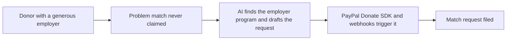

# #72 Matching-Gift Finder

> [!tldr] In one breath
> After a PayPal donation, AI finds the donor's employer matching program and files the match request. **Cut under K2 and K4: a dominant incumbent already does it (56 out of 120).**

> [!example] Picture this
> Leo gives $100 to a food bank. His employer would happily add another $100, but he does not know that, so it never happens. The finder spots his employer, finds the program and files the request for him.

> [!success] Crowd check, Oct 23 2026
> Nonprofit and donation ideas looked thin in a 266 repo GitHub scan (partial coverage: only amanah and a classroom repo). Outside the hackathon, Double the Donation is the dominant incumbent.

**Theme:** [[Theme E10 Cross-border, giving & inclusion|E10 Cross-border, giving & inclusion]] · **Group:** Giving & community · **Crowding on Devpost:** none

## The problem
Many eligible matching gifts go unclaimed (this comes from vendor claims).

## The idea
Employer detection, a program database and request drafting.

## Who it is for
Nonprofits.

## What the AI does
Matching and drafting.

## What PayPal does
Donate SDK and webhooks.

**Building blocks used** (see [[30 Primitives Legend]]):
* `P29` Donate SDK / charity flows
* `P20` Webhooks (events, retries, verification)
* `A06` Entity matching and narrative drafting

## Who else is doing this
Double the Donation. **A dominant incumbent.**

⚠️ Verification: desk research only. The competitor names come from the landscape and Devpost scans, not from a hunt for each idea. Treat "no competitor found" as unproven.

## How it stands out
Low.

## Can we build it?
Medium.

## Smallest demo
A donation leads to a match request.

## Risks
The incumbent, and data access.

## Sources
No sources were recorded for this idea.

## Scores
| Axis | Weight | Desk score | 
|---|---|---|
| Tech | ×2 | 5 | 
| Design | ×2 | 5 | 
| Impact | ×2 | 4 | 
| Innovation | ×2 | 3 | 
| Demo | ×2 | 4 | 
| Feasibility | ×1 | 7 | 
| Risk⁻¹ | ×1 | 7 | 
| **Total /120** | | **56** | 

_Why (desk):_ Solved.

## Why it was cut
Two kill codes fired. See [[41 Brutal Elimination]].
* **K2, crowded cluster or derivative headline.** In plain words: Double the Donation already owns this, so it cannot be called new.
* **K4, weak evidence or low impact.** In plain words: the proof of need and the size of the win were thin.

Eliminated ideas keep their notes and scores.

> [!info]- Jargon decoder
> **Matching gift**: an employer adding money to match an employee's donation. Like a parent promising to double your pocket money savings.
> **Donate SDK**: PayPal's ready made donate button and flow.
> **Webhook**: PayPal knocking to say a donation just came in. Like a doorbell.
> **Entity matching**: working out that two names mean the same company.
> **Incumbent**: an established company that already owns the market.
> **K2 and K4**: the kill codes for crowded market and weak evidence, explained above. More terms in [[Jargon Decoder]].

## Where to next
* ⬆️ Up: [[Idea Index]]
* ⬅️ Previous: [[I071 Disaster Micro-Grant Distributor]] · ➡️ Next: [[I073 Community Pool Ledger]]
* 🎯 Theme: [[Theme E10 Cross-border, giving & inclusion]]
* 🔗 Related: [[41 Brutal Elimination]], [[30 Primitives Legend]], [[Jargon Decoder]]
