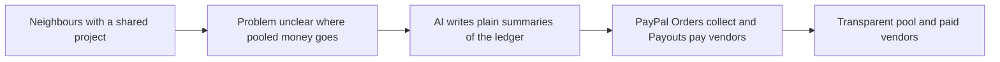

# #73 Community Pool Ledger

> [!tldr] In one breath
> Neighbours pool money for a shared project, and AI keeps a clear ledger and pays the vendors. **Cut under K2: it is obvious, and PayPal's own inspiration list names it (59 out of 120).**

> [!example] Picture this
> A street wants to fix its shared playground. Twenty families chip in through a chat group, and nobody knows who paid or where the money went. With a pool, every contribution and every vendor payment shows up on one public page, with AI written plain summaries.

> [!warning] Crowd check, Oct 23 2026
> Group pooling and splitting is a smaller cluster of 3 to 6 repos (caresplit, potluck, purser, sarafupay, WePay, homeward). Community pooling is on PayPal's inspiration list, so expect many teams to land here. GoFundMe and Open Collective are established outside the hackathon.

**Theme:** [[Theme E10 Cross-border, giving & inclusion|E10 Cross-border, giving & inclusion]] · **Group:** Giving & community · **Crowding on Devpost:** official inspiration

## The problem
Informal money pools lack transparency.

## The idea
People contribute through PayPal, vendors are paid out, and AI writes summaries.

## Who it is for
Community groups.

## What the AI does
Summaries.

## What PayPal does
Orders and Payouts.

**Building blocks used** (see [[30 Primitives Legend]]):
* `P01` Orders v2 (create / capture / get)
* `P11` Payouts (batch)
* `A12` Eligibility reasoning and messaging

## Who else is doing this
GoFundMe, Open Collective. **Established.**

⚠️ Verification: desk research only. The competitor names come from the landscape and Devpost scans, not from a hunt for each idea. Treat "no competitor found" as unproven.

## How it stands out
Low. PayPal's inspiration list names this idea.

## Can we build it?
High.

## Smallest demo
A pool and a payout.

## Risks
It is obvious.

## Sources
* [Hackathon resources and inspiration list](https://paypalaihackathon.devpost.com/resources) ✅

## Scores
| Axis | Weight | Desk score | 
|---|---|---|
| Tech | ×2 | 5 | 
| Design | ×2 | 6 | 
| Impact | ×2 | 3 | 
| Innovation | ×2 | 2 | 
| Demo | ×2 | 5 | 
| Feasibility | ×1 | 9 | 
| Risk⁻¹ | ×1 | 8 | 
| **Total /120** | | **59** | 

_Why (desk):_ Obvious.

## Why it was cut
**K2, crowded cluster or derivative headline.** In plain words: it is the first idea many teams would think of, so it is hard to call new. See [[41 Brutal Elimination]]. Eliminated ideas keep their notes and scores.

> [!info]- Jargon decoder
> **Ledger**: a running record of money in and money out. Like a shared notebook everyone can read.
> **Pool**: many people putting money together for one goal.
> **Orders**: PayPal's way of collecting a payment.
> **Payouts**: PayPal sending money out to many people at once.
> **K2**: the kill code for a crowded market, explained above. More terms in [[Jargon Decoder]].

## Where to next
* ⬆️ Up: [[Idea Index]]
* ⬅️ Previous: [[I072 Matching-Gift Finder]] · ➡️ Next: [[I074 Agent-Hires-Human Microtasks]]
* 🎯 Theme: [[Theme E10 Cross-border, giving & inclusion]]
* 🔗 Related: [[41 Brutal Elimination]], [[30 Primitives Legend]], [[Jargon Decoder]]
