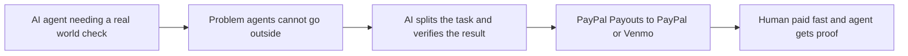

# #74 Agent-Hires-Human Microtasks

> [!tldr] In one breath
> AI agents post small verification tasks to people (a photo, a phone call) and pay them through PayPal or Venmo payouts once AI checks the work. **Decent, but similar platforms exist (74 out of 120).**

> [!example] Picture this
> An AI agent is helping someone choose a restaurant and wants to know if the place is really open. It cannot walk there. It posts "take a photo of the shopfront, $3", a person nearby does it in two minutes, AI confirms the photo, and the $3 arrives in their Venmo.

> [!warning] Crowd check, Oct 23 2026
> Payouts to workers and bounties is a small cluster (payday-agent, Burmalda, takken, routewell, and mergepay for GitHub bounties). An agent that hires humans for verification was not named in the scan, but the note puts it next to the escrow cluster (about 28 repos). Payman and Amazon Mechanical Turk exist outside the hackathon.

**Theme:** [[Theme E9 Agents as economic actors & B2B ops|E9 Agents as economic actors & B2B ops]] · **Group:** Agents as economic actors · **Crowding on Devpost:** adjacent to the escrow cluster

## The problem
Agents need human verification (photos, calls), and humans need instant pay.

## The idea
A task board, verification and Payouts.

## Who it is for
Agent builders and gig workers.

## What the AI does
Breaks work into tasks and verifies the results.

## What PayPal does
Payouts, and Venmo.

**Building blocks used** (see [[30 Primitives Legend]]):
* `P11` Payouts (batch)
* `P12` Payouts to Venmo handles
* `A03` Intent and rationale reasoning (LLM-as-judge)
* `A13` Vision verification / evidence narrative

## Who else is doing this
Payman, Amazon Mechanical Turk. **Platforms where agents pay humans exist.**

⚠️ Verification: desk research only. The competitor names come from the landscape and Devpost scans, not from a hunt for each idea. Treat "no competitor found" as unproven.

## How it stands out
Moderate.

## Can we build it?
High.

## Smallest demo
An agent needs a storefront photo, a human takes it, and a payout follows.

## Risks
It is escrow shaped, and Payman exists.

## Sources
* [Worldpay gig workers: 81% prefer instant payout platforms](https://www.worldpay.com/en/insights/articles/gig-workers-payments-imperative) ✅

## Scores
| Axis | Weight | Desk score | 
|---|---|---|
| Tech | ×2 | 7 | 
| Design | ×2 | 6 | 
| Impact | ×2 | 5 | 
| Innovation | ×2 | 5 | 
| Demo | ×2 | 6 | 
| Feasibility | ×1 | 9 | 
| Risk⁻¹ | ×1 | 7 | 
| **Total /120** | | **74** | 

_Why (desk):_ OK.

**Kill codes:** none triggered.

> [!info]- Jargon decoder
> **Microtask**: a tiny job that takes minutes, like taking one photo. Like a quick errand.
> **Agent**: an AI that takes actions for you, not just chats.
> **Payouts**: PayPal sending money out to many people at once.
> **Venmo handle**: a person's Venmo username, which can receive money.
> **LLM as judge**: using an AI to decide and explain a call.
> **Escrow**: a neutral hold on money until a condition is met.
> **Primitives**: Lego brick style building blocks listed in [[30 Primitives Legend]]. More terms in [[Jargon Decoder]].

## Where to next
* ⬆️ Up: [[Idea Index]]
* ⬅️ Previous: [[I073 Community Pool Ledger]] · ➡️ Next: [[I075 Reverse-Auction Intent Broadcast]]
* 🎯 Theme: [[Theme E9 Agents as economic actors & B2B ops]]
* 🔗 Related: [[30 Primitives Legend]], [[Jargon Decoder]], [[00 PayPal AI Hackathon Hub]]
