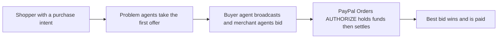

# #75 Reverse-Auction Intent Broadcast

> [!tldr] In one breath
> A buyer's agent announces what it wants to buy, merchant agents bid against each other, and PayPal settles the winner. **Fun but speculative, and it needs merchants to take part (71 out of 120).**

> [!example] Picture this
> You tell your agent "I need a standing desk under $400". Instead of grabbing the first listing, it shouts the request to three shops. They each bid, one drops the price and adds free delivery, and your agent picks the winner and pays.

> [!warning] Crowd check, Oct 23 2026
> Agent to agent haggling is a medium crowded area of about 8 repos (three named "haggle", Haggle Court, mandado, negotiator-payments, asterion-commerce, duespilot). Agent to agent negotiation is also on PayPal's inspiration list. Reverse auction bidding specifically was not named.

**Theme:** [[Theme E9 Agents as economic actors & B2B ops|E9 Agents as economic actors & B2B ops]] · **Group:** Agents as economic actors · **Crowding on Devpost:** official inspiration

## The problem
Agents pick the first offer they see (the "Magentic bias"), so buyers rarely get competitive bids.

## The idea
An intent schema (a standard form describing what the buyer wants), a bidding round, and settlement through PayPal Orders.

## Who it is for
Consumers and merchants.

## What the AI does
Multi agent negotiation.

## What PayPal does
Orders and AUTHORIZE.

**Building blocks used** (see [[30 Primitives Legend]]):
* `P01` Orders v2 (create / capture / get)
* `P02` AUTHORIZE intent (hold funds)
* `A07` Multi-agent negotiation

## Who else is doing this
Pactum, Fairmarkit. **AI procurement negotiation exists for enterprise.**

⚠️ Verification: desk research only. The competitor names come from the landscape and Devpost scans, not from a hunt for each idea. Treat "no competitor found" as unproven.

## How it stands out
It works from the consumer side.

## Can we build it?
Medium.

## Smallest demo
3 merchant agents bid.

## Risks
It needs merchants to participate. Agent to agent is in the official inspiration list.

## Sources
* [Magentic Marketplace: 60 to 100% first proposal bias (arXiv 2510.25779)](https://arxiv.org/html/2510.25779v1) ✅
* [The Automated but Risky Game: agent negotiation imbalance (arXiv 2506.00073)](https://arxiv.org/abs/2506.00073) ✅

## Scores
| Axis | Weight | Desk score | 
|---|---|---|
| Tech | ×2 | 6 | 
| Design | ×2 | 6 | 
| Impact | ×2 | 4 | 
| Innovation | ×2 | 6 | 
| Demo | ×2 | 7 | 
| Feasibility | ×1 | 7 | 
| Risk⁻¹ | ×1 | 6 | 
| **Total /120** | | **71** | 

_Why (desk):_ Fun, speculative.

**Kill codes:** none triggered.

> [!info]- Jargon decoder
> **Reverse auction**: sellers compete to offer the lowest price, instead of buyers bidding up. Like asking three plumbers for quotes.
> **Intent broadcast**: announcing what you want to buy to many sellers at once.
> **Magentic bias**: a study finding that AI agents grab the first proposal they see, 60 to 100% of the time.
> **AUTHORIZE**: PayPal holds the money first and takes it later. Like a hotel holding $200 on your card at check in, then charging only what you owe at check out.
> **Multi agent negotiation**: several AIs bargaining with each other.
> **Procurement**: how a company buys supplies. More terms in [[Jargon Decoder]].

## Where to next
* ⬆️ Up: [[Idea Index]]
* ⬅️ Previous: [[I074 Agent-Hires-Human Microtasks]] · ➡️ Next: [[I076 Haggle Link]]
* 🎯 Theme: [[Theme E9 Agents as economic actors & B2B ops]]
* 🔗 Related: [[30 Primitives Legend]], [[Jargon Decoder]], [[00 PayPal AI Hackathon Hub]]
