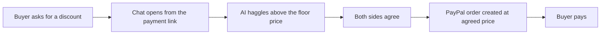

# #76 Haggle Link

> [!tldr] In one breath
> A PayPal payment link with a small AI negotiator inside. The buyer haggles in chat, the AI never goes below the seller's floor price, and the final price becomes a real PayPal order. It was cut because it is fun but low impact (kill K4).

> [!example] Picture this
> Maya sells a used camera online. Every buyer sends the same DM: "Would you take 20% less?" She spends her evenings typing back and forth. With Haggle Link she sets a secret lowest price once. The AI bargains for her, and when a buyer says yes the chat hands over a PayPal link at the agreed price.

> [!warning] Crowd check, Oct 23 2026
> Agent to agent haggling is a small but real cluster in the scan (about 8): three repos named "haggle", Haggle Court, mandado, negotiator-payments, asterion-commerce and duespilot. Medium crowded, and a bargaining bot is a common idea.

**Where it landed:** ❌ ELIMINATED. Desk score 72/120, final score 72/120, verdict `desk-only`. Kill codes: K4.

**Theme:** E9 Agents as economic actors & B2B ops · **Group:** Agents as economic actors · **Crowding on Devpost (first pass):** none

## The problem
Casual sellers waste time haggling in DMs.

## The fix
**A negotiation chat that is bounded by the seller's floor price. When the two sides agree, it creates a PayPal order at that price.**

## Who it is for
Marketplace sellers.

## What the AI does
Negotiation.

## How it uses PayPal
Orders and Payment Links.

**Building blocks used** (decoded in [[30 Primitives Legend]]):
* `P22` Payment Links
* `P01` Orders v2 (create / capture / get)
* `A07` Multi-agent negotiation

## Who else is out there
Nibble. AI negotiation widgets already exist for online shops.

> [!warning] How sure are we?
> ⚠️ Desk research only. The competitor names above come from the landscape and Devpost scans, not from a hunt for each idea. Treat "no competitor found" as unproven.

## What makes it different
It targets the single seller link, not a whole shop.

## Can we build it?
**Feasibility:** High.

## The demo we would show
Negotiate, then pay.

## What could go wrong
Weak evidence that this hurts enough. The LLM could also be tricked into a lower price (exploitability).

## Evidence and sources
* [Training LMs for bilateral trade: price discrimination (arXiv 2604.16472)](https://econpapers.repec.org/paper/arxpapers/2604.16472.htm) ✅

## Scores
Each of the five judging areas is scored 0 to 10 and counts double. Feasibility and low risk count once. The maximum is 120.

| Axis | Weight | Desk score |
|---|---|---|
| Tech | ×2 | 6 |
| Design | ×2 | 7 |
| Impact | ×2 | 3 |
| Innovation | ×2 | 5 |
| Demo | ×2 | 7 |
| Feasibility | ×1 | 9 |
| Risk⁻¹ | ×1 | 7 |
| **Total /120** | | **72** |

*Why (desk):* Fun, low impact.

**Kill criteria triggered:** `K4` Weak evidence or low impact (the problem is not painful enough or lacks proof). See [[41 Brutal Elimination]].

## How it would flow

> [!info]- Jargon decoder
> **Payment Link**: a web address that opens a ready made PayPal checkout, like a paper invoice you can text to someone.
>
> **Floor price**: the lowest price the seller will accept. The AI is a shop assistant told never to go under it.
>
> **Multi agent negotiation (A07)**: two AI programs bargaining with each other, like two market traders agreeing a price.
>
> **Orders**: PayPal's record of one purchase: created, then paid (captured).

## Where to next
* ⬆️ Up: [[Idea Index]]
* ⬅️ Previous: [[I075 Reverse-Auction Intent Broadcast]] · ➡️ Next: [[I077 Fiat Micropayment Credits for Agents]]
* 🔗 Theme: [[Theme E9 Agents as economic actors & B2B ops]]
* 🔗 Related: [[41 Brutal Elimination]], [[30 Primitives Legend]], [[00 PayPal AI Hackathon Hub]]
