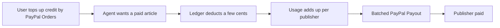

# #77 Fiat Micropayment Credits for Agents

> [!tldr] In one breath
> Users top up a PayPal backed credit balance. AI agents spend it a few cents at a time on articles or API calls, and publishers get paid in batches. Cut as crowded (K2): tab and paywall startups exist and CrawlerPal already won PayPal Dev Days 2025.

> [!example] Picture this
> Leo's AI assistant reads ten news articles a day for him. Paying 10 cents by card each time would cost more in fees than the article is worth. So Leo loads $10 of credit once. The agent spends it a cent at a time and each publisher gets a single payout at the end of the week.

> [!warning] Crowd check, Oct 23 2026
> HTTP 402 pay per crawl is a small cluster in the scan: TollGate, adparity and skuuy. CrawlerPal, the paywall agent, won 1st at PayPal Dev Days 2025. Outside events (SF x402 Feb 2026, Circle Arc Jan 2026) were dominated by agent wallets, escrow and pay per API.

**Where it landed:** ❌ ELIMINATED. Desk score 68/120, final score 68/120, verdict `desk-only`. Kill codes: K2.

**Theme:** E9 Agents as economic actors & B2B ops · **Group:** Agents as economic actors · **Crowding on Devpost (first pass):** Micropayments overbuilt

## The problem
Card fees make payments under about $1 uneconomic. x402 (a way for agents to pay per request) is crypto first and has weak organic demand.

## The fix
**Prepaid credits, a per use ledger, and batched payouts to publishers.**

## Who it is for
Publishers and API providers.

## What the AI does
Agents that consume paid content.

## How it uses PayPal
Orders for the top up, and Payouts.

**Building blocks used** (decoded in [[30 Primitives Legend]]):
* `P01` Orders v2 (create / capture / get)
* `P11` Payouts (batch)
* `A03` Intent and rationale reasoning (LLM-as-judge)

## Who else is out there
Supertab, TollBit, Cloudflare Pay per Crawl. Tab and paywall startups exist, and CrawlerPal won PayPal Dev Days 2025.

> [!warning] How sure are we?
> ⚠️ Desk research only. The competitor names above come from the landscape and Devpost scans, not from a hunt for each idea. Treat "no competitor found" as unproven.

## What makes it different
Low to moderate.

## Can we build it?
**Feasibility:** High.

## The demo we would show
Top up, an agent reads 3 articles, then payouts go out.

## What could go wrong
A previous winner covers this ground, and the space is overbuilt.

## Evidence and sources
* [x402 Bazaar survey: 3.5% organic repeat demand (single author)](https://github.com/rikocr8orh8/x402-bazaar-survey/blob/master/POST.md) ❌
* [PayPal Dev Days 2025 hackathon winners](https://developer.paypal.com/community/blog/winners-dev-days-hackathon) ✅
* [Linux Foundation: x402 Foundation launch](https://www.linuxfoundation.org/press/linux-foundation-is-launching-the-x402-foundation-and-welcoming-the-contribution-of-the-x402-protocol) ✅

## Scores
Each of the five judging areas is scored 0 to 10 and counts double. Feasibility and low risk count once. The maximum is 120.

| Axis | Weight | Desk score |
|---|---|---|
| Tech | ×2 | 6 |
| Design | ×2 | 6 |
| Impact | ×2 | 4 |
| Innovation | ×2 | 4 |
| Demo | ×2 | 6 |
| Feasibility | ×1 | 9 |
| Risk⁻¹ | ×1 | 7 |
| **Total /120** | | **68** |

*Why (desk):* Over served.

**Kill criteria triggered:** `K2` Crowded cluster or derivative headline; innovation cannot be defended (too many teams will build the same thing). See [[41 Brutal Elimination]].

## How it would flow

> [!info]- Jargon decoder
> **Micropayment**: a tiny payment, under about $1. Like paying one coin for one newspaper page.
>
> **x402**: a web standard where a site answers "payment required" and the agent pays on the spot, like a turnstile that takes a coin.
>
> **Batched payout**: saving up many small debts and paying them in one transfer, like paying a whole tab at closing time.
>
> **Ledger**: a running list of who owes what, like a notebook of tallies.
>
> **Payouts**: PayPal's tool for sending money to many people at once.

## Where to next
* ⬆️ Up: [[Idea Index]]
* ⬅️ Previous: [[I076 Haggle Link]] · ➡️ Next: [[I078 Usage-Metered AI SaaS Billing]]
* 🔗 Theme: [[Theme E9 Agents as economic actors & B2B ops]]
* 🔗 Related: [[41 Brutal Elimination]], [[30 Primitives Legend]], [[00 PayPal AI Hackathon Hub]]
