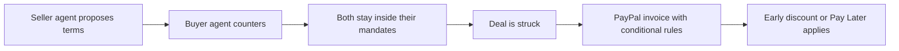

# #79 AR↔AP Agent Terms Handshake

> [!tldr] In one breath
> The seller's AI and the buyer's AI negotiate payment terms, such as an early payment discount versus Pay Later, and agree on a PayPal invoice. It survived elimination with 77/120, as an extension of idea 28.

> [!example] Picture this
> A bakery sends a big invoice to a cafe chain. The bakery's agent says: "2% off if you pay in 10 days." The cafe's agent, which watches cash, counters with 30 days at full price. They settle on 15 days and 1%, and the invoice updates itself with those rules.

> [!warning] Crowd check, Oct 23 2026
> Close match in the scan: duespilot, where an accounts receivable agent negotiates with a client accounts payable agent. Agent to agent haggling is a small cluster (about 8) and invoicing is crowded (about 25). Agent to agent is also on PayPal's own inspiration list, so expect convergence.

**Where it landed:** ✅ SURVIVOR. Desk score 77/120, final score 77/120, verdict `desk-only`.

**Theme:** E9 Agents as economic actors & B2B ops · **Group:** Agents as economic actors · **Crowding on Devpost (first pass):** Official inspiration (agent-to-agent)

## The problem
Business to business payments still rely heavily on checks and manual haggling over terms.

## The fix
**Two agents with limited mandates negotiate. The result is written into the invoice as conditional rules.**

## Who it is for
Small and medium B2B businesses.

## What the AI does
Negotiation within bounds.

## How it uses PayPal
Invoicing conditional rules, and Pay Later.

**Building blocks used** (decoded in [[30 Primitives Legend]]):
* `P09` Invoicing conditional rules (early-payment discount, auto-cancel)
* `P08` Invoicing v2 (create, send, partial payment)
* `A07` Multi-agent negotiation

## Who else is out there
Pactum, C2FO. Enterprise negotiation and discounting exist.

> [!warning] How sure are we?
> ⚠️ Desk research only. The competitor names above come from the landscape and Devpost scans, not from a hunt for each idea. Treat "no competitor found" as unproven.

## What makes it different
Agent to agent for small businesses. Enterprise versions exist.

## Can we build it?
**Feasibility:** Medium.

## The demo we would show
Two agents produce an invoice.

## What could go wrong
Demand is speculative.

## Evidence and sources
* [KC Fed: B2B payments still ~90% use checks](https://www.kansascityfed.org/research/payments-system-research-briefings/b2b-payments-business-processing-and-challenges-to-achieving-straight-through-processing/) ⚠️
* [The Automated but Risky Game: agent negotiation imbalance (arXiv 2506.00073)](https://arxiv.org/abs/2506.00073) ✅

## Scores
Each of the five judging areas is scored 0 to 10 and counts double. Feasibility and low risk count once. The maximum is 120.

| Axis | Weight | Desk score |
|---|---|---|
| Tech | ×2 | 7 |
| Design | ×2 | 6 |
| Impact | ×2 | 5 |
| Innovation | ×2 | 7 |
| Demo | ×2 | 7 |
| Feasibility | ×1 | 7 |
| Risk⁻¹ | ×1 | 6 |
| **Total /120** | | **77** |

*Why (desk):* An interesting extension of idea 28.

**Kill criteria:** none triggered.

## How it would flow

> [!info]- Jargon decoder
> **AR and AP**: accounts receivable (money owed to you) and accounts payable (money you owe). Two sides of one bill.
>
> **Mandate**: a rulebook for an agent: how far it may go, like a negotiator with a signed limit.
>
> **Conditional rules**: if then settings on an invoice, such as "if paid in 10 days, take 2% off".
>
> **Pay Later**: PayPal's pay in parts option.
>
> **Early payment discount**: a small price cut for paying fast, like a cash discount at a market.

## Where to next
* ⬆️ Up: [[Idea Index]]
* ⬅️ Previous: [[I078 Usage-Metered AI SaaS Billing]] · ➡️ Next: [[I080 Price-Change Rollout Agent]]
* 🔗 Theme: [[Theme E9 Agents as economic actors & B2B ops]]
* 🔗 Related: [[41 Brutal Elimination]], [[30 Primitives Legend]], [[00 PayPal AI Hackathon Hub]]
