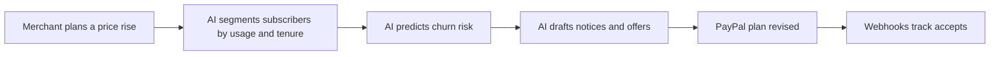

# #80 Price-Change Rollout Agent

> [!tldr] In one breath
> Before a price rise, an AI groups subscribers, predicts who might leave, writes the notice, and offers downgrades through PayPal plan revisions. It survived with 73/120 as a useful but modest idea.

> [!example] Picture this
> A small newsletter wants to go from $8 to $10. The tool spots loyal readers who will shrug, and nervous ones who might cancel. It writes a kind email for each group and offers the nervous ones a cheaper plan with one click.

> [!success] Crowd check, Oct 23 2026
> Subscriptions as a core idea looked thin in the 266 repo scan (only triad and subscription-killer). Nothing matched a price change rollout tool.

**Where it landed:** ✅ SURVIVOR. Desk score 73/120, final score 73/120, verdict `desk-only`.

**Theme:** E8 Failure-path intelligence · **Group:** Subscription revenue ops · **Crowding on Devpost (first pass):** none

## The problem
Price changes are a top reason people cancel. The FTC's $2.5B Amazon settlement raised the stakes on honest subscription practices.

## The fix
**Group subscribers by usage and tenure, write the notices, offer downgrades or annual plans through a subscription revise, and track who accepts.**

## Who it is for
Small subscription businesses.

## What the AI does
Churn prediction and copywriting.

## How it uses PayPal
Subscription plan price change and revise.

**Building blocks used** (decoded in [[30 Primitives Legend]]):
* `P07` Subscriptions (revise, suspend, payment-failed events)
* `P20` Webhooks (events, retries, verification)
* `A05` Structured decision / classification (most common)
* `A12` Eligibility reasoning and messaging

## Who else is out there
Paddle Retain, ProfitWell. Retention analytics exist.

> [!warning] How sure are we?
> ⚠️ Desk research only. The competitor names above come from the landscape and Devpost scans, not from a hunt for each idea. Treat "no competitor found" as unproven.

## What makes it different
A workflow built around PayPal plan changes.

## Can we build it?
**Feasibility:** High.

## The demo we would show
50 synthetic subscribers.

## What could go wrong
Moderate novelty.

## Evidence and sources
* [FTC $2.5B Amazon settlement (subscription dark patterns)](https://www.ftc.gov/news-events/news/press-releases/2025/09/ftc-secures-historic-25-billion-settlement-against-amazon) ✅

## Scores
Each of the five judging areas is scored 0 to 10 and counts double. Feasibility and low risk count once. The maximum is 120.

| Axis | Weight | Desk score |
|---|---|---|
| Tech | ×2 | 7 |
| Design | ×2 | 6 |
| Impact | ×2 | 5 |
| Innovation | ×2 | 5 |
| Demo | ×2 | 5 |
| Feasibility | ×1 | 9 |
| Risk⁻¹ | ×1 | 8 |
| **Total /120** | | **73** |

*Why (desk):* Useful, modest.

**Kill criteria:** none triggered.

## How it would flow

> [!info]- Jargon decoder
> **Churn**: customers leaving, like water leaking from a bucket.
>
> **Segmenting**: sorting people into groups, like sorting laundry before washing.
>
> **Webhook**: an automatic ping PayPal sends when something happens, like a doorbell for your software.
>
> **Dark patterns**: sneaky designs that trick people into staying or paying, like a shop with a hidden exit.

## Where to next
* ⬆️ Up: [[Idea Index]]
* ⬅️ Previous: [[I079 AR↔AP Agent Terms Handshake]] · ➡️ Next: [[I081 Pause-Not-Cancel Retention]]
* 🔗 Theme: [[Theme E8 Failure-path intelligence]]
* 🔗 Related: [[41 Brutal Elimination]], [[30 Primitives Legend]], [[00 PayPal AI Hackathon Hub]]
