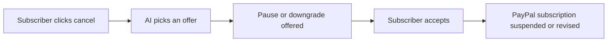

# #81 Pause-Not-Cancel Retention

> [!tldr] In one breath
> When a subscriber tries to cancel, an AI offers a pause or a cheaper plan and does it through PayPal. Cut as crowded (K2): Churnkey and ProsperStack already do this, and it risks looking like a dark pattern.

> [!example] Picture this
> Sam clicks cancel on a meal kit because he is travelling for a month. A chat pops up: "Want to pause for 4 weeks instead?" He taps yes, and the PayPal subscription suspends itself. He stays a customer.

> [!success] Crowd check, Oct 23 2026
> Nothing close in the 266 repo scan (partial coverage); subscriptions as a core idea looked thin. The competition is commercial products like Churnkey.

**Where it landed:** ❌ ELIMINATED. Desk score 65/120, final score 65/120, verdict `desk-only`. Kill codes: K2.

**Theme:** E8 Failure-path intelligence · **Group:** Subscription revenue ops · **Crowding on Devpost (first pass):** none

## The problem
Voluntary churn is about 2.34% per month (Recurly).

## The fix
**A cancellation flow where AI picks the best save offer.**

## Who it is for
Small subscription businesses.

## What the AI does
Choosing the offer.

## How it uses PayPal
Subscription suspend, revise and cancel.

**Building blocks used** (decoded in [[30 Primitives Legend]]):
* `P07` Subscriptions (revise, suspend, payment-failed events)
* `A05` Structured decision / classification (most common)

## Who else is out there
Churnkey, ProsperStack. A mature category.

> [!warning] How sure are we?
> ⚠️ Desk research only. The competitor names above come from the landscape and Devpost scans, not from a hunt for each idea. Treat "no competitor found" as unproven.

## What makes it different
Low.

## Can we build it?
**Feasibility:** High.

## The demo we would show
Cancel turns into a pause.

## What could go wrong
Dark pattern optics: it can look like making cancelling hard.

## Evidence and sources
* [Recurly churn benchmarks: involuntary 1.25%/mo](https://recurly.com/research/churn-rate-benchmarks/) ✅
* [FTC $2.5B Amazon settlement (subscription dark patterns)](https://www.ftc.gov/news-events/news/press-releases/2025/09/ftc-secures-historic-25-billion-settlement-against-amazon) ✅

## Scores
Each of the five judging areas is scored 0 to 10 and counts double. Feasibility and low risk count once. The maximum is 120.

| Axis | Weight | Desk score |
|---|---|---|
| Tech | ×2 | 6 |
| Design | ×2 | 6 |
| Impact | ×2 | 5 |
| Innovation | ×2 | 3 |
| Demo | ×2 | 5 |
| Feasibility | ×1 | 9 |
| Risk⁻¹ | ×1 | 6 |
| **Total /120** | | **65** |

*Why (desk):* Solved, and carries dark pattern risk.

**Kill criteria triggered:** `K2` Crowded cluster or derivative headline; innovation cannot be defended (too many teams will build the same thing). See [[41 Brutal Elimination]].

## How it would flow

> [!info]- Jargon decoder
> **Voluntary churn**: customers who choose to leave, as opposed to a card failing.
>
> **Suspend**: pause a subscription without ending it, like hitting pause on a video.
>
> **Dark pattern**: design that nudges you against your own interest, such as a cancel button that is hard to find.

## Where to next
* ⬆️ Up: [[Idea Index]]
* ⬅️ Previous: [[I080 Price-Change Rollout Agent]] · ➡️ Next: [[I082 Win-Back Agent]]
* 🔗 Theme: [[Theme E8 Failure-path intelligence]]
* 🔗 Related: [[41 Brutal Elimination]], [[30 Primitives Legend]], [[00 PayPal AI Hackathon Hub]]
