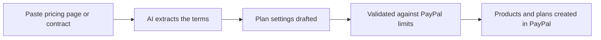

# #83 Spec-to-Plan Billing Compiler

> [!tldr] In one breath
> Paste a pricing page or a contract and the AI turns it into PayPal products and billing plans, including tiers, volume pricing, trials and setup fees. It survived with 71/120 as a neat utility that is feature sized.

> [!example] Picture this
> A founder has a pricing page with three tiers, a 14 day trial and a setup fee. Setting that up in PayPal by hand takes an afternoon and one wrong number means wrong charges. She pastes the page in, and the plans appear, checked against PayPal's rules.

> [!success] Crowd check, Oct 23 2026
> Nothing similar in the 266 repo scan (partial coverage). Developer tooling for PayPal integrators was thin there (only cutover and a webhook simulator).

**Where it landed:** ✅ SURVIVOR. Desk score 71/120, final score 71/120, verdict `desk-only`.

**Theme:** E8 Failure-path intelligence · **Group:** Subscription revenue ops · **Crowding on Devpost (first pass):** none

## The problem
Turning contracts into billing settings is slow and easy to get wrong.

## The fix
**Extract the terms, build the plan settings, and check them against PayPal's plan limits.**

## Who it is for
Software founders and finance teams.

## What the AI does
Structured extraction with checks.

## How it uses PayPal
Catalog products and billing plans.

**Building blocks used** (decoded in [[30 Primitives Legend]]):
* `P30` Catalog products / billing plans
* `P07` Subscriptions (revise, suspend, payment-failed events)
* `A01` Document / image extraction (OCR, validation)

## Who else is out there
Tabs, Maxio. AI contract to billing startups exist (Tabs).

> [!warning] How sure are we?
> ⚠️ Desk research only. The competitor names above come from the landscape and Devpost scans, not from a hunt for each idea. Treat "no competitor found" as unproven.

## What makes it different
Built natively on PayPal.

## Can we build it?
**Feasibility:** High.

## The demo we would show
A pricing page turns into created plans.

## What could go wrong
It is the size of a feature, not a product.

## Evidence and sources
* [paypal/agent-toolkit (46 tools, v1.11.0)](https://github.com/paypal/agent-toolkit) ✅

## Scores
Each of the five judging areas is scored 0 to 10 and counts double. Feasibility and low risk count once. The maximum is 120.

| Axis | Weight | Desk score |
|---|---|---|
| Tech | ×2 | 7 |
| Design | ×2 | 6 |
| Impact | ×2 | 4 |
| Innovation | ×2 | 5 |
| Demo | ×2 | 5 |
| Feasibility | ×1 | 9 |
| Risk⁻¹ | ×1 | 8 |
| **Total /120** | | **71** |

*Why (desk):* A neat utility.

**Kill criteria:** none triggered.

## How it would flow

> [!info]- Jargon decoder
> **Structured extraction**: pulling messy text into tidy fields, like copying a recipe into a form.
>
> **Billing plan**: a PayPal recipe for charging: how much, how often, with what trial.
>
> **Catalog product**: the thing you sell, as PayPal stores it.
>
> **Validation**: checking the output against the rules before using it, like spell check.

## Where to next
* ⬆️ Up: [[Idea Index]]
* ⬅️ Previous: [[I082 Win-Back Agent]] · ➡️ Next: [[I084 Accessible Voice Checkout]]
* 🔗 Theme: [[Theme E8 Failure-path intelligence]]
* 🔗 Related: [[41 Brutal Elimination]], [[30 Primitives Legend]], [[00 PayPal AI Hackathon Hub]]
