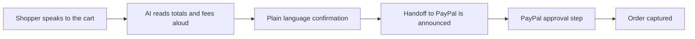

# #84 Accessible Voice Checkout

> [!tldr] In one breath
> A voice and screen reader friendly PayPal checkout layer: it reads the cart aloud, answers questions, and confirms the purchase in plain words. It scored 88 on desk research but 75 after a deep dive, which said demote: the PayPal approval window cannot be made accessible by a third party.

> [!example] Picture this
> Dev is blind and uses a screen reader. Most checkout pages are a maze of unlabeled buttons. Here he says "What is my total?" and hears "$42.10 including $3 shipping. Say confirm to pay." He confirms by voice and is handed over to PayPal, with an announcement of what is happening.

> [!success] Crowd check, Oct 23 2026
> Accessibility first payments got ZERO hits in the 266 repo scan (partial coverage), even though it is on PayPal's own inspiration list. The area looks empty inside the hackathon. Outside it, close competitors exist (see the deep dive section below).

**Where it landed:** ✅ SURVIVOR. Desk score 88/120, final score 75/120, verdict `demote`.

**Theme:** E10 Cross-border, giving & inclusion · **Group:** Inclusive money · **Crowding on Devpost (first pass):** none

## The problem
95.9% of top home pages fail WCAG, shopping sites average 71 errors per page (WebAIM 2026), and missing form labels appear on 51% of pages.

## The fix
**A component built on JS SDK v6 that puts a talking, keyboard friendly layer over the cart and the PayPal approval. It reads totals and fees clearly and confirms intent in plain language.**

## Who it is for
Blind, low vision and motor impaired shoppers, plus merchants who need accessibility compliance (the EAA in the EU).

## What the AI does
Voice understanding, cart questions answered from the real order, and plain language confirmation.

## How it uses PayPal
JS SDK v6 sessions, Orders, and Pay Later messaging read aloud.

**Building blocks used** (decoded in [[30 Primitives Legend]]):
* `P24` JS SDK v6
* `P01` Orders v2 (create / capture / get)
* `P23` Pay Later messaging
* `A08` Speech / voice
* `A11` Translation / tone

## Who else is out there
UserWay, accessiBe. Overlay tools are controversial among accessibility advocates. No accessible first conversational checkout was found.

> [!info] How sure are we?
> Adversarially deep dived with 6 or more differently phrased searches per idea. Full competitor table: [[D084 Accessible Voice Checkout (Deep Dive)]].

## What makes it different
Accessibility is the product, not an overlay.

## Can we build it?
**Feasibility:** Medium. It needs careful accessibility engineering.

## The demo we would show
A screen reader demo that completes a sandbox purchase by voice.

## What could go wrong
Data on payment specific harm is thin, and the build must be genuinely accessible because the judges include an accessibility advocate.

## What the deep dive decided
> [!warning] Verdict: demote
> Real need, but the PayPal approval window is a hard boundary and accessible and AI shopping already exists. Fold "statement form confirmation + announced PayPal handoff + vaulted voice reconfirm" into a shopping or agent finalist as its accessibility pillar.

**Why the score dropped.** The PayPal v6 approval popup or modal is cross origin and owned by PayPal. A third party layer cannot make the approval step accessible, only the handoff around it. The core loop is checkout plus Orders (tech anchor about 5) unless Vault or Refunds are added.

**Close competitors found.** PayU accessible checkout with voice navigation (Aug 2026), Be My Eyes x InnoSearch AI accessible shopping portal (May 2025), Kalon on Devpost (2023), the CHI'26 voice computer use agent shopping study (payment excluded), and agentic browsers as assistive technology (arXiv 2606.24870).

**Evidence.** Strong on how common the problem is: WebAIM 95.9%, the EAA in force, the FTC's $1M action against accessiBe, and about 70% of more than 5,000 lawsuits in 2025 involving e commerce (vendor figure). Payment specific harm data is still missing. Expert accessibility judges (Jo Franchetti, and Sylwia Vargas only via AG Grid) raise the bar.

## Evidence and sources
* [WebAIM Million 2026: 95.9% home pages fail WCAG](https://webaim.org/projects/million/) ✅

## Scores
Each of the five judging areas is scored 0 to 10 and counts double. Feasibility and low risk count once. The maximum is 120.

| Axis | Weight | Desk score | Post-deep-dive |
|---|---|---|---|
| Tech | ×2 | 7 | 5 |
| Design | ×2 | 9 | 8 |
| Impact | ×2 | 6 | 6 |
| Innovation | ×2 | 7 | 5 |
| Demo | ×2 | 8 | 7 |
| Feasibility | ×1 | 7 | 7 |
| Risk⁻¹ | ×1 | 7 | 6 |
| **Total /120** | | **88** | **75** |

*Why (desk):* Strong design and social story, thin harm data.

**Kill criteria:** none triggered.

## How it would flow

> [!info]- Jargon decoder
> **WCAG**: the web's accessibility rulebook, like building codes for ramps and doors but for websites.
>
> **Screen reader**: software that speaks what is on screen aloud for blind users, like an audiobook of the page.
>
> **Overlay**: a bolt on widget that claims to fix accessibility, like painting a ramp onto a staircase.
>
> **EAA**: the European Accessibility Act, an EU law that makes many sites and shops accessible by rule.
>
> **JS SDK v6**: PayPal's latest set of building blocks for putting a pay button on a web page.
>
> **Cross origin popup**: a window owned by another website. Your page cannot reach inside it, like the glass of a bank teller booth.
>
> **Pay Later messaging**: the small text that says "pay in 4", which here is read aloud.

## Where to next
* ⬆️ Up: [[Idea Index]]
* ⬅️ Previous: [[I083 Spec-to-Plan Billing Compiler]] · ➡️ Next: [[I085 Plain-Language Payment Consent]]
* 🔗 Theme: [[Theme E10 Cross-border, giving & inclusion]]
* 🔬 Deep dive: [[D084 Accessible Voice Checkout (Deep Dive)]]
* 🔗 Related: [[41 Brutal Elimination]], [[30 Primitives Legend]], [[00 PayPal AI Hackathon Hub]]
