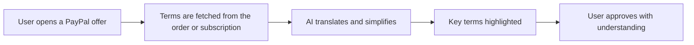

# #85 Plain-Language Payment Consent

> [!tldr] In one breath
> Shows any PayPal order, subscription or Pay Later offer in the user's own language and reading level before they approve it. Cut for weak evidence or low impact (K4): browser translation already does much of this.

> [!example] Picture this
> Rosa is new to the country and reads English slowly. A subscription screen is full of legal words. This tool turns it into simple Spanish: "You pay $9.99 each month until you cancel. First week is free." The key terms are highlighted.

> [!success] Crowd check, Oct 23 2026
> Nothing close in the 266 repo scan (partial coverage). Inclusion and underbanked ideas looked empty, though accessibility and plain language are not themselves a crowded area.

**Where it landed:** ❌ ELIMINATED. Desk score 67/120, final score 67/120, verdict `desk-only`. Kill codes: K4.

**Theme:** E10 Cross-border, giving & inclusion · **Group:** Inclusive money · **Crowding on Devpost (first pass):** none

## The problem
Consent screens assume people read well and speak the language fluently.

## The fix
**Translate, lower the reading level, and highlight the key terms.**

## Who it is for
Multilingual and low literacy users.

## What the AI does
Translation and simplification.

## How it uses PayPal
Order and subscription details.

**Building blocks used** (decoded in [[30 Primitives Legend]]):
* `P01` Orders v2 (create / capture / get)
* `P07` Subscriptions (revise, suspend, payment-failed events)
* `A11` Translation / tone

## Who else is out there
Browser translation. Generic translation tools.

> [!warning] How sure are we?
> ⚠️ Desk research only. The competitor names above come from the landscape and Devpost scans, not from a hunt for each idea. Treat "no competitor found" as unproven.

## What makes it different
Low to moderate.

## Can we build it?
**Feasibility:** High.

## The demo we would show
Subscription terms turned into simple Hindi or Spanish.

## What could go wrong
Thin.

## Evidence and sources
* [World Bank Global Findex 2025](https://www.worldbank.org/en/publication/globalfindex) ✅

## Scores
Each of the five judging areas is scored 0 to 10 and counts double. Feasibility and low risk count once. The maximum is 120.

| Axis | Weight | Desk score |
|---|---|---|
| Tech | ×2 | 5 |
| Design | ×2 | 7 |
| Impact | ×2 | 4 |
| Innovation | ×2 | 4 |
| Demo | ×2 | 5 |
| Feasibility | ×1 | 9 |
| Risk⁻¹ | ×1 | 8 |
| **Total /120** | | **67** |

*Why (desk):* Thin.

**Kill criteria triggered:** `K4` Weak evidence or low impact (the problem is not painful enough or lacks proof). See [[41 Brutal Elimination]].

## How it would flow

> [!info]- Jargon decoder
> **Consent screen**: the page where you agree to pay, like the signature line on a contract.
>
> **Reading level**: how hard the words are, like the difference between a comic and a legal letter.
>
> **Translation and tone (A11)**: changing the language and the voice of text while keeping its meaning.

## Where to next
* ⬆️ Up: [[Idea Index]]
* ⬅️ Previous: [[I084 Accessible Voice Checkout]] · ➡️ Next: [[I086 Layaway Planner]]
* 🔗 Theme: [[Theme E10 Cross-border, giving & inclusion]]
* 🔗 Related: [[41 Brutal Elimination]], [[30 Primitives Legend]], [[00 PayPal AI Hackathon Hub]]
