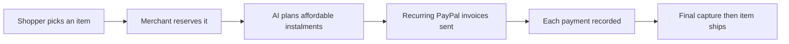

# #86 Layaway Planner

> [!tldr] In one breath
> Layaway for shoppers with no credit history: the AI plans an affordable instalment schedule as recurring PayPal invoices while the merchant holds the item. It survived with 69/120.

> [!example] Picture this
> Tariq wants a $300 coat but has no credit card and no buy now pay later approval. The shop reserves the coat. The AI sees his income pattern and sets 4 payments of $75 as invoices. When the last one clears, the coat ships.

> [!success] Crowd check, Oct 23 2026
> Microloans, inclusion and underbanked ideas had no hits in the 266 repo scan, and Pay Later or Subscriptions as a core idea looked thin (triad, subscription-killer). The area looks empty.

**Where it landed:** ✅ SURVIVOR. Desk score 69/120, final score 69/120, verdict `desk-only`.

**Theme:** E2 Programmable holds · **Group:** Inclusive money · **Crowding on Devpost (first pass):** none

## The problem
37% of US adults could not cover a $400 expense in cash, and credit invisible shoppers cannot use buy now pay later.

## The fix
**A recurring invoice series, a reservation, an AI affordability plan, and shipping only after the final payment is captured.**

## Who it is for
Credit invisible shoppers, and merchants.

## What the AI does
Affordability planning and reminders.

## How it uses PayPal
Recurring invoice series and record payment.

**Building blocks used** (decoded in [[30 Primitives Legend]]):
* `P08` Invoicing v2 (create, send, partial payment)
* `P10` Invoicing recurring series / record payment
* `A04` Forecasting / pricing suggestion

## Who else is out there
Afterpay, Klarna. Buy now pay later serves buyers who have credit, and layaway apps are niche.

> [!warning] How sure are we?
> ⚠️ Desk research only. The competitor names above come from the landscape and Devpost scans, not from a hunt for each idea. Treat "no competitor found" as unproven.

## What makes it different
Moderate.

## Can we build it?
**Feasibility:** High.

## The demo we would show
A $300 item turns into 4 invoices.

## What could go wrong
It conflicts with PayPal's own Pay Later positioning.

## Evidence and sources
* [Fed SHED 2025: 37% couldn't cover $400 with cash](https://www.federalreserve.gov/newsevents/pressreleases/other20260513a.htm) ✅
* [CFPB BNPL report Jan 2025: 63% simultaneous loans](https://files.consumerfinance.gov/f/documents/cfpb_BNPL_Report_2025_01.pdf) ✅

## Scores
Each of the five judging areas is scored 0 to 10 and counts double. Feasibility and low risk count once. The maximum is 120.

| Axis | Weight | Desk score |
|---|---|---|
| Tech | ×2 | 6 |
| Design | ×2 | 6 |
| Impact | ×2 | 5 |
| Innovation | ×2 | 5 |
| Demo | ×2 | 5 |
| Feasibility | ×1 | 9 |
| Risk⁻¹ | ×1 | 6 |
| **Total /120** | | **69** |

*Why (desk):* OK.

**Kill criteria:** none triggered.

## How it would flow

> [!info]- Jargon decoder
> **Layaway**: you reserve something and pay in parts, and only take it home when it is fully paid, like a deposit plan at a shop.
>
> **Credit invisible**: people with no credit file, so lenders cannot score them.
>
> **BNPL**: buy now pay later, a short loan that splits a purchase into payments.
>
> **Recurring invoice series**: a set of repeat invoices sent on a schedule.
>
> **Capture**: actually taking the money that was only promised before.

## Where to next
* ⬆️ Up: [[Idea Index]]
* ⬅️ Previous: [[I085 Plain-Language Payment Consent]] · ➡️ Next: [[I087 Gig Income Statement]]
* 🔗 Theme: [[Theme E2 Programmable holds]]
* 🔗 Related: [[41 Brutal Elimination]], [[30 Primitives Legend]], [[00 PayPal AI Hackathon Hub]]
