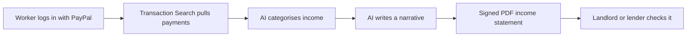

# #87 Gig Income Statement

> [!tldr] In one breath
> Turns a freelancer's PayPal payouts and invoices into a verifiable income statement for renting or loans. It survived with 67/120.

> [!example] Picture this
> Jules drives for three apps and takes small jobs. A landlord asks for proof of income and he only has scattered app screens. With this tool he logs in with PayPal and gets a signed PDF that shows what he earned each month, in plain sentences.

> [!success] Crowd check, Oct 23 2026
> Nothing matching in the 266 repo scan (partial coverage). Transaction Search analytics had only 1 to 2 repos, and inclusion and underbanked ideas had none.

**Where it landed:** ✅ SURVIVOR. Desk score 67/120, final score 67/120, verdict `desk-only`.

**Theme:** E10 Cross-border, giving & inclusion · **Group:** Inclusive money · **Crowding on Devpost (first pass):** none

## The problem
Gig workers struggle to prove their income.

## The fix
**Pull the data with Transaction Search, add an AI written summary, and produce a signed PDF.**

## Who it is for
Gig workers.

## What the AI does
Sorting transactions into categories and writing the narrative.

## How it uses PayPal
Transaction Search and Log in with PayPal.

**Building blocks used** (decoded in [[30 Primitives Legend]]):
* `P18` Transaction Search / Reporting
* `P25` Log in with PayPal
* `A01` Document / image extraction (OCR, validation)

## Who else is out there
Argyle, Plaid Income. Income verification APIs exist.

> [!warning] How sure are we?
> ⚠️ Desk research only. The competitor names above come from the landscape and Devpost scans, not from a hunt for each idea. Treat "no competitor found" as unproven.

## What makes it different
PayPal is the source of the data.

## Can we build it?
**Feasibility:** Medium. Access to a consumer account is through login.

## The demo we would show
Statement generation.

## What could go wrong
Will the verifier trust it.

## Evidence and sources
* [Fed SHED 2025: 37% couldn't cover $400 with cash](https://www.federalreserve.gov/newsevents/pressreleases/other20260513a.htm) ✅

## Scores
Each of the five judging areas is scored 0 to 10 and counts double. Feasibility and low risk count once. The maximum is 120.

| Axis | Weight | Desk score |
|---|---|---|
| Tech | ×2 | 6 |
| Design | ×2 | 6 |
| Impact | ×2 | 5 |
| Innovation | ×2 | 5 |
| Demo | ×2 | 5 |
| Feasibility | ×1 | 7 |
| Risk⁻¹ | ×1 | 6 |
| **Total /120** | | **67** |

*Why (desk):* Moderate.

**Kill criteria:** none triggered.

## How it would flow

> [!info]- Jargon decoder
> **Transaction Search**: PayPal's reporting tool for looking up past payments, like a bank statement you can query.
>
> **Log in with PayPal**: letting someone prove who they are with their PayPal account, like showing a trusted ID.
>
> **Income verification**: proving how much you earn, like a payslip for people without a boss.
>
> **Document extraction (A01)**: AI reading papers or images and pulling out the facts.

## Where to next
* ⬆️ Up: [[Idea Index]]
* ⬅️ Previous: [[I086 Layaway Planner]] · ➡️ Next: [[I088 Quote-to-Deposit for Trades]]
* 🔗 Theme: [[Theme E10 Cross-border, giving & inclusion]]
* 🔗 Related: [[41 Brutal Elimination]], [[30 Primitives Legend]], [[00 PayPal AI Hackathon Hub]]
