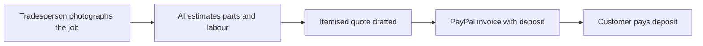

# #88 Quote-to-Deposit for Trades

> [!tldr] In one breath
> A tradesperson photographs the job and the AI drafts an itemised quote and a PayPal invoice with a deposit. Cut as crowded (K2): Jobber, Joist and Housecall Pro already quote jobs, and it overlaps idea 8.

> [!example] Picture this
> A plumber snaps a photo of a leaking boiler. The app lists parts and labour, prices them, and sends the customer an invoice asking for a 30% deposit before the van even leaves.

> [!warning] Crowd check, Oct 23 2026
> Invoicing and receivables chasing is crowded in the scan (about 25): ledgerbird, ledgerly, two invoicepilot, docket, brigpay, paid-tonight, clause-and-pay, paceline and more. No repo matched the photo to quote step exactly. Rain-day-cover (income cover for roofers) is a different idea.

**Where it landed:** ❌ ELIMINATED. Desk score 70/120, final score 70/120, verdict `desk-only`. Kill codes: K2.

**Theme:** E9 Agents as economic actors & B2B ops · **Group:** Trades & B2B ops · **Crowding on Devpost (first pass):** none

## The problem
Quoting is slow, and deposits reduce no shows.

## The fix
**Photo to estimate to an invoice with a partial payment.**

## Who it is for
Tradespeople.

## What the AI does
Vision based estimation.

## How it uses PayPal
Invoicing with partial payments.

**Building blocks used** (decoded in [[30 Primitives Legend]]):
* `P08` Invoicing v2 (create, send, partial payment)
* `A02` Classification with explanation / vision estimation

## Who else is out there
Jobber, Joist, Housecall Pro. Field service apps already include quoting.

> [!warning] How sure are we?
> ⚠️ Desk research only. The competitor names above come from the landscape and Devpost scans, not from a hunt for each idea. Treat "no competitor found" as unproven.

## What makes it different
Low.

## Can we build it?
**Feasibility:** High.

## The demo we would show
Photo turns into an invoice.

## What could go wrong
Incumbents, and it overlaps idea 8.

## Scores
Each of the five judging areas is scored 0 to 10 and counts double. Feasibility and low risk count once. The maximum is 120.

| Axis | Weight | Desk score |
|---|---|---|
| Tech | ×2 | 6 |
| Design | ×2 | 7 |
| Impact | ×2 | 4 |
| Innovation | ×2 | 4 |
| Demo | ×2 | 6 |
| Feasibility | ×1 | 9 |
| Risk⁻¹ | ×1 | 7 |
| **Total /120** | | **70** |

*Why (desk):* Overlaps idea 8, and incumbents exist.

**Kill criteria triggered:** `K2` Crowded cluster or derivative headline; innovation cannot be defended (too many teams will build the same thing). See [[41 Brutal Elimination]].

## How it would flow

> [!info]- Jargon decoder
> **Deposit**: a part payment up front, like holding a table at a restaurant.
>
> **Partial payment**: an invoice that can be paid in pieces.
>
> **Vision estimation (A02)**: AI looking at a photo to judge what is in it, like an inspector glancing at damage.

## Where to next
* ⬆️ Up: [[Idea Index]]
* ⬅️ Previous: [[I087 Gig Income Statement]] · ➡️ Next: [[I089 Voice-Note Invoicing]]
* 🔗 Theme: [[Theme E9 Agents as economic actors & B2B ops]]
* 🔗 Related: [[41 Brutal Elimination]], [[30 Primitives Legend]], [[00 PayPal AI Hackathon Hub]]
