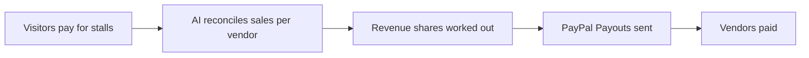

# #91 Event Vendor Settlement

> [!tldr] In one breath
> Markets and festivals collect stall fees and split revenue with vendors automatically. Cut for weak evidence and gated APIs (K4).

> [!example] Picture this
> A weekend food market has 40 stalls. After the weekend the organiser spends days working out who sold what and who owes what share. This tool does the sums and sends each vendor their payment.

> [!success] Crowd check, Oct 23 2026
> Events and ticketing were untouched in the 266 repo scan (partial coverage), and marketplace split payouts were not found as a primary idea.

**Where it landed:** ❌ ELIMINATED. Desk score 59/120, final score 59/120, verdict `desk-only`. Kill codes: K4.

**Theme:** E9 Agents as economic actors & B2B ops · **Group:** Trades & B2B ops · **Crowding on Devpost (first pass):** none

## The problem
Organisers split vendor shares by hand.

## The fix
**Multiparty checkout, or Payouts after AI reconciliation.**

## Who it is for
Event organisers.

## What the AI does
Reconciliation.

## How it uses PayPal
Multiparty (partner gated) or Payouts.

**Building blocks used** (decoded in [[30 Primitives Legend]]):
* `P26` Multiparty / platform (partner-gated)
* `P11` Payouts (batch)
* `A06` Entity matching and narrative drafting

## Who else is out there
Eventeny. Vendor management tools exist.

> [!warning] How sure are we?
> ⚠️ Desk research only. The competitor names above come from the landscape and Devpost scans, not from a hunt for each idea. Treat "no competitor found" as unproven.

## What makes it different
Low.

## Can we build it?
**Feasibility:** Low to medium. Multiparty needs partner enablement.

## The demo we would show
A payout based version.

## What could go wrong
Gated multiparty.

## Evidence and sources
* [PayPal multiseller payments (10 purchase units, platform_fees)](https://developer.paypal.com/platforms/checkout/standard/customize/multiseller-payments.md) ✅

## Scores
Each of the five judging areas is scored 0 to 10 and counts double. Feasibility and low risk count once. The maximum is 120.

| Axis | Weight | Desk score |
|---|---|---|
| Tech | ×2 | 6 |
| Design | ×2 | 6 |
| Impact | ×2 | 3 |
| Innovation | ×2 | 4 |
| Demo | ×2 | 5 |
| Feasibility | ×1 | 6 |
| Risk⁻¹ | ×1 | 5 |
| **Total /120** | | **59** |

*Why (desk):* Weak evidence, and gated APIs.

**Kill criteria triggered:** `K4` Weak evidence or low impact (the problem is not painful enough or lacks proof). See [[41 Brutal Elimination]].

## How it would flow

> [!info]- Jargon decoder
> **Multiparty**: one checkout paying several sellers at once, like a food court till splitting to each stall. PayPal gates it behind partner approval.
>
> **Reconciliation**: matching two lists of numbers until they agree, like checking a receipt against your till.
>
> **Payouts**: PayPal's way of sending money to many people in one go.

## Where to next
* ⬆️ Up: [[Idea Index]]
* ⬅️ Previous: [[I090 Agentic RFQ Desk]] · ➡️ Next: [[I092 Scope-Creep Change-Order Guard]]
* 🔗 Theme: [[Theme E9 Agents as economic actors & B2B ops]]
* 🔗 Related: [[41 Brutal Elimination]], [[30 Primitives Legend]], [[00 PayPal AI Hackathon Hub]]
