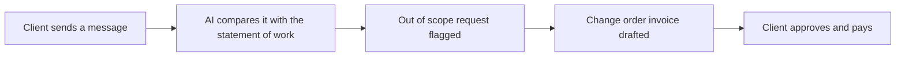

# #92 Scope-Creep Change-Order Guard

> [!tldr] In one breath
> Spots out of scope requests in client messages and turns them into priced change order invoices before the work begins. It survived with 79/120, one of the stronger ideas in this batch.

> [!example] Picture this
> Priya is a freelance designer. Her client writes: "Could you also do a quick logo for the new product?" That is not in the contract. The tool flags it, drafts a $200 change order, and sends it for approval. Priya never has to awkwardly ask for money.

> [!warning] Crowd check, Oct 23 2026
> Invoicing and receivables chasing is crowded in the scan (about 25): ledgerbird, ledgerly, invoicepilot, chaser (Agent Toolkit), owed (Bryntum), clause-and-pay, paceline and others. No repo was spotted that detects scope creep, so the angle is a thin slice inside a crowded cluster.

**Where it landed:** ✅ SURVIVOR. Desk score 79/120, final score 79/120, verdict `desk-only`.

**Theme:** E9 Agents as economic actors & B2B ops · **Group:** Trades & B2B ops · **Crowding on Devpost (first pass):** Invoice cluster

## The problem
Freelancers report "just one more thing" requests and late pay.

## The fix
**Compare each client message with the statement of work, draft a change order invoice, and get client approval.**

## Who it is for
Freelancers and agencies.

## What the AI does
Scope comparison and drafting.

## How it uses PayPal
Invoicing.

**Building blocks used** (decoded in [[30 Primitives Legend]]):
* `P08` Invoicing v2 (create, send, partial payment)
* `A06` Entity matching and narrative drafting
* `A05` Structured decision / classification (most common)

## Who else is out there
Bonsai, HoneyBook. Freelancer suites lack automatic scope detection.

> [!warning] How sure are we?
> ⚠️ Desk research only. The competitor names above come from the landscape and Devpost scans, not from a hunt for each idea. Treat "no competitor found" as unproven.

## What makes it different
Moderate.

## Can we build it?
**Feasibility:** High.

## The demo we would show
Chat becomes a change order that gets paid.

## What could go wrong
The invoice cluster is crowded.

## Evidence and sources
* [Remote 2025: 85% of freelancers paid late sometimes](https://remote.com/blog/contractor-management/reversing-late-payment-culture) ✅

## Scores
Each of the five judging areas is scored 0 to 10 and counts double. Feasibility and low risk count once. The maximum is 120.

| Axis | Weight | Desk score |
|---|---|---|
| Tech | ×2 | 6 |
| Design | ×2 | 7 |
| Impact | ×2 | 6 |
| Innovation | ×2 | 6 |
| Demo | ×2 | 6 |
| Feasibility | ×1 | 9 |
| Risk⁻¹ | ×1 | 8 |
| **Total /120** | | **79** |

*Why (desk):* Decent.

**Kill criteria:** none triggered.

## How it would flow

> [!info]- Jargon decoder
> **Scope creep**: the job quietly growing bigger without more pay, like a pizza that keeps getting extra toppings for free.
>
> **Statement of work**: the document listing exactly what will be delivered.
>
> **Change order**: a short add on agreement with its own price.
>
> **Entity matching (A06)**: AI linking things that mean the same, such as a request and a clause.

## Where to next
* ⬆️ Up: [[Idea Index]]
* ⬅️ Previous: [[I091 Event Vendor Settlement]] · ➡️ Next: [[I093 Lien-Waiver-Gated Contractor Payouts]]
* 🔗 Theme: [[Theme E9 Agents as economic actors & B2B ops]]
* 🔗 Related: [[41 Brutal Elimination]], [[30 Primitives Legend]], [[00 PayPal AI Hackathon Hub]]
