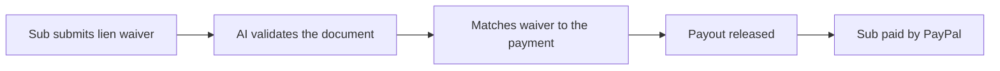

# #93 Lien-Waiver-Gated Contractor Payouts

> [!tldr] In one breath
> Pays a subcontractor only when the AI confirms the matching lien waiver (a legal paper saying they will not claim the building). Cut for weak evidence and a narrow US market (K4).

> [!example] Picture this
> A small builder owes a plumber $5,000. Before paying, the builder needs a signed waiver proving the plumber will not later claim a lien on the house. The AI checks the waiver is correct and complete, and only then does the payment go out.

> [!warning] Crowd check, Oct 23 2026
> Payment gated on a document check is the same family as the AI judged escrow and milestone release cluster (about 28, for example scopepay, specpay, milestone-ai-escrow). Construction as a vertical was untouched, and payouts to workers is a small cluster (payday-agent, Burmalda, takken, routewell).

**Where it landed:** ❌ ELIMINATED. Desk score 58/120, final score 58/120, verdict `desk-only`. Kill codes: K4.

**Theme:** E9 Agents as economic actors & B2B ops · **Group:** Trades & B2B ops · **Crowding on Devpost (first pass):** none

## The problem
Construction payment compliance is heavy on paperwork.

## The fix
**Document validation, then Payouts.**

## Who it is for
Small general contractors in the US.

## What the AI does
Document validation.

## How it uses PayPal
Payouts.

**Building blocks used** (decoded in [[30 Primitives Legend]]):
* `P11` Payouts (batch)
* `A01` Document / image extraction (OCR, validation)

## Who else is out there
Levelset. Procore and Levelset serve this need.

> [!warning] How sure are we?
> ⚠️ Desk research only. The competitor names above come from the landscape and Devpost scans, not from a hunt for each idea. Treat "no competitor found" as unproven.

## What makes it different
Low.

## Can we build it?
**Feasibility:** High.

## The demo we would show
Waiver in, payout out.

## What could go wrong
Niche and US only. PayPal is uncommon in construction.

## Scores
Each of the five judging areas is scored 0 to 10 and counts double. Feasibility and low risk count once. The maximum is 120.

| Axis | Weight | Desk score |
|---|---|---|
| Tech | ×2 | 5 |
| Design | ×2 | 5 |
| Impact | ×2 | 3 |
| Innovation | ×2 | 4 |
| Demo | ×2 | 4 |
| Feasibility | ×1 | 9 |
| Risk⁻¹ | ×1 | 7 |
| **Total /120** | | **58** |

*Why (desk):* Niche.

**Kill criteria triggered:** `K4` Weak evidence or low impact (the problem is not painful enough or lacks proof). See [[41 Brutal Elimination]].

## How it would flow

> [!info]- Jargon decoder
> **Lien waiver**: a signed paper where a worker gives up the right to claim your property over unpaid work, like a receipt that says nothing more is owed.
>
> **General contractor**: the main builder who hires the specialists.
>
> **Payouts**: PayPal's way of sending money to many people at once.
>
> **Document extraction (A01)**: AI reading a paper and checking its fields.

## Where to next
* ⬆️ Up: [[Idea Index]]
* ⬅️ Previous: [[I092 Scope-Creep Change-Order Guard]] · ➡️ Next: [[I094 Fraud Ring Graph]]
* 🔗 Theme: [[Theme E9 Agents as economic actors & B2B ops]]
* 🔗 Related: [[41 Brutal Elimination]], [[30 Primitives Legend]], [[00 PayPal AI Hackathon Hub]]
