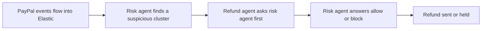

# #94 Fraud Ring Graph

> [!tldr] In one breath
> Indexes PayPal disputes, refunds and webhooks into Elastic, and a risk agent must approve (agent to agent, or A2A) before a refund agent moves any money. It survived with 76/120 as a solid sponsor play.

> [!example] Picture this
> A shop's refund bot is happy to refund anyone who asks. Unknown to it, twelve accounts share one address and keep refunding the same items. The risk agent sees the cluster across all cases and says "block this refund". The money stays put.

> [!warning] Crowd check, Oct 23 2026
> Dispute and chargeback copilots are crowded (about 16): witness, dispute-defender, dispute-copilot (AG Grid), rebuttal, dispute-radar (LightGBM) and more. Agent guardrails are the most saturated area (about 30). The Elastic angle is rarer, but the fraud framing is common.

**Where it landed:** ✅ SURVIVOR. Desk score 76/120, final score 76/120, verdict `desk-only`.

**Theme:** E3 Evidence economy · **Group:** Merchant risk intelligence · **Crowding on Devpost (first pass):** Analytics cluster

## The problem
Refund and dispute abuse forms clusters that are invisible when each case is handled alone.

## The fix
**An Elastic index, ES|QL anomaly tools, and an A2A risk check that gates the refund agent.**

## Who it is for
Small and medium merchants.

## What the AI does
Anomaly detection and agent to agent risk consultation.

## How it uses PayPal
Webhooks, Transaction Search, Refunds and Disputes.

**Building blocks used** (decoded in [[30 Primitives Legend]]):
* `P20` Webhooks (events, retries, verification)
* `P18` Transaction Search / Reporting
* `P16` Refunds (full / partial)
* `P14` Disputes API (get, messages, make-offer, accept-offer, provide-evidence)
* `S05` Sponsor tool: Elastic / Render (⚠ inferred)
* `A15` Anomaly detection

## Who else is out there
Signifyd, Sardine. Fraud vendors serve mid market and above.

> [!warning] How sure are we?
> ⚠️ Desk research only. The competitor names above come from the landscape and Devpost scans, not from a hunt for each idea. Treat "no competitor found" as unproven.

## What makes it different
The A2A gating pattern.

## Can we build it?
**Feasibility:** Medium.

## The demo we would show
A seeded ring is detected and a refund is blocked.

## What could go wrong
The demo could look like analytics.

## Evidence and sources
* [Elastic Agent Builder (MCP + A2A servers)](https://www.elastic.co/docs/explore-analyze/ai-features/elastic-agent-builder) ✅
* [Appriss 2026: $100B preventable return fraud/abuse](https://apprissretail.com/2026-total-retail-loss-benchmark-report/) ✅

## Scores
Each of the five judging areas is scored 0 to 10 and counts double. Feasibility and low risk count once. The maximum is 120.

| Axis | Weight | Desk score |
|---|---|---|
| Tech | ×2 | 7 |
| Design | ×2 | 6 |
| Impact | ×2 | 6 |
| Innovation | ×2 | 6 |
| Demo | ×2 | 6 |
| Feasibility | ×1 | 7 |
| Risk⁻¹ | ×1 | 7 |
| **Total /120** | | **76** |

*Why (desk):* A solid sponsor play, moderate.

**Kill criteria:** none triggered.

## How it would flow

> [!info]- Jargon decoder
> **Fraud ring**: a group working together to cheat, like several shoplifters passing items between them.
>
> **Elastic**: a search and analytics database, like a very fast filing cabinet for events.
>
> **ES|QL**: Elastic's query language, a way to ask the cabinet questions.
>
> **A2A**: agent to agent: one AI asking another AI for an answer before acting.
>
> **Anomaly detection (A15)**: spotting what does not fit the pattern, like one odd number in a column.
>
> **Webhook**: an automatic ping from PayPal when something happens.

## Where to next
* ⬆️ Up: [[Idea Index]]
* ⬅️ Previous: [[I093 Lien-Waiver-Gated Contractor Payouts]] · ➡️ Next: [[I095 Agent Spend Reconciler]]
* 🔗 Theme: [[Theme E3 Evidence economy]]
* 🔗 Related: [[41 Brutal Elimination]], [[30 Primitives Legend]], [[00 PayPal AI Hackathon Hub]]
