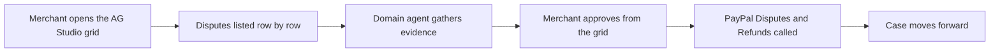

# #96 PayPal Ops Control Room

> [!tldr] In one breath
> An AG Studio dashboard where a dispute specialist agent works beside Studio's own agents, and the merchant approves evidence, offers and refunds straight from the grid. It survived with 84/120 and works best as a shell for another idea.

> [!example] Picture this
> Imagine one screen for a shop owner: a grid listing every open dispute. Click a row and an agent has already gathered the evidence. One click approves it, and the refund or offer goes out through PayPal. No jumping between five tabs.

> [!warning] Crowd check, Oct 23 2026
> AG Grid is more contested than other sponsors (about 20 repos), and dispute copilots are crowded (about 16): dispute-copilot (AG Grid), dispute-radar, dispute-autopilot, two disputedesk and more. A dashboard shell on its own would blend in.

**Where it landed:** ✅ SURVIVOR. Desk score 84/120, final score 84/120, verdict `desk-only`.

**Theme:** E3 Evidence economy · **Group:** Merchant risk intelligence · **Crowding on Devpost (first pass):** Analytics cluster

## The problem
Merchants juggle disputes, refunds and payouts across many screens.

## The fix
**AG Studio with custom widgets and a custom domain agent that calls the PayPal APIs from grid actions.**

## Who it is for
Small business operations teams.

## What the AI does
A domain agent working with Studio's own agents.

## How it uses PayPal
Disputes, Refunds, Payouts and Transaction Search.

**Building blocks used** (decoded in [[30 Primitives Legend]]):
* `S01` Sponsor tool: AG Grid / AG Studio (⚠ inferred)
* `P14` Disputes API (get, messages, make-offer, accept-offer, provide-evidence)
* `P16` Refunds (full / partial)
* `P11` Payouts (batch)
* `P18` Transaction Search / Reporting
* `A03` Intent and rationale reasoning (LLM-as-judge)

## Who else is out there
PayPal dashboard. Analytics dashboards are crowded, but the control surface twist matches AG Grid's criteria.

> [!warning] How sure are we?
> ⚠️ Desk research only. The competitor names above come from the landscape and Devpost scans, not from a hunt for each idea. Treat "no competitor found" as unproven.

## What makes it different
A control surface rather than a report.

## Can we build it?
**Feasibility:** High. Boilerplate exists.

## The demo we would show
A grid of disputes with agent generated evidence widgets.

## What could go wrong
The dashboard cluster is crowded, and it is best used as a shell for another idea.

## Evidence and sources
* [Devpost AG Grid sponsor page (criteria, suggested ideas)](https://paypalaihackathon.devpost.com/details/aggrid) ✅
* [AG Studio Agent Framework (Sep 2026)](https://www.ag-grid.com/blog/introducing-the-ag-studio-agent-framework/) ✅

## Scores
Each of the five judging areas is scored 0 to 10 and counts double. Feasibility and low risk count once. The maximum is 120.

| Axis | Weight | Desk score |
|---|---|---|
| Tech | ×2 | 8 |
| Design | ×2 | 8 |
| Impact | ×2 | 6 |
| Innovation | ×2 | 5 |
| Demo | ×2 | 7 |
| Feasibility | ×1 | 8 |
| Risk⁻¹ | ×1 | 8 |
| **Total /120** | | **84** |

*Why (desk):* A great sponsor prize shell for ideas 16, 20 and 23.

**Kill criteria:** none triggered.

## How it would flow

> [!info]- Jargon decoder
> **AG Grid and AG Studio**: a sponsor's data grid (a super spreadsheet for apps) and its builder with agents. Think of an Excel table that can run actions.
>
> **Control surface**: a screen where you act, not only look, like a cockpit versus a poster.
>
> **Disputes API (P14)**: PayPal's tool for reading and answering payment disputes.
>
> **Domain agent**: an AI trained for one job, such as disputes.
>
> **Transaction Search**: PayPal's tool for looking up past payments.

## Where to next
* ⬆️ Up: [[Idea Index]]
* ⬅️ Previous: [[I095 Agent Spend Reconciler]] · ➡️ Next: [[I097 Control Natural-Language PayPal Assistant]]
* 🔗 Theme: [[Theme E3 Evidence economy]]
* 🔗 Related: [[41 Brutal Elimination]], [[30 Primitives Legend]], [[00 PayPal AI Hackathon Hub]]
