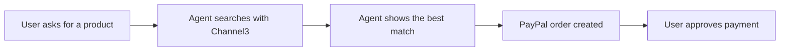

# #98 Control: Channel3 Shopping Agent + PayPal Checkout

> [!tldr] In one breath
> A control group idea: an agent finds a product with Channel3 and pays with PayPal. Cut as the single most duplicated archetype (K2).

> [!example] Picture this
> You tell a bot "find me white running shoes under $80." It searches, shows one pair, and you tap buy. It works, and a hundred other teams built the same thing this month.

> [!warning] Crowd check, Oct 23 2026
> Very crowded. Conversational shopping and checkout is about 25 repos, including at least 10 named "PayPilot", checkout-agent, errand (Channel3), buyguy, agentic-cart, gofer, sahaya (voice), kincart and shopvoice-pay. Channel3 itself is a thinner sponsor (about 4 repos), but this archetype is not.

**Where it landed:** ❌ ELIMINATED. Desk score 59/120, final score 59/120, verdict `desk-only`. Kill codes: K2.

**Theme:** C Control group (obvious ideas) · **Group:** Control group (obvious) · **Crowding on Devpost (first pass):** Shopping-agent cluster (~10)

## The problem
Shopping takes time.

## The fix
**Search plus a checkout button.**

## Who it is for
Consumers.

## What the AI does
A search agent.

## How it uses PayPal
Orders.

**Building blocks used** (decoded in [[30 Primitives Legend]]):
* `P01` Orders v2 (create / capture / get)
* `S03` Sponsor tool: Channel3 (⚠ inferred)
* `A03` Intent and rationale reasoning (LLM-as-judge)

## Who else is out there
Perplexity Shopping, Google AI Mode, Alexa for Shopping. The single most duplicated archetype expected.

> [!warning] How sure are we?
> ⚠️ Desk research only. The competitor names above come from the landscape and Devpost scans, not from a hunt for each idea. Treat "no competitor found" as unproven.

## What makes it different
None.

## Can we build it?
**Feasibility:** Easy.

## The demo we would show
Chat, then buy.

## What could go wrong
OpenAI retired Instant Checkout, and the area is crowded.

## Evidence and sources
* [Devpost 'Built with PayPal' listing (early-entry clustering, ~72 reviewed)](https://devpost.com/software/built-with/paypal) ⚠️
* [CNBC: OpenAI revamps shopping after Instant Checkout (Mar 2026)](https://www.cnbc.com/2026/03/24/openai-revamps-shopping-experience-in-chatgpt-after-instant-checkout.html) ⚠️
* [Channel3 docs (search by text/image/URL, MCP, UCP; no checkout)](https://docs.trychannel3.com/) ✅

## Scores
Each of the five judging areas is scored 0 to 10 and counts double. Feasibility and low risk count once. The maximum is 120.

| Axis | Weight | Desk score |
|---|---|---|
| Tech | ×2 | 5 |
| Design | ×2 | 6 |
| Impact | ×2 | 3 |
| Innovation | ×2 | 1 |
| Demo | ×2 | 6 |
| Feasibility | ×1 | 9 |
| Risk⁻¹ | ×1 | 8 |
| **Total /120** | | **59** |

*Why (desk):* A control idea.

**Kill criteria triggered:** `K2` Crowded cluster or derivative headline; innovation cannot be defended (too many teams will build the same thing). See [[41 Brutal Elimination]].

## How it would flow

> [!info]- Jargon decoder
> **Channel3**: a sponsor's product search service. It finds things to buy but has no checkout of its own.
>
> **Control group**: ideas picked on purpose because they are obvious, as a yardstick.
>
> **Orders**: PayPal's record of one purchase.
>
> **Instant Checkout**: OpenAI's buy button inside ChatGPT, which has been retired.

## Where to next
* ⬆️ Up: [[Idea Index]]
* ⬅️ Previous: [[I097 Control Natural-Language PayPal Assistant]] · ➡️ Next: [[I099 Control Receipt-Scan Bill Splitter]]
* 🔗 Theme: [[Theme C Control group (obvious ideas)]]
* 🔗 Related: [[41 Brutal Elimination]], [[30 Primitives Legend]], [[00 PayPal AI Hackathon Hub]]
