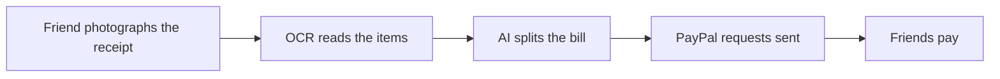

# #99 Control: Receipt-Scan Bill Splitter

> [!tldr] In one breath
> A control group idea: scan a receipt, split it, and request money through PayPal. Cut as derivative and weak (K2 and K4). PayPal's official inspiration list gives this exact example.

> [!example] Picture this
> Four friends finish dinner. One snaps the receipt, the app splits it, and each friend gets a PayPal request. Useful, but this is the example PayPal itself suggests, so many teams will build it.

> [!warning] Crowd check, Oct 23 2026
> Group pooling and splitting is a smaller cluster in the scan (caresplit, potluck, purser, sarafupay, WePay, homeward). Receipt and bill split appears on PayPal's own inspiration list, so expect convergence.

**Where it landed:** ❌ ELIMINATED. Desk score 56/120, final score 56/120, verdict `desk-only`. Kill codes: K2, K4.

**Theme:** C Control group (obvious ideas) · **Group:** Control group (obvious) · **Crowding on Devpost (first pass):** Group-pay cluster (~6)

## The problem
Group dinners.

## The fix
**OCR, a split, and money requests.**

## Who it is for
Friends.

## What the AI does
OCR.

## How it uses PayPal
Invoicing and payment links.

**Building blocks used** (decoded in [[30 Primitives Legend]]):
* `P08` Invoicing v2 (create, send, partial payment)
* `A01` Document / image extraction (OCR, validation)

## Who else is out there
Splitwise, Venmo groups. The official inspiration list lists this exact example.

> [!warning] How sure are we?
> ⚠️ Desk research only. The competitor names above come from the landscape and Devpost scans, not from a hunt for each idea. Treat "no competitor found" as unproven.

## What makes it different
None.

## Can we build it?
**Feasibility:** Easy.

## The demo we would show
Receipt, then splits.

## What could go wrong
No credible problem data.

## Evidence and sources
* [Hackathon resources & inspiration list](https://paypalaihackathon.devpost.com/resources) ✅

## Scores
Each of the five judging areas is scored 0 to 10 and counts double. Feasibility and low risk count once. The maximum is 120.

| Axis | Weight | Desk score |
|---|---|---|
| Tech | ×2 | 4 |
| Design | ×2 | 6 |
| Impact | ×2 | 2 |
| Innovation | ×2 | 1 |
| Demo | ×2 | 6 |
| Feasibility | ×1 | 10 |
| Risk⁻¹ | ×1 | 8 |
| **Total /120** | | **56** |

*Why (desk):* A control idea.

**Kill criteria triggered:** `K2` Crowded cluster or derivative headline; innovation cannot be defended (too many teams will build the same thing); `K4` Weak evidence or low impact (the problem is not painful enough or lacks proof). See [[41 Brutal Elimination]].

## How it would flow

> [!info]- Jargon decoder
> **OCR**: optical character recognition: a computer reading text from a photo, like a scanner that can read.
>
> **Control group**: obvious ideas kept as a yardstick.
>
> **Invoicing**: PayPal's way of requesting money with a bill.
>
> **Payment links**: web addresses that open a ready made PayPal checkout.

## Where to next
* ⬆️ Up: [[Idea Index]]
* ⬅️ Previous: [[I098 Control Channel3 Shopping Agent + PayPal Checkout]] · ➡️ Next: [[I100 Control Budgeting Chatbot over PayPal]]
* 🔗 Theme: [[Theme C Control group (obvious ideas)]]
* 🔗 Related: [[41 Brutal Elimination]], [[30 Primitives Legend]], [[00 PayPal AI Hackathon Hub]]
