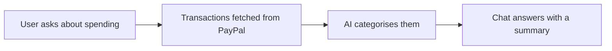

# #100 Control: Budgeting Chatbot over PayPal

> [!tldr] In one breath
> A control group idea: sort PayPal transactions into categories and chat about spending. It ranks last at 50/120, cut as derivative and because PayPal is not central (K2 and K3).

> [!example] Picture this
> You ask a chatbot: "How much did I spend on food this month?" It answers with a chart. Nice, but Rocket Money and others do it better, and PayPal's data is not even the best fit for personal budgets.

> [!warning] Crowd check, Oct 23 2026
> Budget agents are a small cluster in the scan: budget-guardian, two paypal-budget-agent repos and Monetra. Budgeting also appears on PayPal's inspiration list, so expect convergence.

**Where it landed:** ❌ ELIMINATED. Desk score 50/120, final score 50/120, verdict `desk-only`. Kill codes: K2, K3.

**Theme:** C Control group (obvious ideas) · **Group:** Control group (obvious) · **Crowding on Devpost (first pass):** Budgeting cluster

## The problem
People want insight into their spending.

## The fix
**A categoriser plus chat.**

## Who it is for
Consumers.

## What the AI does
Categorisation.

## How it uses PayPal
Transaction Search (merchant scoped, so consumer use is awkward).

**Building blocks used** (decoded in [[30 Primitives Legend]]):
* `P18` Transaction Search / Reporting
* `A05` Structured decision / classification (most common)

## Who else is out there
Rocket Money, Copilot Money, Monarch. A mature consumer category, and the official inspiration list includes it.

> [!warning] How sure are we?
> ⚠️ Desk research only. The competitor names above come from the landscape and Devpost scans, not from a hunt for each idea. Treat "no competitor found" as unproven.

## What makes it different
None.

## Can we build it?
**Feasibility:** Easy.

## The demo we would show
Chat.

## What could go wrong
Consumer data access does not fit.

## Evidence and sources
* [Hackathon resources & inspiration list](https://paypalaihackathon.devpost.com/resources) ✅

## Scores
Each of the five judging areas is scored 0 to 10 and counts double. Feasibility and low risk count once. The maximum is 120.

| Axis | Weight | Desk score |
|---|---|---|
| Tech | ×2 | 3 |
| Design | ×2 | 6 |
| Impact | ×2 | 3 |
| Innovation | ×2 | 1 |
| Demo | ×2 | 5 |
| Feasibility | ×1 | 8 |
| Risk⁻¹ | ×1 | 6 |
| **Total /120** | | **50** |

*Why (desk):* A control idea.

**Kill criteria triggered:** `K2` Crowded cluster or derivative headline; innovation cannot be defended (too many teams will build the same thing); `K3` PayPal is not central to the loop (the idea works without PayPal). See [[41 Brutal Elimination]].

## How it would flow

> [!info]- Jargon decoder
> **Control group**: obvious ideas kept as a yardstick, like a plain test cake.
>
> **Transaction Search (P18)**: PayPal's tool for looking up past payments. It is built for merchants, not for personal accounts.
>
> **Categorisation**: sorting items into labels such as food or travel, like colour coding a diary.

## Where to next
* ⬆️ Up: [[Idea Index]]
* ⬅️ Previous: [[I099 Control Receipt-Scan Bill Splitter]] · ➡️ Next: [[Idea Index]]
* 🔗 Theme: [[Theme C Control group (obvious ideas)]]
* 🔗 Related: [[41 Brutal Elimination]], [[30 Primitives Legend]], [[00 PayPal AI Hackathon Hub]]
