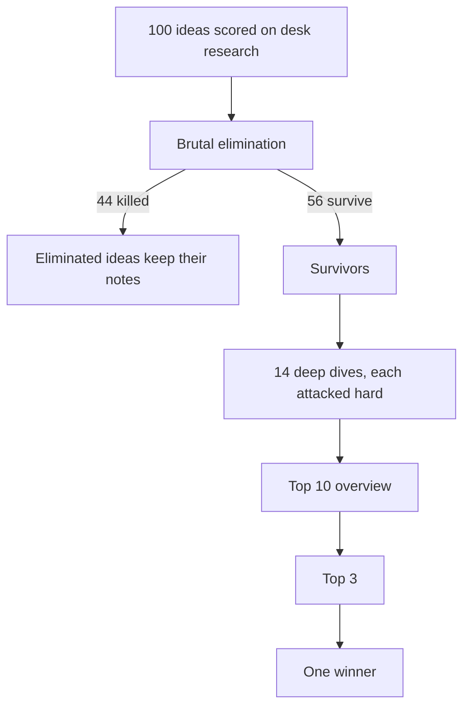

# Idea Index (all 100 ideas)

> [!tldr] In one breath
> This is the scoreboard for all 100 ideas we dreamed up. Each one has a score out of 120. Some were killed in a tough elimination round (44 of them) and 56 survived. Click any idea to read its story.

> [!example] Picture this
> Think of a talent show with 100 acts. Judges give every act a score. Some acts are cut for good reasons (everyone else is doing the same song, or nobody would watch). The rest go through, and a handful get a long, careful look. This page is the full results board.

## How to read this table

> [!info] What each column means
> * **Rank**: position from 1 to 100, sorted by final score. Ties are listed in a steady order.
> * **#**: the idea's ID number. It matches the note name, such as I016.
> * **Idea**: click the name to open the idea note.
> * **Theme**: the group the idea belongs to. E1 to E10 are the ten themes of real, new ideas. C is the "control group" of obvious ideas we added on purpose, as a yardstick.
> * **Desk**: the first pass score out of 120, from desk research (reading and searching, no deep testing). Seven areas are scored 0 to 10: five judging criteria count double, feasibility and low risk count once. Maximum 120.
> * **Final**: the score after deep dives. When we attacked an idea hard and found problems (a competitor, a blocked API), the score dropped. When no deep dive was done, Final equals Desk.
> * **Status**: "survivor" means it passed the elimination round. "eliminated" plus a code means it was killed. K2 means crowded or derivative, K3 means PayPal is not central, K4 means weak evidence or low impact, K6 means no watchable demo, K1 means it needs gated APIs. Details are in [[41 Brutal Elimination]].
> * **Deep dive**: the verdict of the careful look, if the idea got one. "advance-with-changes" means build it, but fix the flagged problems. "demote" means do not build it alone. "none" means no deep dive was done.

Ranked by final score (/120). Eliminated means at least one kill criterion in [[41 Brutal Elimination]] applied.

## How 100 ideas became one winner

Read the steps here: elimination in [[41 Brutal Elimination]], the top ten in [[50 Top 10 Overview]], and the final pick in [[70 The Winning Idea]].

## Crowd heat: where the other teams are

> [!warning] Crowded areas, Oct 23 2026 scan
> A scan of 266 public GitHub repos made for this hackathon (partial coverage, medium confidence) found these crowded areas, from most to least crowded:
> 1. Agent spending limits and guardrails (about 30 repos, the most saturated).
> 2. AI judged escrow and milestone release (about 28).
> 3. Chat to checkout shopping agents (about 25, at least 10 named "PayPilot").
> 4. Freelancer and small business invoicing (about 25).
> 5. Dispute and chargeback copilots (about 16).
> 6. MCP storefronts (about 11) and agent to agent haggling (about 8), medium crowding.

> [!success] Thin or empty areas
> * Accessibility first payments: zero hits, even though it is on PayPal's own inspiration list.
> * Nonprofit and donations (only amanah and a classroom repo), microloans and inclusion (none).
> * Pay Later and Subscriptions as the core idea (thin: triad, subscription-killer).
> * Marketplace split payouts, developer tools for PayPal integrators (only cutover and a webhook simulator), and cross border FX (thin).
> * Venmo, PYUSD, Payouts at scale and Transaction Search analytics (1 to 2 repos each).
> * Untouched fields: events and ticketing, education, farming and co ops, tax and 1099, insurance (except rain-day-cover and tidehold), household worker payroll, climate and community pooling.
> * Sponsor gaps: Bryntum (about 5 repos), APIMatic (1 to 2 repos for 3 prizes), Channel3 (about 4). AG Grid is more contested (about 20).

Full scan: [[17 Live Competition Scan (Oct 23)]].

## The table

| Rank | # | Idea | Theme | Desk | Final | Status | Deep dive |
|---|---|---|---|---|---|---|---|
| 1 | 16 | [[I016 Dispute EV Triage\|#16 Dispute EV Triage]] | E3 | 91 | 91 | eliminated K2 | none |
| 2 | 23 | [[I023 Seller Protection Preflight\|#23 Seller Protection Preflight]] | E3 | 97 | 89 | survivor | advance-with-changes |
| 3 | 3 | [[I003 Mismatch-to-Replacement\|#3 Mismatch-to-Replacement]] | E1 | 93 | 87 | survivor | advance-with-changes |
| 4 | 5 | [[I005 Regret Window\|#5 Regret Window]] | E1 | 87 | 87 | survivor | none |
| 5 | 55 | [[I055 Payout Failure Triage\|#55 Payout Failure Triage]] | E8 | 95 | 86 | survivor | advance-with-changes |
| 6 | 28 | [[I028 Early-Pay Discount Optimizer\|#28 Early-Pay Discount Optimizer]] | E4 | 93 | 85 | survivor | advance-with-changes |
| 7 | 35 | [[I035 Vendor Change Verifier\|#35 Vendor Change Verifier]] | E5 | 85 | 85 | survivor | none |
| 8 | 40 | [[I040 Purpose-Bound Family Support\|#40 Purpose-Bound Family Support]] | E6 | 85 | 85 | survivor | none |
| 9 | 96 | [[I096 PayPal Ops Control Room\|#96 PayPal Ops Control Room]] | E3 | 84 | 84 | survivor | none |
| 10 | 13 | [[I013 Pricing-Error Shield\|#13 Pricing-Error Shield]] | E2 | 83 | 83 | survivor | none |
| 11 | 49 | [[I049 Agent-Buyability Audit\|#49 Agent-Buyability Audit]] | E7 | 82 | 82 | survivor | none |
| 12 | 60 | [[I060 Sandbox Scenario Studio\|#60 Sandbox Scenario Studio]] | E8 | 82 | 82 | survivor | none |
| 13 | 9 | [[I009 Rental Deposit Inspector\|#9 Rental Deposit Inspector]] | E2 | 92 | 81 | survivor | demote |
| 14 | 22 | [[I022 Don't Recognize This Charge Resolver\|#22 "Don't Recognize This Charge" Resolver]] | E3 | 81 | 81 | survivor | none |
| 15 | 38 | [[I038 Household Delegated Agent\|#38 Household Delegated Agent]] | E6 | 81 | 81 | eliminated K2 | none |
| 16 | 43 | [[I043 First-Offer Bias Auditor\|#43 First-Offer Bias Auditor]] | E1 | 81 | 81 | survivor | none |
| 17 | 69 | [[I069 Second-Gift Engine\|#69 Second-Gift Engine]] | E10 | 81 | 81 | survivor | none |
| 18 | 20 | [[I020 Dispute-to-Listing Fixer\|#20 Dispute-to-Listing Fixer]] | E3 | 97 | 80 | survivor | demote |
| 19 | 56 | [[I056 Integration Chaos Monkey\|#56 Integration Chaos Monkey]] | E8 | 90 | 80 | survivor | advance-with-changes |
| 20 | 17 | [[I017 Digital-Goods Proof Ledger\|#17 Digital-Goods Proof Ledger]] | E3 | 79 | 79 | survivor | none |
| 21 | 18 | [[I018 Service-Proof Ledger\|#18 Service-Proof Ledger]] | E3 | 79 | 79 | survivor | none |
| 22 | 25 | [[I025 Hold Release Copilot\|#25 Hold Release Copilot]] | E4 | 79 | 79 | survivor | none |
| 23 | 33 | [[I033 Marketplace Safe-Deal Link\|#33 Marketplace Safe-Deal Link]] | E5 | 79 | 79 | survivor | none |
| 24 | 54 | [[I054 Decline Whisperer\|#54 Decline Whisperer]] | E8 | 79 | 79 | eliminated K2 | none |
| 25 | 65 | [[I065 Net-Landed Quote Engine\|#65 Net-Landed Quote Engine]] | E10 | 79 | 79 | survivor | none |
| 26 | 92 | [[I092 Scope-Creep Change-Order Guard\|#92 Scope-Creep Change-Order Guard]] | E9 | 79 | 79 | survivor | none |
| 27 | 7 | [[I007 Proof-of-Intent Checkout Button\|#7 Proof-of-Intent Checkout Button]] | E1 | 78 | 78 | survivor | none |
| 28 | 8 | [[I008 Final-Price Agent (Overcapture)\|#8 Final-Price Agent (Overcapture)]] | E2 | 90 | 78 | survivor | demote |
| 29 | 27 | [[I027 Account Health Sentinel\|#27 Account Health Sentinel]] | E4 | 78 | 78 | survivor | none |
| 30 | 34 | [[I034 Guardian Mode\|#34 Guardian Mode]] | E5 | 78 | 78 | survivor | none |
| 31 | 79 | [[I079 AR↔AP Agent Terms Handshake\|#79 AR↔AP Agent Terms Handshake]] | E9 | 77 | 77 | survivor | none |
| 32 | 4 | [[I004 Rogue-Agent Claim Verifier\|#4 Rogue-Agent Claim Verifier]] | E1 | 76 | 76 | survivor | none |
| 33 | 42 | [[I042 Pre-Checkout Injection Firewall\|#42 Pre-Checkout Injection Firewall]] | E1 | 91 | 76 | survivor | advance-with-changes |
| 34 | 45 | [[I045 Agent Payment Eval Harness\|#45 Agent Payment Eval Harness]] | E1 | 76 | 76 | eliminated K6 | none |
| 35 | 94 | [[I094 Fraud Ring Graph\|#94 Fraud Ring Graph]] | E3 | 76 | 76 | survivor | none |
| 36 | 51 | [[I051 Micro-Merchant Instant Storefront\|#51 Micro-Merchant Instant Storefront]] | E7 | 75 | 75 | survivor | none |
| 37 | 84 | [[I084 Accessible Voice Checkout\|#84 Accessible Voice Checkout]] | E10 | 88 | 75 | survivor | demote |
| 38 | 11 | [[I011 Tipping-Point Group Buy\|#11 Tipping-Point Group Buy]] | E2 | 74 | 74 | survivor | none |
| 39 | 53 | [[I053 Livestream Checkout Agent\|#53 Livestream Checkout Agent]] | E7 | 74 | 74 | eliminated K4 | none |
| 40 | 74 | [[I074 Agent-Hires-Human Microtasks\|#74 Agent-Hires-Human Microtasks]] | E9 | 74 | 74 | survivor | none |
| 41 | 19 | [[I019 Compelling Evidence Linker\|#19 Compelling Evidence Linker]] | E3 | 73 | 73 | eliminated K2 | none |
| 42 | 39 | [[I039 Caregiver Bill Desk\|#39 Caregiver Bill Desk]] | E6 | 73 | 73 | survivor | none |
| 43 | 58 | [[I058 Exactly-Once Agent Payment Proxy\|#58 Exactly-Once Agent Payment Proxy]] | E8 | 73 | 73 | eliminated K6 | none |
| 44 | 80 | [[I080 Price-Change Rollout Agent\|#80 Price-Change Rollout Agent]] | E8 | 73 | 73 | survivor | none |
| 45 | 2 | [[I002 Three-Party Agent Error Settlement\|#2 Three-Party Agent Error Settlement]] | E1 | 95 | 72 | survivor | demote |
| 46 | 12 | [[I012 No-Show Deposit Sizer\|#12 No-Show Deposit Sizer]] | E2 | 72 | 72 | survivor | none |
| 47 | 14 | [[I014 Delivery-Confirmed Capture\|#14 Delivery-Confirmed Capture]] | E2 | 72 | 72 | eliminated K2 | none |
| 48 | 26 | [[I026 Tracking Courier\|#26 Tracking Courier]] | E4 | 72 | 72 | survivor | none |
| 49 | 44 | [[I044 Agent Price-Parity Checker\|#44 Agent Price-Parity Checker]] | E1 | 72 | 72 | eliminated K4 | none |
| 50 | 47 | [[I047 WebMCP Storefront Kit\|#47 WebMCP Storefront Kit]] | E7 | 95 | 72 | survivor | demote |
| 51 | 48 | [[I048 Catalog-to-UCPACP Manifest Generator\|#48 Catalog-to-UCP/ACP Manifest Generator]] | E7 | 72 | 72 | survivor | none |
| 52 | 52 | [[I052 Voice Phone-Order Taker\|#52 Voice Phone-Order Taker]] | E7 | 72 | 72 | survivor | none |
| 53 | 61 | [[I061 Agent Returns Concierge\|#61 Agent Returns Concierge]] | E3 | 72 | 72 | eliminated K1 | none |
| 54 | 76 | [[I076 Haggle Link\|#76 Haggle Link]] | E9 | 72 | 72 | eliminated K4 | none |
| 55 | 1 | [[I001 Intent Black Box\|#1 Intent Black Box]] | E1 | 92 | 71 | survivor | demote |
| 56 | 6 | [[I006 Agent Evidence Bundle Spec & Validator\|#6 Agent Evidence Bundle Spec & Validator]] | E1 | 71 | 71 | eliminated K6 | none |
| 57 | 15 | [[I015 Commitment Contract to Charity\|#15 Commitment Contract to Charity]] | E2 | 71 | 71 | eliminated K4 | none |
| 58 | 24 | [[I024 Support-Ticket Dispute Early Warning\|#24 Support-Ticket Dispute Early Warning]] | E3 | 71 | 71 | eliminated K2 | none |
| 59 | 30 | [[I030 Cash Application Matcher\|#30 Cash Application Matcher]] | E4 | 71 | 71 | eliminated K6 | none |
| 60 | 32 | [[I032 F&F Scam Interrupter\|#32 F&F Scam Interrupter]] | E5 | 89 | 71 | survivor | demote |
| 61 | 50 | [[I050 Promo & Loyalty-Aware Agent Checkout\|#50 Promo & Loyalty-Aware Agent Checkout]] | E7 | 71 | 71 | survivor | none |
| 62 | 63 | [[I063 Price-Protection Autopilot\|#63 Price-Protection Autopilot]] | E3 | 71 | 71 | eliminated K4 | none |
| 63 | 64 | [[I064 Refund Policy Compiler\|#64 Refund Policy Compiler]] | E3 | 71 | 71 | survivor | none |
| 64 | 67 | [[I067 Multilingual Dispute Communicator\|#67 Multilingual Dispute Communicator]] | E10 | 71 | 71 | survivor | none |
| 65 | 75 | [[I075 Reverse-Auction Intent Broadcast\|#75 Reverse-Auction Intent Broadcast]] | E9 | 71 | 71 | survivor | none |
| 66 | 83 | [[I083 Spec-to-Plan Billing Compiler\|#83 Spec-to-Plan Billing Compiler]] | E8 | 71 | 71 | survivor | none |
| 67 | 89 | [[I089 Voice-Note Invoicing\|#89 Voice-Note Invoicing]] | E9 | 71 | 71 | eliminated K2 | none |
| 68 | 10 | [[I010 Backorder Reauth Manager\|#10 Backorder Reauth Manager]] | E2 | 70 | 70 | survivor | none |
| 69 | 59 | [[I059 v5→v6 Migration & Certification Agent\|#59 v5→v6 Migration & Certification Agent]] | E8 | 70 | 70 | survivor | none |
| 70 | 70 | [[I070 Proof-of-Impact Field Payouts\|#70 Proof-of-Impact Field Payouts]] | E10 | 70 | 70 | eliminated K2 | none |
| 71 | 88 | [[I088 Quote-to-Deposit for Trades\|#88 Quote-to-Deposit for Trades]] | E9 | 70 | 70 | eliminated K2 | none |
| 72 | 29 | [[I029 Payer-Side Pay Later Collections\|#29 Payer-Side Pay Later Collections]] | E4 | 69 | 69 | survivor | none |
| 73 | 71 | [[I071 Disaster Micro-Grant Distributor\|#71 Disaster Micro-Grant Distributor]] | E10 | 69 | 69 | eliminated K4 | none |
| 74 | 86 | [[I086 Layaway Planner\|#86 Layaway Planner]] | E2 | 69 | 69 | survivor | none |
| 75 | 90 | [[I090 Agentic RFQ Desk\|#90 Agentic RFQ Desk]] | E9 | 69 | 69 | survivor | none |
| 76 | 77 | [[I077 Fiat Micropayment Credits for Agents\|#77 Fiat Micropayment Credits for Agents]] | E9 | 68 | 68 | eliminated K2 | none |
| 77 | 21 | [[I021 Proactive INR Deflector\|#21 Proactive INR Deflector]] | E3 | 67 | 67 | eliminated K2 | none |
| 78 | 31 | [[I031 Cash-Gap Forecaster\|#31 Cash-Gap Forecaster]] | E4 | 67 | 67 | eliminated K2,K6 | none |
| 79 | 57 | [[I057 Webhook Drift Doctor\|#57 Webhook Drift Doctor]] | E8 | 67 | 67 | eliminated K6 | none |
| 80 | 62 | [[I062 Returns-Abuse Pattern Detector\|#62 Returns-Abuse Pattern Detector]] | E3 | 67 | 67 | eliminated K6 | none |
| 81 | 85 | [[I085 Plain-Language Payment Consent\|#85 Plain-Language Payment Consent]] | E10 | 67 | 67 | eliminated K4 | none |
| 82 | 87 | [[I087 Gig Income Statement\|#87 Gig Income Statement]] | E10 | 67 | 67 | survivor | none |
| 83 | 46 | [[I046 Protection-Aware Payment Selector\|#46 Protection-Aware Payment Selector]] | E5 | 66 | 66 | eliminated K4 | none |
| 84 | 81 | [[I081 Pause-Not-Cancel Retention\|#81 Pause-Not-Cancel Retention]] | E8 | 65 | 65 | eliminated K2 | none |
| 85 | 82 | [[I082 Win-Back Agent\|#82 Win-Back Agent]] | E8 | 65 | 65 | eliminated K2 | none |
| 86 | 95 | [[I095 Agent Spend Reconciler\|#95 Agent Spend Reconciler]] | E4 | 64 | 64 | eliminated K6 | none |
| 87 | 37 | [[I037 Overpayment & Refund-Scam Shield\|#37 Overpayment & Refund-Scam Shield]] | E5 | 62 | 62 | eliminated K4 | none |
| 88 | 78 | [[I078 Usage-Metered AI SaaS Billing\|#78 Usage-Metered AI SaaS Billing]] | E9 | 61 | 61 | eliminated K2 | none |
| 89 | 36 | [[I036 Invoice-Scam Detector\|#36 Invoice-Scam Detector]] | E5 | 60 | 60 | eliminated K3 | none |
| 90 | 41 | [[I041 Shared Subscription Steward\|#41 Shared Subscription Steward]] | E6 | 60 | 60 | eliminated K2,K4 | none |
| 91 | 97 | [[I097 Control Natural-Language PayPal Assistant\|#97 Control: Natural-Language PayPal Assistant]] | C | 60 | 60 | eliminated K2 | none |
| 92 | 66 | [[I066 Duty-Inclusive Cross-Border Checkout\|#66 Duty-Inclusive Cross-Border Checkout]] | E10 | 59 | 59 | eliminated K2,K4 | none |
| 93 | 73 | [[I073 Community Pool Ledger\|#73 Community Pool Ledger]] | E10 | 59 | 59 | eliminated K2 | none |
| 94 | 91 | [[I091 Event Vendor Settlement\|#91 Event Vendor Settlement]] | E9 | 59 | 59 | eliminated K4 | none |
| 95 | 98 | [[I098 Control Channel3 Shopping Agent + PayPal Checkout\|#98 Control: Channel3 Shopping Agent + PayPal Checkout]] | C | 59 | 59 | eliminated K2 | none |
| 96 | 93 | [[I093 Lien-Waiver-Gated Contractor Payouts\|#93 Lien-Waiver-Gated Contractor Payouts]] | E9 | 58 | 58 | eliminated K4 | none |
| 97 | 68 | [[I068 PPP Price Localizer\|#68 PPP Price Localizer]] | E10 | 56 | 56 | eliminated K2,K4 | none |
| 98 | 72 | [[I072 Matching-Gift Finder\|#72 Matching-Gift Finder]] | E10 | 56 | 56 | eliminated K2,K4 | none |
| 99 | 99 | [[I099 Control Receipt-Scan Bill Splitter\|#99 Control: Receipt-Scan Bill Splitter]] | C | 56 | 56 | eliminated K2,K4 | none |
| 100 | 100 | [[I100 Control Budgeting Chatbot over PayPal\|#100 Control: Budgeting Chatbot over PayPal]] | C | 50 | 50 | eliminated K2,K3 | none |

> [!info]- Jargon decoder
> **Desk research**: scoring an idea by reading and searching, like judging a restaurant from its menu and reviews before eating there.
>
> **Deep dive**: a hard second look that tries to break the idea, like a crash test for a car design.
>
> **Kill criteria**: the rules that knock an idea out, such as "too many teams have built it".
>
> **Control group**: obvious ideas kept as a yardstick, like a plain cake baked to compare with fancy ones.
>
> **Theme (E1 to E10)**: a family of related ideas that share a problem area.

## Where to next
* ⬆️ Up: [[00 PayPal AI Hackathon Hub]]
* 🔗 Related: [[41 Brutal Elimination]], [[50 Top 10 Overview]], [[70 The Winning Idea]], [[Element Themes Overview]]
