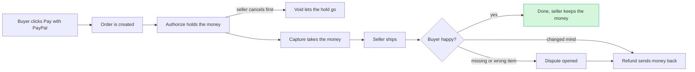
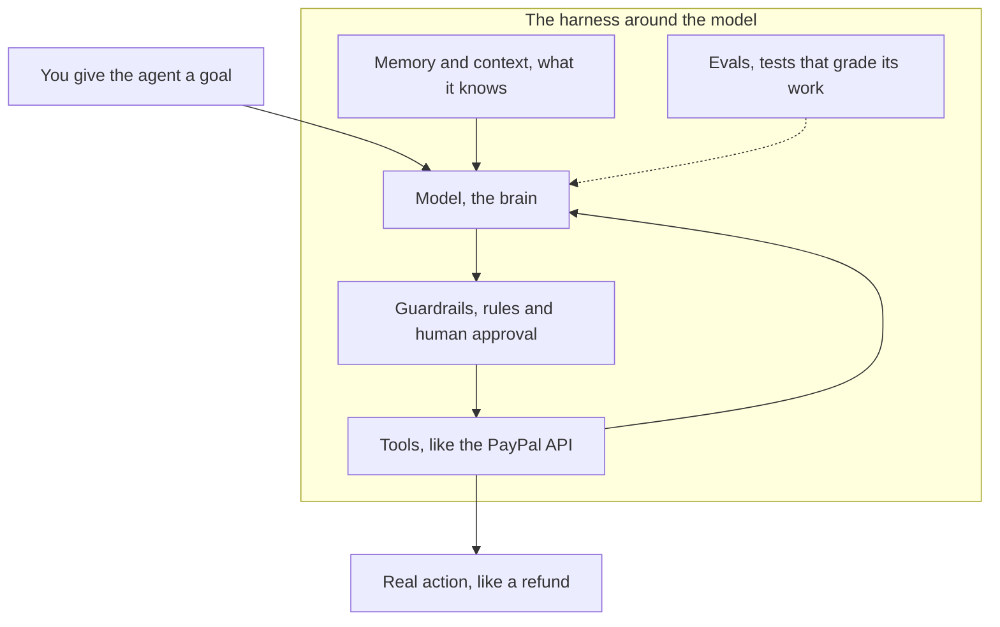

# Jargon Decoder

> [!tldr] In one breath
> This vault is full of words like "capture", "MCP" and "AP2". This page explains each one in one plain sentence, gives it an everyday picture, and points you to the note where it matters most. Stuck on a word anywhere in the vault? Look it up here.

> [!example] Picture this
> Think of this page as the subtitles for a film in a language you half speak. You can still follow the story without them, but with them every scene makes sense. Skim a section once, then come back whenever a word trips you up.

**How to read each entry:** the bold word, then what it means, then "Picture:" with an everyday comparison, then "Where:" with the vault note where the word does the most work.

---

## Money moves

How money actually travels through PayPal, and what happens when things go wrong.

*Life of a PayPal payment. Most payments go straight from capture to "done". The side roads are where most of our hackathon ideas live.*

* **Authorize**: PayPal checks the buyer can pay and holds the money, but nothing moves yet. Picture: a hotel freezing $200 on your card at check in. PayPal gives a 29 day authorization period with a 3 day honor period. Where: [[Theme E2 Programmable holds]]
* **Capture**: the moment the held money is actually taken. Picture: the hotel charging only what you really spent at check out. You can capture up to 115% of the authorized amount or $75 more, whichever is less (this is "overcapture"). Where: [[D008 Final-Price Agent (Overcapture) (Deep Dive)|Final Price Agent]]
* **Void**: cancelling an authorization before any money is taken, so the hold disappears. Picture: tearing up a restaurant bill before anyone pays it. Where: [[Theme E2 Programmable holds]]
* **Refund**: sending money that was already captured back to the buyer, fully or partly. Picture: the shop handing cash back over the counter when you return a jumper. Where: [[11 PayPal Platform & Sandbox Capabilities|PayPal platform]]
* **Payout**: a business sending money out to many people at once, by email, phone, PayPal ID or Venmo handle. Picture: a boss handing out pay envelopes to the whole team in one go. Limit $20k per item; unclaimed payouts return after 30 days. Where: [[D055 Payout Failure Triage (Deep Dive)|Payout Failure Triage]]
* **Hold**: PayPal keeps money in a seller's account but does not let them spend it yet, often until delivery is proven. Picture: a parent keeping your birthday money in a jar until you finish your chores. Adding tracking can release it. Where: [[I025 Hold Release Copilot]]
* **Chargeback**: the buyer's card bank forcibly pulls money back from the seller. Picture: your bank reaching into the shop's till and taking your money back because you complained to the bank, not the shop. Where: [[D002 Three-Party Agent Error Settlement (Deep Dive)|Three Party Agent Error Settlement]]
* **Dispute**: a formal complaint a buyer opens with PayPal about a payment, which the seller must answer with evidence. Picture: a referee stepping in when two players argue about a goal. Where: [[Theme E3 Evidence economy]]
* **Seller Protection**: PayPal's promise to cover sellers for certain losses, but only if they followed specific rules (like shipping to the right address with tracking). Picture: an insurance policy that pays out only if you locked the door. Where: [[D023 Seller Protection Preflight (Deep Dive)|Seller Protection Preflight]]
* **INR (Item Not Received)**: a dispute that says "my parcel never arrived". Picture: you order pizza, wait two hours, and no one ever knocks. Where: [[I021 Proactive INR Deflector]]
* **SNAD (Significantly Not As Described)**: a dispute that says "what arrived is not what you advertised". Picture: you order a red bike and get a blue scooter. Where: [[D020 Dispute-to-Listing Fixer (Deep Dive)|Dispute to Listing Fixer]]
* **Pay Later**: PayPal's "buy now, pay later" options that split a purchase into smaller payments. Picture: paying for a new phone in four chunks instead of all at once. In sandbox, Pay in 4 shows for $30 to $1,500 and Pay Monthly for $199 to $10,000, and sandbox does not simulate the actual instalment billing. Where: [[I029 Payer-Side Pay Later Collections]]
* **Vault**: PayPal safely stores a buyer's payment method as a token, so they can be charged later without typing it in again (even when they are not there). Picture: a coat check ticket. The cloakroom keeps your coat; you only carry the ticket. Where: [[11 PayPal Platform & Sandbox Capabilities|PayPal platform]]
* **Fastlane**: PayPal's quick guest checkout that remembers a shopper's details by email so they skip the long form. Picture: the barista who sees you and starts your usual order before you speak. Where: [[16 Developer Pain, Gaps & Hidden Insights|Developer pain]]
* **PYUSD**: PayPal's own stablecoin, a digital dollar issued by Paxos. Picture: a casino chip that is always worth exactly one dollar. There is no confirmed PayPal product that uses PYUSD for agent payments ❌. Where: [[12 Agentic Payments Landscape|Agentic payments landscape]]
* **Stablecoin**: a cryptocurrency tied to a normal currency like the US dollar so its value stays steady. Picture: a gift card that always equals $1, but lives on the internet and moves in seconds. Where: [[I077 Fiat Micropayment Credits for Agents]]
* **FX (foreign exchange)**: converting one currency into another, usually with a fee hidden in the rate. Picture: the airport kiosk that swaps your pounds for dollars and keeps a slice. Where: [[I065 Net-Landed Quote Engine]]

---

## PayPal plumbing

The pipes and switches a developer touches to make PayPal do things.

* **Sandbox**: PayPal's free practice world with fake money and fake accounts. Picture: a flight simulator; you can crash as often as you like and nobody gets hurt. Where: [[63 Day-1 Sandbox Test Plan|Day 1 sandbox test plan]]
* **REST API**: a standard way for one program to ask another to do something by sending web requests to set addresses. Picture: a restaurant menu with numbered dishes; you order "number 7" and the kitchen knows exactly what to make. Where: [[11 PayPal Platform & Sandbox Capabilities|PayPal platform]]
* **OAuth**: the login handshake that gives an app a temporary access token instead of your password. Picture: a hotel key card that opens only your room and stops working when you check out. PayPal sandbox MCP tokens expire after roughly 8 to 9 hours. Where: [[11 PayPal Platform & Sandbox Capabilities|PayPal platform]]
* **Webhook**: PayPal calling your server automatically the moment something happens, such as a payment completing or a dispute opening. Picture: a doorbell. You do not keep opening the door to check; it rings when someone arrives. PayPal retries a failed webhook up to 25 times over 3 days. Where: [[I057 Webhook Drift Doctor]]
* **Signature verification**: checking that a webhook truly came from PayPal and was not faked. Picture: checking the wax seal on a royal letter before you believe it. Judges with engineering backgrounds look for this. Where: [[D056 Integration Chaos Monkey (Deep Dive)|Integration Chaos Monkey]]
* **Idempotency**: making sure that sending the same request twice only does the thing once. Picture: a lift button. Pressing it ten times still calls one lift. In PayPal this is the `PayPal-Request-Id` header, which the agent toolkit effectively never sets. Where: [[I058 Exactly-Once Agent Payment Proxy]]
* **SDK v6**: version 6 of PayPal's JavaScript kit for putting PayPal buttons and card fields on a website, available since Sept 2025. Picture: a flat pack furniture kit with all the screws already sorted into labelled bags. Where: [[I059 v5→v6 Migration & Certification Agent|v5 to v6 Migration Agent]]
* **Orders v2**: PayPal's main API for creating an order and then authorizing or capturing it. Picture: the order ticket a waiter clips to the kitchen rail. It is primitive P01 and the most used one in our 100 ideas (25 ideas). Where: [[30 Primitives Legend|Primitives legend]]
* **Transaction Search**: the API that lets a business look back through its past payments. Picture: scrolling back through your bank statement. New transactions can take up to three hours to appear, and each search covers at most 31 days. Where: [[D023 Seller Protection Preflight (Deep Dive)|Seller Protection Preflight]]

---

## AI words

What sits inside the "AI" half of an AI hackathon.

*Anatomy of an AI agent. The model is the brain; the harness is everything around it that makes it safe and useful.*

* **LLM (large language model)**: an AI trained on huge amounts of text that predicts and writes words, like Claude or GPT. Picture: a super well read friend who finishes your sentences, usually correctly. Where: [[15 Sponsor Tools|Sponsor tools]]
* **Agent**: an LLM that does not just talk but takes actions in a loop: look, decide, use a tool, check, repeat. Picture: the difference between a travel guidebook and a travel agent who actually books the tickets. Where: [[Theme E1 Agent purchase liability & integrity]]
* **Harness engineering**: designing everything around the model (tools, documents, rules, checks, tests, monitoring) so an agent works reliably. The slogan is "Agent = Model + Harness", and it is framed as the next step after prompt engineering and context engineering (OpenAI, Ryan Lopopolo, Feb 11 2026). Picture: a racehorse is fast, but the saddle, reins and jockey are what make it win races. Where: [[I045 Agent Payment Eval Harness]]
* **Context engineering**: choosing exactly what information the model sees before it answers. Picture: packing a student's exam bag with the right notes, not the whole library. Where: [[15 Sponsor Tools|Sponsor tools]]
* **MCP (Model Context Protocol)**: a common plug standard that lets any AI model use outside tools, like PayPal's. PayPal ships a local `@paypal/mcp` server and a hosted one; the hosted sandbox server was broken from Oct 8 2026. Picture: a USB socket; any device with the right plug just works. Where: [[11 PayPal Platform & Sandbox Capabilities|PayPal platform]]
* **Tool calling**: the model asking to run a specific function, such as "create_refund", with specific inputs, instead of just writing text. Picture: a chef who, instead of describing a cake, hands the kitchen porter a precise order slip. Where: [[16 Developer Pain, Gaps & Hidden Insights|Developer pain]]
* **Structured output / JSON schema**: making the model answer in a fixed, machine readable form (fields, types, allowed values) instead of free prose. A JSON schema is the template that says which fields must be there. Picture: a form with boxes to tick instead of a blank page to scribble on. Where: [[D032 F&F Scam Interrupter (Deep Dive)|F&F Scam Interrupter]]
* **Constrained decoding**: forcing the model, word by word, to only produce output that fits the schema, so it cannot break the format. Picture: a cake mould; however the batter is poured, it comes out star shaped. Where: [[D042 Pre-Checkout Injection Firewall (Deep Dive)|Pre Checkout Injection Firewall]]
* **Jev System One model**: a new model from TypeSafe AI (announced around Sept 15 to 16 2026) that returns only typed decisions (a choice, yes or no, a score) with probabilities, never free text, in about 70 to 500 ms. The vendor claims 20 to 200x faster and 40 to 400x cheaper, and says it is "immune to hallucination", a claim Sean Goedecke disputes. Whether access is open or early access only is unclear. Picture: a bouncer who just says "in" or "out" in half a second, rather than a lawyer writing an essay. It could act as a fast risk gate inside an agent checkout. Where: [[D042 Pre-Checkout Injection Firewall (Deep Dive)|Pre Checkout Injection Firewall]]
* **Eval**: a repeatable test that scores how well an AI system does its job. Picture: a driving test with a fixed route and a checklist, run again after every change to the car. Where: [[I045 Agent Payment Eval Harness]]
* **Hallucination**: when an AI states something false with full confidence. Picture: a friend giving you directions to a shop that closed years ago, without blinking. Where: [[12 Agentic Payments Landscape|Agentic payments landscape]]
* **Prompt injection**: hidden instructions in a web page, email or product listing that trick an AI into doing something its user never asked for. Picture: a note slipped into a delivery driver's parcel saying "also drop the van keys at my house". Researchers got a shopping agent to add an unauthorized gift card this way. Where: [[D042 Pre-Checkout Injection Firewall (Deep Dive)|Pre Checkout Injection Firewall]]
* **RAG (retrieval augmented generation)**: the AI first looks up relevant documents, then answers using them. Picture: an open book exam instead of answering from memory. Where: [[10 Event, Rules & Judging Intelligence|Event and judging intel]]
* **OCR (optical character recognition)**: reading text out of a photo or scanned document. Picture: a phone app that reads the words off a crumpled receipt. Where: [[D023 Seller Protection Preflight (Deep Dive)|Seller Protection Preflight]]
* **Latency**: how long you wait between asking and getting an answer. Picture: the gap between pressing the lift button and the doors opening. In checkout, every extra second loses shoppers. Where: [[D056 Integration Chaos Monkey (Deep Dive)|Integration Chaos Monkey]]

---

## Agentic commerce protocols

"Agentic commerce" means AI agents shopping and paying for people. These protocols are the competing rulebooks for how that works. All details are in [[12 Agentic Payments Landscape|the landscape note]].

* **ACP (Agentic Commerce Protocol)**: OpenAI and Stripe's rules for an agent checking out on a merchant's behalf. Its flagship, ChatGPT Instant Checkout, was retired in Mar 2026 after weak sales; PayPal adopted ACP in Oct 2025. Picture: a shared order form both the shop and the robot shopper agree to fill in. Where: [[12 Agentic Payments Landscape|Agentic payments landscape]]
* **AP2 (Agent Payments Protocol)**: Google's rules for signed "mandates" that prove what a person allowed an agent to buy; donated to the FIDO Alliance on Apr 28 2026. Version 0.2 adds "Human Not Present" payments. Picture: a signed permission slip saying "you may buy trainers under $100". Where: [[12 Agentic Payments Landscape|Agentic payments landscape]]
* **UCP (Universal Commerce Protocol)**: Google and Shopify's rules for the whole journey, from finding a product to after the purchase; live in Google AI Mode and Gemini since Jan 11 2026. Picture: one standard shop layout every store agrees to, so a robot shopper can find the till anywhere. Where: [[12 Agentic Payments Landscape|Agentic payments landscape]]
* **Visa TAP (Trusted Agent Protocol)**: Visa's way for an agent to sign its web requests so a shop knows it is a real, approved agent and whether it is browsing or buying. In pilot. Picture: a staff badge that also shows whether you are on a break or on duty. Where: [[12 Agentic Payments Landscape|Agentic payments landscape]]
* **Mastercard Agent Pay**: Mastercard's system (Apr 29 2025) that gives registered agents special "Agentic Tokens", each limited to one agent and one set of spending rules; built into the PayPal wallet from Oct 27 2025. Picture: a prepaid card that only works at one shop, for one errand. Where: [[12 Agentic Payments Landscape|Agentic payments landscape]]
* **Verifiable Intent**: Mastercard's tamper proof record (Mar 5 2026, built with Google) linking the person, their instructions to the agent and what the agent actually did. Picture: a sealed, signed receipt of the conversation, not just of the purchase. Where: [[D001 Intent Black Box (Deep Dive)|Intent Black Box]]
* **x402**: a way for machines to pay per request on the web using the old "402 Payment Required" code, mostly settled in the USDC stablecoin. Started by Coinbase, moved to the Linux Foundation on Apr 2 2026. Picture: a turnstile that opens when you tap in a coin, for a robot. Where: [[I077 Fiat Micropayment Credits for Agents]]
* **WebMCP**: a proposed web standard from Google and Microsoft where a website lists its own tools (search, add to cart, checkout) for agents to call directly. PayPal supports it only for Store Sync merchants (Sept 16 2026). Picture: a shop that puts a clear "robots order here" hatch next to its front door. Where: [[D047 WebMCP Storefront Kit (Deep Dive)|WebMCP Storefront Kit]]
* **KYA (Know Your Agent)**: checking who an AI agent is, who it works for and whether it can be trusted, before letting it pay. There is no common standard yet; PayPal talked about the idea at Ai4 2026 (Aug 10). Picture: a passport check, but for robots. Where: [[D001 Intent Black Box (Deep Dive)|Intent Black Box]]
* **Web Bot Auth**: a Cloudflare backed draft standard where bots sign their web requests with a cryptographic key, so a site can tell a known agent from a random scraper. Visa TAP builds on it. Picture: a signed visitor pass at reception instead of just saying "I'm allowed in". Where: [[12 Agentic Payments Landscape|Agentic payments landscape]]

---

## Hackathon words

The words that decide whether we win. Full detail in [[10 Event, Rules & Judging Intelligence|event and judging intel]].

* **Devpost**: the website that runs this hackathon, where we submit our project. Submissions close Nov 12 2026, 12:00pm PT. Picture: the exam hall where you hand in your paper. Where: [[10 Event, Rules & Judging Intelligence|Event and judging intel]]
* **Judging criteria**: the five equally weighted things judges score, 20% each: Technological Implementation, Design, Potential Impact, Innovation/Idea and Presentation. Picture: the five categories on a talent show scorecard. Where: [[64 Judge Q&A & Scorecard Optimisation|Judge Q&A and scorecard]]
* **Sponsor prize**: an extra prize offered by a partner company (like AG Grid or APIMatic) for best use of its tool. You can win at most one main or honorable mention prize plus one sponsor prize. Picture: a "best costume" award at a marathon, on top of the race result. Where: [[15 Sponsor Tools|Sponsor tools]]
* **Tie breaker**: the rule for splitting projects with equal scores. Criteria are compared in listed order, so Technological Implementation decides first; if still tied, judges vote. Picture: a penalty shootout after a draw. Where: [[10 Event, Rules & Judging Intelligence|Event and judging intel]]
* **MVP (minimum viable product)**: the smallest version that still really works end to end. Picture: a skateboard that rolls, rather than half a car that does not. Where: [[61 Top 3 & Winner Recommendation|Top 3 and winner]]
* **Demo video**: the public YouTube video showing the project working. It must be under 3 minutes, because judges do not have to watch past that, and they may judge from the video and text alone. A real human voice is safer than AI narration, and "Best Demo Delivery" is a separate $5,000 prize. Picture: a movie trailer that has to sell the whole film. Where: [[10 Event, Rules & Judging Intelligence|Event and judging intel]]

---

## Quick index

Every term, A to Z, with the section it lives in.

* **A**: [[#Agentic commerce protocols|ACP]] · [[#AI words|Agent]] · [[#Agentic commerce protocols|AP2]] · [[#Money moves|Authorize]]
* **C**: [[#Money moves|Capture]] · [[#Money moves|Chargeback]] · [[#AI words|Constrained decoding]] · [[#AI words|Context engineering]]
* **D**: [[#Hackathon words|Demo video]] · [[#Hackathon words|Devpost]] · [[#Money moves|Dispute]]
* **E**: [[#AI words|Eval]]
* **F**: [[#Money moves|Fastlane]] · [[#Money moves|FX]]
* **H**: [[#AI words|Hallucination]] · [[#AI words|Harness engineering]] · [[#Money moves|Hold]]
* **I**: [[#PayPal plumbing|Idempotency]] · [[#Money moves|INR]]
* **J**: [[#AI words|Jev System One model]] · [[#AI words|JSON schema]] · [[#Hackathon words|Judging criteria]]
* **K**: [[#Agentic commerce protocols|KYA]]
* **L**: [[#AI words|Latency]] · [[#AI words|LLM]]
* **M**: [[#Agentic commerce protocols|Mastercard Agent Pay]] · [[#AI words|MCP]] · [[#Hackathon words|MVP]]
* **O**: [[#PayPal plumbing|OAuth]] · [[#AI words|OCR]] · [[#PayPal plumbing|Orders v2]]
* **P**: [[#Money moves|Pay Later]] · [[#Money moves|Payout]] · [[#AI words|Prompt injection]] · [[#Money moves|PYUSD]]
* **R**: [[#AI words|RAG]] · [[#Money moves|Refund]] · [[#PayPal plumbing|REST API]]
* **S**: [[#PayPal plumbing|Sandbox]] · [[#PayPal plumbing|SDK v6]] · [[#Money moves|Seller Protection]] · [[#PayPal plumbing|Signature verification]] · [[#Money moves|SNAD]] · [[#Hackathon words|Sponsor prize]] · [[#Money moves|Stablecoin]] · [[#AI words|Structured output]]
* **T**: [[#Hackathon words|Tie breaker]] · [[#AI words|Tool calling]] · [[#PayPal plumbing|Transaction Search]]
* **U**: [[#Agentic commerce protocols|UCP]]
* **V**: [[#Money moves|Vault]] · [[#Agentic commerce protocols|Verifiable Intent]] · [[#Agentic commerce protocols|Visa TAP]] · [[#Money moves|Void]]
* **W**: [[#Agentic commerce protocols|Web Bot Auth]] · [[#PayPal plumbing|Webhook]] · [[#Agentic commerce protocols|WebMCP]]
* **X**: [[#Agentic commerce protocols|x402]]

## Where to next
* ⬆️ Up: [[00 PayPal AI Hackathon Hub]]
* 🔗 Related: [[30 Primitives Legend|Primitives legend]], [[11 PayPal Platform & Sandbox Capabilities|PayPal platform]], [[12 Agentic Payments Landscape|Agentic payments landscape]], [[10 Event, Rules & Judging Intelligence|Event and judging intel]]
