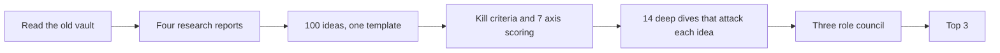

# Method and assumptions

> [!tldr] In one breath
> This note explains how the research was done, step by step, and what its weak spots are. Read the "Known limitations" list before you trust any score or ranking.

> [!example] Picture this
> A cooking show shows you the finished cake, but a good recipe card also tells you "the oven runs hot" and "we ran out of eggs and used yoghurt". This note is that honest recipe card for the whole vault.

## How the research was done

1. Looked through the existing `Agentic-Payments-Hackathon` vault for structure, frontmatter and method (read only, nothing changed).
2. Four research reports run in parallel: PayPal platform and sandbox; the event, sponsors and judges; the agentic payments landscape; problem evidence (~29k words, in `Research/`). The sandbox is PayPal's practice world with pretend money.
3. 100 ideas written to one template (problem, solution, users, AI, PayPal, competitors, differentiation, feasibility, MVP, risks, references). An MVP is the smallest version that still works, like a paper plane before the real plane.
4. Kill criteria first, then scoring on 7 axes. Kill criteria are instant "no" rules, like a height bar at a theme park ride.
5. Fourteen adversarial deep dives (competitor, novelty, feasibility, problem validation). Adversarial means the reviewer tries hard to break the idea, like a crash test.
6. A local council with three roles → Top 3.

## What the confidence marks mean

* ✅ primary source, read directly
* ⚠️ secondary, vendor or single source
* ❌ unverified
* `⚠ inference` marks a judgment call

## Known limitations (read these)

1. **Competitor checks are complete only for the 14 ideas with deep dives.** For the other 86, competitor names come from landscape scans, and "no competitor found" is not evidence of novelty. A dedicated checking pass was started, cut off by a usage limit, and not run again.
2. **Several deep dive agents went over their search budgets,** and a few (e.g. #20, #23) say their competitor searches were cut short.
3. **The council is a single model family** (equivalent to claude-council `--local`). The suggested outside council of several models was not run because no outside API keys were available.
4. **Element codes (P/A/S) and kill codes (K) were rebuilt** from how they were used, because the original legend was not saved.
5. **Sponsor tool codes S01 to S05 are inferred.**
6. **Sandbox behaviour is untested.** All ranking depends on [[63 Day-1 Sandbox Test Plan|the day 1 sandbox test plan]].
7. **Devpost entry counts are early (about 72 to 144 entries reviewed)** against an expected 550 to 1,100 submissions. Duplication risk will rise.
8. **User voices:** several quoted threads are only titles from search snippets, and are labelled as such.
9. Knowledge date: 2026-10-12.

> [!info] Update, Oct 23 2026
> Limitation 7 came true. A live scan found 266 public GitHub repos for this hackathon, including preflight-for-paypal, which does #23's core job. 18,754 people had registered (up from 11,274 on Oct 11). The llm-council skill is now installed. See [[17 Live Competition Scan (Oct 23)]] and [[70 The Winning Idea]].

## What differs from the old vault

* A 4.5 week online format instead of a 7 hour build.
* Scoring tied to the five Devpost criteria.
* Every finalist was attacked hard before ranking; demoted ideas stay visible with their reasons.

> [!info]- Jargon decoder
> **Frontmatter**: the small block of labels at the top of each note, like the tag on a suitcase.
> **Sandbox**: PayPal's test world with pretend money.
> **MVP**: minimum viable product, the smallest version that still works.
> **Kill criteria**: rules that rule an idea out at once.
> **Adversarial deep dive**: a detailed review whose job is to try to break the idea.
> **Council**: several AI helpers with different roles, compared side by side.
> **Model family**: AI models from the same maker. Using only one is like asking three siblings for independent opinions.
> **API key**: a password that lets a program use another company's service.

## Where to next
* ⬆️ Up: [[00 PayPal AI Hackathon Hub]]
* 🔗 Related: [[_Sources & Verification Log]], [[_TASKS & STATUS]], [[62 Council Reports]], [[17 Live Competition Scan (Oct 23)]]
