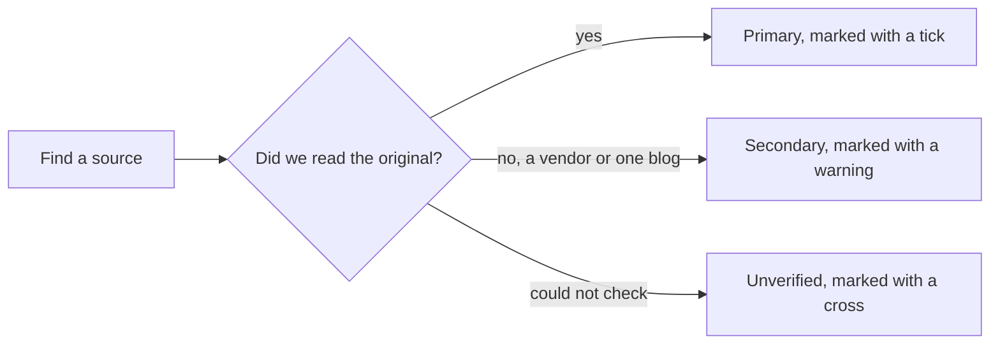

# Sources and verification log

> [!tldr] In one breath
> This is the master list of 109 sources behind the vault. Each one has a link, a trust mark (✅ ⚠️ ❌) and a count of how many ideas cite it. Most (93) are primary sources we read directly.

> [!example] Picture this
> When you write a school essay, the teacher wants a bibliography so they can check you did not make things up. This is the vault's bibliography, plus a sticker on each book saying how much to trust it.

## How to read the table

* **Key**: a short nickname for the source, used inside other notes.
* **Conf** (confidence): ✅ primary, read directly · ⚠️ secondary, vendor or single source · ❌ unverified.
* **Cited by**: how many ideas reference the source. A 0 means no idea cites it directly.
* Deep dive and research notes carry more sources inline, inside the notes themselves.

**Confidence mix: ✅ 93, ⚠️ 15, ❌ 1.** 109 sources registered.

> [!info] Update, Oct 23 2026
> New sources from the live competition scan (Devpost pages, the GitHub search API, and recaps of other agentic commerce hackathons) are listed in [[17 Live Competition Scan (Oct 23)]]. Frontier sources are in [[18 AI and Fintech Frontier (Oct 2026)]].

## The source list

| Key | Source | Conf | Cited by |
|---|---|---|---|
| `devpost-overview` | [PayPal AI Hackathon: Devpost overview](https://paypalaihackathon.devpost.com/) | ✅ | 0 |
| `devpost-rules` | [Official Rules (dates, Stage 1/2 judging, prizes)](https://paypalaihackathon.devpost.com/rules) | ✅ | 0 |
| `devpost-resources` | [Hackathon resources & inspiration list](https://paypalaihackathon.devpost.com/resources) | ✅ | 5 |
| `kickoff-video` | [Kickoff: Set Up PayPal's Sandbox and AI Toolkit From Scratch (transcript)](https://www.youtube.com/watch?v=FFJfCW9z3Do) | ✅ | 2 |
| `devpost-builtwith` | [Devpost 'Built with PayPal' listing (early-entry clustering, ~72 reviewed)](https://devpost.com/software/built-with/paypal) | ⚠️ | 12 |
| `agent-toolkit-repo` | [paypal/agent-toolkit (46 tools, v1.11.0)](https://github.com/paypal/agent-toolkit) | ✅ | 4 |
| `ai-toolkit-repo` | [paypal/AI-Toolkit (coding-agent plugin)](https://github.com/paypal/AI-Toolkit) | ✅ | 0 |
| `issue34` | [AI-Toolkit #34: hosted sandbox MCP returns PAYPAL_API_SETUP_ERROR](https://github.com/paypal/AI-Toolkit/issues/34) | ✅ | 0 |
| `issue95` | [agent-toolkit #95: no human gate or spend bound for capture](https://github.com/paypal/agent-toolkit/issues/95) | ✅ | 0 |
| `issue98` | [agent-toolkit #98: PayPal-Request-Id never set per call (no idempotency)](https://github.com/paypal/agent-toolkit/issues/98) | ✅ | 2 |
| `issue104` | [agent-toolkit #104: host-side action attestation for pay tools](https://github.com/paypal/agent-toolkit/issues/104) | ✅ | 0 |
| `issue105` | [agent-toolkit #105: host spend policy before order/invoice tools](https://github.com/paypal/agent-toolkit/issues/105) | ✅ | 0 |
| `pr107` | [agent-toolkit PR #107: add Payouts tools (open)](https://github.com/paypal/agent-toolkit/pulls) | ✅ | 1 |
| `pp-auth-honor` | [PayPal: authorization 29-day period, 3-day honor, reauth, capture ≤115%/+$75](https://developer.paypal.com/payment-methods/auth-honor.md) | ✅ | 8 |
| `pp-vault` | [PayPal Vault v3: save without purchase, charge payer-not-present](https://developer.paypal.com/api/payment-tokens/save-without-purchase/paypal.md) | ✅ | 0 |
| `pp-disputes-test` | [PayPal Disputes test & go-live: sandbox create/chargeback/adjudicate endpoints](https://developer.paypal.com/disputes/test-go-live.md) | ✅ | 13 |
| `pp-payouts-test` | [PayPal Payouts sandbox test values (ERRPYO0xx)](https://developer.paypal.com/api/payouts/test-go-live.md) | ✅ | 4 |
| `pp-tracking` | [PayPal Add Tracking API: 'fastest way to access on-hold funds'](https://developer.paypal.com/api/tracking/track-orders/integrate.md) | ✅ | 5 |
| `pp-seller-protection` | [PayPal Seller Protection Program (ship-to address rule, SNAD excluded, intangibles evidence)](https://www.paypal.com/us/legalhub/paypal/seller-protection) | ✅ | 4 |
| `pp-webhooks` | [PayPal Webhooks overview (25 retries / 3 days)](https://developer.paypal.com/api/webhooks/overview) | ✅ | 3 |
| `pp-multiseller` | [PayPal multiseller payments (10 purchase units, platform_fees)](https://developer.paypal.com/platforms/checkout/standard/customize/multiseller-payments.md) | ✅ | 1 |
| `pp-acp-doc` | [PayPal Agent Ready: ACP via Braintree (allowance max_amount/expires_at; PayPal wallet 'coming soon')](https://developer.paypal.com/agent-ready/agentic-commerce-protocol.md) | ✅ | 0 |
| `pp-webmcp-blog` | [PayPal blog: WebMCP support via JS SDK (Store Sync merchants only)](https://developer.paypal.com/community/blog/WebMCP_PayPal_Agent_Ready) | ✅ | 1 |
| `pp-ai4` | [PayPal at Ai4 2026: Merchant AI Integration Agent, Know Your Agent](https://newsroom.paypal-corp.com/2026-08-10-PayPal-Takes-Center-Stage-at-Ai4-2026) | ✅ | 1 |
| `pp-acs` | [PayPal Agentic Commerce Services (Agent Ready, Store Sync), Oct 2025](https://newsroom.paypal-corp.com/2025-10-28-PayPal-Launches-Agentic-Commerce-Services-to-Power-AI-Driven-Shopping) | ✅ | 0 |
| `pp-store-sync` | [PayPal Store Sync overview (US, physical goods, access form)](https://developer.paypal.com/store-sync/overview.md) | ✅ | 2 |
| `pp-tx-search` | [PayPal Transaction Search v1 (≤3h lag, 31-day window)](https://developer.paypal.com/docs/api/transaction-search/v1/) | ✅ | 2 |
| `pp-sandbox-repo` | [paypaldev/getting-started-with-paypal-sandbox (PayPal-Mock-Response)](https://github.com/paypaldev/getting-started-with-paypal-sandbox) | ✅ | 2 |
| `pp-fees` | [PayPal merchant fees (3.49%+$0.49; +1.5% intl; 3 to 4% FX)](https://www.paypal.com/us/webapps/mpp/merchant-fees) | ✅ | 2 |
| `pp-js-v6` | [PayPal JS SDK v6 announcement](https://developer.paypal.com/community/blog/paypal-js-sdk-v6/) | ✅ | 2 |
| `pp-mastercard` | [Mastercard × PayPal agentic commerce (Oct 2025)](https://newsroom.paypal-corp.com/2025-10-27-Mastercard-and-PayPal-Join-Forces-To-Accelerate-Secure-Global-Agentic-Commerce) | ✅ | 0 |
| `pp-ucp` | [PayPal supports Google UCP checkout (Jan 2026)](https://s205.q4cdn.com/875401827/files/doc_news/From-Search-to-Checkout-PayPal-Supports-Trusted-AI-Checkout-with-Google-2026.pdf) | ✅ | 0 |
| `pp-devdays25` | [PayPal Dev Days 2025 hackathon winners](https://developer.paypal.com/community/blog/winners-dev-days-hackathon) | ✅ | 2 |
| `worldpay-liability` | [Worldpay: 'No liability shift exists yet' for agent disputes (Jul 2026)](https://worldpay.com/insights/articles/agentic-commerce-liability-is-still-being-written) | ✅ | 5 |
| `chargeflow-reg` | [Chargeflow: agent disputes don't fit reason codes; VAMP thresholds](https://www.chargeflow.io/blog/agentic-commerce-regulation-what-merchants-need-to-know) | ⚠️ | 3 |
| `arxiv-mandate` | [Beyond the Mandate: 48 threats vs AP2 v0.2 (arXiv 2608.23858)](https://www.emergentmind.com/papers/2608.23858) | ✅ | 3 |
| `arxiv-whispers` | [Whispers of Wealth: prompt injection vs AP2 shopping agent (arXiv 2601.22569)](https://arxiv.org/abs/2601.22569v1) | ✅ | 1 |
| `arxiv-magentic` | [Magentic Marketplace: 60 to 100% first-proposal bias (arXiv 2510.25779)](https://arxiv.org/html/2510.25779v1) | ✅ | 3 |
| `arxiv-negotiation` | [The Automated but Risky Game: agent negotiation imbalance (arXiv 2506.00073)](https://arxiv.org/abs/2506.00073) | ✅ | 2 |
| `arxiv-bilateral` | [Training LMs for bilateral trade: price discrimination (arXiv 2604.16472)](https://econpapers.repec.org/paper/arxpapers/2604.16472.htm) | ✅ | 2 |
| `owasp-agentic` | [OWASP Top 10 for Agentic Applications 2026](https://genai.owasp.org/resource/owasp-top-10-for-agentic-applications-for-2026) | ✅ | 1 |
| `mastercard-vi` | [Mastercard Verifiable Intent (Mar 2026)](https://www.mastercard.com/au/en/news-and-trends/stories/2026/verifiable-intent.html) | ✅ | 2 |
| `cloudflare-tap` | [Cloudflare: signed agents, Visa TAP, Web Bot Auth](https://blog.cloudflare.com/secure-agentic-commerce/) | ✅ | 2 |
| `akamai-soti` | [Akamai SOTI 2026: commerce 47.9% of AI bot traffic; agent hijacking](https://www.akamai.com/newsroom/press-release/akamai-research-commerce-becomes-the-epicenter-for-ai-bot-attacks-and-agentic-fraud-in-2026) | ✅ | 2 |
| `adobe-ai-traffic` | [Adobe via Decrypt: AI retail traffic +393% YoY Q1 2026, converts 42% better](https://decrypt.co/364733/ai-traffic-us-retailers-jumps-q1-agentic-shoppers-outspend-humans?amp=1) | ⚠️ | 0 |
| `accenture-trust` | [Accenture 2026: only 9% would let an agent pay](https://www.thediplomat.ro/2026/06/09/accenture-study-74-of-consumers-are-ready-to-let-an-ai-agent-shop-on-their-behalf/) | ⚠️ | 1 |
| `riskified-pulse` | [Riskified Agentic Commerce Pulse Q1 2026: 46.5% trust no company](https://www.riskified.com/press/riskified-agentic-commerce-pulse/) | ✅ | 0 |
| `rtbhouse` | [RTB House survey: 35% want approval before agent completes](https://www.digitaltransactions.net/consumers-like-ai-for-product-discovery-but-dont-fully-trust-it-for-purchases/) | ⚠️ | 1 |
| `nmi-survey` | [NMI Aug 2026: 76% uncomfortable with AI completing purchases; 58% fear wrong item](https://www.nmi.com/about-us/news/nmi-research-consumers-want-ai-to-help-them-shop-not-control-their-spending/) | ✅ | 3 |
| `visa-trust` | [Visa: Earning Consumer Trust in Agentic Commerce (PayPal top-3 trusted)](https://corporate.visa.com/en/products/intelligent-commerce/earning-trust-report.html) | ✅ | 1 |
| `pa-liability` | [The Payments Association: UK merchants: no consensus on agent liability (May 2026)](https://thepaymentsassociation.org/article/agentic-commerce-uk-retail-an-unresolved-liability-question/) | ✅ | 2 |
| `mirakl-readiness` | [Mirakl via Beet.TV: <1% of product pages LLM-ready](https://www.beet.tv/2026/08/fewer-than-1-of-product-pages-are-llm-ready-mirakls-meadon.html) | ⚠️ | 3 |
| `modernretail-instant` | [Modern Retail: what went wrong with ChatGPT Instant Checkout](https://www.modernretail.co/technology/what-went-wrong-with-chatgpts-instant-checkout/) | ⚠️ | 2 |
| `cnbc-instant` | [CNBC: OpenAI revamps shopping after Instant Checkout (Mar 2026)](https://www.cnbc.com/2026/03/24/openai-revamps-shopping-experience-in-chatgpt-after-instant-checkout.html) | ⚠️ | 1 |
| `webmcp-eweek` | [eWeek: Chrome launches WebMCP early preview](https://www.eweek.com/de/news/google-webmcp-chrome-ai-web-standard-preview/) | ⚠️ | 1 |
| `webmcp-brosset` | [Patrick Brosset: WebMCP updates (navigator.modelContext, registerTool)](https://patrickbrosset.com/articles/2026-02-23-webmcp-updates-clarifications-and-next-steps/) | ⚠️ | 1 |
| `ucp-blog` | [Google Developers: Under the hood: Universal Commerce Protocol](https://developers.googleblog.com/under-the-hood-universal-commerce-protocol-ucp/) | ✅ | 1 |
| `ap2-fido` | [Google: AP2 donated to FIDO Alliance (Apr 2026)](https://blog.google/products-and-platforms/platforms/google-pay/agent-payments-protocol-fido-alliance/) | ✅ | 0 |
| `x402-lf` | [Linux Foundation: x402 Foundation launch](https://www.linuxfoundation.org/press/linux-foundation-is-launching-the-x402-foundation-and-welcoming-the-contribution-of-the-x402-protocol) | ✅ | 1 |
| `x402-survey` | [x402 Bazaar survey: 3.5% organic repeat demand (single author)](https://github.com/rikocr8orh8/x402-bazaar-survey/blob/master/POST.md) | ❌ | 1 |
| `hn-agent-payments` | [HN Algolia: 2026 'agent payments' Show HN threads](https://hn.algolia.com/api/v1/search?query=agent%20payments&tags=story&numericFilters=created_at_i>1767225600) | ✅ | 1 |
| `stripe-sessions` | [Stripe Sessions 2026 announcements (agent guardrails, Issuing for agents)](https://stripe.com/au/blog/everything-we-announced-at-sessions-2026) | ✅ | 1 |
| `ramp-agents` | [Ramp: Agent Cards, Policy Agent](https://ramp.com/blog/ai-agents-finance) | ✅ | 1 |
| `mc-chargebacks` | [Mastercard/Datos 2025 State of Chargebacks: 261M→324M by 2028; 45% fraudulent](https://www.mastercard.com/us/en/news-and-trends/Insights/2025/2025-global-chargebacks-outlook.html) | ✅ | 6 |
| `lexisnexis-tcof` | [LexisNexis True Cost of Fraud 2026: $5.13 per $1 (US retail)](https://risk.lexisnexis.com/about-us/press-room/press-release/20260624-tcof-retail-and-commerce) | ✅ | 2 |
| `cb911-report` | [Chargebacks911 2026 Field Report: SMBs represent only 60.3%; evidence collection #1 pain](https://chargebacks911.com/chargeback-field-report/) | ✅ | 5 |
| `cbio-stats` | [chargeback.io: merchants win 8.1% of all US disputes (Mastercard funnel)](https://www.chargeback.io/blog/chargeback-statistics) | ⚠️ | 1 |
| `cfpb-db` | [CFPB complaint DB: PayPal 2025: 7,464; #1 'trouble accessing funds' 1,276](https://www.consumerfinance.gov/data-research/consumer-complaints/) | ✅ | 3 |
| `trustpilot-pp` | [Trustpilot paypal.com: 1.4/5, 41,843 reviews](https://www.trustpilot.com/review/www.paypal.com) | ✅ | 1 |
| `pp-holds` | [PayPal: funds availability, holds up to 21 days](https://www.paypal.com/us/brc/article/funds-availability) | ✅ | 3 |
| `qb-late` | [QuickBooks 2026 Late Payments Report: 59% have 30+ day overdue; $17.7K owed](https://quickbooks.intuit.com/r/small-business-data/small-business-late-payments-report-2026/) | ✅ | 5 |
| `remote-freelance` | [Remote 2025: 85% of freelancers paid late sometimes](https://remote.com/blog/contractor-management/reversing-late-payment-culture) | ✅ | 2 |
| `recurly-churn` | [Recurly churn benchmarks: involuntary 1.25%/mo](https://recurly.com/research/churn-rate-benchmarks/) | ✅ | 2 |
| `baymard` | [Baymard: 70.22% cart abandonment; reasons](https://baymard.com/lists/cart-abandonment-rate) | ✅ | 1 |
| `appriss-returns` | [Appriss 2026: $100B preventable return fraud/abuse](https://apprissretail.com/2026-total-retail-loss-benchmark-report/) | ✅ | 2 |
| `nrf-returns` | [NRF/Happy Returns: $890B returns 2024](https://nrf.com/media-center/press-releases/nrf-and-happy-returns-report-2024-retail-returns-total-890-billion) | ✅ | 1 |
| `ftc-2025` | [FTC: $15.9B reported fraud losses 2025](https://www.ftc.gov/news-events/news/press-releases/2026/03/ftc-testifies-joint-economic-committee-agencys-efforts-combat-fraud) | ✅ | 1 |
| `ftc-databook24` | [FTC Consumer Sentinel Data Book 2024](https://www.ftc.gov/system/files/ftc_gov/pdf/csn-annual-data-book-2024.pdf) | ✅ | 4 |
| `ukfinance-2026` | [UK Finance Annual Fraud Report 2026: APP £576.4M; 175,809 purchase scams](https://www.ukfinance.org.uk/system/files/2026-06/UK%20Finance%20Fraud%20Report%202026.pdf) | ✅ | 3 |
| `ftc-older` | [FTC Protecting Older Consumers 2024 to 2025: $2.4B reported; $10.1 to 81.5B adjusted](https://www.ftc.gov/system/files/ftc_gov/pdf/P144400-OlderAdultsReportDec2025.pdf) | ✅ | 2 |
| `fincen-efe` | [FinCEN elder financial exploitation analysis](https://www.fincen.gov/news/news-releases/fincen-issues-analysis-elder-financial-exploitation) | ✅ | 1 |
| `ftc-amazon` | [FTC $2.5B Amazon settlement (subscription dark patterns)](https://www.ftc.gov/news-events/news/press-releases/2025/09/ftc-secures-historic-25-billion-settlement-against-amazon) | ✅ | 2 |
| `webaim` | [WebAIM Million 2026: 95.9% home pages fail WCAG](https://webaim.org/projects/million/) | ✅ | 2 |
| `findex` | [World Bank Global Findex 2025](https://www.worldbank.org/en/publication/globalfindex) | ✅ | 3 |
| `fep` | [Fundraising Effectiveness Project: 43.3% retention; donors −3.6%](https://afpglobal.org/news/fundraising-effectiveness-project-reports-strongest-revenue-growth-five-years-even-fewer) | ✅ | 1 |
| `wb-rpw` | [World Bank Remittance Prices Worldwide: 6.49% avg; SSA 8.78%](https://remittanceprices.worldbank.org/) | ✅ | 1 |
| `worldpay-gig` | [Worldpay gig workers: 81% prefer instant-payout platforms](https://www.worldpay.com/en/insights/articles/gig-workers-payments-imperative) | ✅ | 2 |
| `imperva-bots` | [Imperva 2026 Bad Bot Report: >53% automated traffic](https://www.imperva.com/blog/bad-bot-report-2026-bots-agentic-age/) | ✅ | 0 |
| `gp-15pct` | [Global Payments: consumers expect 15% of purchases by agents in 5 years](https://investors.globalpayments.com/news-events/press-releases/detail/516/consumers-expect-ai-to-make-15-of-their-purchases-within) | ✅ | 0 |
| `kcfed-b2b` | [KC Fed: B2B payments still ~90% use checks](https://www.kansascityfed.org/research/payments-system-research-briefings/b2b-payments-business-processing-and-challenges-to-achieving-straight-through-processing/) | ⚠️ | 3 |
| `fed-shed` | [Fed SHED 2025: 37% couldn't cover $400 with cash](https://www.federalreserve.gov/newsevents/pressreleases/other20260513a.htm) | ✅ | 3 |
| `cfpb-bnpl` | [CFPB BNPL report Jan 2025: 63% simultaneous loans](https://files.consumerfinance.gov/f/documents/cfpb_BNPL_Report_2025_01.pdf) | ✅ | 2 |
| `channel3-docs` | [Channel3 docs (search by text/image/URL, MCP, UCP; no checkout)](https://docs.trychannel3.com/) | ✅ | 2 |
| `kernel-payments` | [KERNEL payments doc (Stripe Link, AgentCard; no PayPal)](https://www.kernel.sh/docs/browsers/payments) | ✅ | 2 |
| `ag-studio` | [AG Studio Agent Framework (Sep 2026)](https://www.ag-grid.com/blog/introducing-the-ag-studio-agent-framework/) | ✅ | 1 |
| `ag-prize` | [Devpost AG Grid sponsor page (criteria, suggested ideas)](https://paypalaihackathon.devpost.com/details/aggrid) | ✅ | 3 |
| `bryntum-prize` | [Devpost Bryntum sponsor page (suggested ideas)](https://paypalaihackathon.devpost.com/details/bryntum) | ✅ | 1 |
| `elastic-ab` | [Elastic Agent Builder (MCP + A2A servers)](https://www.elastic.co/docs/explore-analyze/ai-features/elastic-agent-builder) | ✅ | 1 |
| `render-wf` | [Render Workflows docs](https://www.render.com/docs/workflows) | ✅ | 0 |
| `astropods` | [Astropods docs (Postman agent runtime, evaluators)](https://docs.astropods.com/) | ✅ | 0 |
| `bryntum-rules` | [Bryntum: Mats Bryntse 'keep humans in the loop where risk is high (payments)'](https://bryntum.com/blog/reflections-on-the-beyond-the-prompt-2026-conference/) | ✅ | 0 |
| `skale-x402` | [SKALE/Coinbase agentic commerce x402 hackathon winners (Feb 2026)](https://skale.space/blog/san-francisco-agentic-commerce-x402-hackathon-recap-winners) | ✅ | 0 |
| `lablab-arc` | [lablab.ai Agentic Commerce on Arc winners (Jan 2026)](https://lablab.ai/blog/agentic-commerce-on-arc-ai-hackathon) | ✅ | 0 |
| `psd3` | [Freshfields: PSD3/PSR impersonation-fraud refunds](https://www.freshfields.com/en/our-thinking/blogs/risk-and-compliance/psd3-psr-what-the-eus-new-payments-rules-mean-for-your-business-102mrom) | ⚠️ | 0 |
| `psr-app` | [UK PSR APP reimbursement dashboard](https://www.psr.org.uk/information-for-consumers/app-scams-reimbursement-dashboard) | ✅ | 0 |
| `upi-reserve` | [Razorpay: agentic payments & NPCI (UPI Reserve Pay)](https://razorpay.com/blog/agentic-payments-and-npci/) | ✅ | 1 |
| `ic3-2024` | [FBI IC3 2024 report (BEC losses)](https://www.ic3.gov/AnnualReport/Reports/2024_IC3Report.pdf) | ⚠️ | 1 |
| `zacks-pp` | [Nasdaq/Zacks: PayPal agentic meaningful 'from 2028'; branded checkout +2%](https://www.nasdaq.com/articles/paypal-agentic-payments-can-they-reshape-future-commerce) | ⚠️ | 1 |
| `klarna-agentic` | [Klarna agentic commerce: 'signals agents rely on to choose a payment provider'](https://www.klarna.com/international/enterprise/agentic-commerce/) | ✅ | 1 |

> [!info]- Jargon decoder
> **Primary source**: the original document, like reading the rule book itself rather than a friend's summary of it.
> **Secondary / vendor source**: someone reporting on the original, or a company that sells a fix for the problem it describes. Useful, but they may have a reason to exaggerate.
> **Sandbox**: PayPal's practice world with pretend money.
> **MCP**: Model Context Protocol, a standard plug that lets AI assistants use outside tools.
> **Idempotency**: making sure sending the same request twice only does it once, like a lift button that does not call two lifts if you press it twice.
> **Authorization, capture, honor period**: holding money, taking it, and the days the hold is guaranteed to work. Like a hotel holding $200 at check in and charging at check out.
> **Chargeback / dispute**: a buyer asking their bank or PayPal to reverse a payment.
> **x402, AP2, ACP, UCP**: new standards that let AI agents pay or check out. x402 uses the "402 Payment Required" web code like a coin slot on a web page.
> **WebMCP**: a way for a web page to offer tools directly to an AI assistant in the browser.
> **arXiv**: a free website where researchers post papers before or alongside formal publication.

## Where to next
* ⬆️ Up: [[00 PayPal AI Hackathon Hub]]
* 🔗 Related: [[_Method & Assumptions]], [[_TASKS & STATUS]], [[13 Problem Evidence Base]], [[17 Live Competition Scan (Oct 23)]]
