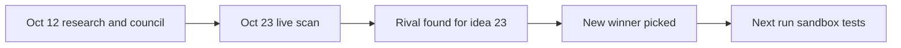

# Tasks and status (2026-10-12, updated 2026-10-23)

> [!tldr] In one breath
> The research, scoring, deep dives and council are done. On Oct 23 we renamed files, rewrote notes for easy reading, scanned the live competition, researched the frontier, installed the llm-council skill and picked a new winner. Sandbox tests and wider competitor checks are still open.

> [!example] Picture this
> It is the checklist stuck on the fridge before a family trip. Some boxes are ticked, some are not, and a few new ones got added the night before when plans changed.

## Done on 2026-10-23
* [x] 2026-10-23: renamed files to remove dashes from file names
* [x] 2026-10-23: rewrote notes in an easy reading style
* [x] 2026-10-23: live competition scan of 266 GitHub repos ([[17 Live Competition Scan (Oct 23)]])
* [x] 2026-10-23: frontier research ([[18 AI and Fintech Frontier (Oct 2026)]])
* [x] 2026-10-23: llm-council skill installed (its verdict is in [[71 Council Verdict (Oct 23)]])
* [x] 2026-10-23: new winner picked, because preflight-for-paypal now does #23's core job ([[70 The Winning Idea]])

## Done on 2026-10-12
* [x] Look through the existing vault (read only)
* [x] Research reports A to D
* [x] 100 ideas with full fields
* [x] Kill criteria and scoring of all 100
* [x] Element themes and primitives legend
* [x] 14 adversarial deep dives, Wrong Box combination
* [x] Three role council
* [x] Vault written

## Not done or still open
* [ ] Competitor checks for the 86 ideas without deep dives
* [x] Follow up competitor hunt for #23 (3 searches): found DisputeDesk, nearby but not identical. Repeat before submission
* [ ] Sandbox day 1 tests T1 to T10 ([[63 Day-1 Sandbox Test Plan]])
* [ ] Deep dive of bench ideas ([[44 Bench Ideas Not Deep-Dived]])
* [ ] Outside council using several different AI model families (the llm-council skill is installed; check [[71 Council Verdict (Oct 23)]] for which models it used)
* [ ] Add a "completed research" entry for this vault to `Research Inbox.md` (outside the vault; not done without confirmation)

> [!info]- Jargon decoder
> **Sandbox**: PayPal's practice world with pretend money.
> **Deep dive**: a detailed review that tries hard to break an idea.
> **Bench ideas**: good ideas kept in reserve, like substitutes on a football bench.
> **Council**: several AI helpers with different roles, compared side by side.
> **llm-council skill**: an installed tool that runs a question past five AI advisors who review each other.

## Where to next
* ⬆️ Up: [[00 PayPal AI Hackathon Hub]]
* 🔗 Related: [[_Method & Assumptions]], [[_Sources & Verification Log]], [[70 The Winning Idea]], [[63 Day-1 Sandbox Test Plan]]
