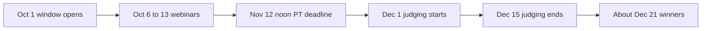
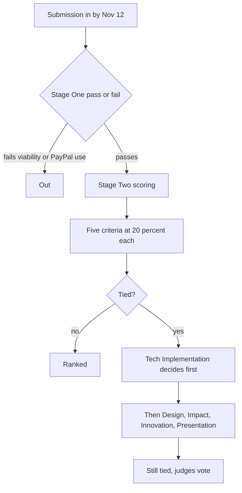

# Event, Rules and Judging Intelligence

> [!tldr] In one breath
> This note is the rulebook and the referee guide in one place. It covers the dates, the hard rules, who the judges are and what each one seems to care about, what the webinars said, and how Devpost turns all of that into a score. **The big lesson: judges may never run your code, so the video and the write up are the real product.**

> [!example] Picture this
> You are entering a cooking contest where the judges might only look at a photo and read your recipe card. They may never taste the dish. You would spend a lot of time on that photo and that card. This hackathon works the same way: a 3 minute video and a Devpost page carry most of the weight, and one judge is even allowed to be an AI.

> [!info] How sure are we?
> Researched 2026-10-11. ✅ means a primary source (official page, the person's own talk or post, the actual transcript). ⚠️ means a secondary source (press, aggregator, third party profile). ❌ means unverified or not found. `⚠ inference` marks my own judgment, not a sourced fact.

> [!success] Update Oct 23 2026
> * **Registrants are now 18,754** (up from 11,274 on Oct 11).
> * **The project gallery is still unpublished.** Devpost says "The hackathon managers haven't published this gallery yet."
> * **The judging criteria are confirmed** as: Technological Implementation, Design (a complete product, not a proof of concept), Potential Impact, Innovation ("differs from existing concepts"), and Presentation.
> * Still required: a working demo, a public open source repo with a visible license, and a YouTube video under 3 minutes.
> * See [[17 Live Competition Scan (Oct 23)]] for what other teams are building.

## Key facts at a glance

| Item | Value | Source |
|---|---|---|
| Submission window | Oct 1, 2026 9:15am PT → **Nov 12, 2026 12:00pm PT** (which is 3:00pm EST) | ✅ [Rules §1](https://paypalaihackathon.devpost.com/rules), ✅ [Dates](https://paypalaihackathon.devpost.com/details/dates) |
| Judging | Dec 1 (2pm PT) → Dec 15 (8am PT) 2026 | ✅ [Rules §1](https://paypalaihackathon.devpost.com/rules) |
| Winners announced | About Dec 21, 2026, 12:00pm EST | ✅ [Dates](https://paypalaihackathon.devpost.com/details/dates) |
| Registered participants | **11,274** on Oct 11. **18,754** on Oct 23 | ✅ [Overview](https://paypalaihackathon.devpost.com/) |
| Cash | $67,500 headline. The "Why Join" copy says "$69,750 in total prizes" (likely counting Render credits and APIMatic subscriptions) | ✅ [Overview](https://paypalaihackathon.devpost.com/) |
| Tracks | **None.** "No prescribed problem statements and no set of tracks." The one hard requirement is to "meaningfully use both PayPal and AI" | ✅ [Overview](https://paypalaihackathon.devpost.com/) |
| PayPal scope | Any PayPal family service counts: "Venmo, Braintree, Xoom, Honey, Zettle, Paidy, Hyperwallet, Simility, Swift Financial, and others", used in the free sandbox | ✅ [Rules §4](https://paypalaihackathon.devpost.com/rules) |
| Gallery | Not yet published (still true on Oct 23) | ✅ [Gallery](https://paypalaihackathon.devpost.com/project-gallery) |

> [!warning] Deadline mix up
> In the kickoff webinar Jo Franchetti said submissions close at "2:00 p.m. Pacific time" ([video](https://www.youtube.com/watch?v=FFJfCW9z3Do), ✅ transcript). The Rules say 12:00pm PT, and the Rules win in any conflict (Rules §11.4). **Plan for 12:00pm PT, which is 3:00pm EST, on Nov 12.**

### The calendar in one picture

---

## The judges: what they say and what they likely reward

**General caveat.** Rules §6 says judges "may or may not be listed individually," "may change," and judging "may utilize… **automated AI-driven analysis**." ✅ [Rules](https://paypalaihackathon.devpost.com/rules) **So write your submission so that a machine can read it too.**

### PayPal DevRel: the likely first gatekeepers

These three hosted the kickoff. They are the most likely Stage One and Honorable Mention (HM) gatekeepers. DevRel means "developer relations": the people whose job is to help outside developers succeed with PayPal.

**Jo Franchetti, Developer Advocate, PayPal (UK)**
* Profile: "Software Engineer and Developer Advocate at PayPal (UK)," focused on DX (developer experience), TypeScript and "teaching good use of the web." She mentors and promotes mental health, diversity and inclusion. ✅ [GitNation](https://gitnation.com/person/jo_franchetti). Previously DevRel at Deno. ⚠️ [WeAreDevelopers](https://www.wearedevelopers.com/@jo-franchetti) (stale profile)
* 2026 talks:
  * *"Personalisation Without the Price Tag: Local LLMs for JavaScript Developers"* (JSNation and React Summit 2026). Covers schema structured prompts, "validating and repairing unpredictable output," and running models locally to control cost and environmental impact.
  * *"npm install && pray"* (Node Congress 2026). Covers supply chain attacks, risks of AI generated code, and sandboxing untrusted code.
  * ✅ [GitNation](https://gitnation.com/person/jo_franchetti)
* Kickoff quotes: PayPal must be "central to what your project does… not something that's just bolted on." "Presentation is a full fifth of your score." "Don't leave the demo video until the last minute." ✅ [kickoff](https://www.youtube.com/watch?v=FFJfCW9z3Do)
* ⚠ inference, likely rewards: LLM output checked against a schema, with a repair loop; deliberate cost and model choices (a local or small model where it fits); security hygiene (secrets kept on the server, sandboxing, care with dependencies); accessibility and good web practice; PayPal in the core loop; a polished, clear video.

**Eddie Jaoude, Developer Advocate, PayPal (UK)**
* He is a long time open source advocate: "Open Source is about people, community and collaboration." He founded the EddieHub community and BioDrop (an open source Linktree alternative built with Next.js, Tailwind, Playwright, GitHub Actions and Kubernetes). He makes YouTube and live content including "GitHub Profiles that Stand Out," where he reviews repos live. ✅ [GitHub Stars profile](https://stars.github.com/profiles/eddiejaoude)
* Kickoff (sandbox segment): he stressed separate business and personal sandbox accounts, webhooks with signature verification, retries, debugging through event logs, and **"test the unhappy paths, not just the happy path… negative testing."** He also said "chat in public… this is a collaboration." ✅ [kickoff](https://www.youtube.com/watch?v=FFJfCW9z3Do)
* ⚠ inference, likely rewards: a **repo that looks like a real open source project**, with a clear README, LICENSE in the About panel, CONTRIBUTING, issues, CI (GitHub Actions), tests (Playwright) and a one command run. He wants webhook verification and visible handling of failure paths (declines, cancels, refunds). Public Discord participation probably helps too.

**Marco Podien, Developer Advocate, PayPal (Germany)**
* Previously a developer advocate at the Algorand Foundation. His talks cover **end to end TypeScript and type safety** and "Real-World Problems That Blockchain Actually Solves." ⚠️ [WeAreDevelopers](https://www.wearedevelopers.com/@marco-podien) (profile predates his PayPal role). PayPal DevRel job postings for Germany and the UK appeared in 2026. ⚠️ [AnitaB jobs](https://jobs.anitab.org/companies/paypal/jobs/68717394-developer-advocate-devrel-germany)
* Kickoff: "Approach your whole idea **from the idea first**. Don't look for a PayPal product… and then try to push something into it… think about a problem… then map this to the PayPal capabilities." He toured the capabilities beyond checkout (Invoicing, Subscriptions, Payouts, Disputes, Login with PayPal, Order Tracking, Fastlane, Vault, Pay Later) and pointed to the Postman collection's agentic commerce examples. ✅ [kickoff](https://www.youtube.com/watch?v=FFJfCW9z3Do)
* ⚠ inference, likely rewards: framing that starts with the problem; PayPal capabilities beyond checkout used where they fit (Payouts, Disputes, Tracking, Vault); typed code from end to end (TypeScript, Zod schemas shared between front end and back end). He may respond well to PYUSD or stablecoin use if the problem really calls for it (his Algorand background; PYUSD appeared in a 2025 PayPal hackathon winner, see [[14 Prior Winners & Duplicated Archetypes]]). Not verified.

**Nathaniel Olson, Senior Product Manager, PayPal**
* He co presented the APIMatic webinar. He described his frustration with vibe coding agents installing "SDKs that were two, three, sometimes even five years old." He championed Context Plugins internally, saying they turned "demos into somewhat of a magic trick," and he values **live demo reliability**: "I've never had a single concern while running with the context plugin." He also evaluated Context7 as an alternative. ✅ [APIMatic webinar](https://youtu.be/zRWixN68tDg)
* ⚠ inference: he appears to own AI developer tooling (Context Plugins, possibly the AI Toolkit). Likely rewards: current SDK versions (JS SDK v6, Server SDKs), error handling ready for production, and demos that work reliably from start to finish. A PM lens means a clear user and a clear problem.

**Karthik Ravi, Software Engineer, PayPal** · **Himraj Singh, Engineering Manager, PayPal**
* ❌ No attributable public talks or posts found. Searches returned only unrelated profiles or job listings.
* ⚠ inference: engineering judges probably weight Technological Implementation, which is also the first tie breaker. Expect them to look at real API depth (more than Orders create and capture), correct webhook handling, idempotency, and whether the AI does real work rather than producing text.

### Sponsor judges

They likely judge their own sponsor prize and may also sit on main panels.

**Sylwia Vargas, Senior Technical Community Manager, AG Grid**
* She was DevRel Lead at StackBlitz. Her topics are React, DX, **web accessibility**, linguistics, curriculum design and **realtime collaboration (CRDTs)**. She co organises React Robins (a community for women and non binary React developers). ⚠️ [Sessionize](https://sessionize.com/sylwia) (from before AG Grid). She is listed as contact for AG Grid's "Beyond the Prompt" conference. ✅ [agenda](https://ag-grid.com/downloads/beyond-the-prompt/beyond-the-prompt-agenda.json)
* The tone of the AG Grid prize page ("Bring your curiosity, creativity, and personality!", Friends and The Office storefront jokes) suggests she wrote it or shaped it. ⚠ inference
* ⚠ inference, likely rewards: personality and polish, custom widgets and theming (explicitly asked for), accessible UI, a dashboard for several users working together, and use of the Agent Framework beyond the defaults.

**Ameer Hassan, Co Founder (listed), APIMatic**
* His Nordic APIs bio calls him "VP Strategy & Business Development," a self described "non-developer who enjoys helping developers." He came from banking and telecom product and strategy, and his talk was "Developing a Business Case for SDKs Driven API Adoption." ⚠️ [Nordic APIs](https://nordicapis.com/speakers/ameer-hassan/) (old)
* ⚠ inference, likely rewards: a clear business case and a measurable improvement in developer experience from the plugin (for example, "integration built in X minutes, Y error paths handled").

**Mats Bryntse, CEO, Bryntum**
* He keynoted Beyond the Prompt 2026 with the talk "One-click agentic SDLC." ✅ [agenda](https://ag-grid.com/downloads/beyond-the-prompt/beyond-the-prompt-agenda.json). A Bryntum DevRel recap credits him with five rules: **"Automate what you understand." "Force evidence. Especially tests." "If the agent can't explain it, don't ship it." "Keep humans in the loop where risk is high"** (citing *payments* explicitly), and put value ahead of perfection. ✅ [Bryntum blog, May 22 2026](https://bryntum.com/blog/reflections-on-the-beyond-the-prompt-2026-conference/)
* ⚠ inference, likely rewards: scheduling driven by an agent, with explicit human approval at the points where money is at risk; tests in the repo; an agent that explains its scheduling decisions.

**Ignacio Valdez Bicard, Founding Engineer, Channel3**
* ❌ No attributable public content found.
* Company context: Channel3 is building a neutral catalog for agentic commerce and earns money through affiliate attribution on buy links. ✅ [UCP docs](https://docs.trychannel3.com/use-cases/ucp), ⚠️ [SiliconANGLE](https://siliconangle.com/2025/12/10/channel3-raises-6m-make-every-single-product-sold-web-discoverable-ai-agents/)
* ⚠ inference, likely rewards: heavy, serious API use (image or URL search, filters, offers across many retailers, enrichment) beyond a single keyword search, and a flow that ends in a real purchase. A founding engineer will notice whether the integration is deep or decorative.

**Carly Richmond, Senior Manager, Developer Advocacy, Elastic**
* Search Labs posts: **"What is context engineering?"** (Sep 4, 2025), covering prompts, RAG, memory, tools and structured outputs. It warns about "context confusion" and "context poisoning," and recommends keeping tool sets small (the RAG MCP pattern). Also "Building AI agents with AI SDK and Elastic" (Mar 2025). ✅ [author page](https://www.elastic.co/search-labs/author/carly-richmond), ✅ [article](https://www.elastic.co/search-labs/blog/context-engineering-overview). Her Devoxx UK talk "Retrieval in an AI Era" went from naive RAG through agentic RAG with reranking. ✅ [Devoxx](https://devoxx.co.uk/talk%3Fid=35454.html). She has also written on Kibana dashboard design and RUM (real user monitoring). ✅ [Elastic blog](https://www.elastic.co/blog/author/carly-richmond)
* ⚠ inference, likely rewards: deliberate retrieval (hybrid BM25 plus vector search, reranking), small curated tool sets, structured outputs, and agent evaluation, with the reasoning explained in the README.

**Pooja Mistry, Sr. Developer Advocate, Postman**
* She wrote the Astropods walkthrough (Oct 7, 2026). ✅ [Postman blog](https://blog.postman.com/build-ai-agents-with-astropods/). She ran "AI-Powered API & MCP Bootcamp" (PlatformCon, June 26, 2026). ✅ [PlatformCon](https://2026.platformcon.com/speakers/pooja-mistry). Earlier she led IBM's partnership advocacy and gave an API testing workshop. ✅ [GitNation](https://gitnation.com/person/pooja_mistry)
* ⚠ inference, likely rewards: Astropods or Postman used meaningfully (traces, evaluators, collections with tests), and a design that puts APIs first, where the agent's tools are well specified APIs.

**Shifra Williams, Founding DevRel Engineer, Render**
* Interview (Oct 2, 2026). Her guiding question is "How does this make my developer's day better?" She rejected AI generated video: "They want to hear from real people… a real human developer experience." She regrets not stressing throughput in her Workflows demo. ✅ [HackerNoon](https://hackernoon.com/how-does-this-make-my-developers-day-better-asks-render-founding-devrel-engineer-shifra-williams)
* Talks: "Building for Agent Experience" (Render's MCP server, CLI and agent skills, designed for humans *and* agents) and "Ship a Production Voice Agent" (LiveKit on Render). ✅ [GitNation](https://gitnation.com/person/shifra_williams)
* ⚠ inference, likely rewards: a real deployed service (not localhost), Workflows used for real concurrency, scale shown in the demo, and **a real human voice in the video** (avoid fully AI generated narration and avatars).

### What the judges agree on (⚠ inference)

1. **Trust and safety around money** comes up again and again: Mats (humans in the loop for payments), Jo (sandboxing, validation), Eddie (unhappy paths, webhook verification), Carly (structured outputs), Pooja (evaluators flagging PII, meaning personal data). It is valued, but **it is also the single most duplicated idea on Devpost already** (see [[14 Prior Winners & Duplicated Archetypes]]). Treat it as the minimum, not the pitch.
2. **Production realism over vibe code**: Nathaniel, Mats, APIMatic and Shifra all talk about "production-ready" code.
3. **Start from the problem, and use PayPal beyond checkout**: Marco.
4. **Open source repo quality**: Eddie, and Jo's invitation to contribute.
5. **A human, clear, 3 minute video**: Jo, Shifra, and the "Best Demo Delivery" prize.

---

## The webinars

### "Start building with PayPal" kickoff (Oct 6, 2026)

* Real YouTube title: **"Set Up PayPal's Sandbox and AI Toolkit From Scratch (Live Walkthrough)"**. Uploaded by Devpost on 2026-10-06, 44:35 long, about 1,315 views on Oct 11. Speakers were Jo Franchetti, Marco Podien and Eddie Jaoude, hosted by Darlyze Calixte (Devpost). **The full transcript was retrieved.** ✅ [YouTube](https://www.youtube.com/watch?v=FFJfCW9z3Do) (via Firecrawl's YouTube post processor)
* Chapters: 0:10 hackathon overview · 8:35 what PayPal offers · 14:20 Postman collection · 15:33 AI Toolkit · 17:38 toolkit commands · 19:08 sandbox MCP server · 23:58 docs and agent frameworks · 25:35 sandbox walkthrough · 31:20 credentials · 34:10 webhooks · 39:08 debugging · 40:35 demo project and unhappy paths. ✅

**Key takeaways** (all ✅ transcript):
* "Adding a PayPal button to an unrelated app is not going to be enough."
* The elevator pitch is framed as "what you'd say to a friend at the pub or to an investor." Existing projects are allowed if meaningfully extended. Several substantially different entries are allowed.
* **"Best demo delivery is also a real $5,000 prize. So that three-minute video could get you $5,000."**
* Prize stacking is encouraged: "you could be prize stacking."
* Example MCP prompt: "create a subscription plan at $9 a month with a two-week trial, then subscribe this test buyer."
* PayPal example code: [paypal-examples/docs-examples](https://github.com/paypal-examples/docs-examples).

> [!tip] Practical gotchas from the kickoff
> * Sandbox MCP tokens expire roughly every 9 hours. Run `/paypal:setup refresh`.
> * App feature toggles take up to 10 minutes to apply.
> * Enable Transaction Search.
> * Webhooks retry up to 25 times over 3 days. Verify webhook signatures.
> * Use ngrok or Cloudflare tunnels locally.
> * Keep sandbox personal and business accounts in the same country.

### APIMatic webinar (Oct 7 live, uploaded Oct 9)

* Title: **"Power Your PayPal Hackathon Project with APIMatic Context Plugins"**. PayPal Developer channel, 24:56, about 78 views. **The full transcript was retrieved.** ✅ [YouTube](https://youtu.be/zRWixN68tDg)
* Speakers: Nathaniel Olson (PayPal PM) and an APIMatic engineer (name transcribed as "Sohabe"; ❌ spelling unverified).
* Content: vibe coding failures caused by stale SDKs; the benchmark claim (the Context Plugin beats docs MCP, OpenAPI only and no context approaches across models from "GLM 5.3 flash" to "Opus 4.8"); the five covered APIs; a live demo building a coffee shop checkout ("Little Bean Coffees") in 5 to 7 minutes; and the prize rules (see [[15 Sponsor Tools]]).
* The demo prompt is in the video description. ⚠ inference: **expect many coffee shop and simple storefront clones built from this exact prompt. Do not look like it.**

### Still to come (as of Oct 11)

* Oct 12, 7am PT: "Build a payments dashboard without building a dashboard" (Teams; likely AG Grid). ❌ not yet held.
* Oct 13, 1am PT: an APAC repeat of "Start building with PayPal." ✅ [Overview](https://paypalaihackathon.devpost.com/)
* Other updates: "Live Build Session Oct 6," "FAQs," and "The PayPal build session recording is up." ✅ [Updates](https://paypalaihackathon.devpost.com/updates)

---

## How Devpost judging actually works

All ✅ [Rules](https://paypalaihackathon.devpost.com/rules) unless noted.

* **Stage One, pass or fail:** "whether the ideas meet a baseline level of viability… reasonably fits the theme and reasonably applies the required APIs/SDKs."
* **Stage Two:** five **equally weighted** criteria (Technological Implementation, Design, Potential Impact, Innovation/Idea, Presentation), each worth 20%.
* **Tie break order:** the criteria in listed order. **Technological Implementation first**, then Design, Impact, Innovation, Presentation. If still tied, the judges vote.
* **Judges do not have to test:** they "may choose to judge based solely on the text description, images, and video." The project must still be "available free of charge… until the Judging Period ends," with test credentials or sandbox logins in the README.
* **Video:** under 3 minutes; "judges aren't required to watch past that." It must be public on YouTube, show the project running on its target device, and contain no unlicensed music or third party trademarks. ✅ [Overview](https://paypalaihackathon.devpost.com/)
* **A working demo is required:** repo setup instructions *or* a hosted URL. "A design mockup, static prototype, or non-functional demo does not meet this requirement."
* **Repo:** must be public on GitHub, GitLab or Bitbucket, with an open source license "detectable and visible at the top of the repository page (in the About section)."
* **Judging may use "automated AI-driven analysis."** (§6)
* **Prize stacking:** at most one Grand Prize plus one Sponsor Prize, *or* one Honorable Mention plus one Sponsor Prize. You cannot win a Grand Prize and an HM together, or two sponsor prizes. ✅ Rules §8, ✅ [FAQ](https://paypalaihackathon.devpost.com/details/faqs)
* **Existing projects** must be "significantly updated" during the window, and entrants should explain how. **Multiple submissions** must be "substantially different."
* **Eligibility:** age of majority. Excludes Brazil, Quebec, Russia, Crimea, Cuba, Iran, North Korea and OFAC sanctioned countries; the exclusion applies to every team member. India is not excluded. ✅ Rules §3, FAQ. No cap on team size. ✅ FAQ

**Takeaway: Technological Implementation is worth 20% and also breaks ties, so it is the single most valuable place to be deep.**

---

## What this means for our strategy (⚠ inference throughout)

1. **Design for a judge who never runs the code.** The video and the Devpost text are the real product. Spend real effort on a tight 2:45 video: the problem in 15s, a live flow from start to finish showing the PayPal sandbox state changing (both buyer and merchant views, as Eddie demoed), and the architecture in 20s. Presentation is 20% and also unlocks the $5k Best Demo Delivery prize.
2. **Clear Stage One with no doubt.** Name the exact PayPal APIs in the first lines of the description (for example "Orders v2 + Payouts + Disputes + Webhooks via the PayPal MCP server / Server SDK"). Show PayPal in the core loop within the first 30s of the video. Because AI screening is possible, use clear headings a machine can read: "PayPal integration," "AI integration," "How to run," "Sandbox test accounts."
3. **Win the tie break with depth on Technological Implementation.** Use **at least 3 PayPal capabilities beyond basic checkout** (Payouts, Disputes, Subscriptions, Invoicing, Vault, Transaction Search, Shipment tracking), with **verified webhooks** and visible handling of unhappy paths (decline, cancel, refund, retry). Make the AI do work that matters (planning, tool calls, structured decisions), not just generate text.
4. **Do not lead with one of the 12 crowded archetypes.** If you build in one, the difference must show in the first 20 seconds. The Innovation criterion literally asks "does the project differ from existing concepts?" Judges will have seen five PayPilots. (Archetypes are listed in [[14 Prior Winners & Duplicated Archetypes]].)
5. **Treat "Design" as product completeness**, not just looks ("complete, coherent product experience … not just a technical proof of concept"). That means onboarding, empty states, error states and a real end state.
6. **Potential Impact needs a named audience and evidence** ("a credible, specific case… for a real audience"). Use a specific persona and numbers, ideally a real user quote or pilot.
7. **Play the prize portfolio:** aim for one main or HM prize plus one sponsor prize. AG Grid has the best sponsor expected value ($10k across 5 slots, with polish and agent framework criteria a strong team can hit). APIMatic is almost free to qualify for (use the plugin, answer the form question), but it can't stack with another sponsor prize, so pick the sponsor you can win most clearly. HM categories exclude Grand Prizes, so a project wins at most one of those.
8. **Hosted demo plus a one command repo.** Deploy on Render (a possible Render prize, and it satisfies "functional demo"). Add a seeded sandbox and test account credentials in the README. Include CI, tests and a LICENSE in the About panel (Eddie's lens).
9. **Show PayPal insider fluency:** current SDKs (JS SDK v6, Server SDKs), the AI Toolkit's `/paypal:doctor` passing, and ideally a merged PR to paypal/AI-Toolkit cited in the submission.
10. **Use a real human voice in the video**, not an AI avatar (Shifra's explicit stance; Jo and Eddie are human centred DevRel). Use royalty free music or none (a rules requirement).
11. **Timing:** submit drafts early. The Devpost submission is locked after Nov 12 12:00pm PT, but the repo can keep improving (judges review during Dec 1 to 15). ⚠ The Rules say judging relies on the submitted materials, so don't count on changes after the deadline.

---

## Gaps and things not verified

* Karthik Ravi, Himraj Singh, Ignacio Valdez Bicard: ❌ no public professional content found.
* Nathaniel Olson: known only from the APIMatic webinar. No other public footprint found.
* Marco Podien and Sylwia Vargas profiles predate their current roles. Their current role statements come from Devpost and the kickoff.
* Postman, Render and Zapier detail pages were read through a WebFetch summary because of a Firecrawl rate limit. Core facts (credits, trial) are consistent but not word for word.
* Devpost "Built with PayPal" attribution of projects to hackathons is inferred.
* The total final submission count is an estimate (the Oct 23 scan guesses 500 to 1,000+, an estimate, not data).

> [!info]- Jargon decoder
> **Devpost**: the website that runs the contest. Think of it as the stadium, ticket office and scoreboard in one.
> **Sandbox**: a fake copy of PayPal where money is pretend. Like a flight simulator: every button works, nobody gets hurt.
> **DevRel**: developer relations. The friendly staff whose job is to help outside coders succeed, like guides at a theme park.
> **Stage One / Stage Two**: Stage One is the bouncer at the door (are you in or out?). Stage Two is the actual scoring.
> **Tie breaker**: the rule that decides between two equal scores, like a penalty shootout after a drawn match.
> **Prize stacking**: winning more than one prize with the same project, like one cake taking "best overall" and "best decoration."
> **Webhook**: PayPal calling your server to say "something happened," like a parcel service texting you when the box arrives, instead of you checking the door every minute.
> **Signature verification**: checking a webhook really came from PayPal, like checking the wax seal on a letter.
> **Unhappy path / negative testing**: deliberately testing what happens when things go wrong (card declined, refund, cancel). Like a fire drill.
> **Idempotency**: making sure doing the same request twice has the same effect as doing it once. Like a lift button: pressing it five times still calls one lift.
> **MCP (Model Context Protocol)**: a standard plug that lets an AI use outside tools, like a universal power adapter for AI assistants.
> **AI Toolkit / Context Plugin**: add ons that teach coding assistants how to use PayPal correctly, like a cheat sheet taped inside the assistant's notebook.
> **SDK**: a ready made code kit for an API, like a flat pack furniture kit with the right screws included.
> **Vibe coding**: letting an AI write code from loose prompts without much checking. Fast, but it may grab old parts, like building with whatever is in the garage.
> **CI (GitHub Actions)**: robots that test your code every time you change it, like a spell checker that runs on every save.
> **Open source license / LICENSE**: the legal note saying others may use your code. Devpost wants it visible in the repo's About panel.
> **RAG**: retrieval augmented generation. The AI looks things up before it answers, like an open book exam.
> **BM25 plus vector, reranking**: two ways to search (keyword matching and meaning matching), then a second pass to sort the best results to the top.
> **CRDTs**: a data trick that lets several people edit the same thing at once without clashing, like Google Docs.
> **Schema validation and repair loop**: checking the AI's answer fits an exact form, and asking it to fix mistakes, like a teacher handing back homework until the blanks are filled correctly.
> **PYUSD**: PayPal's own stablecoin, a crypto token designed to always be worth one US dollar.
> **Vault**: PayPal's safe for saved payment methods, so a customer can be charged later without typing card details again.
> **OFAC**: the US office that keeps the sanctions list of countries and people you may not do business with.
> **Honorable Mention (HM)**: a named category prize, separate from the Grand Prizes.
> More terms: [[Jargon Decoder]].

## Where to next
* ⬆️ Up: [[00 PayPal AI Hackathon Hub]]
* ➡️ Next: [[11 PayPal Platform & Sandbox Capabilities]]
* 🔗 Related: [[14 Prior Winners & Duplicated Archetypes]], [[15 Sponsor Tools]], [[17 Live Competition Scan (Oct 23)]], [[70 The Winning Idea]], [[Jargon Decoder]]
