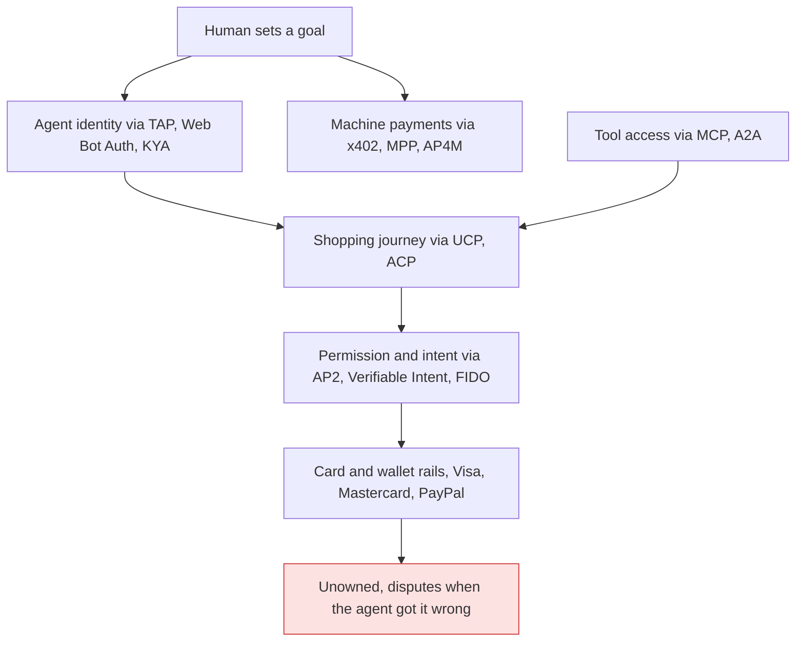
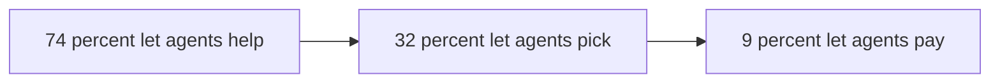

# Agentic Payments Landscape (as of 2026-10-11)

> [!tldr] In one breath
> AI agents that shop and pay for people are being built by everyone, with a dozen competing rulebooks. **Paying is mostly solved. What happens when an agent buys the wrong thing, who is to blame, and how to prove what the human wanted, is not.** That unowned gap sits right on top of PayPal's buyer protection and dispute system.

> [!example] Picture this
> You ask a friend to grab "a phone charger" on their way home. They come back with a $90 wireless charging stand. They did not steal your money, you did say "buy a charger", but it is not what you meant. Who pays for the return? Today, when the friend is an AI agent, no card network has an answer. PayPal already settles "item not as described" fights every day.

> [!success] What changed since this was written
> This note was researched on 2026-10-11. For newer developments in AI and fintech through October 2026, read [[18 AI and Fintech Frontier (Oct 2026)]].

**Purpose:** find unsolved problems and different, PayPal native opportunities for the PayPal AI Hackathon 2026. Not a hype summary.

> [!info] How sure are we?
> **Confidence:** ✅ primary source (company, regulator, standards body, paper) · ⚠️ secondary (press, analyst, vendor blog summarizing others) · ❌ unverified (single weak source, or recalled and not checked again this session) · `⚠ inference` = my analytical conclusion, not a sourced fact.
> **Status:** **[SHIPPED]** live for real users or merchants · **[PILOT]** limited or closed beta · **[ANNOUNCED]** said, not shown live · **[SPEC]** document or repo exists, adoption unclear · **[RETIRED]**.
> **Method:** web research run 2026-10-11 with web search, page fetches and the HN Algolia API. The GitHub API was blocked in this sandbox, so star counts were read from rendered repo pages on the same day and are approximate.

## Key facts at a glance

| Fact | Number or status | Source |
|---|---|---|
| ChatGPT Instant Checkout | **Retired** Mar 2026, about 6 months after launch; about 12 Shopify merchants went live | ⚠️ [CNBC](https://www.cnbc.com/2026/03/24/openai-revamps-shopping-experience-in-chatgpt-after-instant-checkout.html) |
| AI referred retail traffic | +393% YoY in Q1 2026, converting 42% better | ⚠️ [Decrypt/Adobe](https://decrypt.co/364733/ai-traffic-us-retailers-jumps-q1-agentic-shoppers-outspend-humans?amp=1) |
| Liability rule for "authorized but wrong" agent buys | **None exists** | ✅ [Worldpay](https://worldpay.com/insights/articles/agentic-commerce-liability-is-still-being-written) |
| Consumers who would let an agent pay | 9% of 25,000+ | ⚠️ [Accenture](https://www.thediplomat.ro/2026/06/09/accenture-study-74-of-consumers-are-ready-to-let-an-ai-agent-shop-on-their-behalf/) |
| x402 volume | About $24M per 30 days, falling from 2025 highs | ⚠️ [Crypto Briefing](https://cryptobriefing.com/solana-x402-market-share-dominance/) |
| PayPal's own timeline for agentic revenue | "more meaningful from 2028 onward" | ⚠️ [Nasdaq/Zacks](https://www.nasdaq.com/articles/paypal-agentic-payments-can-they-reshape-future-commerce) |
| Product pages that are LLM ready | Fewer than 1% of 500 | ⚠️ [Beet.TV](https://www.beet.tv/2026/08/fewer-than-1-of-product-pages-are-llm-ready-mirakls-meadon.html) |
| PYUSD supply | About $2.89B (Oct 6, 2026), no agent use case documented | ⚠️ [Stablecoin Insider](https://stablecoininsider.org/paypals-pyusd-q2-2026-report-supply-adoption-and-key-metrics/) |

---

## 0. The ten findings that matter most for picking an idea

1. **Checkout inside chat failed at its first try. Discovery inside chat did not.** OpenAI retired ChatGPT Instant Checkout in March 2026, about six months after launch. Only about 12 Shopify merchants went live, and Walmart saw in chat conversion about 3× lower than click out ([CNBC](https://www.cnbc.com/2026/03/24/openai-revamps-shopping-experience-in-chatgpt-after-instant-checkout.html) ⚠️, [Modern Retail](https://www.modernretail.co/technology/what-went-wrong-with-chatgpts-instant-checkout/) ⚠️, [Rye](https://rye.com/blog/openai-chatgpt-checkout-agentic-commerce) ⚠️). Meanwhile Adobe says AI referred retail traffic rose 393% YoY in Q1 2026 and now converts 42% *better* than other sources ([Decrypt summarizing Adobe](https://decrypt.co/364733/ai-traffic-us-retailers-jumps-q1-agentic-shoppers-outspend-humans?amp=1) ⚠️). → Value is moving to discovery, trust and after purchase care, not "another chat checkout button." `⚠ inference`
2. **No network has a liability rule for "authorized but wrong" agent purchases.** Worldpay's Head of Agentic Commerce wrote in July 2026 that "No liability shift exists yet" and that agent disputes that are not fraud (misread instruction, wrong item, out of scope) have no clear owner ([Worldpay](https://worldpay.com/insights/articles/agentic-commerce-liability-is-still-being-written) ✅). **This is the single biggest unowned problem, and it sits right on top of PayPal's Resolution Center and Purchase Protection.**
3. **There are too many protocols, and foundations are merging them.** AP2 went to FIDO (Apr 2026) ([Google](https://blog.google/products-and-platforms/platforms/google-pay/agent-payments-protocol-fido-alliance/) ✅). x402 went to the Linux Foundation (Apr 2026) ([LF](https://www.linuxfoundation.org/press/linux-foundation-is-launching-the-x402-foundation-and-welcoming-the-contribution-of-the-x402-protocol) ✅). EMVCo published a draft agentic framework (Sep 2026) ([Digital Transactions](https://www.digitaltransactions.net/emvcos-effort-to-reinforce-trust-in-card-based-agentic-commerce/) ⚠️). Visa now sells one integration spanning TAP, MPP, ACP and UCP ([TechInformed](https://techinformed.com/visa-opens-one-integration-for-ai-agent-payments/) ⚠️). → Building yet another protocol is low value. Building *translation, evidence and policy layers across protocols* is high value. `⚠ inference`
4. **Signed mandates do not prove intent if the agent was tricked before signing.** A systematic AP2 v0.2 analysis listed 48 threats, 8 of them High, and concluded exactly that ([Beyond the Mandate, arXiv 2608.23858](https://www.emergentmind.com/papers/2608.23858) ✅). Earlier red teaming broke a Gemini based AP2 shopping agent with simple injections ([arXiv 2601.22569](https://arxiv.org/abs/2601.22569v1) ✅).
5. **Consumers will let agents research. Very few will let them pay.** Only 9% of 25,000+ consumers would let an agent complete a purchase including payment ([Accenture via Diplomat](https://www.thediplomat.ro/2026/06/09/accenture-study-74-of-consumers-are-ready-to-let-an-ai-agent-shop-on-their-behalf/) ⚠️). 46.5% trust no company to manage purchases for them ([Riskified Q1 2026](https://www.riskified.com/press/riskified-agentic-commerce-pulse/) ✅). Trust for small purchases depends on easy returns ([RTB House via Digital Transactions](https://www.digitaltransactions.net/consumers-like-ai-for-product-discovery-but-dont-fully-trust-it-for-purchases/) ⚠️).
6. **Machine micropayments are overbuilt compared with demand.** By one analysis, x402 volume is about $24M per 30 days on Solana (about 70% share) and has "declined from its 2025 highs" ([Crypto Briefing](https://cryptobriefing.com/solana-x402-market-share-dominance/) ⚠️). An independent survey of 14,865 x402 Bazaar listings found only 3.5% with organic repeat demand, and the top 10 sellers took 89% of volume ([GitHub survey](https://github.com/rikocr8orh8/x402-bazaar-survey/blob/master/POST.md) ❌ single author).
7. **PayPal is present on the consumer checkout protocols (ACP, UCP, AP2, Copilot Checkout, Perplexity) but mostly absent from the machine payment layer.** PayPal is not named among the x402 Foundation founding members listed by the Linux Foundation and Coinbase ([LF](https://www.linuxfoundation.org/press/linux-foundation-is-launching-the-x402-foundation-and-welcoming-the-contribution-of-the-x402-protocol) ✅, [Coinbase on X](https://x.com/coinbase/status/2039689438922522728) ⚠️), nor among Mastercard's 30+ Agent Pay for Machines participants ([Mastercard](https://www.mastercard.com/us/en/news-and-trends/press/2026/june/mastercard-launches-agent-pay-for-machines.html) ✅). `⚠ inference` from absence in the published lists.
8. **PayPal's own management says agentic is a 2028+ revenue story.** Zacks reported in August 2026 that PayPal expects agentic products to "become more meaningful from 2028 onward." Branded checkout grew only 2% in Q2 2026 ([Nasdaq/Zacks](https://www.nasdaq.com/articles/paypal-agentic-payments-can-they-reshape-future-commerce) ⚠️). → A hackathon project that defends branded checkout's *trust premium* in agent flows maps directly onto the CEO's problem. `⚠ inference`
9. **Merchant data, not payments, is the bottleneck.** Fewer than 1% of 500 product pages scored 80% on Mirakl's LLM readiness test ([Beet.TV](https://www.beet.tv/2026/08/fewer-than-1-of-product-pages-are-llm-ready-mirakls-meadon.html) ⚠️). Instant Checkout lacked real time inventory, coupons, loyalty and store pickup ([Modern Retail](https://www.modernretail.co/technology/what-went-wrong-with-chatgpts-instant-checkout/) ⚠️).
10. **The legal status of agents on other companies' sites is still unsettled.** A district court blocked Perplexity's Comet from shopping on Amazon under the CFAA in March 2026 ([GeekWire](https://www.geekwire.com/2026/03/10/judge-blocks-perplexitys-ai-bot-from-shopping-on-amazon-in-early-test-of-agentic-commerce/) ⚠️). The Ninth Circuit vacated the injunction 3 to 0 in August 2026, holding that the *user* is the one accessing the site ([Sovereign Magazine](https://www.sovereignmagazine.com/article/ninth-circuit-perplexity-comet-amazon-cfaa-ruling) ⚠️). The case continues.

---

## 1. Protocols and standards (status late 2026)

### The protocol map in one picture

**Takeaway: every layer has at least one standard, except the last box. Nobody owns what happens after a correct payment for the wrong thing.**

### 1.1 Summary table

| Protocol | Owner / governance | Layer | What it actually specifies | Status | PayPal position |
|---|---|---|---|---|---|
| **AP2** (Agent Payments Protocol) | Google → **FIDO Alliance** (donated Apr 28, 2026) | Payment authorization / consent | Signed "mandates" (Intent, Cart, Payment) as verifiable credentials. v0.2 adds **"Human Not Present"** autonomous payments under instructions agreed in advance | **[SPEC]** v0.2 on GitHub (about 3.2k★). Used inside Google UCP checkout | Said it was adopting AP2 in Sep 2025 ([TechCrunch](https://techcrunch.com/2025/10/28/paypal-partners-with-openai-to-let-users-pay-for-their-shopping-within-chatgpt) ⚠️). Named FIDO supporter ([FIDO](https://fidoalliance.org/fido-alliance-to-develop-standards-for-trusted-ai-agent-interactions/) ✅) |
| **ACP** (Agentic Commerce Protocol) | OpenAI + Stripe, Apache-2.0 | Checkout + delegated payment | Checkout session API between agent and merchant. Payment via Shared Payment Token (SPT) | **[SPEC]** latest stable 2026-04-17, about 1.5k★ ([GitHub](https://github.com/agentic-commerce-protocol/agentic-commerce-protocol) ✅). Its flagship, Instant Checkout, was **[RETIRED]** in Mar 2026. Microsoft Copilot Checkout uses ACP ([Microsoft](https://about.ads.microsoft.com/en/blog/post/january-2026/conversations-that-convert-copilot-checkout-and-brand-agents) ✅) | Adopted ACP, with PayPal wallet in ChatGPT planned for 2026 ([TechCrunch](https://techcrunch.com/2025/10/28/paypal-partners-with-openai-to-let-users-pay-for-their-shopping-within-chatgpt) ⚠️). Live status after the pivot: ❌ unclear |
| **UCP** (Universal Commerce Protocol) | Google + Shopify (co devs Etsy, Wayfair, Target, Walmart), Apache-2.0 | Full journey: discovery → checkout → order → after purchase | `/.well-known/ucp` capability profile. Capabilities (Checkout, Identity Linking, Order, Payment Token Exchange) plus reverse DNS extensions. Transports REST/JSON-RPC/MCP/A2A. Payment *handlers* are separate from *instruments*. Embedded Checkout Protocol for steps that need a human (3DS, approvals) | **[SHIPPED]** in Google AI Mode/Gemini for US retailers since Jan 11, 2026 ([Google Dev Blog](https://developers.googleblog.com/under-the-hood-universal-commerce-protocol-ucp/) ✅). About 3.4k★ | Announced as a payment option in Google's UCP checkout, "will soon be available" ([PayPal PDF](https://s205.q4cdn.com/875401827/files/doc_news/From-Search-to-Checkout-PayPal-Supports-Trusted-AI-Checkout-with-Google-2026.pdf) ✅). Live status: ❌ not confirmed |
| **x402** (HTTP 402 payments) | Coinbase → **x402 Foundation @ Linux Foundation** (Apr 2, 2026) | Machine/API micropayments | Server returns 402 with payment requirements, client pays (stablecoin, mostly USDC), facilitator verifies. **V2** (Dec 11, 2025): sessions, wallet identity (SIWx/CAIP-122), Discovery extension, CAIP multi chain, fiat/card facilitators, extensions ([x402.org](https://www.x402.org/writing/x402-v2-launch) ✅) | **[SHIPPED]**. About 6.3k★ ([GitHub](https://github.com/x402-foundation/x402) ✅). Volume is modest and falling (§5) | Not in the published founding member lists. `⚠ inference` gap |
| **MPP** (Machine Payments Protocol) | Stripe + Tempo (Mar 18, 2026) | Machine payments | Agent requests resource → payment request → agent authorizes → delivery. Stablecoins on Tempo, plus cards and BNPL via SPT. Settles into the merchant's Stripe balance ([Stripe](https://stripe.com/it/blog/machine-payments-protocol) ✅) | **[SHIPPED]** on Stripe PaymentIntents | None found |
| **Visa Intelligent Commerce + Trusted Agent Protocol (TAP)** | Visa | Agent identity + tokenized credentials | TAP: agent signs HTTP requests (RFC 9421 via Web Bot Auth). Key published in a Visa hosted directory. Tag tells browsing apart from purchasing. Nonce prevents replay ([Cloudflare](https://blog.cloudflare.com/secure-agentic-commerce/) ✅) | **[PILOT]**: "hundreds of controlled" live transactions and 100+ partners as of Dec 2025 ([Visa IR](https://investor.visa.com/news/news-details/2025/Visa-and-Partners-Complete-Secure-AI-Transactions-Setting-the-Stage-for-Mainstream-Adoption-in-2026/default.aspx) ✅). **Intelligent Commerce Connect** (Apr 2026) is in pilot with Aldar, AWS, Diddo, Highnote, Mesh, Payabli and Sumvin ([TechInformed](https://techinformed.com/visa-opens-one-integration-for-ai-agent-payments/) ⚠️) | Not mentioned in VIC Connect coverage |
| **Mastercard Agent Pay / Agentic Tokens / Verifiable Intent / AP4M** | Mastercard (VI co developed with Google, donated to FIDO) | Tokens + intent evidence + machine to machine | Agentic tokens for registered agents. **Verifiable Intent** (Mar 5, 2026): a tamper resistant, selectively disclosed record that links cardholder, instructions and the agent and merchant interaction, built on FIDO/EMVCo/IETF/W3C specs ([Mastercard](https://www.mastercard.com/au/en/news-and-trends/stories/2026/verifiable-intent.html) ✅). **Agent Pay for Machines** (Jun 10, 2026): credentialing, permissioning and settlement over several rails including stablecoins, with 30+ participants ([Mastercard](https://www.mastercard.com/us/en/news-and-trends/press/2026/june/mastercard-launches-agent-pay-for-machines.html) ✅) | VI: **[SPEC]** with reference implementation. Agent Pay intent API integration "in the coming months." AP4M: **[PILOT]** | Mastercard and PayPal partnership on agentic commerce, Oct 27, 2025 ([PayPal newsroom](https://newsroom.paypal-corp.com/2025-10-27-Mastercard-and-PayPal-Join-Forces-To-Accelerate-Secure-Global-Agentic-Commerce) ✅ title only). Not named in AP4M |
| **Web Bot Auth / signed agents** | Cloudflare, IETF draft | Agent authentication at the HTTP layer | HTTP Message Signatures (RFC 9421), Ed25519, `keyid` → well known key directory. Amex also adopting ([Cloudflare](https://blog.cloudflare.com/secure-agentic-commerce/) ✅) | **[SHIPPED]** at Cloudflare. Directories are per network "to start" | No PayPal directory found. `⚠ inference` gap |
| **KYA (Know Your Agent)** | Fragmented: Skyfire KYAPay (IETF draft `draft-skyfire-kyapayprofile-01`), Sumsub AI Agent Verification (Jan 29, 2026), ERC-8004 on chain registries (Jan 29, 2026), EMVCo future work item ([BlockEden](https://blockeden.xyz/blog/2026/04/26/kya-know-your-agent-new-kyc-a16z-skyfire-fatf-compliance-battleground/) ⚠️) | Agent identity/reputation | No common standard. EMVCo lists "Know Your Agent and Agentic Transaction Indicators" as *future* work ([Digital Transactions](https://www.digitaltransactions.net/emvcos-effort-to-reinforce-trust-in-card-based-agentic-commerce/) ⚠️) | **[FRAGMENTED]** | PayPal Ventures led Kite AI's $18M Series A ("Agent Passport") ([PayPal newsroom](https://newsroom.paypal-corp.com/2025-09-02-Kite-Raises-18M-in-Series-A-Funding-To-Enforce-Trust-in-the-Agentic-Web) ✅) |
| **FIDO agent standards** | FIDO Alliance (Apr 28, 2026) | Auth + delegation | Three areas: Verifiable User Instructions, Agent Authentication, Trusted Delegation for Commerce. Payments TWG (chaired by Mastercard and Visa) starts from AP2 + Verifiable Intent ([FIDO](https://fidoalliance.org/fido-alliance-to-develop-standards-for-trusted-ai-agent-interactions/) ✅) | **[WORKING GROUP]** | PayPal quoted as supporter ✅ |
| **EMVCo Agentic Payments Framework** | EMVCo | Card rail intent coordination | "Common coordination point" so consumer intent carries across participants and recurring purchases. Feedback closed Sep 30, 2026 ([Digital Transactions](https://www.digitaltransactions.net/emvcos-effort-to-reinforce-trust-in-card-based-agentic-commerce/) ⚠️) | **[DRAFT]** | n/a (PayPal is not an EMVCo owner, `⚠ inference`) |
| **MCP for payments** | Anthropic → Agentic AI Foundation (LF) ([Anthropic](https://www.anthropic.com/news/donating-the-model-context-protocol-and-establishing-of-the-agentic-ai-foundation) ⚠️ via link) | Tool access | Payment providers ship MCP servers. UCP can bind over MCP | **[SHIPPED]** widely | PayPal Agent Toolkit (OpenAI Agents SDK, LangChain, Vercel AI SDK, MCP), about 190★ ([GitHub](https://github.com/paypal/agent-toolkit) ✅). Low developer mindshare compared with x402 (6.3k★) and AP2 (3.2k★). `⚠ inference` |
| **A2A** | Started by Google | Agent to agent messaging | UCP and AP2 bind to A2A as a transport ([Google Dev Blog](https://developers.googleblog.com/under-the-hood-universal-commerce-protocol-ucp/) ✅) | **[SPEC]** | Indirect |
| **India: UPI Reserve Pay / UPI Circle / reported "Unified Agent Protocol"** | NPCI | National rail | Reserve Pay blocks funds for a merchant (about ₹10,000 cap, up to 90 days). UPI Circle delegates authority to a secondary user, which can be an agent ([Yahoo/Reuters](https://finance.yahoo.com/technology/ai/articles/india-eyes-ai-driven-upi-084800065.html) ⚠️) | Reserve Pay **[SHIPPED]**. Agent protocol **[REPORTED]** Sep 2026 | None |

### 1.2 What none of the protocols specify

* **What happens in disputes that are not fraud.** None of AP2, ACP, UCP or VI defines what happens when a correctly signed mandate produced the wrong outcome. Mastercard's January 2026 "rules of the road" names intent, credentials and agent identity as goals but assigns no liability ([Mastercard](https://www.mastercard.com/us/en/news-and-trends/stories/2026/agentic-commerce-rules-of-the-road.html) ✅).
* **Whether the context before signing was clean.** Mandates protect data *after* signing. A2A messages and MCP tool outputs that shape the cart *before* signing are outside AP2's protection ([arXiv 2608.23858](https://www.emergentmind.com/papers/2608.23858) ✅).
* **Identity across protocols.** Visa and Mastercard each host their own agent key directory "to start" ([Cloudflare](https://blog.cloudflare.com/secure-agentic-commerce/) ✅). A merchant has to check several registries, and there is no wallet neutral one. `⚠ inference`
* **Faithfulness to the consumer's instructions.** Cloudflare raises, and does not resolve, how a merchant should honor specific instructions a consumer gave the agent ([Cloudflare](https://blog.cloudflare.com/secure-agentic-commerce/) ✅).
* **The cost of stacking protocols.** A UCP+AP2 transaction needs about four cryptographic verifications versus one for ACP's SPT ([Eco explainer](https://eco.com/support/en/articles/14839408-universal-commerce-protocol-ucp-explained) ⚠️). That burden falls on long tail merchants outside Shopify.
* **Uneven governance.** UCP remains led by Google under Apache-2.0 and has not been moved to a foundation (same source ⚠️).

---

## 2. Company landscape

### 2.1 Incumbents and platforms

| Company | What shipped (with status) | What they do NOT solve | Source |
|---|---|---|---|
| **PayPal** | Agentic Commerce Services: **Agent Ready** (existing merchants accept payments on AI surfaces) and **Store Sync** (catalog + cart + order injection) **[SHIPPED, sales led]** Oct 28, 2025. ChatGPT/ACP **[ANNOUNCED]**. Perplexity Instant Buy (about 6,000+ merchants via BigCommerce/Wix/Shopware) **[SHIPPED Nov 2025]**. Copilot Checkout partner **[SHIPPED Jan 2026]**. Google UCP **[ANNOUNCED]**. Cymbio acquisition for catalog management (Feb 2026). Hey Savi UK in app checkout with Debenhams (Jun 2026). Agent Toolkit/MCP | No public agent dispute product. No agent identity directory. No machine payment (x402/MPP class) offer. Agentic expected to matter "from 2028" | [Newsroom](https://newsroom.paypal-corp.com/2025-10-28-PayPal-Launches-Agentic-Commerce-Services-to-Power-AI-Driven-Shopping) ✅, [Dev docs](https://developer.paypal.com/agentic-commerce-services/about) ✅, [Stellagent](https://stellagent.ai/insights/paypal-agentic-commerce-strategy) ⚠️, [Retail Brew](https://www.retailbrew.com/stories/2026/02/03/payments-giant-paypal-gains-agentic-muscle-with-cymbio-deal) ⚠️, [Nasdaq/Zacks](https://www.nasdaq.com/articles/paypal-agentic-payments-can-they-reshape-future-commerce) ⚠️ |
| **Stripe** | Sessions (Apr 29, 2026). **Shipped:** Agentic Commerce Suite, MPP, SPTs (stablecoin, cards, Klarna, Affirm), Link agent wallet with spending approvals, stablecoins in 32 more markets, Privy agent wallets. **Preview:** platform ACS, Radar bot abuse (good agent vs. bad bot), Issuing for agents (single use virtual cards), agent guardrails (identity, scopes, approvals). **Announced:** UCP via Google, Meta in ad checkout, agent ready Treasury | Who owns consumer side disputes. Consumer trust across wallets. Note: "Order Intents" was **not found** in Stripe's Sessions recap ❌ | [Stripe](https://stripe.com/au/blog/everything-we-announced-at-sessions-2026) ✅ |
| **Shopify** | Agentic Storefronts (manage ChatGPT, Copilot, AI Mode and Gemini from Admin). **Catalog** (billions of products, enriched by LLMs). **Agentic plan** opens Catalog to brands not on Shopify. UCP co developer **[SHIPPED Jan 2026]**. Storefront Catalog MCP migrating to UCP ([Weaverse](https://weaverse.io/blogs/shopify-storefront-catalog-mcp-ucp-migration-hydrogen-2026) ⚠️) | Wallet and dispute neutrality (pushes Shop Pay). The long tail off Shopify | [Shopify](https://www.shopify.com/news/ai-commerce-at-scale) ✅ |
| **Google** | UCP checkout in AI Mode/Gemini (Google Pay + Wallet data). Direct Offers. AP2 → FIDO | Not wallet neutral in practice. Platform dependence | [Google](https://blog.google/products/ads-commerce/agentic-commerce-ai-tools-protocol-retailers-platforms/) ✅ |
| **OpenAI** | Instant Checkout **[RETIRED Mar 2026]**. Shopping is now discovery plus merchant apps inside ChatGPT (Instacart, Target, Expedia) | Native checkout economics | [Forrester](https://www.forrester.com/blogs/what-it-means-that-the-leader-in-agentic-commerce-just-pulled-back/) ⚠️, [CNBC](https://www.cnbc.com/2026/03/24/openai-revamps-shopping-experience-in-chatgpt-after-instant-checkout.html) ⚠️ |
| **Microsoft** | Copilot Checkout (US), merchant of record stays with merchant. PayPal, Stripe, Shopify, Etsy. Based on ACP **[SHIPPED Jan 8, 2026]**. Self reported: Copilot journeys produced 53% more purchases within 30 minutes | Disputes and identity are handed to partners | [Microsoft](https://about.ads.microsoft.com/en/blog/post/january-2026/conversations-that-convert-copilot-checkout-and-brand-agents) ✅, [Axios](https://www.axios.com/2026/01/08/microsoft-ai-copilot-checkout) ⚠️ |
| **Amazon** | **Alexa for Shopping** (May 13, 2026) replaces Rufus. Scheduled or price triggered add to cart (the user still checks out). **Buy for Me** completes purchases on third party sites with the card on file. Rufus served 300M+ customers in 2025. Suing outside agents (Perplexity) | Walled garden. Hostile to third party agents on Amazon.com | [Digital Commerce 360](https://www.digitalcommerce360.com/2026/05/13/amazon-launches-ai-agent-alexa-for-shopping/) ⚠️ |
| **Visa** | VIC, TAP, VIC Connect (pilot). Predicted "millions" of consumers using agents to buy by holiday 2026 | Liability rules. Identity outside the Visa network | [Visa IR](https://investor.visa.com/news/news-details/2025/Visa-and-Partners-Complete-Secure-AI-Transactions-Setting-the-Stage-for-Mainstream-Adoption-in-2026/default.aspx) ✅ |
| **Mastercard** | Agent Pay (2025), Verifiable Intent (spec), AP4M (pilot). Working with Microsoft on Copilot | Explicit liability allocation | §1.1 ✅ |
| **Adyen / Checkout.com / Worldpay (Global Payments)** | Quoted supporters of Verifiable Intent. Adyen is an x402 Foundation member. Adyen, Checkout.com and Global Payments are in AP4M. Adyen and Stripe are UCP endorsers | Consumer facing trust. They are B2B acquirers | [Mastercard VI](https://www.mastercard.com/au/en/news-and-trends/stories/2026/verifiable-intent.html) ✅, [LF](https://www.linuxfoundation.org/press/linux-foundation-is-launching-the-x402-foundation-and-welcoming-the-contribution-of-the-x402-protocol) ✅ |
| **Klarna** | Backs UCP and AP2 (Feb 2, 2026). Available via Stripe SPT (Mar 3, 2026). Own "Agentic Product Protocol" (feed → discoverability, 100M+ products claimed) | Credit risk specific to agents. Disputes | [Klarna](https://www.klarna.com/international/press/klarna-backs-googles-universal-commerce-protocol-ucp-to-enable-agentic/) ✅, [Klarna enterprise](https://www.klarna.com/international/enterprise/agentic-commerce/) ✅ |
| **Affirm** | Available as an SPT method on Stripe | Same | [Stripe](https://stripe.com/au/blog/everything-we-announced-at-sessions-2026) ✅ |

### 2.2 Agent payments startups

| Company | Funding | What they ship | Gap | Source |
|---|---|---|---|---|
| **Natural** | $30M Series A (Forerunner, Jul 20, 2026), $40M+ total, plus a $100M credit facility (Upper90) | Agent Pay/Request live. Accept, Cards, Credit, Direct and Billing upcoming. Own ledgering, settlement across several banks, agent identity. Openly rethinking dispute handling | Consumer side reach | [PR Newswire](https://www.prnewswire.com/news-releases/natural-raises-30m-series-a-to-build-payments-infrastructure-for-ai-agents-302829855.html) ✅, [TechCrunch](https://techcrunch.com/2026/07/20/natural-raises-30m-to-reinvent-payments-for-ai-agents-and-take-on-stripe/) ⚠️ |
| **Catena Labs** | $18M seed (a16z crypto, May 2025) | Agent Commerce Kit (ACK): identity, payments, receipts, human oversight (based on W3C VC). Aims to be a regulated, AI native financial institution | Distribution | [FinTech Futures](https://www.fintechfutures.com/fintech-start-ups/catena-labs-emerges-from-stealth-with-18m-seed-funding) ⚠️ |
| **Kite AI** | $18M Series A led by **PayPal Ventures** and General Catalyst. $33M total (Sep 2025) | Agent Passport (verifiable identity + guardrails), agent payment chain | Merchant adoption | [PayPal newsroom](https://newsroom.paypal-corp.com/2025-09-02-Kite-Raises-18M-in-Series-A-Funding-To-Enforce-Trust-in-the-Agentic-Web) ✅ |
| **Skyfire** | about $9.5M | KYAPay (signed JWT vouching for agent, principal and platform), IETF draft. Demo on Visa rails (Dec 2025). F5 bot defense integration (2026). AP4M participant | Standard adoption | [Stellagent](https://stellagent.ai/insights/agentic-commerce-infra-startups) ⚠️, [BlockEden](https://blockeden.xyz/blog/2026/04/26/kya-know-your-agent-new-kyc-a16z-skyfire-fatf-compliance-battleground/) ⚠️ |
| **Nekuda** | $5M (Madrona, with Amex Ventures and Visa Ventures) | Agent wallet / commerce SDK | Scale | [Business Wire](https://www.businesswire.com/news/home/20250514808097/en/Nekuda-Raises-$5M-Led-by-Madrona-Together-with-Amex-Ventures-and-Visa-Ventures-to-Power-Agentic-Payments) ✅ title |
| **Basis Theory** | about $33M | Tokenization vault / credential pass through for agents. Verifiable Intent supporter | Consumer UX | [Stellagent](https://stellagent.ai/insights/agentic-commerce-infra-startups) ⚠️ |
| **Rye** | about $14M | Universal checkout API for agents | Liability for failed or wrong orders | Same ⚠️ |
| **Crossmint** | ❌ funding not checked again | Agent wallets, stablecoin rails. AP4M participant | n/a | [Mastercard AP4M](https://www.mastercard.com/us/en/news-and-trends/press/2026/june/mastercard-launches-agent-pay-for-machines.html) ✅ (participation only) |
| **Payman** | ❌ not verified this session | Payouts from agents to humans (historically) | n/a | ❌ |

### 2.3 Identity and fraud players

* **Prove** launched "Verified Agent" in Oct 2025 ([Business Wire](https://www.businesswire.com/news/home/20251023729694/en/Prove-Launches-Verified-Agent-Solution-to-Secure-the-$1.7-Trillion-Agentic-Commerce-Revolution) ✅). It is a FIDO supporter ✅.
* **Sumsub** AI Agent Verification (Jan 2026) verifies the *human behind* the agent, not the agent ([BlockEden](https://blockeden.xyz/blog/2026/04/26/kya-know-your-agent-new-kyc-a16z-skyfire-fatf-compliance-battleground/) ⚠️).
* **Forter** markets identification of "legitimate AI agents, distinguishing them from bad actors" ([Forter](https://www.forter.com/ai/) ✅ marketing).
* **Riskified** runs a quarterly Agentic Commerce Pulse. Q1 2026: 46.5% trust no company to buy for them ([Riskified](https://www.riskified.com/press/riskified-agentic-commerce-pulse/) ✅).
* **Signifyd** reports orders referred by AI agents up 1,247% YoY (Oct 2025) in its network ([Signifyd](https://www.signifyd.com/blog/agentic-commerce/) ✅ vendor data).
* **Sardine** published a 2026 whitepaper, "Rethinking Fraud Prevention for Agentic Commerce" ([Sardine](https://sardine.ai/whitepapers/rethinking-fraud-prevention-for-agentic-commerce) ✅ title).
* **What fraud vendors don't solve:** they score *fraud*, not *authorized but wrong* outcomes, and they guarantee against fraud chargebacks, not "my agent misunderstood me" disputes. `⚠ inference`, consistent with [Worldpay](https://worldpay.com/insights/articles/agentic-commerce-liability-is-still-being-written) ✅.

### 2.4 B2B spend and finance agents

* **Ramp:** Policy Agent (autonomous expense review, review only by default). AP Agent (auto applies the card in vendor portals). **Agent Cards**: a tokenized virtual card per agent per task with its own limit ([Ramp](https://ramp.com/blog/ai-agents-finance) ✅). Procurement agents launched April 2026 ([Albato](https://albato.com/blog/publications/best-ai-agents-for-finance-operations) ⚠️).
* **Brex:** "Agents on Brex" for categorization, review and approval ([Brex](https://www.brex.com/platform/intelligent-finance) ✅).
* **Intuit:** AI agents in QuickBooks ([Accounting Today](https://www.accountingtoday.com/news/intuit-debuts-ai-agents-for-quickbooks) ⚠️). **Xero** acquired Melio (AP payments), and Intuit responded with agentic AI ([CPA Trendlines](https://cpatrendlines.com/?p=144490) ⚠️). **BILL:** AP/AR agents ([Albato](https://albato.com/blog/publications/best-ai-agents-for-finance-operations) ⚠️).
* **Gap:** all of these are *closed loops inside one spend platform*. Nobody reconciles agent spend that crosses wallets, cards, stablecoins and marketplaces for SMBs or freelancers, PayPal's core base. `⚠ inference`

---

## 3. Unsolved technical challenges (with evidence)

### 3.1 Liability and chargebacks when an agent buys
* **Fraud is roughly covered. Disputes are not.** With proper agent authentication and token issuance, liability follows existing tokenized transaction rules: the issuer carries fraud risk and cardholder chargeback rights remain. Disputes that are *not fraud* (misread instruction, wrong item, outside authorization) have no clear owner among issuer, acquirer, agent platform and merchant ([Worldpay](https://worldpay.com/insights/articles/agentic-commerce-liability-is-still-being-written) ✅).
* **Merchants' new exposure** (same source): disputes with no signed record of what the shopper authorized, where issuers side with the cardholder. Unverifiable "my agent went rogue" friendly fraud. "Not what I wanted" on goods that can't be returned. Confusion between bots and agents.
* **Existing thresholds don't discount agent disputes.** Visa VAMP "Excessive" at 1.5% (from Apr 2026) and Mastercard ECM tiers count all disputes no matter who started them ([Chargeflow](https://www.chargeflow.io/blog/agentic-commerce-regulation-what-merchants-need-to-know) ⚠️).
* **Reason codes don't fit.** Agent scenarios "do not fit neatly into existing reason codes" (same ⚠️).
* **US consumer law is silent.** Reg E: $50/$500/unlimited tiers. Reg Z: $50 cap and 60 day billing error notice. No CFPB guidance on AI agents found ([CFPB Reg E](https://www.consumerfinance.gov/rules-policy/regulations/1005/) ✅, [Reg Z 1026.12](https://www.consumerfinance.gov/rules-policy/regulations/1026/12/) ✅, absence per [Chargeflow](https://www.chargeflow.io/blog/agentic-commerce-regulation-what-merchants-need-to-know) ⚠️). Under the CFPB's Reg E interpretation, a consumer who grants authority to someone who exceeds it is liable unless they revoked it. Whether an agent counts as that "someone" is unresolved (same ⚠️).
* **EU:** PSD2/SCA can block agentic transactions from completing ([Worldpay](https://worldpay.com/insights/articles/agentic-commerce-liability-is-still-being-written) ✅).
* `⚠ inference`: **PayPal already rules on millions of disputes that are not card disputes** ("item not as described", "item not received") in its own rulebook. It can define an **agent dispute taxonomy and evidence standard** inside its own network without waiting for Visa, Mastercard or EMVCo.

### 3.2 Agent authentication and identity
* Signed request identity exists (TAP, Agent Pay via Web Bot Auth) but in **per network directories** ([Cloudflare](https://blog.cloudflare.com/secure-agentic-commerce/) ✅).
* KYA is fragmented across IETF drafts, vendor KYC of the principal, and on chain registries (§1.1).
* Bad actors exploit the gap. Amazon alleged Comet disguised itself as Chrome and patched around a block within 24 hours ([GeekWire](https://www.geekwire.com/2026/03/10/judge-blocks-perplexitys-ai-bot-from-shopping-on-amazon-in-early-test-of-agentic-commerce/) ⚠️).
* Akamai: "autonomous shopping agents mimic human microbehaviors," and "agent hijacking" is used to abuse stored payment credentials ([Akamai](https://www.akamai.com/newsroom/press-release/akamai-research-commerce-becomes-the-epicenter-for-ai-bot-attacks-and-agentic-fraud-in-2026) ✅).

### 3.3 Consent and intent verification
* Verifiable Intent and AP2 mandates create signed records ✅, but **the meaning gap remains**. A signature proves *what was signed*, not that the cart matched the human's goal ([arXiv 2608.23858](https://www.emergentmind.com/papers/2608.23858) ✅).
* Identical audit logs can mean different things depending on who was delegated what. That is the evidence gap a chargeback style process would need to close (arXiv 2606.09692, as summarized by [TinyFish Current](https://current.tinyfish.ai/issue/39/market-pulse/article/32344/who-pays-to-unwind-it) ❌ not read directly).
* Users want a human checkpoint: 35% want approval before completion ([RTB House](https://www.digitaltransactions.net/consumers-like-ai-for-product-discovery-but-dont-fully-trust-it-for-purchases/) ⚠️). 40% want to stay involved in at least one stage ([Accenture](https://www.thediplomat.ro/2026/06/09/accenture-study-74-of-consumers-are-ready-to-let-an-ai-agent-shop-on-their-behalf/) ⚠️).

### 3.4 Prompt injection and manipulation of shopping and payment agents
* **AP2 red team (Jan 2026):** "Branded Whisper" (ranking manipulation) and "Vault Whisper" (data theft) reliably subverted a Gemini-2.5-Flash + ADK AP2 shopping agent ([arXiv 2601.22569](https://arxiv.org/abs/2601.22569v1) ✅).
* **AP2 v0.2 systematic analysis:** 48 threats across 5 families and 5 architectures, 8 High (AIVSS), with 5 PoCs (proofs of concept) and a scanner that knows the deployment ([arXiv 2608.23858](https://www.emergentmind.com/papers/2608.23858) ✅).
* **Microsoft Magentic Marketplace (Oct 2025):** first proposal bias of 60 to 100% (a 10 to 30× advantage to whoever responds first). Welfare fell 65% (Sonnet-4) and 44% (GPT-5, minimal reasoning) going from 3 to 100 search results. GPT-4o, GPT-OSS-20B and Qwen3-4B were significantly manipulable. Frontier models resisted better ([arXiv 2510.25779](https://arxiv.org/html/2510.25779v1) ✅).
* **OWASP Top 10 for Agentic Applications (2026 edition, released Dec 2025)** ([OWASP GenAI](https://genai.owasp.org/resource/owasp-top-10-for-agentic-applications-for-2026) ✅). Goal hijacking, tool misuse and identity or privilege abuse apply directly to payment agents (`⚠ inference` mapping).
* **Task success ≠ safe execution.** Agents that completed tasks still leaked data (arXiv 2606.17114 per [TinyFish](https://current.tinyfish.ai/issue/39/market-pulse/article/32344/who-pays-to-unwind-it) ❌).

### 3.5 Hallucinated or wrong purchases
* Agents get worse with more options (Magentic, above ✅). Shopping benchmarks exist (e.g., [ShoppingBench, AAAI](https://ojs.aaai.org/index.php/AAAI/article/view/40640) ✅; [functionality grounded e-commerce benchmark, ACL 2026](https://aclanthology.org/2026.acl-long.68/) ✅), but **none measures the rate of wrong item purchases with money at stake, or the dispute cost that follows**. `⚠ inference` from benchmark scope.
* Deals between agents are "an inherently imbalanced game," and LLM quirks cause overspending or accepting unreasonable deals ([Zhu et al., arXiv 2506.00073](https://arxiv.org/abs/2506.00073) ✅).

### 3.6 Refunds and returns for agent purchases
* Shoppers worried in chat checkout would yield "five boxes when they actually just want it all in one" (Walmart). Checkout per item breaks combined shipping and returns ([Modern Retail](https://www.modernretail.co/technology/what-went-wrong-with-chatgpts-instant-checkout/) ⚠️).
* Trust for agent purchases depends on returns. The RTB House US figures (22 to 42% by generation) are for ≤$250 with a 7 day return window ([Digital Transactions](https://www.digitaltransactions.net/consumers-like-ai-for-product-discovery-but-dont-fully-trust-it-for-purchases/) ⚠️).
* UCP keeps the merchant as merchant of record and routes returns through normal merchant channels ([Eco](https://eco.com/support/en/articles/14839408-universal-commerce-protocol-ucp-explained) ⚠️). **No protocol has a widely deployed way for an agent to start a return (RMA).** `⚠ inference`. UCP has an "Order" capability, but return flows are not documented in what I reviewed.

### 3.7 Merchant catalog readiness
* Under 1% of 500 sampled product pages are "LLM-ready" ([Mirakl via Beet.TV](https://www.beet.tv/2026/08/fewer-than-1-of-product-pages-are-llm-ready-mirakls-meadon.html) ⚠️, vendor methodology).
* Missing real time inventory, promotions, loyalty and pickup sank Instant Checkout ([Modern Retail](https://www.modernretail.co/technology/what-went-wrong-with-chatgpts-instant-checkout/) ⚠️).
* Long tail merchants on WooCommerce, Magento or custom stacks are invisible to UCP agents unless they build a manifest and handler ([Eco](https://eco.com/support/en/articles/14839408-universal-commerce-protocol-ucp-explained) ⚠️). PayPal's Store Sync and Cymbio are aimed at this ([Dev docs](https://developer.paypal.com/store-sync/overview) ✅).

### 3.8 Negotiation and settlement between agents
* LLM bargaining research shows that price discrimination through a sequence of offers wins, and quick conceders (especially buyers) lose ([Bergemann et al., arXiv 2604.16472](https://econpapers.repec.org/paper/arxpapers/2604.16472.htm) ✅).
* Mastercard AP4M aims to "establish common rules" for machine to machine payments, but a partner calls it "still in their early stages" ([Mastercard](https://www.mastercard.com/us/en/news-and-trends/press/2026/june/mastercard-launches-agent-pay-for-machines.html) ✅).
* There is no escrow or conditional settlement standard for negotiated agent deals (`⚠ inference`). HN builders keep reinventing pieces of it: "pays once when the reply is lost" idempotency, authorization middleware, policy layers ([HN Algolia](https://hn.algolia.com/api/v1/search?query=agent%20payments&tags=story&numericFilters=created_at_i>1767225600) ✅).

### 3.9 Micropayments for content and APIs
* x402: about $50M cumulative and 165M transactions by late April 2026, with an average of about $0.30 per call ([Eco](https://eco.com/support/en/articles/14839400-what-is-agentic-commerce-the-2026-guide) ⚠️). Activity is falling from 2025 highs, and cumulative counts range from 120M to 187M depending on the tracker, which suggests the numbers are inflated by activity that isn't real demand ([Crypto Briefing](https://cryptobriefing.com/solana-x402-market-share-dominance/) ⚠️).
* Bazaar: median listed price $0.014 per call. 3.5% of listings have organic repeat demand. Estimated organic GMV is in the low thousands of dollars per month ([survey](https://github.com/rikocr8orh8/x402-bazaar-survey/blob/master/POST.md) ❌).
* `⚠ inference`: the bottleneck is **demand, and finding endpoints worth paying for**, not rails. Micropayments funded with normal money (no crypto wallet needed) for mainstream consumers and creators are under served.

### 3.10 Reconciliation of agent spend
* Agents pay across SPTs, virtual cards, stablecoin wallets and PayPal balances. Closed loop tools (Ramp, Brex) reconcile only their own instruments (§2.4).
* Attribution is broken. "You can sell through it, but you can't fully measure it" ([Opascope](https://opascope.com/insights/ai-shopping-assistant-guide-2026-agentic-commerce-protocols/) ⚠️).

### 3.11 Dispute evidence
* VI's selective disclosure "allows transaction details to be verified for fraud mitigation or dispute resolution," but no network rule says what evidence wins an agent dispute ([Mastercard VI](https://www.mastercard.com/au/en/news-and-trends/stories/2026/verifiable-intent.html) ✅).
* `⚠ inference`: an **"agent dispute evidence bundle"** (mandate + a hash of the context before signing + agent identity + a snapshot of merchant capabilities + delivery proof) that maps to Visa CE3.0 style compelling evidence and PayPal's own SNAD/INR rules has no owner.

### 3.12 Price discrimination against (or by) agents
* Strategic agents price discriminate effectively in bargaining ([arXiv 2604.16472](https://econpapers.repec.org/paper/arxpapers/2604.16472.htm) ✅).
* Signed agent identity (TAP's browsing vs. purchasing tags) gives merchants a clean signal to price differently for agents ([Cloudflare](https://blog.cloudflare.com/secure-agentic-commerce/) ✅). `⚠ inference`: no consumer side tool checks whether an agent was shown worse prices than a human session.

### 3.13 Accessibility
* No source found that treats shopping agents as assistive technology, or that tests agent checkout for blind or low vision users. ❌ evidence gap. `⚠ inference`: agentic checkout could be the biggest accessibility upgrade in e-commerce, and the European Accessibility Act (applies from June 2025) raises the stakes in the EU. Not checked again this session ❌.

---

## 4. Regulation and policy, 2025 to 2026 (only what matters for opportunities)

| Jurisdiction | Item | Status / dates | Why it matters for ideas | Source |
|---|---|---|---|---|
| **EU** | AI Act via **AI Omnibus** | In force Jul 27, 2026. Annex III stand alone high risk rules (incl. creditworthiness) from **Dec 2, 2027**. Embedded products Aug 2, 2028. Shopping agents are **not** an Annex III category. Art. 50 transparency obligations not delayed (fines up to €15M / 3%) | Telling consumers they are talking to an agent, and credit decisions run by agents in BNPL flows | [EU Digital Strategy](https://digital-strategy.ec.europa.eu/en/news/ai-omnibus-enters-force) ⚠️ via [Chargeflow](https://www.chargeflow.io/blog/agentic-commerce-regulation-what-merchants-need-to-know), [Jones Walker](https://www.joneswalker.com/en/insights/blogs/ai-law-blog/yes-august-2-still-matters-the-eu-approved-a-high-risk-ai-delay-but-most-trans.html) ⚠️ |
| **EU** | **PSD3 / PSR** | Agreed texts published Apr 23, 2026. **Impersonation fraud:** PSP must refund in full when spoofed via its own channels, and the burden of proof is on the PSP. **Online platforms liable to PSPs** if notified of fraudulent content and they fail to remove it | Agent impersonation scams ("I'm your PayPal agent") become PSP liabilities. Platform liability creates demand for detection | [Freshfields](https://www.freshfields.com/en/our-thinking/blogs/risk-and-compliance/psd3-psr-what-the-eus-new-payments-rules-mean-for-your-business-102mrom) ⚠️, [EP press](https://www.europarl.europa.eu/news/en/press-room/20251121IPR31540/payment-services-deal-more-protection-from-online-fraud-and-hidden-fees) ✅ |
| **UK** | PSR **APP fraud mandatory reimbursement** (since Oct 2024) | One year evaluation (Jul 1, 2026): reimbursement 54% → 65%. APP losses over Faster Payments down about 21% (about £73m/yr) | Precedent: when liability shifts to PSPs, fraud falls. A model for agent disputes | [Regulation Tomorrow](https://www.regulationtomorrow.com/2026/07/payment-fraud-falls-by-73m-following-psr-reimbursement-scheme/) ⚠️, [PSR dashboard](https://www.psr.org.uk/information-for-consumers/app-scams-reimbursement-dashboard) ✅ |
| **UK** | HM Treasury "Modernising Payment Services Regulation" consultation | Jul 14 to Oct 6, 2026 | Window for agent payment rules | [GOV.UK](https://www.gov.uk/government/consultations/modernising-payment-services-regulation) ⚠️ via Chargeflow |
| **US** | **CFPB Section 1033** (open banking) | Final rule Oct 2024. Blocked by a court. CFPB is rewriting it (fees for data access reopened). NPRM sent to OIRA Aug 2026. Apr 1, 2026 compliance date passed without enforcement. JPMorgan and Plaid paid access deal (Sep 2025) | Agents powered by bank data face unsettled access economics. Advantage to wallets that already hold the data (PayPal/Venmo) `⚠ inference` | [CRS](https://www.congress.gov/crs-product/IF13117) ✅, [Ballard/CFM](https://www.consumerfinancemonitor.com/2026/08/06/cfpb-sends-new-section-1033-open-banking-proposal-to-oira-for-review/) ⚠️, [Open Banking Tracker](https://www.openbankingtracker.com/guides/section-1033-status) ⚠️ |
| **US** | CFPB on agents | No Reg E/Z rule or guidance specific to agents found | A regulatory vacuum, so private rulebooks (like PayPal's) set the norms in practice | [Chargeflow](https://www.chargeflow.io/blog/agentic-commerce-regulation-what-merchants-need-to-know) ⚠️ |
| **US** | Federal Reserve | Gov. Waller (Sep 28, 2026): trust is the biggest barrier to purchases delegated to agents | Trust tooling lines up with policy | [Fed speech](https://www.federalreserve.gov/newsevents/speech/waller20260928a.htm) ⚠️ via Chargeflow |
| **US** | **GENIUS Act** (stablecoins) | Enacted Jul 2025. Takes effect on the earlier of **Jan 18, 2027** or 120 days after final rules. OCC NPRM Feb 25, 2026. Treasury NPRM Aug 17, 2026. Draft Treasury language reportedly would make issuers separate agent initiated from human initiated transactions in SAR reporting | PYUSD (issued by Paxos) gains regulatory clarity. Flagging agent transactions creates demand for compliance tooling | [OCC](https://www.occ.gov/news-issuances/bulletins/2026/bulletin-2026-3.html) ✅, [Treasury](https://home.treasury.gov/news/press-releases/sb0605) ✅, [Chapman tracker](https://www.chapman.com/publication-genius-act-rulemaking-tracker) ⚠️, [BlockEden](https://blockeden.xyz/blog/2026/04/26/kya-know-your-agent-new-kyc-a16z-skyfire-fatf-compliance-battleground/) ❌ (SAR draft claim) |
| **US states** | Colorado SB 26-189 (signed May 14, 2026, effective Jan 1, 2027) covers automated decisions in lending, not shopping. A Dec 11, 2025 executive order targets state AI laws | Low direct relevance | [MoFo](https://www.mofo.com/resources/insights/260515-colorado-hits-reset-ai-regulation) ⚠️ |
| **India** | NPCI agentic UPI | ChatGPT pilot with Razorpay + NPCI using **UPI Reserve Pay** (Oct 9, 2025). Claude + Razorpay + NPCI (Feb 20, 2026). Pine Labs **P3P** agent protocol on UPI live (Jun 2026). Reuters reports an NPCI **Unified Agent Protocol** for small payments without approval for each transaction (Sep 2026) | The most advanced agent design on a *national rail*. A template for delegated, capped mandates scoped to one merchant | [Reuters](https://www.reuters.com/world/india/indias-payments-authority-razorpay-launch-ai-led-payments-chatgpt-2025-10-09/) ✅, [Razorpay](https://razorpay.com/blog/agentic-payments-and-npci/) ✅, [Yahoo/Reuters](https://finance.yahoo.com/technology/ai/articles/india-eyes-ai-driven-upi-084800065.html) ⚠️ |
| **Brazil** | Pix | Iniciador claims the first agentic payment solution on an instant payment rail, via an Open Finance payment initiator license (May 2026). No BCB position specific to agents found | Pix + Open Finance lets agents start payments without cards | [NeoFeed](https://neofeed.com.br/startups/fintech-brasileira-leva-pix-a-era-da-inteligencia-artificial/en/) ⚠️ |
| **Global AML** | FATF Rec. 16 update (Jun 2025). 73% of surveyed jurisdictions have Travel Rule laws (Apr 2026) | Agent wallets moving stablecoins inherit Travel Rule duties | [BlockEden](https://blockeden.xyz/blog/2026/04/26/kya-know-your-agent-new-kyc-a16z-skyfire-fatf-compliance-battleground/) ⚠️ |

**Takeaway: in the US there is no agent rule at all, and the UK showed that moving liability to payment companies cuts fraud. A private rulebook like PayPal's can set the norm first.**

---

## 5. Market data

### 5.1 Forecasts (treat as upper bounds)
* **McKinsey:** up to **$1T** of US orchestrated retail revenue and **$3 to 5T** global by 2030. These are "as much as" framings with no published methodology in the coverage ([Digital Commerce 360](https://www.digitalcommerce360.com/2025/10/20/mckinsey-forecast-5-trillion-agentic-commerce-sales-2030/) ⚠️).
* **Morgan Stanley:** a figure of about $190 to 385B of US e-commerce by 2030 circulates ([Paz.ai title](https://www.paz.ai/blog/morgan-stanleys-385b-bet-why-agentic-commerce-is-e-commerces-biggest-opportunity-since-mobile) ❌ the page content did not contain the figures).
* **Prove** frames a "$1.7 trillion" agentic commerce opportunity ([Business Wire](https://www.businesswire.com/news/home/20251023729694/en/Prove-Launches-Verified-Agent-Solution-to-Secure-the-$1.7-Trillion-Agentic-Commerce-Revolution) ✅ vendor claim).
* **PayPal** expects more than 40% of Americans to start product discovery on AI surfaces by holiday 2026 ([Stellagent](https://stellagent.ai/insights/paypal-agentic-commerce-strategy) ⚠️).

### 5.2 Traffic and conversion
* **Adobe:** AI traffic to US retail up 4,700% YoY (Jul 2024 → Jul 2025) ([Adobe](https://business.adobe.com/blog/generative-ai-powered-shopping-rises-with-traffic-to-retail-sites) ✅ via link). Q1 2026 up 393% YoY. Holiday 2025 up 693%. In March 2026, AI traffic converted 42% better and was worth 37% more per visit; a year earlier it converted 38% worse ([Decrypt](https://decrypt.co/364733/ai-traffic-us-retailers-jumps-q1-agentic-shoppers-outspend-humans?amp=1) ⚠️).
* **Akamai SOTI (Jul 15, 2026):** commerce took **47.9%** of all AI bot traffic (Jul to Dec 2025). Training crawlers were more than 70% of AI bot triggers in commerce. Commerce phishing rose from 56.6k to 134.6k per day (Feb → Apr 2026) ([Akamai](https://www.akamai.com/newsroom/press-release/akamai-research-commerce-becomes-the-epicenter-for-ai-bot-attacks-and-agentic-fraud-in-2026) ✅).
* **Signifyd:** orders referred by AI up 1,247% and sales up 894% YoY (Oct 2025) ([Signifyd](https://www.signifyd.com/blog/agentic-commerce/) ✅ vendor).
* **Instacart:** "a very small percentage" of orders come directly through AI agents ([Modern Retail](https://www.modernretail.co/technology/what-went-wrong-with-chatgpts-instant-checkout/) ⚠️).
* **Microsoft:** journeys involving Copilot produced 53% more purchases within 30 minutes ([Microsoft](https://about.ads.microsoft.com/en/blog/post/january-2026/conversations-that-convert-copilot-checkout-and-brand-agents) ✅ self reported).

### 5.3 Consumer trust, 2025 to 2026
* **Accenture** (25k+, 16 countries, Jun 2026): 74% trust agents to *help*. 32% would let an agent pick the final product within limits. **9% would let it pay** ([Diplomat](https://www.thediplomat.ro/2026/06/09/accenture-study-74-of-consumers-are-ready-to-let-an-ai-agent-shop-on-their-behalf/) ⚠️).
* **Riskified** Q1 2026: 46.5% trust no company to manage purchases. More than half fear online fraud ([Riskified](https://ir.riskified.com/news-releases/news-release-details/riskified-study-finds-consumers-arent-ready-hand-over-control-ai) ✅).
* **RTB House** (1,840; US, UK, FR, JP, Aug 2026): 35% want human approval before completion. US trust for ≤$250 with 7 day returns: Boomers 22%, Gen X 29%, Millennials 42%, Gen Z 35% ([Digital Transactions](https://www.digitaltransactions.net/consumers-like-ai-for-product-discovery-but-dont-fully-trust-it-for-purchases/) ⚠️).
* **Adobe** survey (5k+ US): 39% have used AI for online shopping. 85% of those say it improved the experience ([Decrypt](https://decrypt.co/364733/ai-traffic-us-retailers-jumps-q1-agentic-shoppers-outspend-humans?amp=1) ⚠️).

**Takeaway: trust drops off a cliff at the moment money moves. That cliff is the product opportunity.**

### 5.4 Merchant readiness
* Mirakl: under 1% of product pages LLM ready ([Beet.TV](https://www.beet.tv/2026/08/fewer-than-1-of-product-pages-are-llm-ready-mirakls-meadon.html) ⚠️).
* Only about 12 Shopify merchants ever went live on Instant Checkout ([Rye](https://rye.com/blog/openai-chatgpt-checkout-agentic-commerce) ⚠️).
* Visa says small merchants "could move faster" on AI shopping ([PYMNTS](https://www.pymnts.com/?p=4214915) ❌ title only).

### 5.5 Machine payments
* x402: see §3.9. Claims from the Coinbase side of 160M+ transactions circulate ([KuCoin](https://www.kucoin.com/news/flash/coinbase-processes-1t-in-stablecoin-payments-annually-x402-hits-160m-transactions) ❌).
* **PYUSD:** about $2.89B supply (Oct 6, 2026), down about 31% from a $4.2B peak (Mar 5, 2026). Eighth largest USD stablecoin (about 0.9% share). 17 networks. 70 markets. **No agent payment use case documented** ([Stablecoin Insider](https://stablecoininsider.org/paypals-pyusd-q2-2026-report-supply-adoption-and-key-metrics/) ⚠️).

---

## 6. Academic and developer signal

### 6.1 Papers, 2025 to 2026
| Paper | Key result | Source |
|---|---|---|
| Magentic Marketplace (Microsoft, Oct 2025) | First proposal bias 60 to 100%. Welfare collapses with more options. Smaller models are manipulable | [arXiv 2510.25779](https://arxiv.org/html/2510.25779v1) ✅ |
| Whispers of Wealth (Jan 2026) | Prompt injection attacks on an AP2 shopping agent manipulate rankings and leak data | [arXiv 2601.22569](https://arxiv.org/abs/2601.22569v1) ✅ |
| Beyond the Mandate (2026) | 48 threats against AP2 v0.2, 8 High. Mandates don't secure the context before authorization | [arXiv 2608.23858](https://www.emergentmind.com/papers/2608.23858) ✅ |
| The Automated but Risky Game (2025) | Consumer negotiations between agents are imbalanced. Overspending risk | [arXiv 2506.00073](https://arxiv.org/abs/2506.00073) ✅ |
| Training LMs for Bilateral Trade (Apr 2026, Yale/Cowles) | 15k negotiations. Price discrimination through sequential offers wins. SFT vs. RL trade off | [arXiv 2604.16472](https://econpapers.repec.org/paper/arxpapers/2604.16472.htm) ✅ |
| ShoppingBench (AAAI) / ACL 2026 e-commerce web agent benchmark | Shopping evaluation grounded in intent | [AAAI](https://ojs.aaai.org/index.php/AAAI/article/view/40640) ✅, [ACL](https://aclanthology.org/2026.acl-long.68/) ✅ |
| arXiv 2606.09692 / 2606.17114 | Audit logs lack mandate context. Task success ≠ safe execution | via [TinyFish](https://current.tinyfish.ai/issue/39/market-pulse/article/32344/who-pays-to-unwind-it) ❌ |
| "Counterfeit Verifiability in Autonomous Agent Payments" (Jun 2026) | Preprint on fake proofs in agent payments | [Zenodo](https://zenodo.org/records/21042364) ❌ not read |

### 6.2 Open source (stars as rendered 2026-10-11, approximate)
* x402-foundation/x402 ≈ **6.3k★**, 1.8k forks. coinbase/x402 is now a dev fork ([GitHub](https://github.com/x402-foundation/x402) ✅).
* Universal-Commerce-Protocol/ucp ≈ **3.4k★** ([GitHub](https://github.com/Universal-Commerce-Protocol/ucp) ✅).
* google-agentic-commerce/AP2 ≈ **3.2k★**, 509 forks ([GitHub](https://github.com/google-agentic-commerce/AP2) ✅).
* agentic-commerce-protocol ≈ **1.5k★**. Spec 2026-04-17 ([GitHub](https://github.com/agentic-commerce-protocol/agentic-commerce-protocol) ✅).
* paypal/agent-toolkit ≈ **190★** ([GitHub](https://github.com/paypal/agent-toolkit) ✅). `⚠ inference`: PayPal's developer surface for agents is small next to the protocols. A hackathon entry that ships a strong open source PayPal × UCP/AP2 adapter fills a visible gap.
* Mastercard Verifiable Intent reference implementation ([verifiableintent.dev via Mastercard](https://www.mastercard.com/au/en/news-and-trends/stories/2026/verifiable-intent.html) ✅).

### 6.3 Developer pain points (HN 2026)
Agent payment stories got little engagement: top posts had about 3 to 12 points ([HN Algolia](https://hn.algolia.com/api/v1/search?query=agent%20payments&tags=story&numericFilters=created_at_i>1767225600) ✅). The recurring *Show HN* themes are revealing:
* **Policy and authorization layers:** "Ledge: policy layer… prevents unauthorized txns", "PaySentry: control plane", "Larkin: authorization middleware for x402", "XBPP: open standard for governing agent payments".
* **Reliability and idempotency:** "pays once when the reply is lost", "Helix: self-healing SDK".
* **Trust and credit:** "on-chain credit score for agent-to-agent payments".
* **Rails without crypto:** "agent payments by social handles (not Stripe, not bank rails)", "EUR settlement via SEPA Instant".
* `⚠ inference`: developers are building **guardrails, idempotency and credit or reputation** by hand. Those are the missing building blocks, and many are PayPal shaped (payments by social handle = Venmo, buyer protection, credit = PayPal Credit/Pay Later).

---

## 7a. Twenty emerging problems nobody owns yet

Each item: **problem** → evidence → why it's unsolved. Most are `⚠ inference` syntheses built on the cited evidence.

1. **Agent dispute taxonomy and rulings ("authorized but wrong").** Evidence: no liability shift, and agent disputes that are not fraud have no owner ([Worldpay](https://worldpay.com/insights/articles/agentic-commerce-liability-is-still-being-written) ✅). Reason codes don't fit ([Chargeflow](https://www.chargeflow.io/blog/agentic-commerce-regulation-what-merchants-need-to-know) ⚠️). Unsolved because networks move through EMVCo and FIDO on cycles of several years, and fraud vendors only guarantee fraud.
2. **Proof of the context before signing.** Evidence: mandates don't cover A2A/MCP inputs that shape the cart ([arXiv 2608.23858](https://www.emergentmind.com/papers/2608.23858) ✅). Unsolved: needs a hash or transcript of "what the agent saw and why," and no protocol requires one.
3. **Portable agent dispute evidence bundle.** Evidence: VI enables selective disclosure for disputes, but no rule defines winning evidence ([Mastercard](https://www.mastercard.com/au/en/news-and-trends/stories/2026/verifiable-intent.html) ✅). Unsolved: evidence formats differ per network and per processor.
4. **Agent identity and reputation registry that is neutral across wallets.** Evidence: Visa and Mastercard host separate directories "to start" ([Cloudflare](https://blog.cloudflare.com/secure-agentic-commerce/) ✅). KYA is fragmented ([BlockEden](https://blockeden.xyz/blog/2026/04/26/kya-know-your-agent-new-kyc-a16z-skyfire-fatf-compliance-battleground/) ⚠️). Unsolved: every registry is owned by a rail with an incentive.
5. **Returns (RMA) started by agents, and combined shipping.** Evidence: the "five boxes" problem, and returns drive trust ([Modern Retail](https://www.modernretail.co/technology/what-went-wrong-with-chatgpts-instant-checkout/) ⚠️, [RTB House](https://www.digitaltransactions.net/consumers-like-ai-for-product-discovery-but-dont-fully-trust-it-for-purchases/) ⚠️). Unsolved: in practice protocols stop at order confirmation.
6. **Graduated autonomy: consent UX between "approve every purchase" and "fully autonomous."** Evidence: 9% would let agents pay, 35% want approval, 40% want to stay involved in one stage (§5.3). AP2 v0.2 adds Human Not Present ✅. Unsolved: no consumer grade policy language ("auto buy refills under $40 from merchants with ≥X protection").
7. **A shopping agent runtime that resists injection, with guardrails that understand payments.** Evidence: AP2 agents subverted by simple prompts ✅. Akamai reports agent hijacking used to abuse stored credentials ✅. Unsolved: general LLM guardrails don't understand payment meaning (payee changes, quantity inflation, ranking manipulation).
8. **Auditing agent recommendations for first mover bias and ranking manipulation.** Evidence: 60 to 100% first proposal bias ([Magentic](https://arxiv.org/html/2510.25779v1) ✅). Unsolved: no one audits whether an agent's choice was fair to the consumer.
9. **Detecting price discrimination against agents.** Evidence: signed agent tags make agents identifiable ✅, and strategic price discrimination works ([arXiv 2604.16472](https://econpapers.repec.org/paper/arxpapers/2604.16472.htm) ✅). Unsolved: no consumer side comparison of agent vs. human quotes.
10. **Reconciling agent spend across instruments for SMBs and freelancers.** Evidence: Ramp/Brex reconcile only their own cards (§2.4). Agents pay via SPTs, stablecoins and wallets. Unsolved: no neutral ledger across rails.
11. **Agent readiness for long tail merchants not on Shopify.** Evidence: <1% of pages LLM ready ⚠️. Merchants not on Shopify must build UCP themselves ([Eco](https://eco.com/support/en/articles/14839408-universal-commerce-protocol-ucp-explained) ⚠️). Unsolved: Shopify serves its own merchants and PayPal Store Sync is sales led ✅.
12. **Real time inventory, promotions and loyalty in agent checkout.** Evidence: the missing features that sank Instant Checkout ⚠️. Unsolved: UCP extensions exist in principle, but loyalty and coupon extensions aren't standardized.
13. **Attribution and analytics for agent commerce.** Evidence: "you can't fully measure it" ([Opascope](https://opascope.com/insights/ai-shopping-assistant-guide-2026-agentic-commerce-protocols/) ⚠️). Unsolved: no standard referral or agent session identifiers in checkout data.
14. **Human step up that doesn't break the agent flow.** Evidence: UCP's ECP exists for 3DS and approvals ✅, and PSD2/SCA blocks agent flows ([Worldpay](https://worldpay.com/insights/articles/agentic-commerce-liability-is-still-being-written) ✅). Unsolved: no wallet native "push to phone, approve, resume" pattern across protocols.
15. **Micropayments in normal money for mainstream consumers and creators (no crypto wallet).** Evidence: x402 is crypto first, has low organic demand, and averages about $0.30 (§3.9). Unsolved: card economics fail below about $1, and stablecoin UX shuts out most consumers.
16. **Escrow and conditional settlement for deals between agents.** Evidence: AP4M is still defining common rules ✅. HN builders reinvent idempotency and credit ✅. Unsolved: no programmable escrow building block that is aware of disputes.
17. **Defense against agent impersonation scams ("I'm your PayPal assistant").** Evidence: PSD3/PSR makes PSPs refund impersonation via their channels and gives platforms liability ✅. Commerce phishing more than doubled (Akamai ✅). Unsolved: no verified agent badge for chat channels that consumers use.
18. **Flagging agent transactions for AML/SAR (stablecoin and fiat).** Evidence: draft Treasury requirement to separate agent initiated transactions ❌. EMVCo "Agentic Transaction Indicators" is future work ⚠️. Unsolved: no field or standard yet.
19. **Household and shared delegation (family agents, caregivers).** Evidence: UPI Circle delegates to a secondary user or agent ([Yahoo/Reuters](https://finance.yahoo.com/technology/ai/articles/india-eyes-ai-driven-upi-084800065.html) ⚠️). Nothing equivalent exists in Western wallets (`⚠ inference`). Unsolved: Western wallets have one owner only.
20. **Agent checkout designed for accessibility first.** Evidence: no research found (❌ gap). Unsolved: protocols assume a sighted human for step up and review screens.

---

## 7b. Crowded spaces to avoid (or stand apart from sharply)

1. **"Chat to checkout" for a single merchant or assistant.** OpenAI retired its own version. Google, Microsoft, Perplexity and Amazon all ship one ([CNBC](https://www.cnbc.com/2026/03/24/openai-revamps-shopping-experience-in-chatgpt-after-instant-checkout.html) ⚠️, [Microsoft](https://about.ads.microsoft.com/en/blog/post/january-2026/conversations-that-convert-copilot-checkout-and-brand-agents) ✅).
2. **New agent payment protocols.** AP2, ACP, UCP, x402, MPP, TAP, VI, KYAPay, P3P and XBPP already exist, and foundations are merging them (§1).
3. **Crypto micropayment rails / API paywalls on x402.** Activity is down from 2025 highs, 3.5% organic demand, and the top 10 sellers take 89% ([Crypto Briefing](https://cryptobriefing.com/solana-x402-market-share-dominance/) ⚠️, [survey](https://github.com/rikocr8orh8/x402-bazaar-survey/blob/master/POST.md) ❌).
4. **Agent wallets / virtual cards for agents.** Stripe Issuing for agents, Link agent wallet, Ramp Agent Cards, Privy, Coinbase Agentic Wallets, Crossmint, Nekuda, Natural Cards ([Stripe](https://stripe.com/au/blog/everything-we-announced-at-sessions-2026) ✅, [Ramp](https://ramp.com/blog/ai-agents-finance) ✅, [PR Newswire](https://www.prnewswire.com/news-releases/natural-raises-30m-series-a-to-build-payments-infrastructure-for-ai-agents-302829855.html) ✅).
5. **Generic "spending limits / policy engine for agents."** Covered by Stripe agent guardrails (preview), Ramp, Brex and several HN projects ✅.
6. **AI expense categorization and receipt bots.** Ramp, Brex, Intuit, Xero and BILL (§2.4).
7. **Basic product feed syndication to AI.** Shopify Agentic Storefronts, PayPal Store Sync, Klarna APP and Google Merchant Center (§2.1).
8. **"AI shopping assistant that finds deals."** Honey style features exist in every assistant. Alexa for Shopping already does actions triggered by price ⚠️.

---

## 7c. Where PayPal is uniquely positioned (grounded)

| PayPal asset | Why it matters for agents | Evidence | Unowned problems it maps to (7a #) |
|---|---|---|---|
| **Two sided network** (about 400M consumers, about 20M merchants) | The only player that can define agent rules on *both* sides without card network politics. Agent Ready lets existing merchants accept agent payments without new integration | [TechCrunch](https://techcrunch.com/2025/10/28/paypal-partners-with-openai-to-let-users-pay-for-their-shopping-within-chatgpt) ⚠️ (400M), [Stellagent](https://stellagent.ai/insights/paypal-agentic-commerce-agent-ready) ⚠️ (20M), [Dev docs](https://developer.paypal.com/agentic-commerce-services/about) ✅ | 1, 3, 4, 11 |
| **Buyer/Seller Protection + Resolution Center** | A private rulebook that already rules on disputes that are not card disputes. It can add "agent SNAD" or "agent out of scope" categories *now*, while networks are still drafting | Protection cited as PayPal's differentiator in ChatGPT and Google announcements ([TechCrunch](https://techcrunch.com/2025/10/28/paypal-partners-with-openai-to-let-users-pay-for-their-shopping-within-chatgpt) ⚠️, [PayPal PDF](https://s205.q4cdn.com/875401827/files/doc_news/From-Search-to-Checkout-PayPal-Supports-Trusted-AI-Checkout-with-Google-2026.pdf) ✅). Gap per [Worldpay](https://worldpay.com/insights/articles/agentic-commerce-liability-is-still-being-written) ✅ | 1, 2, 3, 5 |
| **Present on every consumer agent surface** (ACP, UCP, AP2, Copilot, Perplexity) | Can become the *wallet neutral trust layer* across protocols, the "one integration" counterpart to Visa VIC Connect on the consumer side | §1.1, §2.1 | 4, 6, 14 |
| **Venmo social graph** (TPV +14%, Pay with Venmo +44% in Q2 2026) | Payments by social handle are a recurring HN ask. Household and friend delegation ("my roommate's agent splits groceries") is unexplored | [Nasdaq/Zacks](https://www.nasdaq.com/articles/paypal-agentic-payments-can-they-reshape-future-commerce) ⚠️, [HN](https://hn.algolia.com/api/v1/search?query=agent%20payments&tags=story&numericFilters=created_at_i>1767225600) ✅ | 16, 19 |
| **Honey** (deal and price data) | A natural fit for *auditing* agent recommendations and detecting price discrimination aimed at agents, rather than yet another coupon finder | `⚠ inference`. Magentic bias evidence ✅ | 8, 9 |
| **Pay Later / BNPL** (volume +26% in Q2 2026) | Credit that knows about agents: underwriting and affordability checks when an agent proposes financing | [Nasdaq/Zacks](https://www.nasdaq.com/articles/paypal-agentic-payments-can-they-reshape-future-commerce) ⚠️ | 6 |
| **Payouts / Hyperwallet** | Payouts from agents to humans and creators (bounties, data labeling, refunds) with KYC'd recipients. Machine payment players lack networks of KYC'd payees | `⚠ inference`. ❌ Hyperwallet scale not checked again | 15, 16 |
| **Xoom** | Cross border agent remittances under rules the user sets (rate thresholds, recurring family support) | `⚠ inference`. ❌ not checked again | 6, 19 |
| **Zettle** (in person POS) | From agent to the real world: pre order or pay at pickup flows started by agents for small shops | `⚠ inference` | 11, 12 |
| **PYUSD** (≈$2.89B, 17 chains, 70 markets) | A stablecoin on a regulated path (GENIUS) for agent micropayments that start and end in normal money, *wrapped so consumers never see crypto*. PayPal is absent from x402/AP4M founding lists, which is both a gap and open space | [Stablecoin Insider](https://stablecoininsider.org/paypals-pyusd-q2-2026-report-supply-adoption-and-key-metrics/) ⚠️, [OCC](https://www.occ.gov/news-issuances/bulletins/2026/bulletin-2026-3.html) ✅ | 15, 18 |
| **Store Sync + Cymbio** | Catalog cleanup for merchants not on Shopify. Getting the long tail agent ready is a strategic counter to Shopify | [Dev docs](https://developer.paypal.com/store-sync/overview) ✅, [Retail Brew](https://www.retailbrew.com/stories/2026/02/03/payments-giant-paypal-gains-agentic-muscle-with-cymbio-deal) ⚠️ | 11, 12, 13 |
| **FIDO membership + Kite investment** | A seat at the agent authentication table and an identity bet already placed | [FIDO](https://fidoalliance.org/fido-alliance-to-develop-standards-for-trusted-ai-agent-interactions/) ✅, [Kite](https://newsroom.paypal-corp.com/2025-09-02-Kite-Raises-18M-in-Series-A-Funding-To-Enforce-Trust-in-the-Agentic-Web) ✅ | 4 |
| **Global reach + PSD3/UK APP exposure** | PayPal must handle impersonation fraud refunds under PSD3. Defense against agent impersonation is both a compliance need and a product | [Freshfields](https://www.freshfields.com/en/our-thinking/blogs/risk-and-compliance/psd3-psr-what-the-eus-new-payments-rules-mean-for-your-business-102mrom) ⚠️ | 17 |

**Strategic context (why judges may care):**
* PayPal replaced CEO Alex Chriss with Enrique Lores (from Mar 1, 2026) after branded checkout growth slowed to 1% in Q4 2025 ([Yahoo Finance](https://finance.yahoo.com/news/paypal-fires-ceo-alex-chriss-151601295.html) ⚠️). Q2 2026 branded checkout grew 2%, and agentic is framed as meaningful "from 2028" ([Nasdaq/Zacks](https://www.nasdaq.com/articles/paypal-agentic-payments-can-they-reshape-future-commerce) ⚠️).
* `⚠ inference`: a project that shows **PayPal wallet selection rising in agent flows because of protection and dispute guarantees** goes straight at branded checkout's core problem. Agents optimize for approval rates and handling after purchase, which Klarna openly markets as "the signals agents rely on to choose a payment provider" ([Klarna](https://www.klarna.com/international/enterprise/agentic-commerce/) ✅). PayPal's version would be protection guarantees in a form machines can read, which agents can weigh when picking a wallet.

**Highest leverage idea zones for the hackathon** (`⚠ inference`, ranked by evidence strength × PayPal fit × how well it demos):
1. **Agent Dispute Copilot + evidence standard.** Capture the mandate, a hash of the context before signing, agent identity and a merchant snapshot, then assemble the claim automatically in PayPal Resolution Center with a new "agent out of scope" category (#1 to 3).
2. **Graduated autonomy policy wallet.** Spending policies in plain language compile to AP2 intent mandates / PayPal vault constraints, with Venmo style household delegation (#6, #19).
3. **Agent fairness auditor using Honey data.** Flag ranking manipulation, first proposal bias and pricing aimed at agents before the user approves (#7 to 9).
4. **Agent readiness kit for the long tail.** WooCommerce/Magento → UCP manifest + PayPal Store Sync, plus inventory, promo and returns extensions (#5, #11, #12).
5. **PYUSD micropayments the consumer never sees.** PayPal balance in normal money → PYUSD settlement → endpoints compatible with x402/MPP for creators and APIs (#15).

---

### Appendix: items flagged ❌ to follow up before any pitch
* Stripe "Order Intents" (not found in the Sessions 2026 recap).
* Morgan Stanley $190 to 385B forecast (the page fetched lacked numbers).
* Payman and Crossmint funding. Hyperwallet and Xoom current scale.
* Treasury draft requiring agent vs. human SAR distinction.
* Live status of PayPal in ChatGPT (after the Instant Checkout pivot) and in Google UCP checkout.
* arXiv 2606.09692 / 2606.17114 (cited second hand).
* Whether the European Accessibility Act applies to agent checkout.

> [!info]- Jargon decoder
> **Agentic commerce / agent**: an AI that shops and pays for you, like a personal shopper you text instructions to.
> **Protocol**: an agreed rulebook so different systems can talk, like the rules of the road that let any car use any street.
> **AP2 (Agent Payments Protocol)**: Google's rulebook, now at FIDO, for signed "mandates": digital permission slips saying what the agent may buy. "Human Not Present" means the agent pays while you are away, within rules you signed earlier.
> **Mandate**: that signed permission slip. Intent mandate = "buy me running shoes under $100"; cart mandate = "these exact shoes"; payment mandate = "charge this card."
> **ACP (Agentic Commerce Protocol)**: OpenAI and Stripe's checkout rulebook for agents. Pays with a Shared Payment Token (SPT), a single use payment pass the agent hands the merchant.
> **UCP (Universal Commerce Protocol)**: Google and Shopify's rulebook for the whole trip: find, buy, track, return. Shops publish a `/.well-known/ucp` file, like a shop window sign listing what they support.
> **x402**: uses the old web error code "402 Payment Required" so a website can say "pay a few cents, then I'll answer." Like a turnstile on every page. Mostly paid with stablecoins.
> **MPP (Machine Payments Protocol)**: Stripe and Tempo's version of payments between machines.
> **TAP / Web Bot Auth**: the agent signs every web request with its own key, like a delivery driver showing a company badge at the door. A nonce stops anyone reusing a captured request.
> **Verifiable Intent**: Mastercard's tamper proof record linking you, your instructions and what the agent did, like a sealed envelope you can open only the parts of.
> **KYA (Know Your Agent)**: identity checks for AI agents, like a passport office for bots. No common standard yet.
> **FIDO / EMVCo**: industry clubs that write security standards. FIDO is behind passkeys; EMVCo is behind chip cards.
> **MCP (Model Context Protocol)**: a universal plug that lets an AI use tools. **A2A**: a standard for agents talking to other agents.
> **Stablecoin / USDC / PYUSD**: crypto tokens built to always equal one US dollar. PYUSD is PayPal's, issued by Paxos.
> **Chargeback / dispute**: a buyer asks the bank or PayPal to reverse a payment. **SNAD** = "significantly not as described"; **INR** = "item not received."
> **Liability shift**: a rule that says who pays when something goes wrong, like a rental contract saying who covers a scratch on the car.
> **Authorized but wrong**: you allowed the purchase, but the agent bought the wrong thing. Not fraud, still a problem.
> **Prompt injection**: hidden text that tricks an AI into doing something else, like a forged note slipped into a babysitter's instructions.
> **Red teaming**: friendly hackers attacking a system on purpose to find holes.
> **First proposal bias**: the agent tends to pick whoever answers first, like a hungry shopper buying from the first stall in the market.
> **Tokenization / virtual card**: replacing the real card number with a stand in code, like a coat check ticket instead of handing over your coat.
> **Merchant of record**: the business legally selling to you and handling refunds.
> **Reg E / Reg Z / CFPB**: US consumer protection rules for electronic payments and credit, and the agency that enforces them.
> **PSD2/SCA, PSD3/PSR**: EU payment laws. SCA (strong customer authentication) makes you confirm payments with a second step, which can block agents.
> **APP fraud**: "authorised push payment" scams where you are tricked into sending money yourself.
> **GENIUS Act**: the US stablecoin law. **SAR**: a suspicious activity report banks file. **AML / Travel Rule**: anti money laundering rules; the Travel Rule makes sender and receiver details travel with the payment.
> **Open banking (Section 1033)**: rules letting you share your bank data with other apps.
> **UPI / Pix**: India's and Brazil's national instant payment systems. UPI Reserve Pay blocks money for one merchant, like a deposit held at a counter.
> **Idempotency**: sending the same request twice only does it once, like a lift button.
> **Escrow**: money held by a neutral party until both sides keep their promise.
> **RMA**: return merchandise authorization, the official "yes, send it back" ticket.
> **Vault**: PayPal's safe for saved payment methods, so an agent can charge you later within limits.
> **BNPL / Pay Later**: buy now, pay in instalments.
> **GMV / TPV**: total value of goods sold, and total payment volume.
> **YoY**: year over year, compared with the same time last year.
> More terms: [[Jargon Decoder]].

## Where to next
* ⬆️ Up: [[00 PayPal AI Hackathon Hub]]
* ⬅️ Previous: [[11 PayPal Platform & Sandbox Capabilities]] · ➡️ Next: [[13 Problem Evidence Base]]
* 🔗 Related: [[18 AI and Fintech Frontier (Oct 2026)]], [[14 Prior Winners & Duplicated Archetypes]], [[16 Developer Pain, Gaps & Hidden Insights]], [[70 The Winning Idea]], [[Jargon Decoder]]
