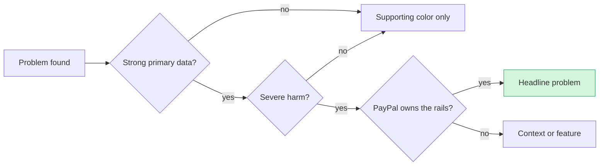
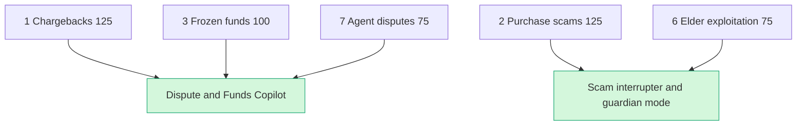

# Problem Evidence Base: the money problems AI plus PayPal could fix

> [!tldr] In one breath
> This note is our proof locker. It collects the real numbers (who loses money, how much, how often) for 25 payment problems, so our pitch can win the "Potential Impact" score with facts instead of vibes. **The strongest cases: disputes, scams, frozen PayPal funds, trust in AI shoppers, and late invoices.**

> [!example] Picture this
> A woman sells handmade candles. A buyer receives a $40 order, says "lovely!", then tells their bank the package never came. The bank takes the $40 back, adds a fee, and gives her 7 days to prove otherwise with screenshots, tracking numbers and chat logs spread across five apps. She gives up. Multiply her by millions and you get a $33.79B problem. That is the kind of story this note backs with numbers.

**Researched:** 2026-10-11 · **Purpose:** PayPal AI Hackathon 2026, "Potential Impact" criterion · **Scope:** global, leaning US and UK because that is where the primary data lives.

## How to read the confidence marks

| Mark | Meaning | Use it in a pitch? |
|---|---|---|
| ✅ Primary | I read the number on the publisher's own page or report during this session. | Yes |
| ⚠️ Secondary | It came from a reputable source quoting a primary one, or from a primary page with thin or vendor run methods. | With care |
| ❌ Unverified | A popular number I could not trace to a primary source. | **No. Keep it off slides.** |

**About the user quotes.** Reddit blocks direct scraping from this environment. Every Reddit quote below is the exact snippet a search engine stored for that URL, tagged "(snippet)". Open the thread and confirm the context before you put a quote on a slide. Trustpilot and Hacker News quotes were read on the page itself.

---

## 0. The five strongest problem cases at a glance

| # | Problem | Killer number | Why PayPal cares |
|---|---|---|---|
| 1 | Disputes and friendly fraud | Merchants win only **8.1%** of all US disputes outright | PayPal runs one of the world's biggest dispute systems |
| 2 | Getting at your own money (holds, frozen funds) | **#1** CFPB complaint about PayPal: 1,276 of 7,464 | It is PayPal's own biggest complaint |
| 3 | Late invoices | **59%** of US small businesses have invoices 30+ days overdue | PayPal already does invoicing |
| 4 | Scams in push payments and marketplaces | US fraud losses **$15.9B** in 2025 | F&F vs G&S (Friends & Family, no protection, vs Goods & Services, protected) is exactly where users get burned |
| 5 | Trust in AI shopping agents | **76%** of US adults uncomfortable with AI buying for them | PayPal is a top 3 trusted brand for shopping agents |

1. **Disputes and friendly fraud are expensive, growing, and mostly lost by merchants.** Mastercard forecasts 324M chargebacks by 2028, up 24%. Merchants call 45% of their chargebacks fraudulent. Each $1 of fraud costs US retailers $5.13. Merchants win only 8.1% of all US disputes outright. Preparing evidence is the #1 reported pain. PayPal runs one of the world's largest dispute systems (Resolution Center), so this problem sits in its core business.
2. **Getting at your own money (holds, limitations, frozen funds) is PayPal's single biggest complaint category.** In 2025, "Trouble accessing funds in your mobile or digital wallet" was the #1 issue in CFPB complaints about PayPal: 1,276 of 7,464 complaints. Trustpilot shows 1.4/5 across 41,843 reviews, 88% of them 1 star. This problem is specific to PayPal and politically sensitive, and a pitch that frames AI as *helping merchants clear holds faster* is credible.
3. **Late payment strains small business cash flow.** 59% of US small businesses have invoices 30+ days overdue, up from 47% a year earlier. Those businesses are owed $17.7K on average. 85% of freelancers are paid late at least some of the time. PayPal already does invoicing.
4. **Scams in push payments and marketplaces.** US consumers reported $15.9B in fraud losses in 2025, up from $12.5B. UK APP fraud hit £576.4M in 2025, with 175,809 purchase scam cases. 66% of UK APP fraud starts online, and 68% of Lloyds customers' fraud reports start on Meta platforms. PayPal's Friends & Family versus Goods & Services split is exactly where users get burned.
5. **Trust in agentic commerce is a brand new problem, and PayPal is already a trusted brand there.** 76% of US adults are uncomfortable with AI completing purchases for them, and 70% want to review or override first (NMI, Aug 2026). Visa found PayPal among the top 3 most trusted brands to provide shopping agents. Liability for agent made purchases is unresolved: no single answer got more than 24% of UK merchants.

---

## 1. Small business and merchant problems

### 1.1 Chargebacks, friendly fraud and the chore of gathering dispute evidence

**Who suffers:** online merchants of every size, hardest on small businesses with no fraud team. Especially digital goods, subscriptions, travel and high AOV ecommerce. PayPal merchants face both card network chargebacks and PayPal's own internal disputes.

**The numbers**

| Metric | Value | Source | Conf. |
|---|---|---|---|
| Global chargeback volume | 261M in 2025, forecast 324M by 2028 (+24%) | Mastercard / Datos Insights, *2025 State of Chargebacks*, [mastercard.com](https://www.mastercard.com/us/en/news-and-trends/Insights/2025/2025-global-chargebacks-outlook.html); PDF via [HubSpot-hosted report](https://464903.fs1.hubspotusercontent-na1.net/hubfs/464903/2025%20state%20of%20chargebacks%20report.pdf) (2025) | ✅ |
| Global chargeback value | $33.79B in 2025, forecast $41.69B in 2028 (+23%) | Same Mastercard PDF (2025) | ✅ |
| Share merchants classify as fraudulent | 45% | Mastercard (2025) | ✅ |
| Average chargeback amount | $94 across 4 countries; >50% of US merchants average >$100 | Mastercard PDF (2025) | ✅ |
| Merchants whose chargeback volume rose >10% in the past year | ~28 to 31% depending on country | Mastercard PDF (2025) | ✅ |
| Fully loaded cost per $1 of fraud, US retail and ecommerce | **$5.13** (Canada $5.23), up from ~$2.40 in 2016 | LexisNexis Risk Solutions, *2026 True Cost of Fraud: Retail & Ecommerce*, n=513, [press release 24 Jun 2026](https://risk.lexisnexis.com/about-us/press-room/press-release/20260624-tcof-retail-and-commerce) | ✅ |
| Prior year | $4.61 per $1 (US) | LexisNexis, [2 Apr 2025](https://risk.lexisnexis.com/about-us/press-room/press-release/20250402-tcof-ecommerce-and-retail) | ✅ |
| Merchant win rate on disputes they fight (US) | ~54% of representments | Mastercard / Datos data as reported by [chargeback.io](https://www.chargeback.io/blog/chargeback-statistics) (2026) | ⚠️ |
| Merchant win rate across *all* US disputes | **8.1%** outright | Same (Mastercard funnel, via chargeback.io) | ⚠️ |
| Average net recovery rate | 10.7% of cases | Chargebacks911, *2026 Chargeback Field Report*, n>250 merchants, [chargebacks911.com](https://chargebacks911.com/chargeback-field-report/) (2026) | ✅ (vendor survey) |
| Merchants who fight friendly fraud chargebacks | 76.8% overall; **only 60.3% of small businesses** (96.6% enterprise) | Chargebacks911 (2026) | ✅ (vendor survey) |
| Merchants who say they don't dispute any chargebacks | ~one third | Chargebacks911 (2026) | ✅ (vendor survey) |
| Top representment challenge | **Evidence collection** (#1 in the written answers) | Chargebacks911 (2026) | ✅ |
| Merchants using AI fraud tools | 26.7%; 37% plan to | Chargebacks911 (2026) | ✅ (vendor survey) |
| Friendly fraud share of chargebacks | Merchants estimate 43.8%; Visa cited at 75%; vendor internal data 86% | Chargebacks911 (2026), citing Visa | ⚠️ |
| Third party fee + internal labour per dispute | $46 + $82 | [chargeback.io](https://www.chargeback.io/blog/chargeback-statistics) (2026), original source unclear | ❌ |
| PayPal's own dispute fees (US) | $15 per dispute (standard), $30 (high volume); $20 chargeback fee | [PayPal merchant fees](https://www.paypal.com/us/webapps/mpp/merchant-fees), updated 1 Oct 2026 | ✅ |

**What people do today:** merchants gather screenshots, tracking numbers, delivery photos, chat logs and terms by hand under strict deadlines, often 7 to 10 days on PayPal and ~20 to 45 days on the card networks. Larger merchants pay contingency fee services such as Chargebacks911, Justt, Chargeflow or Midigator, typically 20 to 30% of recovered funds. Many small businesses simply accept the loss.

**Why current tools fail:** outsourced representment is priced for mid market and enterprise. Small merchants have the lowest representment rate (60.3%) precisely because the effort isn't worth it on a $40 order. Evidence lives scattered across Shopify, shipping carriers, email and PayPal. Reason code rules differ by network, and AI is barely deployed (26.7%). **The small seller is the one left behind.**

**User voices**
* "Customers don't immediately recognize the charge on their statement, they're more likely to dispute it rather than contact you first." Thread: "Chargebacks are killing small businesses." [r/smallbusiness](https://www.reddit.com/r/smallbusiness/comments/1kd5oy5/chargebacks_are_killing_small_businesses/) (snippet)
* Thread title: "Customer got the product and explicitly said it was worth it… then [charged back]." [r/smallbusiness](https://www.reddit.com/r/smallbusiness/comments/1isquq3/customer_got_the_product_and_explicitly_said_it/) (snippet)
* "How to fight a USD5200 chargeback?" [r/smallbusiness](https://www.reddit.com/r/smallbusiness/comments/1g0rxx0/how_to_fight_a_usd5200_chargeback/) (snippet)
* Thread title: "Chargeback fraud or 'friendly fraud' is out of control." [r/PersonalFinanceCanada](https://www.reddit.com/r/PersonalFinanceCanada/comments/1repixp/chargeback_fraud_or_friendly_fraud_is_out_of/) (snippet)

**AI plus PayPal angle:** an AI agent that builds the evidence packet for each reason code automatically, from PayPal transaction data, shipping APIs and merchant chats, and estimates the win probability so the merchant knows which cases are worth fighting. Pair it with deflection before a dispute starts: a clearer descriptor plus AI outreach when the buyer asks "I don't recognise this charge."

---

### 1.2 PayPal holds, reserves, limitations and frozen funds

**Who suffers:** new sellers, sellers with a sudden sales spike, freelancers receiving their first large payment, cross border sellers, and marketplace sellers on Etsy and eBay style platforms with reserves.

**The numbers**

| Metric | Value | Source | Conf. |
|---|---|---|---|
| CFPB complaints naming PayPal Holdings, 2025 | **7,464** | CFPB Consumer Complaint Database API, query `company=Paypal Holdings, Inc`, date received 2025-01-01→2026-01-01, [consumerfinance.gov](https://www.consumerfinance.gov/data-research/consumer-complaints/) (pulled 2026-10-11) | ✅ |
| #1 issue | **"Trouble accessing funds in your mobile or digital wallet": 1,276 (17%)** | Same | ✅ |
| Other access related issues | "Money was not available when promised" 219; "Managing an account → Deposits and withdrawals" 290; "Funds not handled or disbursed as instructed" 87; "Company closed your account" 59; "Funds not received from closed account" 40 | Same | ✅ |
| Fraud and unauthorized transaction complaints | "Unauthorized transactions or other transaction problem" 1,255; "Fraud or scam" 1,129 | Same | ✅ |
| Trustpilot (paypal.com) | **TrustScore 1.4/5, 41,843 reviews, 88% 1 star** | [Trustpilot](https://www.trustpilot.com/review/www.paypal.com), read 2026-10-11 | ✅ |
| Standard new seller hold | "Usually held for up to 21 days" | [PayPal merchant guide](https://www.paypal.com/us/brc/article/funds-availability) | ✅ |
| Limitation hold maximum | Up to 180 days under the user agreement | PayPal UA, as discussed on [HN](https://news.ycombinator.com/item?id=13851120) | ⚠️ |
| Count or $ value of merchant holds | **Not public.** No figure found. | n/a | ❌ |

Caveat: the CFPB data covers consumer complaints, which undercounts business accounts. **Treat 7,464 as a floor on visible pain, not a measure of how common it is.**

**What people do today:** sellers file CFPB complaints to force a response within 15 business days, call support again and again, upload documents blindly, or move to Stripe or Square, which have their own holds. A forum thread from April 2026 advises: "(1) file CFPB complaint… (2) request your account data… (3) … also file with state AG and BBB." One poster says "cfpb complaint got the funds released in 22 days." [terms.law forum](https://terms.law/forum/thread/paypal-business-account-frozen-april-2026.html) (2026, read via search excerpt)

**Why current tools fail:** hold reasons are vague ("velocity flag", "risk review"), and sellers don't know which document will clear a hold. Support is scripted, and nothing tells a seller "here is exactly what will release your funds and when."

**User voices**
* "Taking too long to clear my money their holding and Im getting the run around." Trustpilot, 2 Oct 2026 ([link](https://www.trustpilot.com/review/www.paypal.com))
* Thread title: "Paypal just decided to hold over $100k of my money for 180 days." [r/AusLegal](https://www.reddit.com/r/AusLegal/comments/1p4fbuv/paypal_just_decided_to_hold_over_100k_of_my_money/) (snippet)
* "I have a small consulting business and my first payment was subject to a 21 day hold." [r/paypal](https://www.reddit.com/r/paypal/comments/1gsryw8/i_recieved_money_but_its_on_hold/) (snippet)
* "First time using PayPal for a $16000 payment, and it's on hold…" [r/paypal](https://www.reddit.com/r/paypal/comments/1j8uuxp/first_time_using_paypal_for_a_16000_payment_and/) (snippet)
* "paypal limitation 180 day hold on $11k, what's worked for people?" [terms.law](https://terms.law/forum/thread/paypal-business-account-frozen-april-2026.html) (Apr 2026)
* Etsy reserve: "It states they will hold 75% of my funds for 45 days (like what?!)" [r/Etsy](https://www.reddit.com/r/Etsy/comments/odbx8p/payment_reserve_question/) (snippet, older thread)

**AI plus PayPal angle:** a "Hold Copilot" that explains in plain language why funds are held, builds the exact proof bundle (tracking uploads, delivery confirmation, invoice and contract) that has released holds early in the past, and forecasts the release date so the seller can plan cash flow. Pitch it as cutting support load for PayPal and anxiety for sellers. **It doesn't loosen risk controls.**

---

### 1.3 Late paid invoices and cash flow gaps

**Who suffers:** small businesses selling to other businesses, agencies, contractors and freelancers on net 30, 60 or 90 terms.

| Metric | Value | Source | Conf. |
|---|---|---|---|
| US small businesses with invoices 30+ days overdue | **59%** in 2026, up from **47%** in 2025 | Intuit QuickBooks, *2026 Small Business Late Payments Report*, [quickbooks.intuit.com](https://quickbooks.intuit.com/r/small-business-data/small-business-late-payments-report-2026/) (Jul 2026; survey n=1,305, Dec 2025, plus quarterly n≈5,000) | ✅ |
| Average owed to businesses with unpaid invoices | **$17.7K** (2026); $17.5K (2025) | Same; [2025 report](https://quickbooks.intuit.com/r/small-business-data/small-business-late-payments-report-2025/) | ✅ |
| Businesses with ≥20% of invoices 30+ days late | 22% | QuickBooks 2026 | ✅ |
| Net 30 businesses with overdue invoices, vs businesses paid immediately | 55% vs 26% | QuickBooks 2026 | ✅ |
| Businesses saying processing times create cash gaps | 49% | QuickBooks 2026 | ✅ |
| What processing delays caused in 2025 | 26% delayed own salary; 19% took on debt or used a card they otherwise wouldn't; 18% paid a bill late and incurred a fee | QuickBooks 2026 | ✅ |
| Paid for instant transfer in 2025 | 59% (15% routinely) | QuickBooks 2026 | ✅ |
| One late payment made payroll or bills hard to cover | 39%; for a missed payment under $5K, 27% | QuickBooks 2026 | ✅ |
| Not fully automated in bills management | 74% | QuickBooks 2026 | ✅ |
| UK small businesses, average owed | £21.4K; 54% have invoices 30+ days overdue | [QuickBooks UK 2025](https://quickbooks.intuit.com/uk/blog/small-business-late-payments-report-2025/) | ✅ |
| Businesses with 90 day terms putting expenses on credit cards | 40% of monthly expenses vs 33% for immediate terms | QuickBooks 2025 | ✅ |
| US businesses still using checks for some B2B payments | ~90% | Kansas City Fed, [Payments System Research Briefing, 25 Sep 2026](https://www.kansascityfed.org/research/payments-system-research-briefings/b2b-payments-business-processing-and-challenges-to-achieving-straight-through-processing/), citing Albers et al. 2026 | ⚠️ |
| Adults who would cover a $400 emergency with cash or equivalent | 63% (so 37% couldn't) | Federal Reserve SHED 2025, [press release 13 May 2026](https://www.federalreserve.gov/newsevents/pressreleases/other20260513a.htm) | ✅ |

**What people do today:** manual reminder emails, spreadsheet ageing reports, paid instant transfers (PayPal charges 1.5%, min $0.50), credit cards, factoring, and switching to upfront deposits.

**Why current tools fail:** accounting tools send generic reminders. Nobody predicts *which* client will pay late, adapts the tone and channel, or offers the payer an easy way to pay right now: a one click PayPal, Venmo or Pay Later link with a reward for paying early.

**User voices**
* Users describe clients who "delay payments even after the work is delivered. They have to send multiple reminders manually. And clients often add 'just one more…'" [r/freelancing](https://www.reddit.com/r/freelancing/comments/1ol1sfd/how_do_you_handle_clients_who_do_not_pay_on_time/) (snippet)

**AI plus PayPal angle:** an AI collections agent built on PayPal Invoicing. It predicts the late payment risk of each invoice, drafts personal nudges that get firmer over time, offers Pay Later to the *payer* (the merchant gets paid now, the payer spreads the cost), and forecasts the cash gap.

---

### 1.4 Failed payments and involuntary churn in subscriptions

| Metric | Value | Source | Conf. |
|---|---|---|---|
| Average monthly churn across industries | Voluntary 2.34%, **involuntary 1.25%**, so roughly 35 to 38% of churn is involuntary | Recurly, [Churn rate benchmarks](https://recurly.com/research/churn-rate-benchmarks/) (data Jul 2026) | ✅ (vendor network data; figures don't fully match the stated 3.27% total) |
| Revenue at risk from failed payments, 2025 | ~$129B of a $1.5T subscription economy | Recurly press release, [Jan/Mar 2024](https://recurly.com/press/failed-payments-could-cost-subscription-companies-more-than-129-billion-in-2025-us/) | ⚠️ (vendor forecast) |
| Revenue recovered by Recurly's recovery tools, 2025 | >$155M in software; ~$100M in digital media | Recurly, [State of Subscriptions](https://www.recurly.com/research/state-of-subscriptions/) | ✅ (vendor) |
| Cards declined at checkout (cart abandonment reason) | 10% of abandoners | Baymard (2025), see 1.5 | ✅ |

**Why current tools fail:** rules based dunning ("retry in 3 days") ignores issuer, time of day and balance patterns. Wallet payment methods like PayPal billing agreements, which survive a card being reissued, are rarely used as fallbacks.

**AI plus PayPal angle:** smart retry timing plus an AI "payment method rescue" message that asks the subscriber to switch to their PayPal wallet, which doesn't expire the way a card does. **Measurable return makes this an easy sell to judges.**

---

### 1.5 Cart abandonment caused by payment friction

| Metric | Value | Source | Conf. |
|---|---|---|---|
| Average documented cart abandonment | **70.22%** (50 studies) | Baymard Institute, [cart-abandonment list](https://baymard.com/lists/cart-abandonment-rate), updated 22 Sep 2025 | ✅ |
| Reasons, excluding "just browsing" | Extra costs too high 40%; didn't trust site with card 19%; account required 18%; checkout too long or complicated 17%; couldn't calculate total up front 12%; card declined 10%; not enough payment methods 9% | Baymard (2025) | ✅ |
| Recoverable via better checkout design | ~$260B in lost orders (US+EU) | Baymard (2025) | ✅ (Baymard's model) |
| Shoppers who abandoned because of a fraud check, or who avoid purchases | LexisNexis reports rising "customer transaction abandonment" (described, not counted) | LexisNexis 2025 | ⚠️ |

**Why current tools fail:** checkout tuning is static A/B testing. Trust signals and the order of payment methods aren't tailored to the shopper or market.

**AI plus PayPal angle:** weaker for a hackathon, because PayPal already sells "one click" checkout. **Use it only as supporting evidence** ("19% don't trust the site with their card"), which is a PayPal selling point.

---

### 1.6 Refund abuse and returns fraud

| Metric | Value | Source | Conf. |
|---|---|---|---|
| US retail returns, 2024 | $890B; 16.9% of sales | NRF + Happy Returns, [press release Dec 2024](https://nrf.com/media-center/press-releases/nrf-and-happy-returns-report-2024-retail-returns-total-890-billion) | ✅ |
| Retailers calling return fraud a significant issue | 93% | Same | ✅ |
| Returns, 2025 | $706B; fraud **2% ($14B)** plus abuse **12% ($86B)**, so 14.2% (~$100B) preventable | Appriss Retail, [2026 Total Retail Loss Benchmark](https://apprissretail.com/2026-total-retail-loss-benchmark-report/) (early 2026; survey Dec 2025) | ✅ |
| Returns, 2024 | $685B; fraud and claims $103B (15.14%) | Appriss Retail + Deloitte, 2024, via [Appriss](https://apprissretail.com/resources/2024-consumer-returns-report/) | ✅ |
| Shoppers who avoided a purchase over return policy concerns | 47% | Appriss 2026 | ✅ |
| Consumers who say a bad return experience would stop them shopping again | 67% | NRF 2024 | ✅ |

Note: NRF ($890B) and Appriss ($685B to $706B) measure differently. **Don't mix them in one sentence.**

**PayPal relevance:** medium. Refunds flow through PayPal, and Item Not As Described (INAD) claims overlap with dispute abuse. Returns logistics are not PayPal's core business.

---

### 1.7 Payment reconciliation across channels

| Metric | Value | Source | Conf. |
|---|---|---|---|
| Cash reconciliation time | 20 to 50 hours per month for many finance teams | Ledge, *Month-end close benchmarks 2025*, [ledge.co](https://www.ledge.co/content/month-end-close-benchmarks-for-2025) | ⚠️ (vendor) |
| Companies spending >30 hours per month on manual payment tasks | ~1 in 3 | EBizCharge 2026, [blog](https://ebizcharge.com/blog/the-state-of-payment-automation-in-2026-why-1-in-3-businesses-still-waste-a-work-week-each-month-on-payment-tasks/) | ⚠️ (vendor) |
| Data prep before reconciliation | 3 hours on average | Kani Payments 2025 survey, [kanipayments.com](https://kanipayments.com/blog/payment-reconciliation/) | ⚠️ (vendor) |
| Remittance data travels separately from the payment; matching is error prone | Described, not counted | KC Fed (2026) | ✅ |

**Verdict:** the pain is real, but every number comes from a vendor, and PayPal has little edge because reconciliation is a fight among accounting tools. **Best as a feature inside a small business copilot, not a headline problem.**

---

### 1.8 Cross border fees and currency conversion for small sellers

| Metric | Value | Source | Conf. |
|---|---|---|---|
| PayPal US Checkout rate | 3.49% + $0.49 | [PayPal merchant fees](https://www.paypal.com/us/webapps/mpp/merchant-fees), 1 Oct 2026 | ✅ |
| International surcharge | +1.50% | Same | ✅ |
| Currency conversion spread | 3.00%, or 4.00% in some cases | Same | ✅ |
| Implied total on a cross border, cross currency sale | ≈8 to 9% + fixed fee (3.49 + 1.5 + 3 to 4) | Worked out from the above | ✅ (arithmetic) |
| Instant transfer fee | 1.5%, min $0.50 | Same | ✅ |
| Small businesses saying high FX costs reduce interest in cross border relationships | 66% | Payoneer 2023 playbook, via [payoneer.com](https://www.payoneer.com/resources/how-to-use-payoneer/uncovering-the-challenges-opportunities-in-cross-border-payments/) | ⚠️ (dated, vendor) |

**User voices**
* "My main problem is that PayPal took 11.2% of the total transaction without any details as to why it was charged that much." [r/paypal](https://www.reddit.com/r/paypal/comments/1ladrll/what_rates_are_being_applied_in_paypal/) (snippet, ~2025)
* "3.49% fee is only for domestic transactions. for international transactions, either 4.99% + 0.49$ or 4.49% + 0.49$ fee will apply." [r/paypal](https://www.reddit.com/r/paypal/comments/157w9ck/i_calculated_the_fees_but_paypal_deducted_even/) (snippet)

**Verdict:** the pain is real but awkward to pitch *to PayPal*, because the fees are PayPal's revenue. A safer frame is **fee transparency and optimisation**: an AI that explains every deduction, shows the cheaper route (for example, invoicing in the payer's currency or holding a multi currency balance), and prices quotes so the freelancer takes home the amount they meant to.

---

### 1.9 Sales tax and VAT complexity

| Metric | Value | Source | Conf. |
|---|---|---|---|
| Small businesses saying they fully comply with remote seller sales tax rules | ~50% (vs 60% of larger businesses), five years after *Wayfair* | Avalara poll, cited by National Taxpayers Union Foundation, [ntu.org](https://www.ntu.org/foundation/detail/how-can-states-reduce-compliance-burdens-for-remote-sellers) | ⚠️ |
| 2026 trend: states taxing more digital goods and services, more enforcement | Described, not counted | [Avalara, Feb 2026](https://www.avalara.com/blog/en/north-america/2026/02/small-business-sales-tax.html) | ⚠️ (vendor) |

**Verdict:** few fresh numbers and only a moderate PayPal link. **Avoid it as a headline.**

---

## 2. Freelancers, creators and gig workers

### 2.1 Late payment, non payment and ghosting

| Metric | Value | Source | Conf. |
|---|---|---|---|
| Freelancers paid late at least some of the time | **85%** | Remote, *Contractor Management Report 2025*, via [remote.com blog, 19 Feb 2025](https://remote.com/blog/contractor-management/reversing-late-payment-culture) | ✅ (blog summary of own report; sample not stated) |
| Freelancers paid late or not at all more than half the time | ~21% | Same | ✅ |
| Freelance invoices paid ≥1 day late | 29% (women 31% vs men 24%) | Bonsai invoice data (>100K freelancers), [hellobonsai.com](https://www.hellobonsai.com/blog/late-freelance-payment) | ⚠️ (undated) |
| Freelancers with late payments in 2025; share saying it caused stress | 67.5%; 81.2% | Leapers, *2025 Mental Health in Freelancing*, via [ioumarker.com](https://www.ioumarker.com/blog/late-payment-statistics) | ⚠️ |
| Companies managing freelancer billing in spreadsheets or in house tools | 49% | Remote 2025 | ✅ |
| "71% of freelancers have had trouble collecting payment" (Freelancers Union) | Widely repeated. The original is a study from around 2015. | n/a | ❌ for 2024 to 2026 use |

**User voices**
* "Just had my 5th client this year straight up disappear after I sent final files. No response, no payment, nothing." [r/Freelancers](https://www.reddit.com/r/Freelancers/comments/1w69ziv/anyone_else_constantly_get_burned_by_clients_who/) (snippet)
* "Paypal took a 'back the eff off' approach, and threw me to the dogs. I submitted the contract, proof of the triple confirmation that the client…" [r/web_design](https://www.reddit.com/r/web_design/comments/1mftyi/screwed_by_paypal_what_marketplacespayment/) (snippet, older)

**What people do today:** 50% upfront deposits, milestone billing, Upwork escrow (which costs a 10%+ platform fee), and collection agencies.

**Why current tools fail:** PayPal's Seller Protection doesn't cover services or intangible goods. Escrow lives only inside marketplaces, so freelancers working off platform (most of them) have no neutral way to hold milestone money, and scope creep disputes have no structured evidence.

**AI plus PayPal angle:** an AI written scope of work turned into milestone payment requests, with an AI "acceptance check" against the agreed deliverables and evidence packaging if a dispute arises. Needs care: PayPal doesn't offer consumer escrow, so **frame it as milestone invoicing plus proof of work packaging.**

### 2.2 Multi currency invoicing and cross border fees

The fee evidence is in 1.8. A freelancer paid through PayPal by an overseas client in a different currency can lose ~8 to 9% before withdrawal fees. **How often people complain about this: not found** beyond anecdotes. Payoneer's 2023 report says 32% of freelancers expanded to clients in new countries ([Payoneer 2023](https://www.payoneer.com/resources/industry-pulse/research-reports/payoneer-freelancer-report/)), ⚠️ dated.

### 2.3 Tax reporting (1099-K)

* The One Big Beautiful Bill Act (2025) **retroactively restored the 1099-K threshold to >$20,000 AND >200 transactions** for third party settlement organisations such as PayPal and Venmo. Source: IRS [IR-2025-107, 23 Oct 2025](https://www.irs.gov/newsroom/irs-issues-faqs-on-form-1099-k-threshold-under-the-one-big-beautiful-bill-dollar-limit-reverts-to-20000); [PayPal help](https://www.paypal.com/us/cshelp/article/current-form-1099-k-reporting-thresholds-2025-update-help1131). ✅
* **What it means:** the "surprise 1099-K for selling my old couch" problem that drove so much content in 2022 to 2024 has largely gone away at the federal level (some states keep lower thresholds). **Avoid building a 1099 helper as a headline idea.** The deeper problem, that freelancers don't set aside tax or track deductible expenses, remains but lacks fresh hard data.

### 2.4 Gig and creator payout speed

| Metric | Value | Source | Conf. |
|---|---|---|---|
| Gig workers reporting slow or late payments | >50% | Worldpay gig worker research, [9 Dec 2025](https://www.worldpay.com/en/insights/articles/gig-workers-payments-imperative) | ✅ (sample not disclosed) |
| Would pay a small fee for immediate access | 67% | Same | ✅ |
| Would prioritise a platform with instant payouts | 81% | Same | ✅ |
| US adults doing gig activities in the prior month | 20% | Federal Reserve SHED 2024, [PDF May 2025](https://www.federalreserve.gov/publications/files/2024-report-economic-well-being-us-households-202505.pdf) | ✅ |
| Small businesses that paid for instant transfer in 2025 | 59% | QuickBooks 2026 | ✅ |

**Creator fan support and tipping:** I found **no strong, recent problem data with numbers**. See Section 8.

---

## 3. Consumers

### 3.1 Scams in P2P, bank transfers and marketplaces

| Metric | Value | Source | Conf. |
|---|---|---|---|
| US reported fraud losses, 2025 | **$15.9B** from 3M reports (2024: $12.5B, 2.6M reports) | FTC, [press release 25 Mar 2026](https://www.ftc.gov/news-events/news/press-releases/2026/03/ftc-testifies-joint-economic-committee-agencys-efforts-combat-fraud); [JEC testimony](https://www.ftc.gov/system/files/ftc_gov/pdf/ftc-testimony-jec-hearing-on-the-rising-scam-economy.pdf) | ✅ |
| Payment methods with highest losses, 2025 | Bank transfers #1, crypto #2 (no $ in testimony) | FTC JEC testimony (2026) | ✅ |
| Same, 2024 | Bank transfer or payment $2.09B; crypto $1.42B | FTC, [Consumer Sentinel Data Book 2024](https://www.ftc.gov/system/files/ftc_gov/pdf/csn-annual-data-book-2024.pdf) | ✅ |
| Impostor scams, 2025 | >1M reports; >$3.5B lost | FTC 2026 | ✅ |
| Investment scams, 2025 | $7.9B | FTC 2026 | ✅ |
| Social media as contact method | >$2B in losses (FY2025), the top contact method by $ | FTC JEC testimony | ✅ |
| Online shopping fraud, 2024 | 383,441 reports; 76% reported a loss; $432M lost; median $130 | FTC Data Book 2024 | ✅ |
| Median fraud loss, 2024 | $497 | FTC Data Book 2024 | ✅ |
| UK total fraud losses, 2025 | £1,279.8M (unauthorised £703.4M; **APP £576.4M**) | UK Finance, [Annual Fraud Report 2026](https://www.ukfinance.org.uk/system/files/2026-06/UK%20Finance%20Fraud%20Report%202026.pdf) (Jun 2026) | ✅ |
| UK APP cases, 2025 | 248,070 | Same | ✅ |
| UK purchase scams, 2025 | **175,809 cases; £118.1M**; £91.8M (78%) reimbursed | Same | ✅ |
| APP fraud starting online | **66% of cases**, 32% of losses | Same | ✅ |
| Lloyds customers' fraud reports starting on Meta platforms | 68% | Lloyds fraud director in *The Sunday Times*, via [Malwarebytes, Jun 2026](https://www.malwarebytes.com/blog/scams/2026/06/scammers-love-meta-according-to-lloyds-bank) | ⚠️ |
| Share of Meta 2024 ad revenue internally estimated to come from scam or banned goods ads | ~10% | Reuters investigation (Nov 2025), via Malwarebytes | ⚠️ |
| Zelle | CFPB alleged >$870M in losses; **suit dismissed with prejudice 4 Mar 2025** | [CFPB archive](https://www.consumerfinance.gov/archive/newsroom/cfpb-sues-jpmorgan-chase-bank-of-america-and-wells-fargo-for-allowing-fraud-to-fester-on-zelle/); [Banking Dive](https://www.bankingdive.com/news/cfpb-drops-fraud-suit-against-zelle-jpmorgan-wells-fargo-bank-of-america/741573/) | ✅ |
| PayPal "Fraud or scam" CFPB complaints, 2025 | 1,129 | CFPB API (see 1.2) | ✅ |

**Why current tools fail:** warnings are generic ("Do you know this person?") and fire on every payment, so users click straight past them. Friends & Family payments carry no purchase protection. US regulators stepped back from P2P scam liability in 2025, which leaves prevention by the platform as the main line of defence. **That raises the value of an AI fix on PayPal's side.**

**User voices**
* "It's a scam. They will do a chargeback and you will have no protections." On a buyer offering Friends & Family, [r/paypal](https://www.reddit.com/r/paypal/comments/1idkc20/im_selling_inperson_and_the_buyer_offered_to_do_a/) (snippet)
* Thread title: "Seller says they need the money paid by friends and family not goods and [services]." [r/FacebookMarketplace](https://www.reddit.com/r/FacebookMarketplace/comments/1dr1tzp/seller_says_they_need_the_money_paid_by_friends/) (snippet)
* Trustpilot, 9 Oct 2026: a user "opened 31 disputes involving Buyee purchases," with 24 refunded and 7 denied ([link](https://www.trustpilot.com/review/www.paypal.com)).

**AI plus PayPal angle:** a "scam interrupter" that understands context at the moment of a P2P send. It reads the listing, chat or invoice the user pastes or shares, spots purchase scam patterns (a stranger, F&F requested for goods, price too good, urgency), and steers the user to Goods & Services. **Strong evidence, strong PayPal relevance, and clear social impact.**

### 3.2 Elder financial exploitation

| Metric | Value | Source | Conf. |
|---|---|---|---|
| Reported losses, age 60+, 2024 | ~$2.4B (2023: ~$1.9B; ~4x since 2020) | FTC, *Protecting Older Consumers 2024 to 2025*, [PDF Dec 2025](https://www.ftc.gov/system/files/ftc_gov/pdf/P144400-OlderAdultsReportDec2025.pdf) | ✅ |
| Estimate adjusted for underreporting | $10.1B to $81.5B lost by older adults in 2024, depending on method | Same | ✅ |
| Older adults reporting a loss of >$100K | 1,136 (2020) → 5,125 (2024), +351% | Same | ✅ |
| Median loss | $900 for 60+; $1,650 for 80+ | Same | ✅ |
| Most reported payment methods for older adults | Credit cards and gift cards | Same | ✅ |
| EFE related suspicious activity in bank reports | 155,415 filings, ~$27B (Jun 2022 to Jun 2023) | FinCEN, [Financial Trend Analysis](https://www.fincen.gov/news/news-releases/fincen-issues-analysis-elder-financial-exploitation) (Apr 2024) | ✅ |
| Annual EFE losses | $28.3B, of which only $7.8B is reported | AARP PPI, [Jun 2023](https://www.aarp.org/press/releases/2023-06-15-aarp-report-finds-28-billion-a-year-is-stolen-from-us-adults-over-60.html) | ✅ (2023) |

**Why current tools fail:** banks' "trusted contact" features just sit there, and family members have no read only, privacy respecting way to watch for odd activity. Scammers often coach victims to ignore warnings.

**AI plus PayPal angle:** "Guardian mode". Based on consent, it sends AI alerts about unusual activity to a trusted contact (new payee + large amount + unusual time), and adds a cooling off delay for first time, high value sends.

### 3.3 Subscription traps and forgotten subscriptions

| Metric | Value | Source | Conf. |
|---|---|---|---|
| FTC v. Amazon: enrolment without consent, sabotaged cancellation | **$2.5B settlement** (Sep 2025) | [FTC press release](https://www.ftc.gov/news-events/news/press-releases/2025/09/ftc-secures-historic-25-billion-settlement-against-amazon) | ✅ |
| FTC "Click-to-Cancel" rule | **Vacated** by the 8th Circuit, 8 Jul 2025; FTC restarted rulemaking with an ANPRM | [WilmerHale](https://www.wilmerhale.com/en/insights/client-alerts/20250801-eighth-circuit-vacates-the-ftcs-click-to-cancel-rule-but-federal-and-state-regulators-likely-to-remain-active); [Crowell](https://www.crowell.com/en/insights/client-alerts/clicking-all-the-right-boxes-ftc-moves-to-revive-click-to-cancel-rule-following-eighth-circuit-vacatur) | ✅ |
| Respondents paying for ≥1 unused subscription each month | 59.9%; avg 2.6 unused; $26.79/month wasted | Self Financial, [2026 survey](https://www.self.inc/info/cost-of-unused-paid-subscriptions/) | ⚠️ (survey run by a lender; numbers swing a lot year to year, $10.57 in 2025) |
| Wasted on unused subscriptions | ~$204/year | CNET 2025 survey, via [ReSubs](https://resubs.app/resources/hidden-cost-of-forgotten-subscriptions); [CNET page](https://www.cnet.com/tech/services-and-software/subscription-survey-2026/) blocked here | ⚠️ |
| "Americans spend $219/month but estimate $86" (underestimate by $133) | Widely cited | C+R Research, originally ~2022. I couldn't load the primary. | ⚠️/❌ for "current" claims |

**Why current tools fail:** Rocket Money style apps need bank linking and charge 30 to 60% of savings. Cancelling still means fighting a tricky flow on each merchant's site. With the federal rule vacated, making cancellation hard stays legal in many cases.

**AI plus PayPal angle:** PayPal already has a list of each user's automatic payments (billing agreements). An AI that flags unused or price hiked subscriptions *from PayPal's own recurring payment data* and cancels through PayPal's existing "cancel automatic payment" control is a strong fit: **no bank linking needed, and it uses PayPal's own rails.**

### 3.4 BNPL stacking and over indebtedness

| Metric | Value | Source | Conf. |
|---|---|---|---|
| BNPL borrowers with loans at the same time | ~63% (2022); 33% across multiple lenders | CFPB, *Consumer Use of BNPL*, [Jan 2025](https://files.consumerfinance.gov/f/documents/cfpb_BNPL_Report_2025_01.pdf) | ✅ |
| Heavy users (>1 BNPL loan per month on average) | ~20% | Same | ✅ |
| BNPL users who paid late in the past year | 41% (up from 34%) | LendingTree 2025, via Richmond Fed [Economic Brief 26-05, Feb 2026](https://www.richmondfed.org/publications/research/economic_brief/2026/eb_26-05) | ⚠️ |
| BNPL charge off rate | 2.63% (2022), 1.83% (2023); "no clear evidence of elevated stress" | Richmond Fed (2026) | ✅ |
| Est. 2025 BNPL volume | ~$70B (~1.1% of card volume) | Richmond Fed (2026) | ✅ |

**Verdict:** mixed evidence. Stacking is real, but the Fed sees no stress across the system. PayPal is itself a major BNPL provider (Pay in 4), so a "BNPL harm" pitch works against the sponsor. A safer frame is **Pay Later that checks affordability**: an AI that shows the user all their upcoming instalments across purchases before they commit.

### 3.5 Accessibility barriers at checkout

| Metric | Value | Source | Conf. |
|---|---|---|---|
| Home pages with detected WCAG failures | **95.9%** (2026), up from 94.8% (2025) | WebAIM, [The WebAIM Million 2026](https://webaim.org/projects/million/) (Feb 2026) | ✅ |
| Average errors per page | 56.1 | Same | ✅ |
| Shopping category pages | 71.0 errors on average (2nd worst of 31 categories) | Same | ✅ |
| Missing form input labels | 51% of pages | Same | ✅ |
| Platforms | Shopify 75.1, Magento 75.8, PrestaShop 143.2 errors on average | Same | ✅ |

**Gap:** I found **no recent numbers on lost sales or failed checkouts among disabled users**. The often cited "Click-Away Pound" (£17.1B) is from 2019 (❌ for current claims). Proof that barriers are *everywhere* is strong. Proof of *payment specific harm* is thin.

**AI plus PayPal angle:** a voice first PayPal checkout or payment assistant built for screen readers. It stands out well, but you'll need to cite WebAIM (pages) plus WHO's disability figure (~1.3B people, not checked again here).

### 3.6 Financial inclusion and the unbanked

| Metric | Value | Source | Conf. |
|---|---|---|---|
| Adults globally with an account | 79% | World Bank, [Global Findex 2025](https://www.worldbank.org/en/publication/globalfindex) | ✅ |
| Adults without an account | ~1.3B; ~900M of them own a mobile phone, ~530M a smartphone | Findex 2025 via [BIIA](https://www.biia.com/financial-inclusion-at-record-high-but-1-3-billion-still-unbanked-world-bank-global-findex-2025-report/) and [FinDev Gateway](https://www.findevgateway.org/data/global-findex-database) | ⚠️ |
| Adults who could reliably access emergency money | 56% | Findex 2025 | ✅ |
| US unbanked households | 4.2% (~5.6M), 2023 | FDIC, [2023 National Survey](https://www.fdic.gov/news/press-releases/2024/fdic-survey-finds-96-percent-us-households-were-banked-2023) | ✅ |
| Top reason for being unbanked (2021) | Can't meet minimum balance (21.7%); don't trust banks (13.2%) | [FDIC](https://www.fdic.gov/household-survey) | ✅ |

**Verdict:** big numbers, but PayPal needs a bank account or card in most markets, so the link is indirect. **Works better as background for remittances (4.3).**

### 3.7 Group expenses, refund recovery, hidden fees

* **Group expenses:** no credible problem data with numbers found. ❌
* **Refund recovery (price drops, unclaimed refunds, flight compensation):** only vendor claims (for example AirHelp style "most eligible passengers never claim"). Not verified. ❌
* **Hidden fees:** the FTC's junk fees rule (live event tickets and short term lodging) is real regulation, but I didn't re-verify fresh harm figures. Baymard's "extra costs too high" (40% of abandoners) is the best stand in. ✅ (as a proxy)

---

## 4. Nonprofits and social impact

### 4.1 Donor retention

| Metric | Value | Source | Conf. |
|---|---|---|---|
| Overall donor retention, 2025 | **43.3%** (2024: 43.1%) | Fundraising Effectiveness Project, [Q4 2025 report](https://publications.fepreports.org/archive/2025-q4/retention-time-series/); [AFP release](https://afpglobal.org/news/fundraising-effectiveness-project-reports-strongest-revenue-growth-five-years-even-fewer) | ✅ |
| Change in donor count, 2025 | **−3.6%**, falling every year since 2021 | Same | ✅ |
| Dollars raised, 2025 | +5.0% | Same | ✅ |
| New (first year) donor retention | "Essentially flat"; FEP calls turning a first gift into a second "the most consequential unsolved problem in the donor pipeline" | AFP (2026) | ✅ |
| First time donors who give again | 18.5% | Zeffy stats page, [zeffy.com](https://www.zeffy.com/blog/nonprofit-statistics) | ⚠️ |
| Donors put off by platform or processing fees | 15% | Zeffy 2025 survey (same page) | ⚠️ (vendor that sells a free model) |

### 4.2 Payment costs for small charities

| Metric | Value | Source | Conf. |
|---|---|---|---|
| PayPal domestic donation receive rate | 2.89% + $0.49; +1.5% international | [PayPal consumer fees](https://www.paypal.com/us/webapps/mpp/paypal-fees) (2026) | ✅ |
| Share of revenue from online giving | 13.4% for small nonprofits, 4.1% for large | Blackbaud 2024, via [NPTechForGood](https://www.nptechforgood.com/101-best-practices/online-fundraising-statistics-for-nonprofits/) | ⚠️ |
| Online donors who opt in to cover fees | 55% | GoFundMe Pro, via NPTechForGood | ⚠️ |
| Nonprofits using AI smart donation forms | 9% | *2026 Nonprofit Tech for Good Report*, via NPTechForGood | ⚠️ |

**User voices**
* "Stripe fees are eating into a lot of smaller donations." [r/nonprofit](https://www.reddit.com/r/nonprofit/comments/r2tskq/looking_to_move_off_stripe/) (snippet, older)

**AI plus PayPal angle:** an AI engine that turns a first gift into a second: personal impact updates triggered by PayPal donation events, plus a smart nudge toward recurring giving. **This is where the FEP evidence is strongest.** Note: the fixed fee ($0.49) hurts tiny donations the most.

### 4.3 Remittance costs

| Metric | Value | Source | Conf. |
|---|---|---|---|
| Global average cost of sending $200 | **6.49% (Q1 2025)**, up from 6.26% in Q4 2024; latest headline 6.36% (Q3 2025 report) | World Bank, [RPW Q1 2025 report](https://remittanceprices.worldbank.org/sites/default/files/rpw_main_report_and_annex_q125_1_0.pdf); [RPW homepage](https://remittanceprices.worldbank.org/) | ✅ |
| SDG target | 3% by 2030; ≤5% in every corridor | Same | ✅ |
| Banks / MTOs / digital | 14.55% / 5.04% / 4.85% | RPW Q1 2025 | ✅ |
| Sub Saharan Africa (most expensive) | 8.78% | RPW Q1 2025 | ✅ |
| South Asia (cheapest) | 4.80% | RPW Q1 2025 | ✅ |
| PayPal international P2P fee (US) | 5% (min $0.99, max $4.99) + FX spread 3 to 4% | [PayPal fees](https://www.paypal.com/us/webapps/mpp/paypal-fees) | ✅ |

**Verdict:** strong primary data with clear social impact, and PayPal owns Xoom. Risk: PayPal's own spread is part of the cost, so frame the idea as *route optimisation and transparency* (the cheapest total amount that lands) or *family remittance that is safe from fraud*, **not as "PayPal is expensive."**

### 4.4 Mutual aid, disaster payouts and microloans

No strong 2024 to 2026 numbers on *payment friction* found. Findex 2025 says 1 in 4 adults in low and middle income countries faced a natural disaster in the past 3 years ([World Bank](https://www.worldbank.org/en/publication/globalfindex)) ✅, but that doesn't measure payout friction. See Section 8.

---

## 5. Platforms and marketplaces

### 5.1 Trust and escrow for informal marketplaces

The evidence is shared with 3.1:
* UK: 175,809 purchase scam cases and £118.1M in 2025 (UK Finance 2026). ✅
* 68% of Lloyds customers' fraud reports start on Meta platforms (2026). ⚠️
* US online shopping fraud: $432M in 2024, 383K reports (FTC). ✅

**Why current tools fail:** Facebook Marketplace has no built in payment protection for local or shipped deals between strangers. Users fall back on F&F, Zelle or cash. PayPal G&S protection exists, but the fee (~3%) pushes people toward F&F, and scammers exploit exactly that.

**AI plus PayPal angle:** a "safe deal link". The seller pastes the listing, AI checks it makes sense (price, reused images, account age signals the user provides), and a G&S payment link is created with buyer and seller protections explained in plain language. **It makes the right path the easy path.**

### 5.2 Split payments, payout compliance and instant payouts

* Demand for instant payouts: 81% of gig workers would prioritise a platform offering it; 67% would pay a fee (Worldpay, Dec 2025). ✅
* KYC friction for payouts: **no data with numbers found**. ❌
* Split payments for marketplaces: no problem level data found. ❌

---

## 6. Problems new to the age of AI agents

| Metric | Value | Source | Conf. |
|---|---|---|---|
| US adults uncomfortable with AI completing purchases for them | **76%** | NMI, *Embedded Payments: Agentic Commerce Reality Check*, n=1,000 US adults, [26 Aug 2026](https://www.nmi.com/about-us/news/nmi-research-consumers-want-ai-to-help-them-shop-not-control-their-spending/) | ✅ (vendor survey) |
| Must be able to review or override before purchase | 70% | Same | ✅ |
| Don't trust AI to process payments securely | 69% | Same | ✅ |
| Worry AI could overspend | 60% | Same | ✅ |
| Worry it buys the wrong item, size or colour | 58% | Same | ✅ |
| If AI makes a premature purchase, who they'd blame | AI provider 62%; retailer 34%; **payments provider 24%** | Same | ✅ |
| Have used AI to complete a transaction | 11% | Same | ✅ |
| Comfortable using AI to complete purchases | 24% | Bain, *AI Payments Consumer Survey*, n=2,016 US, Mar 2025, [bain.com](https://www.bain.com/insights/agentic-ai-commerce-hinges-on-consumer-trust/) (Jul 2025) | ✅ |
| Shoppers using AI somewhere in the journey; at least somewhat comfortable with agents buying | 73%; 70% (top concern: payment security 32%) | Riskified, n≈5,400 across 9 markets, Sep to Oct 2025, [press release 20 Oct 2025](https://www.riskified.com/press/global-study-73-of-shoppers-using-ai-in-shopping-journey-but-merchants-face-new-agentic-commerce-risks/) | ✅ (vendor) |
| Top concerns about shopping agents | Data security 50%; privacy 44%; purchase accuracy 42%; loss of control ~50% | Visa, *Earning Consumer Trust in Agentic Commerce*, n=3,700 (US/AU/NZ), 2025, [visa.com](https://corporate.visa.com/en/products/intelligent-commerce/earning-trust-report.html) | ✅ |
| **Most trusted brands to provide shopping agents** | **PayPal, Amazon, Visa** (Tier 1, 42%) | Visa (2025) | ✅ |
| Expected share of purchases made by AI agents in 5 years | 15% (up from 9% a year earlier) | Global Payments, n=8,000 across 7 markets, [press release](https://investors.globalpayments.com/news-events/press-releases/detail/516/consumers-expect-ai-to-make-15-of-their-purchases-within) (2026) | ✅ |
| UK merchants: who pays for a £2,000 agent purchase made when the agent was only asked to research | No agreement. "Depends" 24%; shared 21%; AI vendor 18%; PSP 15%; consumer 13%; merchant 9% | The Payments Association, n=100 UK online retailers, [14 May 2026](https://thepaymentsassociation.org/article/agentic-commerce-uk-retail-an-unresolved-liability-question/) | ✅ |
| Merchants with low or no confidence in liability frameworks | 22% | Same | ✅ |
| Automated share of web traffic | >53% (2025), up from 51% (2024) | Imperva, *2026 Bad Bot Report*, [29 Apr 2026](https://www.imperva.com/blog/bad-bot-report-2026-bots-agentic-age/) | ✅ |
| AI driven traffic growth, 2025 | "Nearly tripled"; retail and ecommerce take 46.6% of agent traffic; good and bad automation rates differ by **only 0.5 pp** | HUMAN Security, *2026 State of AI Traffic*, [humansecurity.com](https://www.humansecurity.com/learn/resources/2026-state-of-ai-traffic-cyberthreat-benchmarks/) | ✅ (vendor) |
| Gen AI traffic to US retail sites | +4,700% YoY (Jul 2025), from a small base | Adobe, via [IntelliPay](https://intellipay.com/agentic-commerce-and-ai-payments-what-every-merchant-needs-to-know-in-2026/) | ⚠️ |
| Dispute patterns caused by agents | New friendly fraud excuse ("my agent went rogue"), "not what I wanted" chargebacks, disputes with no audit trail | Worldpay, [insight article](https://worldpay.com/en/insights/articles/agentic-commerce-liability-is-still-being-written) (2026) | ✅ (described, not counted) |
| Volume of disputes caused by agents | **No data yet.** | n/a | ❌ |

**Verdict:** the *trust* and *liability* evidence is strong and fresh. The *dispute volume* evidence doesn't exist yet. Pitch agent disputes as a problem that is coming, anchored to today's friendly fraud numbers (1.1) plus the liability confusion survey, and **don't invent volume**. PayPal's top 3 trust position in Visa's own research is a gift for the pitch.

**AI plus PayPal angle:** a "mandate and receipt" layer. The user sets spending rules in PayPal (cap, category, list of allowed merchants, approval threshold). The agent's purchases are signed against that mandate, and the AI produces a "why I bought this" receipt a human can read, which doubles as dispute evidence for the merchant. It answers the 70% who want review or override, the 60% overspend worry, and the merchants' liability gap all at once.

---

## 7. Ranked table: top 25 problems by evidence strength × severity × PayPal relevance

Each factor is scored 1 to 5. Score = E × S × R, out of 125. (E = evidence, S = severity, R = PayPal relevance.)

| # | Problem | E | S | R | Score | Why |
|---|---|---|---|---|---|---|
| 1 | Chargebacks, friendly fraud and the evidence prep burden | 5 | 5 | 5 | 125 | Mastercard plus LexisNexis primaries; $5.13 per $1; merchants win 8.1% of all disputes; PayPal runs a massive dispute system. |
| 2 | P2P and marketplace purchase scams (F&F misuse) | 5 | 5 | 5 | 125 | FTC $15.9B, UK purchase scams 175K cases, 66% start online; PayPal G&S vs F&F is the exact failure point. |
| 3 | PayPal holds, limitations and frozen funds | 4 | 5 | 5 | 100 | #1 CFPB issue (1,276); Trustpilot 1.4 with 88% 1 star; no public volume data, so E=4. |
| 4 | Trust, mandates and control in agentic commerce | 4 | 4 | 5 | 80 | Five fresh surveys (76% uncomfortable, 70% want override); PayPal is a top 3 trusted brand; volume data immature. |
| 5 | Late invoices and small business cash flow gaps | 5 | 4 | 4 | 80 | QuickBooks 59% overdue, $17.7K owed; PayPal Invoicing and Pay Later fit. |
| 6 | Elder financial exploitation | 5 | 5 | 3 | 75 | FTC $2.4B reported, up to $81.5B adjusted; >$100K losses +351%; PayPal has guardian features to build on. |
| 7 | Liability and disputes for agent made purchases | 3 | 5 | 5 | 75 | Liability survey (no answer >24%); new dispute types; no volume data yet. |
| 8 | Freelancer late and non payment | 4 | 4 | 4 | 64 | Remote 85% / 21%; PayPal is the default freelancer rail; no Seller Protection for services. |
| 9 | Forgotten subscriptions and cancellation traps | 4 | 3 | 5 | 60 | FTC $2.5B Amazon settlement, rule vacated; PayPal holds billing agreement data natively. Consumer survey $ figures are soft. |
| 10 | Remittance cost and transparency | 5 | 4 | 3 | 60 | World Bank 6.49%, SSA 8.78%; Xoom fit, but PayPal's own fees conflict. |
| 11 | Involuntary churn from failed payments | 4 | 3 | 5 | 60 | Recurly 1.25% involuntary monthly (~35 to 38% of churn); PayPal wallet as a fallback that doesn't expire. |
| 12 | Cross border fee opacity for small sellers and freelancers | 4 | 3 | 5 | 60 | Fee schedule verified (~8 to 9% stack); "PayPal took 11.2%" complaints; frame as transparency. |
| 13 | New donor retention for nonprofits | 5 | 3 | 4 | 60 | FEP 43.3%, donors −3.6% per year, first year conversion "unsolved"; PayPal Giving Fund fit. |
| 14 | Card trust and payment method friction at checkout | 5 | 3 | 4 | 60 | Baymard 70.22%; 19% distrust card entry; PayPal already addresses it, so AI adds less. |
| 15 | Gig and creator payout speed | 3 | 3 | 5 | 45 | Worldpay 81% / 67%; PayPal Payouts plus instant transfer; single vendor survey. |
| 16 | Bot vs legitimate agent traffic at checkout | 4 | 4 | 3 | 48 | Imperva 53%, HUMAN 0.5 pp gap; more a security vendor problem than PayPal's core. |
| 17 | Returns and refund abuse | 5 | 4 | 2 | 40 | Appriss $100B preventable; PayPal is on the edge except for INAD claims. |
| 18 | Accessibility at checkout | 4 | 3 | 3 | 36 | WebAIM 95.9% failures; payment specific harm data missing. |
| 19 | Payment reconciliation for small businesses | 2 | 3 | 4 | 24 | Vendor only data; good as a feature, weak as a headline. |
| 20 | BNPL stacking | 4 | 2 | 3 | 24 | CFPB 63% stacking, but the Fed sees no stress across the system; conflicts with PayPal Pay in 4. |
| 21 | Small charity processing costs | 3 | 2 | 4 | 24 | Fee schedule verified; harm data from vendors. |
| 22 | Global unbanked and inclusion | 5 | 4 | 1 | 20 | Findex 1.3B; PayPal needs a bank or card, so the link is indirect. |
| 23 | Sales tax and VAT compliance | 2 | 3 | 2 | 12 | Old Avalara data; weak PayPal link. |
| 24 | 1099-K confusion | 4 | 1 | 3 | 12 | Threshold back to $20K/200 (IRS 2025), so the problem mostly evaporated. |
| 25 | Group expense splitting | 1 | 2 | 4 | 8 | No credible data. |

**Best combined pitch:** problems #1 + #3 + #7 make a single "AI Dispute & Funds Copilot for small sellers" that covers today's chargebacks, today's holds and tomorrow's agent disputes. Problems #2 + #6 make a "consumer scam interrupter / guardian mode" story with strong social impact.

---

## 8. Problems that sound great but lack data (avoid as a headline)

1. **Group expense splitting and roommate bills.** No credible survey measuring harm or time lost. Splitwise style apps exist, and Venmo already splits.
2. **Creator tipping and fan support.** No 2024 to 2026 pain data with numbers found. Platform specific anecdotes only.
3. **Unclaimed refunds, price drop refunds, flight compensation.** The numbers come from claims companies (AirHelp type) with an obvious agenda. Couldn't verify.
4. **Agent caused dispute *volumes*.** Real as a risk, but nobody has published counts. Present it as a coming problem and anchor it to friendly fraud data.
5. **"71% of freelancers struggle to get paid" (Freelancers Union).** About 10 years old. Use Remote 2025 (85% / 21%) instead.
6. **"Americans underestimate subscriptions by $133/month" (C+R Research).** Originally ~2022 and endlessly recycled. Pair it with the FTC Amazon settlement if you use it at all.
7. **Disaster relief and mutual aid payout friction.** Compelling story, but no payout delay numbers found.
8. **Microloans.** No fresh data tying microloans to payment friction. Kiva style stories only.
9. **1099-K tax confusion.** It was real in 2022 to 2024, but the OBBBA restored the $20K/200 threshold in 2025, so the problem largely went away federally.
10. **Accessibility revenue loss.** WebAIM proves the barriers exist. The often quoted "Click-Away Pound £17.1B" is from 2019, and no recent checkout specific loss figure exists.
11. **Reconciliation hours.** Every number comes from a reconciliation vendor. Fine as supporting color, risky as the "impact" headline.
12. **Chargeback cost per dispute ($46 fees + $82 labour).** Circulates on vendor blogs without a traceable primary. Use LexisNexis $5.13 per $1 instead.
13. **BNPL "debt crisis".** The CFPB shows stacking, but the Richmond Fed (Feb 2026) finds "no clear evidence of elevated stress", and PayPal is a BNPL lender. It's off message for this sponsor.

---

## 9. Gaps and warnings for the team

* **No public PayPal specific numbers** for hold volumes, dispute volumes or freelancer share. Don't make them up. The CFPB counts above are the best public PayPal specific signal.
* The **FTC 2025 Data Book** PDF didn't load here, so 2025 dollar splits by payment method are missing (the testimony gives rank only). Use 2024 dollar figures (bank transfer $2.09B, crypto $1.42B) or check [ftc.gov/exploredata](https://www.ftc.gov/exploredata).
* I took the **Reddit quotes from search engine snippets** because direct access was blocked. Check each in a browser before putting it on a slide.
* **Vendor surveys** (Chargebacks911, Recurly, NMI, Riskified, Worldpay, Self) are labelled. Judges may discount them, so **lead with Mastercard, LexisNexis, FTC, UK Finance, World Bank, FEP, QuickBooks, WebAIM and CFPB.**
* The **CFPB API query** used `company=Paypal Holdings, Inc` for date received 2025-01-01 to 2026-01-01, retrieved 2026-10-11. The counts will shift slightly as late complaints are published.

> [!info]- Jargon decoder
> **Chargeback**: the buyer asks their bank to pull the money back. Like a shop's till being raided by the bank after the customer already walked out with the goods.
> **Friendly fraud**: a real customer who got the item still claims they didn't, or "forgets" they bought it. Like eating the meal, then telling the waiter it never arrived.
> **Representment**: the merchant fighting a chargeback with evidence. Think of it as the seller's day in court.
> **Reason code**: the label the bank puts on a dispute ("not received", "not as described"). Each label needs different proof, like different exam questions needing different answers.
> **Dispute deadline / evidence packet**: the folder of proof (tracking, photos, chats) a seller must hand in before the clock runs out.
> **AOV**: average order value, how much a typical basket costs.
> **Hold, reserve, limitation**: PayPal keeping a seller's money for a while. A hold is like a parent keeping your birthday cash "until we know the gift arrived safely". A limitation is more like your account being grounded.
> **CFPB**: the US Consumer Financial Protection Bureau, a government watchdog where people file complaints about money companies.
> **APP fraud**: Authorised Push Payment fraud. You press "send" yourself because a scammer tricked you. The bank did nothing wrong technically, which is why it is so hard to undo.
> **P2P**: person to person payments, like sending a friend money for pizza.
> **F&F vs G&S**: PayPal's Friends & Family (no fee, no protection, meant for gifts) vs Goods & Services (small fee, buyer protection, meant for purchases). Scammers ask for F&F so you can't get your money back.
> **Descriptor**: the name that shows on your bank statement. If it says "XJ*TRD 4412" instead of "Candle Shop", people panic and dispute.
> **Net 30 / net 60 / net 90**: "pay me within 30, 60 or 90 days". Basically an IOU with a due date.
> **Factoring**: selling your unpaid invoices to a company for less than face value so you get cash now. Like selling a $100 gift card for $90 today.
> **Instant transfer**: paying a fee (1.5% at PayPal) to move money to your bank now instead of in a few days.
> **Dunning**: the polite (then less polite) reminders sent when a subscription payment fails.
> **Involuntary churn**: losing a subscriber not because they quit, but because their card failed. They wanted to stay. Their card didn't.
> **Billing agreement**: a standing permission for a merchant to charge your PayPal account regularly, like a gym membership on autopay.
> **Cart abandonment**: filling a shopping basket online and then leaving without paying.
> **INAD / SNAD**: Item Not As Described / Significantly Not As Described, a claim that the thing you got isn't what was advertised.
> **Reconciliation**: matching every payment received to the right invoice or order. Like ticking off a guest list at the door.
> **FX spread**: the hidden markup when money is converted between currencies. The airport exchange booth's cut.
> **1099-K**: a US tax form that payment apps send to people who receive a lot of payments.
> **Seller Protection**: PayPal's promise to cover sellers in some disputes. It does not cover services or digital items.
> **Escrow**: a neutral middleman holds the money until both sides are happy. Like a referee holding the bet money.
> **EFE**: elder financial exploitation, when older people are scammed or robbed by people they trust.
> **SAR / suspicious activity filings**: reports banks must send to the government when a transaction looks criminal.
> **ANPRM**: Advance Notice of Proposed Rulemaking, a regulator saying "we're thinking about making a rule, tell us what you think".
> **BNPL / Pay Later / Pay in 4**: buy now, pay later. Split a purchase into instalments.
> **Stacking**: having several BNPL loans running at once, which is easy to lose track of.
> **Charge off**: a lender giving up on a debt and writing it off as lost.
> **WCAG**: the official rulebook for making websites usable by people with disabilities.
> **Unbanked**: people with no bank account at all.
> **Remittance**: money sent home by people working abroad.
> **MTO**: money transfer operator, companies like Western Union.
> **SDG**: the UN's Sustainable Development Goals. One goal is making remittances cost under 3%.
> **KYC**: Know Your Customer, the ID checks a payment company must do before moving your money.
> **PSP**: payment service provider, the company that processes the payment (PayPal is one).
> **Agentic commerce / AI agent**: an AI that doesn't just suggest a product but actually buys it for you. Like sending a very fast intern to the shops with your card.
> **Mandate**: a set of spending rules you give an agent, like "max $50, only groceries, ask me above $30". A permission slip with limits.
> **pp**: percentage points. Going from 10% to 10.5% is 0.5 pp.
> **Contingency fee**: a service that only gets paid if it wins, taking a cut of what it recovers.

## Where to next
* ⬆️ Up: [[00 PayPal AI Hackathon Hub]]
* ⬅️ Previous: [[12 Agentic Payments Landscape]] · ➡️ Next: [[14 Prior Winners & Duplicated Archetypes]]
* 🔗 Related: [[16 Developer Pain, Gaps & Hidden Insights]], [[17 Live Competition Scan (Oct 23)]], [[70 The Winning Idea]], [[Jargon Decoder]]
