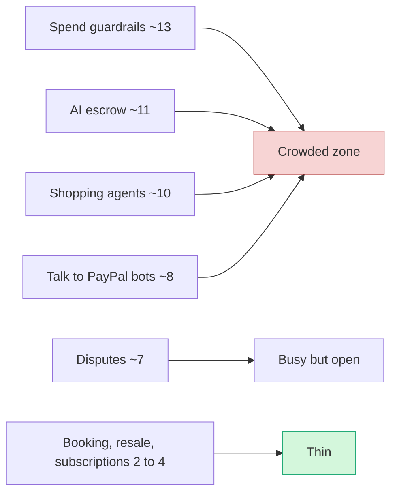

# Prior winners and duplicated archetypes

> [!tldr] In one breath
> We looked at who won similar AI payment hackathons and at about 72 early PayPal projects on Devpost. **Winners treated agents as real economic players or did unglamorous, real integration work. The crowd is piling into spend guardrails, AI escrow (a referee holding the money until the work is checked), shopping agents and "talk to PayPal" bots.**

> [!example] Picture this
> Imagine a school science fair where 40 kids show up with a baking soda volcano. Each volcano might be great, but the judges stop seeing them after the third one. This note is us walking the hall early, counting the volcanoes, and picking a table nobody else is at.

> [!warning] Newer data exists
> This note is a snapshot from about Oct 12, based on ~72 Devpost entries. The Oct 23 scan of 266 GitHub repos is bigger and fresher. See [[17 Live Competition Scan (Oct 23)]] for the current crowd heat map.

_Extract of section 4 of the event report._

## What won before, at a glance

| Hackathon | When | Winning pattern | Lesson for us |
|---|---|---|---|
| PayPal Dev Days 2025 | May 2025 | Paywall agent, SDK migration, PYUSD | PayPal rewards real integration work |
| SKALE / Coinbase / Google x402 | Feb 2026 | Agents as economic actors | Think beyond "AI shopping helper" |
| Agentic Commerce on Arc | Jan 2026 | Entries that looked like real businesses | Look viable, not like a toy |
| Solana x402 | Dec 2025 | Micropayments and paid APIs for agents | Crypto heavy, less relevant to PayPal |
| MACH AI Exchange | Jul 2026 | Orchestration with human approvals | Not just a chat box around a model |
| Old PayPal hackathons | 2014 to 2016 | Social impact giving | PayPal has long liked charity angles |

## 4. Prior winners and the most duplicated archetypes

### 4.1 Similar hackathons: what won

**PayPal Dev Days 2025 Hackathon** (San Jose, under 24 hours, article dated May 29, 2025). Tracks were Agentic Integrations (MCP Server / Agent Toolkit), Vibe Coding with Replit, and Upgrade Your Legacy Integration. ✅ [PayPal Dev blog](https://developer.paypal.com/community/blog/winners-dev-days-hackathon)
* 1st **CrawlerPal**: "a paywall AI agent assistant built with PayPal APIs" ($5k + AWS credits).
* 2nd **Codebusters**: moved Shopware 6's PayPal integration from JS SDK v5 to the beta v6.
* 3rd **Rosen**: upgraded a PYUSD powered social trading app.
* ⚠ inference: PayPal judges rewarded (a) agents paying for content access (pay per crawl), (b) the unglamorous work of **adopting the newest SDK** in real open source code, and (c) PYUSD.

**SKALE / Coinbase / Google "Agentic Commerce x402" hackathon** (San Francisco plus online, Feb 2026). 324 registered, 86 submissions. Judged on partner integration, **agentic depth, commerce realism, polish and readiness to ship**. ✅ [SKALE blog](https://skale.space/blog/san-francisco-agentic-commerce-x402-hackathon-recap-winners)
* Winners: World of Geneva (autonomous agents playing an RPG), Moltbet (prediction market *for agents*), Superpage (agents paying for real ecommerce), Pincer (ad sponsored 402 paywall fees), Legasi (credit and reputation layer for agents), RequestTap (open source x402 router, AP2 track), Civiclens (civic rewards).
* ⚠ inference: winners treated **agents as economic actors** (markets between agents, credit, reputation) rather than as human shopping assistants.

**Agentic Commerce on Arc** (lablab.ai, Circle/Arc plus Google, Jan 9 to 24, 2026). 1,200+ people, 222 teams. ✅ [lablab.ai](https://lablab.ai/blog/agentic-commerce-on-arc-ai-hackathon)
* Winners: NewsFacts, AisaEscrow, VibeCard rewards, RSoft Agentic Bank, Arcana, AI Merchant Studio & Storefront (Best Design), OmniAgentPay ($20k GCP), Arc Merchant (x402 micropayments), JoyKeep. Common types were agent banking, **escrow**, storefront and merchant tools, rewards, agent payment infrastructure, stablecoin SDKs and insurance.
* Google raised its prize pool from $10k to $40k because entries looked like "viable businesses."

**Solana x402 Hackathon** (winners Dec 2025). Sentinel Agent (agent monitoring paid via x402), Galaksio (USDC to instant compute), ParallaxPay, Agentx402, x402Resolve and others. Themes were micropayments and paid APIs for agents. ⚠️ [Phemex, citing an X post](https://phemex.com/news/article/solana-x402-hackathon-announces-winners-in-micropayments-and-ai-41757)

**MACH AI Exchange Hackathon** (Bloomreach, article Jul 2026). 900+ registrants, 83 teams. Winner SilentWatch (churn reactivation). The write up says the best entries "were not just wrapping a language model in a chat box" and that orchestration across systems with human approvals mattered more. ⚠️ [MACH Alliance](https://machalliance.org/insights-hub/from-who-showed-up-to-what-they-built)

**Older PayPal hackathons:** BattleHack (2014 to 2015; for example WeBzerking Care, "TransferWise for charity donations") and Opportunity Hack. These show PayPal has a long history of rewarding social impact giving. ⚠️ [Silicon Allee](https://news.siliconallee.com/?p=27286), [PayPal APAC](https://newsroom.apac.paypal-corp.com/PayPal-announces-winners-of-Opportunity-Hack-2016)

### 4.2 Direct evidence that this hackathon is clustering

Devpost's public "Built with PayPal" listing already shows dozens of PayPal plus AI sandbox projects. Most are almost certainly this hackathon's entries in progress: they mention the sandbox, Orders v2 and agents. I reviewed about 72 entries across pages 1 to 3. ✅ [page 1](https://devpost.com/software/built-with/paypal) · [page 2](https://devpost.com/software/built-with/paypal?page=2) · [page 3](https://devpost.com/software/built-with/paypal?page=3) (WebFetch summaries. ⚠ The hackathon link is inferred; the listing doesn't show hackathon names.)

Rough counts of the archetypes I saw (one project can count in more than one):

| Observed cluster | ~Count / 72 | Examples |
|---|---|---|
| **Agent spend governance / human approval payment gate** (policy engine, budgets, mandates, audit) | ~13 | AGENT GATE, Pulse Safe Commerce Agent, PayGuard, BOLT Control Plane, AgentAllowance, Leash, BoundPay, LexProof, VELQIRIS Evidence Gate, XReceipt, AI PAY, PayPilot (deterministic router) |
| **Escrow / pay on verified work** (AI judge releases funds) | ~11 | JudgePay, EscrowEase, AgentEscrow, PACT, Handovr AI, LOCIM, Accepted Work Settlement, MergePay (GitHub bounties), Nightcall Pays, Timeline Studio, Paceline |
| **Shopping / checkout agent** | ~10 | Agentic Cart, Checkout Agent, acp-sandbox, Dukkan, AgentBaazar, AgentDeal, CarryPay, ShopVoice Pay, MAHI, Babes & Babies |
| **"Talk to PayPal" plain language payment assistant** | ~8 | **"PayPilot" appears as the name of 5 separate projects**, plus PayFlow AI, PayBuddy AI, PayAgent AI, SmartPay AI, PayGroq |
| **Disputes / refunds / chargebacks** | ~7 | SubGuard, Fairplay, Rebuttal, Refund Desk, PayGuard AI, PayPilot Resolve, HoldWatch |
| **Reconciliation / bookkeeping / insights** | ~6 | Chaser, Caseproof, Invoice-Sync, Salah, SmartPay AI, Parts Ledger |
| **Group pay / splitting / group buy** | ~6 | Together, Tipping Point, Rally, SarafuPay, PayBuddy, Parts Ledger |
| **Invoice generation / chasing unpaid invoices** | ~4 | PayPilot (invoices + chase), Clause-to-Cash, Vendora, Paceline |
| **Booking / front desk agent with deposits** | ~4 | Vidal Booking, paypal-frontdesk, Glow Pilot, TownHubs |
| **Photo → price → list → sell** | ~2 | SHELF, Resell.Store |
| **Subscription cancel / guard** | ~2 | Subscription Killer, SubGuard |

⚠ inference: these ~72 visible entries are early movers about 10 days into a 6 week window, from a pool of 11,274 registrants. They are an early warning sign. Assuming a typical Devpost submit rate of roughly 5 to 10%, expect **about 550 to 1,100 final submissions** (estimate, not sourced).

### 4.3 The ~12 most duplicated archetypes we expect (ranked by expected volume)

Evidence key: [D] = seen on Devpost "Built with PayPal" (§4.2) · [S] = suggested on an official sponsor page or webinar · [P] = recurring winner or entry type in earlier agentic commerce hackathons (§4.1).

1. **AI shopping agent that searches products and pays with PayPal** (often with Channel3). [D][S Channel3 "shopping agents, gift finders, AI stylists"][P Superpage, KERNEL "Personal Shopper" cookbook]
2. **Human in the loop "agent wallet" / spend policy gate / mandate layer.** [D ~13][P Legasi, OmniAgentPay]. The judges' own talking points (Mats, Jo) push people here.
3. **AI escrow / milestone release by an "AI judge"** for freelancers or bounties. [D ~11][P AisaEscrow]
4. **Plain language PayPal assistant ("PayPilot")** that sends money, creates invoices, checks balances or summarises transactions over the MCP server. [D ~8, name collisions][S the AI Toolkit makes this a 10 minute build]
5. **AI dispute / chargeback / refund assistant** for merchants. [D ~7][S Bryntum "dispute triage board"]
6. **Merchant analytics / anomaly dashboard / "ask your revenue."** [D][S AG Grid storefront, anomaly alert and plain language finance ideas][P MACH: analytics most common]
7. **Invoice generator plus payment reminder ("nudge") agent.** [D][S AG Grid "Nudge-bot"]
8. **Bill or receipt splitting and group payments** (receipt scan → PayPal requests or payouts). [D ~6]
9. **Personal budgeting / spending insights chatbot** over transaction data. [D SmartPay, Salah, MamaPal]
10. **Subscription manager / forgotten subscription killer.** [D][S Bryntum "subscription revenue radar"]
11. **Booking or appointment agent with PayPal deposits** (salons, rentals, tickets). [D ~4][S Bryntum "equipment rental," "event ticketing"]
12. **Donation / creator tipping / nonprofit dashboard.** [S AG Grid "nonprofit donation dashboard"][P BattleHack charity winners]. Honorable mentions: the **simple storefront / coffee shop checkout** copied from the APIMatic demo prompt [S], and **photo to listing resale agents** [D].

> [!tip] The strategic reading (⚠ inference)
> Archetypes #2 and #3 look sophisticated, which is exactly why they are crowded. Teams read the same "trust and agents" talk. **A project that *contains* a safety gate is fine. A project whose *pitch* is the safety gate will sit among ~10% of the field.**

> [!info]- Jargon decoder
> **Archetype**: a type of project that many teams build in slightly different flavors. Like "volcano" at a science fair.
> **Agentic / AI agent**: an AI that takes actions (pays, books, buys) rather than just chatting.
> **Agents as economic actors**: AIs that earn, spend, borrow or trade with each other, like tiny businesses, rather than just helping a human shop.
> **MCP server**: Model Context Protocol, a standard plug that lets an AI use a tool. Like a universal power adapter between the AI and PayPal.
> **Agent Toolkit / AI Toolkit**: PayPal's ready made kits that give an AI the ability to call PayPal.
> **SDK / JS SDK v6**: a software development kit, a box of ready made code pieces. v6 is the newest PayPal one for web pages.
> **Orders v2**: PayPal's main API for creating and paying for an order.
> **Sandbox**: PayPal's practice playground with fake money, like Monopoly cash.
> **x402 / HTTP 402**: a way for a website to say "pay me a tiny amount first" before it gives an AI the content. A toll booth for bots.
> **Pay per crawl / paywall agent**: charging AI bots each time they read a page.
> **AP2**: Google's Agent Payments Protocol, a rulebook for how AI agents prove they are allowed to pay.
> **PYUSD / USDC / stablecoin**: digital coins designed to always be worth $1. PYUSD is PayPal's own.
> **Escrow**: a neutral party holds the money until the work is checked. A referee holding the prize.
> **AI judge**: an AI that decides whether the work meets the agreement and releases the money.
> **Human in the loop**: a person must approve before the AI acts. Like a parent signing the permission slip.
> **Spend policy gate / mandate**: rules that limit what an agent can spend ("max $50, groceries only").
> **Devpost**: the website that hosts this hackathon and its project listings.
> **Submit rate**: the share of registered people who actually hand in a project.

## Where to next
* ⬆️ Up: [[00 PayPal AI Hackathon Hub]]
* ⬅️ Previous: [[13 Problem Evidence Base]] · ➡️ Next: [[15 Sponsor Tools]]
* 🔗 Related: [[17 Live Competition Scan (Oct 23)]], [[Theme C Control group (obvious ideas)]], [[70 The Winning Idea]]
