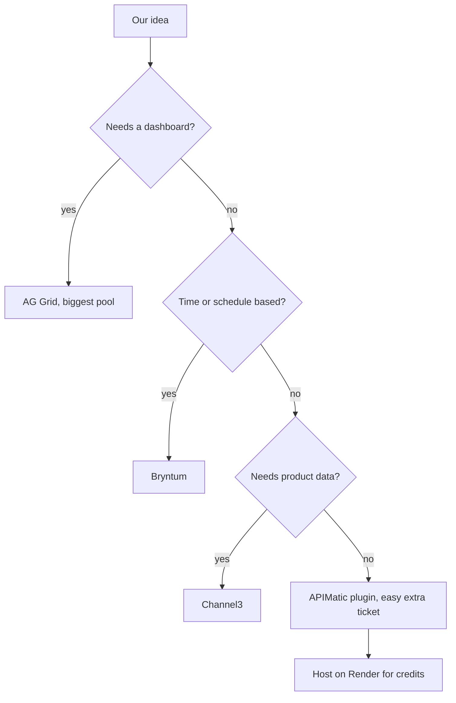

# Sponsor tools

> [!tldr] In one breath
> Ten sponsor tools come with this hackathon, but only five pay prizes: AG Grid ($10,000 pool), APIMatic, Bryntum, Channel3 and Render (credits). **You can win one sponsor prize on top of a main prize, so pick the sponsor tool that fits the idea best and use it deeply, not as a sticker.**

> [!example] Picture this
> Think of the sponsors as stalls at a market that each hand you a free ingredient. Most cooks will grab the same three and make the same sandwich. The trick is to pick the ingredient that makes *your* dish better, and to cook with it properly so the stall owner, who is also a judge, notices.

_Extract of section 1 of the event report._

## 1. Sponsor tools

### Prize map (who actually pays)

| Sponsor | Prize | Winners | Total | Source |
|---|---|---|---|---|
| AG Grid | $5,000 / $2,000 / $1,000 ×3 | 5 | **$10,000** | ✅ [Rules §8](https://paypalaihackathon.devpost.com/rules) |
| APIMatic | $1,000 + 6 months Business subscription | 3 | $3,000 + subs | ✅ Rules §8 |
| Bryntum | $1,000 | 3 | $3,000 | ✅ Rules §8 |
| Channel3 | $1,500 | 1 | $1,500 | ✅ Rules §8 |
| Render | $1,000 / $750 / $500 in **credits** | 3 | $2,250 credits | ✅ Rules §8 |
| Astropods, Elastic, KERNEL, Postman, Zapier | **No prize.** Free access only | 0 | none | ✅ Rules §8 (not listed) |

⚠ inference: AG Grid offers the deepest sponsor pool. Its 1st place ($5k) equals an Honorable Mention, and it pays out to 5 winners. A project can hold one sponsor prize on top of a Grand Prize or HM (Rules §8; ✅ [FAQ](https://paypalaihackathon.devpost.com/details/faqs)), so **the best pairing for expected sponsor money is an AG Grid (or Bryntum) prize alongside a main prize.** Only the highest single sponsor prize counts, so stacking several sponsor tools adds eligibility but not cash.

### All ten tools at a glance

| Tool | One line | Prize? | Our smarter angle |
|---|---|---|---|
| AG Grid | Dashboards and grids that agents can drive | ✅ $10k pool | Dashboard as the agent's control panel |
| APIMatic | Feeds correct PayPal API context to coding agents | ✅ $3k | Show retries, idempotency and error paths |
| Astropods | Runs agents in production with evaluators | No | Show the evaluator catching unapproved money moves |
| Bryntum | Timelines, schedulers, calendars | ✅ $3k | Schedule driven by when money actually lands |
| Channel3 | Product catalog of 100M+ items for agents | ✅ $1.5k | Seller side pricing or dispute evidence |
| Elastic | Search engine plus agent builder | No | Risk checking agent that others must consult |
| KERNEL | Cloud browsers for agents | No | QA bot or dispute evidence collector |
| Postman | API testing platform | No | Ship a test collection judges can run in one click |
| Render | Hosting plus durable workflows | ✅ credits | Retryable backbone for money moving steps |
| Zapier | Connects AI to 9,000+ apps | No | Use it only for the non PayPal side jobs |

---

### 1.1 AG Grid (AG Studio + Studio Agent Framework)
* **What it is:** AG Studio is an "embedded analytics library… dashboards, charts, and grids together in one component." It has a built in data engine, cross filtering, and the **Studio Agent Framework**, "so agents can build, query, and edit dashboards for you and alongside you." ✅ [details/aggrid](https://paypalaihackathon.devpost.com/details/aggrid)
* **Access:** free 45 day trial license, plus an official starter repo, [paypaldev/hackathon-paypal-ag-grid-boilerplate](https://github.com/paypaldev/hackathon-paypal-ag-grid-boilerplate), with AG Studio and PayPal already wired up. ✅ same page
* **Prize criteria (stated):** "covers both what your dashboard looks like and how you build it. Show us polish: custom widgets, theming, and layout tools, not just AG Grid or AG Charts on their own. Take Studio Agent Framework for a spin: a custom agent talking to Studio's built-in agents, or a swapped-in harness." ✅ same page
* **Ideas they suggested (so these will be copied a lot):** storefront analytics for fictional TV businesses, an anomaly alert agent for refund spikes, a nonprofit donation dashboard, a plain language finance agent, and an unpaid invoice "nudge-bot." ✅ same page
* **Framework details:** published Sep 28, 2026 (Josh Hobson). It is modular: the harness runs in the browser and manages multiple agents. Runners can be local, Vercel AI SDK, or custom. Agent definitions, chat UI and tools can all be swapped. It is "disabled until you connect your own LLM." ✅ [AG Grid blog](https://www.ag-grid.com/blog/introducing-the-ag-studio-agent-framework/)
* **Webinar:** Oct 12, 7am PT, "Build a payments dashboard without building a dashboard." ✅ [Overview](https://paypalaihackathon.devpost.com/)
* **Less obvious PayPal plus AI combo** (⚠ inference): **make the dashboard the agent's control panel, not a report.** For example, a PayPal Disputes "war room" where a custom expert agent (a dispute evidence specialist) talks to Studio's built in widget agents. Each dispute row gets a generated widget showing how ready its evidence is, and approving it from the grid calls the PayPal Disputes API. That hits "custom agent talking to Studio's built-in agents" plus custom widgets, and it is a real merchant pain point. Avoid the suggested donation, storefront and nudge ideas word for word.

### 1.2 APIMatic (Context Plugins for PayPal)
* **What it is:** turns API specs into SDKs, portals, MCP servers and **Context Plugins**: agent plugins that feed trustworthy PayPal API context into Claude Code, Cursor, Codex and Copilot. ✅ [details/apimatic](https://paypalaihackathon.devpost.com/details/apimatic), ✅ [webinar](https://youtu.be/zRWixN68tDg)
* **Coverage:** PayPal Server SDKs in TypeScript, Python, Java, Ruby, PHP and C#, across five APIs: **Orders, Payments, Vault, Subscriptions, Transaction Search**. It installs with one `npx` command, and no APIMatic credentials are needed. ✅ webinar transcript
* **Access:** anyone who used the plugin gets 1 month of APIMatic Basic. Winners get 6 months of Business. Claim via a [Google Form](https://docs.google.com/forms/d/e/1FAIpQLScc2oCgAFACm7d6H3R4mgzv-O34DdyVnLIBNiwmUNggr_-hhA/viewform). ✅ details page
* **Prize requirement:** "You just have to utilize the context plugin in some way while building your hackathon project. Then answer the plug-in question on the submission form." ✅ webinar transcript (Nathaniel Olson)
* **Claims:** about 50× cheaper context than alternatives on their "production readiness" benchmark. Their argument is that code generated from a bare OpenAPI spec "only works for the happy flows. It doesn't account for errors… retries… server going down." ✅ webinar (vendor claim, unverified)
* **Less obvious combo** (⚠ inference): the bar to qualify is tiny, so **this is a nearly free extra prize ticket for any team using a coding agent.** To *win* it, show what the plugin changed: sturdy retries, idempotency and error paths in the PayPal integration, plus a short README section on how the plugin shaped the integration. That speaks to APIMatic's "production-ready by default" pitch.

### 1.3 Astropods (Postman's agent runtime)
* **What it is:** an "agent operating system for running AI agents in production": models, knowledge stores, tool integrations, observability, runtime and guardrails. Agents are defined in a declarative `astropods.yml` plus an `AGENT.md` Agent Card. The CLI (`ast project create/start`, `ast blueprint push/deploy`) handles the lifecycle. Other pieces are a Remote Sandbox VM, a Messaging SDK (Slack and web chat over gRPC), an AI Gateway, and **evaluators** that run on production traces. ✅ [docs.astropods.com](https://docs.astropods.com/), ✅ [details/astropods](https://paypalaihackathon.devpost.com/details/astropods)
* **Ownership:** **Astropods is a Postman product.** The docs footer reads "© 2026 Postman." The walkthrough, published Oct 7, 2026, was written by **Pooja Mistry** (a Postman judge). It calls Astropods "the agent operating system layer" in the Postman AI stack and lists automated evaluation that flags "unnecessary tool calls, exposed personal data, and negative user sentiment." ✅ [Postman blog](https://blog.postman.com/build-ai-agents-with-astropods/)
* **Access:** free account. There is no dedicated prize. ✅ details page
* **Less obvious combo** (⚠ inference): deploy a PayPal acting agent on Astropods and **show its evaluator dashboard in the demo**: traces of every PayPal tool call, cost per transaction, and a custom evaluator that flags any money movement made without a matching approval. That turns "trust the agent with money" into something you can see. It also gives the Postman judge her own product in a serious role. There is no Astropods prize, but it could plausibly lift Technological Implementation scores.

### 1.4 Bryntum (Gantt / Scheduler / Calendar)
* **What it is:** commercial JS components for anything time based. ✅ [details/bryntum](https://paypalaihackathon.devpost.com/details/bryntum)
* **Access:** 45 day trial (`npm install @bryntum/scheduler@npm:@bryntum/scheduler-trial`). ✅ same page. Bryntum also runs an MCP server (mcp.bryntum.com), agent skills and docs that agents can read. ✅ [bryntum.com/agents](https://bryntum.com/agents/)
* **Prize criteria:** "the cleanest timeline, the smartest resource booking, or an agent that drives the schedule itself." ✅ details page
* **Ideas they suggested:** agency Gantt with payment tranches as dependencies, equipment rental locked on payment, ticketing calendar, subscription revenue radar, a **dispute triage board**, and an agent driven rescheduler fed by payment webhooks. ✅ details page
* **Corporate link:** AG Grid and Bryntum jointly organised the "Beyond the Prompt" conference (London, May 19, 2026). ✅ [agenda JSON](https://ag-grid.com/downloads/beyond-the-prompt/beyond-the-prompt-agenda.json). A law firm notice describes a "partnership with AG Grid" involving Adelis Equity Partners. ⚠️ [Travers Smith](https://www.traverssmith.com/knowledge/knowledge-container/travers-smith-advises-adelis-equity-partners-and-bryntum-on-partnership-with-ag-grid/). The Bryntum intro session is hosted on AG Grid's Livestorm account. ✅ details page
* **Less obvious combo** (⚠ inference): **scheduling that follows cash flow.** PayPal Pay Later or Subscriptions webhooks drive a Scheduler where an agent replans resources (contractors, rooms, shifts) based on *when money actually lands*. Payouts to contractors are released by the Gantt dependency graph. One project could use both AG Studio and Bryntum (same corporate family), but only one sponsor prize can be won.

### 1.5 Channel3 (product catalog API for agents)
* **What it is:** "One API returns clean, normalized product data, titles, images, prices, variants, availability, and buy links, across 100M+ products from 25,000+ retailers." ✅ [details/channel3](https://paypalaihackathon.devpost.com/details/channel3)
* **Access:** 20,000 free credits with promo **PAYPAL-HACKATHON-2026**. They will top up on Discord: "don't let credits block your demo." ✅ same page
* **Prize requirement:** "Your project may use the Channel3 API or our MCP server as a meaningful part of the product experience, search, product enrichment or recommendations. Projects that only reference Channel3 without calling it will not meet this requirement." ✅ same page
* **More detail from their docs:**
  * Search works by text, **image**, or **URL**, with filters for price, brand, category, dimensions and attributes. It returns offers from multiple retailers. ✅ [docs](https://docs.trychannel3.com/)
  * Ways in: REST API, SDK, **MCP** (`https://mcp.trychannel3.com/`, no key for the free tier), CLI, **UCP** profile (`ucp.trychannel3.com`, with tools `search_catalog`, `lookup_catalog`, `get_product`), and **MPP** (pay per call, no signup). ✅ [docs](https://docs.trychannel3.com/), [UCP](https://docs.trychannel3.com/use-cases/ucp), [MCP](https://docs.trychannel3.com/mcp-overview)
  * **How it makes money:** buy URLs are credited to the developer, so partner brand commissions apply. Channel3 does **not** do checkout. Its UCP flow ends at a buy link. ✅ [UCP page](https://docs.trychannel3.com/use-cases/ucp)
  * Company: raised a $6M seed led by Matrix in Dec 2025. Its stated vision is a "neutral, storefront-agnostic catalog of every product sold online." ⚠️ [SiliconANGLE](https://siliconangle.com/2025/12/10/channel3-raises-6m-make-every-single-product-sold-web-discoverable-ai-agents/)
* **The gap PayPal fills** (⚠ inference): Channel3 handles finding products and PayPal handles paying. Every "shopping agent" team will join the two the obvious way (agent searches, then a PayPal checkout button). **That is the single most copied pattern expected in this hackathon** (see §4 in [[14 Prior Winners & Duplicated Archetypes]]).
* **Less obvious combos** (⚠ inference):
  * (a) **Flip it to the seller side:** use Channel3 image search to price check an item a seller photographs. Then create a PayPal invoice or Payment Link priced against live market offers, so the agent becomes the seller's pricing analyst. Copies exist (SHELF, Resell.Store on Devpost, see §4), so stand out hard.
  * (b) **Dispute evidence:** for a PayPal "item not as described" dispute, use Channel3 URL or lookup to pull the official product spec and attach it as structured evidence.
  * (c) **Refund to replacement:** after a PayPal refund, the agent finds similar in stock items across retailers.
  * (d) **Gift registry / group funding:** many payers fund one Channel3 item through PayPal, with an agent that tracks price and stock until the goal is met.

### 1.6 Elastic (Elasticsearch, Agent Builder, Workflows)
* **What it is:** a search and analytics engine with hybrid and vector search. ✅ [details/elastic](https://paypalaihackathon.devpost.com/details/elastic)
* **Suggested use (sponsor page):** "build a multi-step AI agent that uses Elasticsearch combining a **Jina embedding model**," optionally with "Elastic Agent Builder, Elastic Workflows, Search, ES|QL, Observability, Security, or the A2A/MCP connectivity." ✅ same page
* **Access:** 14 day serverless trial via [ela.st/elastic-paypal-hackathon](https://ela.st/elastic-paypal-hackathon), which you can extend yourself by 30 days ([form](https://www.elastic.co/trialextension)), or run locally for free. ✅ same page. No prize.
* **Agent Builder:** agents grounded in your indices. Custom tools can be ES|QL, index search, MCP or workflow tools. It **exposes agents over an MCP server and an A2A server**, and agents can trigger Workflows (and the reverse). ✅ [Elastic docs](https://www.elastic.co/docs/explore-analyze/ai-features/elastic-agent-builder). It became generally available on Jan 22, 2026. Workflows was in tech preview at that point. ⚠️ [press release via Nasdaq](https://www.nasdaq.com/press-release/elastic-announces-general-availability-agent-builder-expanded-capabilities-2026-01-22)
* **Less obvious combo** (⚠ inference): load PayPal **webhook events plus Transaction Search output** into Elasticsearch, and use ES|QL tools in Agent Builder to investigate anomalies and fraud patterns (refund spikes, dispute clusters by SKU). Expose the agent via A2A so a *separate* PayPal acting agent (for example, a refund agent) must consult it before moving money. That is risk checking between agents, which matches Carly Richmond's "context engineering" theme (§2).

### 1.7 KERNEL (browser infrastructure for agents)
* **What it is:** "Cloud infrastructure for AI agents to act on the internet. <30ms browser spin-up, reliable bot anti-detection… 24fps live session view with full replay." Managed auth keeps agents logged in. It runs headful Chromium and works "with every agent harness and cua model." ✅ [details/kernel](https://paypalaihackathon.devpost.com/details/kernel)
* **Access:** **$50 in credits** via [dashboard link with code KERNELDEVPOST2026](https://dashboard.onkernel.com/hackathon?code=KERNELDEVPOST2026). No prize. ✅ same page
* **More detail from docs:**
  * A browser starts in about 30ms (p50) and 105ms (p99), each in its own isolated VM. A standby mode stops billing about 5s after disconnect. Each session has a REPL, process exec and SSH. The browser image and VM runtime are open source. ✅ [kernel.sh/docs](https://www.kernel.sh/docs)
  * **Payments building block:** browser agents complete purchases without handling raw card data. Wallet integrations are **Link (Stripe)**, which issues a single use card per purchase, and **AgentCard**. A `fill` API types vault values into fields without them passing through app code *or the model's context*. There is no PayPal wallet integration. ✅ [payments doc](https://www.kernel.sh/docs/browsers/payments)
  * Cookbooks include **"Personal Shopper,"** Claude Computer Use loop, Browser Use, Stagehand + Google CUA, and Mastra. Integrations cover Claude Agent SDK, OpenAI Agents SDK, Vercel AI SDK and 1Password. There is also a page on buying a browser with MPP. ✅ [llms.txt index](https://www.kernel.sh/docs/llms.txt)
* **Less obvious combo** (⚠ inference): KERNEL's payment wallets are built around Stripe, so **the obvious "browser agent buys stuff" is both overdone and aligned with a competitor.** Better:
  * (a) **Merchant side QA agent:** a KERNEL browser walks through a merchant's own PayPal sandbox checkout from start to finish (happy and unhappy paths, as Eddie Jaoude stressed in the kickoff). The replay recording is attached as evidence, and failures are diagnosed with PayPal's `/paypal:explain-error` logic.
  * (b) **Dispute evidence collector:** the agent logs into the carrier or tracking portals the merchant uses (managed auth), screenshots proof of delivery, and submits it through the PayPal Disputes API. Live view plus replay gives the judges a trail they can audit.
  * (c) Use the `fill` style idea of keeping secrets out of model context as a design principle, and *say so*. It speaks to Jo Franchetti's security interests (§2).

### 1.8 Postman
* **What it is:** a platform for the whole life of an API. ✅ [details/postman](https://paypalaihackathon.devpost.com/details/postman) (WebFetch summary)
* **Access:** free sign up, the **official PayPal Postman collection** ([postman.com/paypal](https://postman.com/paypal), which includes "examples for agentic commerce" per Marco Podien), and a "Learn API by doing" path focused on AI. No prize. ✅ details page, ✅ kickoff transcript
* **Less obvious combo** (⚠ inference): ship a **Postman collection of your project's own API** (for example, the endpoints your agent exposes) with tests that run your PayPal flows, and link it in the README so judges can test in one click. Postman's MCP server also lets agents use the Postman API. ⚠️ [Postman docs](https://learning.postman.com/docs/developer/postman-api/postman-mcp-server/overview). Pairs naturally with Astropods (same company).

### 1.9 Render
* **What it is:** a cloud platform for apps and agents. Web services, Postgres, workers, and **Render Workflows**, where tasks are defined as functions with the SDK and fanned out across "hundreds of concurrent instances." ✅ [details/render](https://paypalaihackathon.devpost.com/details/render) (WebFetch summary)
* **Access:** **$50 in Render credits** via the claim link. ✅ details page
* **Prize:** $1,000 / $750 / $500 in credits for "Eligible Submissions that use any Render tools." No further criteria published. ✅ Rules §8
* **Workflows:** TypeScript and Python SDKs. Each run gets its own instance, runs up to 24 hours, retries automatically, and can chain or await child tasks. Agent orchestration is a headline use case, with a `run_agent` example fanning out to `gather_context`, `execute_skills` and `compose_response`. No built in scheduling. ✅ [Render docs](https://www.render.com/docs/workflows)
* **Less obvious combo** (⚠ inference): use Workflows as the **durable, retryable backbone for money moving agent steps**: idempotent capture, continuing when a webhook arrives, and undo (refund) tasks on failure. A hosted Render URL also meets the "functional demo" rule with no setup hassle for judges.

### 1.10 Zapier (Zapier MCP)
* **What it is:** Zapier MCP lets AI tools (Claude, ChatGPT, Cursor) take actions across 9,000+ apps, **including PayPal**, with Zapier handling login. ✅ [details/zapier](https://paypalaihackathon.devpost.com/details/zapier) (WebFetch summary)
* **Access:** 14 day Professional trial, no card. No prize. ✅ details page
* **Risk** (⚠ inference): a project whose PayPal use runs *only* through Zapier's PayPal actions may look like "PayPal bolted on" (Jo Franchetti: "adding a PayPal button to an unrelated app is not going to be enough," ✅ kickoff). **Use Zapier for the *non PayPal* side jobs (CRM, Sheets, Slack), and call PayPal APIs or the PayPal MCP directly.**

### 1.11 PayPal's own AI tooling (the core requirement)
* **PayPal AI Toolkit** ([github.com/paypal/AI-Toolkit](https://github.com/paypal/AI-Toolkit), Apache-2.0). It is a Claude Code plugin (Codex via its plugin marketplace per the kickoff) with:
  * the `paypal-best-practices` skill
  * commands `/paypal:setup`, `/paypal:sandbox`, `/paypal:test-accounts`, `/paypal:explain-error`, `/paypal:doctor`
  * a PreToolUse hook that forces SDK version checks
  * a sandbox MCP server covering Orders/Payments, Invoices (including QR), Subscriptions, Disputes, Catalog, Shipment and Reporting

  ✅ repo README, ✅ kickoff transcript. On Oct 11 the repo had **4 commits, 3 stars, 0 forks.** ✅ repo
* **Agent Toolkit** (separate from the AI Toolkit) offers framework adapters for LangChain, CrewAI, Mastra and Vercel AI SDK. There is also an MCP server and agent tools reference. ✅ kickoff transcript (Marco), ✅ [Resources](https://paypalaihackathon.devpost.com/resources) → [docs.paypal.ai](https://docs.paypal.ai/)
* **Jo Franchetti invited PRs:** "having I shipped a commit to the PayPal org is a brilliant thing to have on that CV… we absolutely will review them and get them merged." ✅ kickoff transcript. ⚠ inference: the toolkit is young (3 stars), so **a team that sends a real fix or new error code upstream to paypal/AI-Toolkit during the hackathon and cites the merged PR earns unusual goodwill from the three DevRel judges.**
* Agentic commerce context: PayPal launched "Agentic Commerce Services" (**Agent Ready**, **Store Sync**) on Oct 28, 2025, with Perplexity named as a discovery surface. ✅ [PayPal newsroom](https://newsroom.paypal-corp.com/2025-10-28-PayPal-Launches-Agentic-Commerce-Services-to-Power-AI-Driven-Shopping). The same day, a PayPal and OpenAI partnership covered paying inside ChatGPT. ⚠️ [TechCrunch](https://techcrunch.com/2025/10/28/paypal-partners-with-openai-to-let-users-pay-for-their-shopping-within-chatgpt). One Devpost project title mentions "PayPal's Cart API" for agents (AgentBaazar). ⚠️ [Devpost listing](https://devpost.com/software/built-with/paypal?page=3)

> [!info]- Jargon decoder
> **Sponsor prize / HM**: extra prizes from tool companies. HM is Honorable Mention, a smaller main prize.
> **EV (expected value)**: the prize money you can expect on average, counting your odds. A 50% shot at $2,000 is worth about $1,000.
> **Boilerplate repo**: a starter project with the wiring already done, like a cake mix instead of raw flour.
> **Harness**: everything wrapped around an AI model so it can work: tools, rules, memory, checks. The model is the engine, the harness is the rest of the car.
> **Runner**: the piece that actually runs an agent, locally or in the cloud.
> **LLM**: large language model, the AI brain (like Claude or GPT).
> **MCP server**: a standard plug that lets an AI use a tool. A universal adapter.
> **Context Plugin**: a plugin that feeds a coding AI the correct, current API docs so it writes working code instead of guessing.
> **OpenAPI spec**: a machine readable description of an API, like a menu listing every dish and its ingredients.
> **Happy path / unhappy path**: the flow where everything works vs the flow where things go wrong (declined card, timeout).
> **Idempotency**: doing the same request twice has the same effect as doing it once. Pressing the lift button ten times still calls one lift, and you get charged once, not ten times.
> **Retry**: trying again after a failure, ideally without double charging.
> **Observability / traces**: a recording of every step an agent took, like a flight recorder.
> **Evaluator**: an automatic checker that grades an agent's behavior, like a referee reviewing replays.
> **Gantt chart**: a timeline chart of tasks and what depends on what.
> **Webhook**: PayPal calling your app to say "something just happened", like a doorbell instead of checking the porch every minute.
> **UCP / MPP**: Universal Commerce Protocol (Google's standard for agent shopping) and Machine Payments Protocol (pay per call for machines).
> **Vector search / embedding**: searching by meaning instead of exact words. "Cheap sofa" finds "budget couch".
> **ES|QL**: Elastic's query language for asking questions of your data.
> **A2A**: agent to agent, a standard for one AI to call another AI.
> **Headful Chromium**: a real visible Chrome browser running in the cloud.
> **p50 / p99**: the typical speed (half of starts are faster) and the near worst case (99% are faster).
> **Vault / `fill` API**: a safe that stores card details and types them into a form so neither your code nor the AI ever sees them.
> **Durable workflow**: a multi step job that survives crashes and picks up where it left off.
> **Capture**: actually taking the money after it was approved.
> **Compensation task**: an undo step, like issuing a refund if a later step fails.
> **PreToolUse hook**: a check that runs before the coding AI uses a tool, like a bouncer at the door.
> **DevRel**: developer relations, the people at PayPal whose job is to help developers. Three of them judge.
> **PR (pull request)**: a proposed code change sent to a project for review.
> **Agent Ready / Store Sync**: PayPal services that let merchants accept agent payments and make their catalogs visible to AI shopping tools.

## Where to next
* ⬆️ Up: [[00 PayPal AI Hackathon Hub]]
* ⬅️ Previous: [[14 Prior Winners & Duplicated Archetypes]] · ➡️ Next: [[16 Developer Pain, Gaps & Hidden Insights]]
* 🔗 Related: [[10 Event, Rules & Judging Intelligence]], [[11 PayPal Platform & Sandbox Capabilities]], [[17 Live Competition Scan (Oct 23)]]
