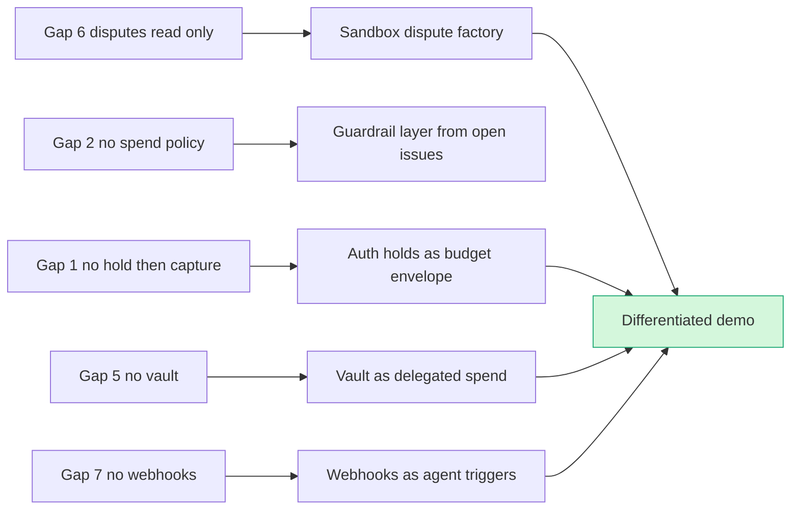

# Developer pain, gaps and hidden insights

> [!tldr] In one breath
> PayPal's agent tools can only do the simple stuff: take a payment, read a dispute, send an invoice. **They can't hold money and release it later, can't enforce spending limits, can't fight disputes with evidence, and can't react to events.** The PayPal APIs underneath *can* do most of this, so a team that wires those hidden powers up for an agent is building in empty space.

> [!example] Picture this
> PayPal gave AI agents a Swiss Army knife, but only the bottle opener and the toothpick fold out. The scissors, the saw and the screwdriver are all in there, built and working. Nobody added the hinge. This note lists the missing hinges, and every one of them is a project idea.

_Extracts: platform report sections 4 to 7; landscape report section 7._

## The whole note at a glance

| Part | What it tells you | Best use |
|---|---|---|
| §4 Developer pain | Real bug reports and forum questions | Proof that our fix solves real pain |
| §5 Sandbox starter repo | What PayPal's own guide covers and skips | Know what judges have already seen |
| §6 Gaps | 15 things PayPal's agent tools cannot do | **Our build space** |
| §7 Hidden insights | 15 powerful but underused PayPal features | Demo tricks that impress |
| §7a Unowned problems | 20 agent era problems nobody owns | Idea pool |
| §7b Saturated spaces | 8 areas to avoid | What not to pitch |
| §7c PayPal's unique assets | Where only PayPal can win | Sponsor fit story |

## From the PayPal platform report

## 4. Developer pain signals (2025 to 2026)

**What developers keep tripping over: a flaky hosted MCP, tokens that expire, no safety rails, no idempotency, and webhooks that don't arrive.**

| Theme | Evidence (title, URL) | Conf |
|---|---|---|
| Hosted MCP reliability | "Sandbox MCP: every tool returns PAYPAL_API_SETUP_ERROR 'Unsupported cache mode: default'" ([AI-Toolkit #34](https://github.com/paypal/AI-Toolkit/issues/34)) | ✅ |
| Token lifecycle | "Replace the static PAYPAL_SANDBOX_ACCESS_TOKEN header with headersHelper…" ([#28](https://github.com/paypal/AI-Toolkit/issues/28)); "README: 9 hour token expiration" ([#10](https://github.com/paypal/AI-Toolkit/issues/10)) | ✅ |
| Agent safety and guardrails | #95 no human gate or spend bound; #82 `pay_order` without confirmation; #104 action attestation; #105 host spend policy ([agent-toolkit issues](https://github.com/paypal/agent-toolkit/issues?q=is%3Aissue)) | ✅ |
| Idempotency | #98 `PayPal-Request-Id` never set per call ([link](https://github.com/paypal/agent-toolkit/issues/98)) | ✅ |
| Supply chain | #96 `@paypal/mcp` pins agent-toolkit to `latest`; PR #101 CVE bumps | ✅ |
| Stale examples | #93 Assistants API retired; AI SDK v4 types; `openai-agents==0.0.2` pin | ✅ |
| Wrong domain | #43 `api.` vs `api-m.` | ✅ |
| v6 SDK bugs | paypal-js: "[Bug] Web SDK v6 Card Fields have incorrect Tab order in Safari" (#1028); "[Doc/Bug?] Card Fields testing" (#1033); "[Bug] Inconsistency in the subscription flow depending on the user's login state" (#975); "[Bug] Error on submit credit card payment not logged by callbacks" (#596, 34 comments) ([paypal-js issues](https://github.com/paypal/paypal-js/issues)) | ✅ |
| v6 sandbox onApprove | Unanswered on Stack Overflow: "integrating the PayPal JavaScript SDK v6 … critical issue in the Sandbox environment: the onApprove callback…" ([SO tag](https://stackoverflow.com/questions/tagged/paypal-sandbox?tab=Unanswered)) | ⚠️ |
| Webhooks | "PayPal Webhooks Not Received on Production Server (but working via ngrok…)" ([SO 79572615](https://stackoverflow.com/questions/79572615/paypal-webhooks-not-received-on-production-server-but-working-via-ngrok-and-web)); "PayPal sandbox webhook signature verification fails for an event but succeeds for another" ([SO tag](https://stackoverflow.com/questions/tagged/paypal-rest-sdk?tab=Newest)); "PayPal webhook listener gets an HTTP 302 and gets retries" ([SO tag](https://stackoverflow.com/questions/tagged/paypal-webhooks?tab=Newest)) | ⚠️ |
| Vault | "PayPal Vaulting: billingToken is null in onApprove response" ([SO 79538649](https://stackoverflow.com/questions/79538649/paypal-vaulting-billingtoken-is-null-in-onapprove-response)) | ⚠️ |
| Disputes evidence | "Paypal Disputes API returns INVALID_EVIDENCE_FILE when posting file" ([SO 78902643](https://stackoverflow.com/questions/78902643/paypal-disputes-api-returns-invalid-evidence-file-when-posting-file)) | ⚠️ |
| Server SDK feedback channel | `paypal/PayPal-TypeScript-Server-SDK` shows **0 issues**, so the tracker is likely switched off ([issues](https://github.com/paypal/PayPal-TypeScript-Server-SDK/issues?q=is%3Aissue)) | ✅ (observed) |
| Sandbox webhook delay | "Webhook events in sandbox may be delayed; use the Webhooks Simulator" ([test-accounts.md](https://github.com/paypal/AI-Toolkit/blob/main/commands/test-accounts.md)) | ✅ |

---

## 5. Hackathon resource: `paypaldev/getting-started-with-paypal-sandbox`

* Created 2026-09-28; last merge 2026-10-01. It is one README plus one image. ✅ git log
* **What it covers:** the default Business and Personal accounts, which can't be deleted; Create Custom Account for custom balances and cards; multi currency balances; the three URLs (`developer.paypal.com`, `www.sandbox.paypal.com`, `api-m.sandbox.paypal.com`).
* **Recommendations:** it recommends `@paypal/paypal-server-sdk` for automatic OAuth.
* **Negative testing:** a `PayPal-Mock-Response` example with `INSTRUMENT_DECLINED` and `DUPLICATE_INVOICE_ID`, and the account level Negative Testing toggle, with the warning: "Turn **Negative Testing** back off … it's easy to forget and later looks like a broken integration."
* **What it does not cover:** disputes, payouts, vault, webhooks or AI.

✅ [repo](https://github.com/paypaldev/getting-started-with-paypal-sandbox)

---

## 6. Gaps: what PayPal's agent tooling does NOT do yet (the most valuable section)

Each gap is grounded in the code or docs above. "Toolkit" means agent-toolkit v1.11.0 plus `@paypal/mcp`. "Hosted" means `mcp.sandbox.paypal.com`.

| # | Gap in one line | Underlying API can do it? |
|---|---|---|
| 1 | No hold now, charge later | Yes, Payments v2 |
| 2 | No spend limits or approvals | Only Braintree ACP token; build it yourself |
| 3 | No per call idempotency | Yes, header exists |
| 4 | No Payouts tools | Yes, in sandbox |
| 5 | No saved payment methods | Yes, Vault v3 |
| 6 | Disputes read and accept only | Yes, full lifecycle |
| 7 | No webhooks | Yes |
| 8 | No Payment Links, buttons or QR | Only invoice QR codes today |
| 9 | No acting for other sellers | Yes, with headers |
| 10 | No buyer side tools | Mostly gated |
| 11 | Broken or old plumbing | n/a |
| 12 | Fragile hosted MCP | n/a |
| 13 | No agent identity | No |
| 14 | PayPal wallet in ACP not shipped | No, "coming soon" |
| 15 | Docs and code disagree | n/a |

1. **No authorize then capture for agents.** `create_order` hardcodes `intent:'CAPTURE'`, and there are no `authorize_order`, `capture_authorization`, `reauthorize` or `void` tools. Agents can't place a *hold* and settle only after a condition is met, even though Payments v2 supports 29 day auths, reauthorization and over capture up to 115%. ✅ `payloadUtils.ts:197`, [auth-honor](https://developer.paypal.com/payment-methods/auth-honor.md)
2. **No spend policy, budget, approval gate or audit record.** There is no `max_amount`, allow list or human in the loop hook in the toolkit (issues #95, #82, #104 and #105 are all open). The only "allowance" idea PayPal ships is Braintree's ACP delegated token (`max_amount`, `expires_at`), and that is ChatGPT only and Braintree only. ✅
3. **No idempotency per tool call.** `PayPal-Request-Id` is a single constant for the whole client, or missing (#98, with PR #108 open). An LLM that retries can create orders or refunds twice. ✅
4. **No Payouts tools** (PR #107 open), even though Payouts, including Venmo handles, is fully testable with sandbox test values. ✅
5. **No Vault / payment method token tools.** Agents can't save a PayPal, Venmo or card method and later charge it with the payer absent (`vault_id`), even though `/v3/vault/*` works in sandbox. ✅
6. **Disputes only support read and accept.** There is no `provide_evidence`, `make_offer`, `send_message`, `escalate`, `appeal` or `acknowledge_return_item`, and nothing exposes the sandbox simulators (`create dispute`, `adjudicate`, `require-evidence`). The only dispute tool that changes anything, `accept_dispute_claim`, is the one PayPal's own skill warns against automating. ✅
7. **No webhooks tools or event intake.** Nothing registers or verifies webhooks or turns events into agent triggers. Agents can only ask, never be told; ⚠ inference: they have to poll Transaction Search, which lags up to 3 hours.
8. **No Payment Links, buttons or QR tools** (PR #78 open since 2025-12). Only invoice QR codes exist. ✅
9. **No multiparty or platform context.** `merchant_id` in the context is never sent as `PayPal-Auth-Assertion`, so a platform agent can't act on behalf of sellers or set `platform_fees`. ✅ `client.ts`
10. **No Pay Later, Fastlane, Apple Pay or Google Pay, and no buyer side tools.** The toolkit is for the merchant's back office only. Buyer side agent checkout exists only as gift card only remote commerce tools behind a feature flag, plus gated ACP, UCP and Store Sync. ✅
11. **Broken or legacy plumbing.** It uses the `api.sandbox.paypal.com` domain (#43), AI SDK v4 types, `openai-agents==0.0.2` and Assistants API examples (#93), and MCP results come back as `String(result)` text with no `structuredContent` or output schemas. ✅
12. **Hosted MCP is fragile.** It uses static bearer tokens that expire after about 8 hours, a gateway 429 on reconnect, and the open #34 outage. The remote OAuth consent flow is documented with production `mcp.paypal.com` examples. ✅
13. **Agent identity (KYA) is only an idea.** There is no API, token format or "agent" field on Orders. The only machine readable agent attribution is Braintree's `facilitator_details.oauth_application_name`. ✅ [Ai4](https://newsroom.paypal-corp.com/2026-08-10-PayPal-Takes-Center-Stage-at-Ai4-2026), [ACP doc](https://developer.paypal.com/agent-ready/agentic-commerce-protocol.md)
14. **The PayPal wallet in ACP is not shipped.** `paypal_wallet` and `venmo_wallet` are "coming soon"; ACP via Braintree supports only card, Apple Pay and Google Pay. ✅
15. **Docs and code disagree.** The tools reference lists about 30 tools while the code has 46. The local, remote and "2 tools" claims conflict. Store Sync cart paths contradict the ruleshub `/v2/cart`. AI docs moved from docs.paypal.ai to developer.paypal.com in Sept 2026. ✅

---

## 7. Hidden insights and underused features a hackathon team could exploit

Each item is grounded in a source above. The idea attached to each one is ⚠ inference.

1. **Sandbox dispute *factory*.** `POST /v1/customer/disputes` with the buyer's `PayPal-Auth-Assertion`, plus `/process-chargeback`, `/change-reason`, `/require-evidence` and `/adjudicate`, lets you script a whole dispute from start to finish, buyer side included. Then drive it with an AI "dispute defense agent" that compiles evidence (tracking, refund proof, chat logs) and calls `provide-evidence`. Escalation can be sped up with $5, $9 or $11 amounts, and `allowappeal` accounts unlock the appeal flow. **It makes a live, repeatable demo, and no agent tool covers it today.** ✅ [disputes test-go-live](https://developer.paypal.com/disputes/test-go-live.md)
2. **Authorization holds as an agent spending tool.** Authorize with a 29 day hold, reauthorize on schedule, capture up to 115% or +$75 and capture in parts. Together these make a built in escrow and budget envelope an agent can work inside ("hold $X, release only on verified delivery"). It also fills gaps 1 and 2. ✅ [auth-honor](https://developer.paypal.com/payment-methods/auth-honor.md)
3. **`PayPal-Mock-Response` for chaos testing agents.** Inject `INSTRUMENT_DECLINED`, `DUPLICATE_INVOICE_ID` and similar on any sandbox call to show the agent recovering: it switches funding, avoids double charges and explains to the user. **Judges rarely see demos of things going wrong.** ✅ [sandbox repo](https://github.com/paypaldev/getting-started-with-paypal-sandbox)
4. **Payouts test values for a payout agent that behaves the same every run.** `ERRPYO0xx` notes and `ERRPYOB0xx` batch IDs reproduce about 50 failure modes (RECEIVER_UNREGISTERED, RISK_DECLINE, CIP_NOT_VERIFIED…). Combined with `VENMO_HANDLE`, a contractor payout or bounty payout agent can show how it handles every failure branch. ✅ [payouts test-go-live](https://developer.paypal.com/api/payouts/test-go-live.md)
5. **The vault is the missing agent building block.** `/v3/vault/setup-tokens` → `payment-tokens` → Orders with `vault_id` when the payer isn't present. Pair it with your own policy layer (caps, merchant allow list, approvals) to build a real delegated spend agent in sandbox, without waiting for ACP's PayPal wallet. ✅ [vault doc](https://developer.paypal.com/api/payment-tokens/save-without-purchase/paypal.md)
6. **Build the guardrail layer PayPal's own issue tracker is asking for.** Issues #95, #98, #104 and #105 describe the exact spec: per call `PayPal-Request-Id`, a spend bound, action attestation and a record after each action. A "policy wrapped PayPal MCP" proxy maps directly onto the "Best Use of PayPal + AI" story. ✅
7. **Invoicing is the deepest agent surface.** It has 22 tools, including recurring series, conditional rules (early payment discount, auto cancel), auto reminders, record payment or refund, and search. **A collections agent can use far more of PayPal than a checkout bot can.** ✅ `tools.ts`
8. **`get_merchant_insights`** (`/v1/merchant/insights`, ORDERS or SALES, DAILY to YEARLY) is a little known analytics endpoint already wrapped as a tool. Use it for an AI CFO or forecasting feature. ✅ [agent-tools](https://developer.paypal.com/ai-tools/agent-tools.md)
9. **Braintree sandbox plus ChatGPT developer mode** reproduces the ACP Instant Checkout flow end to end (`requestCheckout` → `complete_checkout` → `transaction.sale` with `payment_mode:"test"`). It is the most "agentic commerce" thing a team can actually demo, and it carries `facilitator_details` attribution. Confirm token issuance in test mode early, because it's ❌ unverified. ✅ [ACP doc](https://developer.paypal.com/agent-ready/agentic-commerce-protocol.md)
10. **WebMCP is announced but closed.** PayPal published only a benchmark (4.6× cheaper, 2× faster, 3 vs 30+ steps) and a video. A team can build its *own* WebMCP style storefront tools (`search`, `cart`, `start_checkout`) on JS SDK v6 that hand off to PayPal approval. That is a believable preview of where PayPal is going, and nobody can get the official version yet. ✅ [WebMCP blog](https://developer.paypal.com/community/blog/WebMCP_PayPal_Agent_Ready)
11. **Webhooks as agent triggers.** You get up to 10 URLs per app, 25 retries over 3 days, and dispute, subscription and capture events. An agent that wakes on events (e.g. on `BILLING.SUBSCRIPTION.PAYMENT.FAILED`, run a dunning conversation, then `send_invoice`) fills gap 7. Use real sandbox events, not the simulator, if you need signature verification. ✅ [webhooks overview](https://developer.paypal.com/api/webhooks/overview)
12. **Shipment tracking feeds dispute defense and fund release.** The tracking tools already exist (`create_shipment_tracking`), and the disputes docs use tracking as `PROOF_OF_FULFILLMENT`. ✅
13. **Multi seller orders with `platform_fees`** (up to 10 purchase units, INSTANT or DELAYED disbursement) allow an AI marketplace or concierge that splits a cart across sellers. No agent tool supports it and PayPal's own skill leaves it out, so it's open territory. Check sandbox partner enablement first. ✅ [multiseller](https://developer.paypal.com/platforms/checkout/standard/customize/multiseller-payments.md)
14. **The remote "commerce" MCP tools** (`search_product`, `create_cart`, `checkout_cart` with `x-feature-flags: commerce:true`) are a hidden buyer side agent path. They are gift cards only and documented against production, so probe the sandbox early. ✅ [agent-tools](https://developer.paypal.com/ai-tools/agent-tools.md)
15. **Survive the MCP outage.** Ship a "dual path" (hosted MCP, then local `@paypal/mcp`, then direct REST) and show it in the demo. The #34 reporter's REST "witness" pattern is a good template. ✅ [#34](https://github.com/paypal/AI-Toolkit/issues/34)

---

## From the landscape report

## 7a. Twenty new problems nobody owns yet

Each item: **problem** → evidence → why it's unsolved. Most are `⚠ inference` conclusions built on the cited evidence.

| # | Problem in plain words | PayPal asset that maps to it (from §7c) |
|---|---|---|
| 1 to 3 | Disputes and proof when an agent buys the wrong thing | Resolution Center, two sided network |
| 4 | Agent ID card that works on every rail | Two sided network, every agent surface, FIDO + Kite |
| 5, 12 | Returns, stock and coupons inside agent checkout | Resolution Center (5), Store Sync and Zettle (12) |
| 6, 14 | Approval settings between "ask me always" and "never" | Every agent surface, plus Pay Later and Xoom (6) |
| 7 | Agents tricked by hidden instructions | None listed |
| 8, 9 | Agents biased, or charged more | Honey |
| 10 | One ledger across every way agents pay | None listed |
| 11, 13 | Small shops not on Shopify becoming agent ready | Store Sync + Cymbio, plus network and Zettle (11) |
| 15, 16 | Tiny payments and escrow without crypto | PYUSD (15), Payouts (15, 16), Venmo (16) |
| 17 | Fake "PayPal assistant" scams | Global reach + PSD3 exposure |
| 18 | Flagging agent payments for anti money laundering | PYUSD |
| 19 | Family and caregiver agents | Venmo, Xoom |
| 20 | Accessible agent checkout | None listed |

1. **Agent dispute categories and judging ("authorized but wrong").** Evidence: no liability shift, and agent disputes that aren't fraud have no owner ([Worldpay](https://worldpay.com/insights/articles/agentic-commerce-liability-is-still-being-written) ✅). Reason codes don't fit ([Chargeflow](https://www.chargeflow.io/blog/agentic-commerce-regulation-what-merchants-need-to-know) ⚠️). Unsolved because networks move through EMVCo and FIDO on cycles of several years, and fraud vendors only guarantee fraud.
2. **Proof of context before signing.** Evidence: mandates don't cover A2A/MCP inputs that shape the cart ([arXiv 2608.23858](https://www.emergentmind.com/papers/2608.23858) ✅). Unsolved: needs a hash or transcript of "what the agent saw and why," and no protocol requires one.
3. **A portable dispute evidence bundle for agents.** Evidence: VI enables selective disclosure for disputes, but no rule defines winning evidence ([Mastercard](https://www.mastercard.com/au/en/news-and-trends/stories/2026/verifiable-intent.html) ✅). Unsolved: evidence formats differ per network and per processor.
4. **An agent identity and reputation registry that no wallet owns.** Evidence: Visa and Mastercard host separate directories "to start" ([Cloudflare](https://blog.cloudflare.com/secure-agentic-commerce/) ✅). KYA is fragmented ([BlockEden](https://blockeden.xyz/blog/2026/04/26/kya-know-your-agent-new-kyc-a16z-skyfire-fatf-compliance-battleground/) ⚠️). Unsolved: every registry is owned by a rail with its own interests.
5. **Returns started by agents, and bundled delivery.** Evidence: the "five boxes" problem, and returns drive trust ([Modern Retail](https://www.modernretail.co/technology/what-went-wrong-with-chatgpts-instant-checkout/) ⚠️, [RTB House](https://www.digitaltransactions.net/consumers-like-ai-for-product-discovery-but-dont-fully-trust-it-for-purchases/) ⚠️). Unsolved: in practice, protocols stop at order confirmation.
6. **Step by step autonomy: consent between "approve every purchase" and "fully autonomous."** Evidence: 9% would let agents pay, 35% want approval, 40% want to stay involved in one stage (§5.3). AP2 v0.2 adds Human Not Present ✅. Unsolved: no policy language normal consumers can use ("auto-buy refills under $40 from merchants with ≥X protection").
7. **A shopping agent runtime that resists injection, with guardrails that understand payments.** Evidence: AP2 agents subverted by simple prompts ✅. Akamai reports agent hijacking used to abuse stored credentials ✅. Unsolved: general LLM guardrails don't understand payment meaning (payee changes, quantity inflation, ranking manipulation).
8. **Auditing agent recommendations for first mover bias and ranking manipulation.** Evidence: 60 to 100% first proposal bias ([Magentic](https://arxiv.org/html/2510.25779v1) ✅). Unsolved: no one checks whether an agent's choice was fair to the consumer.
9. **Spotting price discrimination against agents.** Evidence: signed agent tags make agents identifiable ✅, and strategic price discrimination works ([arXiv 2604.16472](https://econpapers.repec.org/paper/arxpapers/2604.16472.htm) ✅). Unsolved: no consumer side comparison of agent vs human quotes.
10. **Matching agent spending across every payment method for small businesses and freelancers.** Evidence: Ramp and Brex reconcile only their own cards (§2.4). Agents pay via SPTs, stablecoins and wallets. Unsolved: no neutral ledger across rails.
11. **Getting long tail merchants agent ready (not on Shopify).** Evidence: <1% of pages LLM ready ⚠️. Merchants not on Shopify must build UCP themselves ([Eco](https://eco.com/support/en/articles/14839408-universal-commerce-protocol-ucp-explained) ⚠️). Unsolved: Shopify serves its own merchants and PayPal Store Sync is sold by a sales team ✅.
12. **Live inventory, promotions and loyalty in agent checkout.** Evidence: the missing features that sank Instant Checkout ⚠️. Unsolved: UCP extensions exist in principle, but loyalty and coupon extensions aren't standardized.
13. **Agent commerce attribution and analytics.** Evidence: "you can't fully measure it" ([Opascope](https://opascope.com/insights/ai-shopping-assistant-guide-2026-agentic-commerce-protocols/) ⚠️). Unsolved: no standard referral or agent session identifiers in checkout data.
14. **Human approval step that doesn't break the agent flow.** Evidence: UCP's ECP exists for 3DS and approvals ✅, and PSD2/SCA blocks agent flows ([Worldpay](https://worldpay.com/insights/articles/agentic-commerce-liability-is-still-being-written) ✅). Unsolved: no "push to phone, approve, resume" pattern built into wallets across protocols.
15. **Tiny payments in normal money for everyday consumers and creators (no crypto wallet).** Evidence: x402 is crypto first, has low real demand, and averages about $0.30 (§3.9). Unsolved: card economics fail below about $1, and stablecoin UX shuts out most consumers.
16. **Escrow and conditional settlement for deals between agents.** Evidence: AP4M is still defining common rules ✅. HN builders keep reinventing idempotency and credit ✅. Unsolved: no programmable escrow building block that understands disputes.
17. **Defense against agent impersonation scams ("I'm your PayPal assistant").** Evidence: PSD3/PSR makes PSPs refund impersonation via their channels and gives platforms liability ✅. Commerce phishing more than doubled (Akamai ✅). Unsolved: no verified agent badge for chat channels consumers use.
18. **Flagging agent transactions for AML/SAR (stablecoin and fiat).** Evidence: draft Treasury requirement to tell agent initiated transactions apart ❌. EMVCo "Agentic Transaction Indicators" is future work ⚠️. Unsolved: no field or standard yet.
19. **Household and shared delegation (family agents, caregivers).** Evidence: UPI Circle delegates to a secondary user or agent ([Yahoo/Reuters](https://finance.yahoo.com/technology/ai/articles/india-eyes-ai-driven-upi-084800065.html) ⚠️). Nothing similar exists in Western wallets (`⚠ inference`). Unsolved: Western wallets have one owner only.
20. **Agent checkout built for accessibility first.** Evidence: no research found (❌ gap). Unsolved: protocols assume a sighted human for approval and review screens.

---

## 7b. Overcrowded spaces to avoid (or stand out from sharply)

1. **"Chat to checkout" for a single merchant or assistant.** OpenAI retired its own version. Google, Microsoft, Perplexity and Amazon all ship one ([CNBC](https://www.cnbc.com/2026/03/24/openai-revamps-shopping-experience-in-chatgpt-after-instant-checkout.html) ⚠️, [Microsoft](https://about.ads.microsoft.com/en/blog/post/january-2026/conversations-that-convert-copilot-checkout-and-brand-agents) ✅).
2. **New agent payment protocols.** AP2, ACP, UCP, x402, MPP, TAP, VI, KYAPay, P3P and XBPP already exist, and foundations are merging them (§1).
3. **Crypto micropayment rails and API paywalls on x402.** Activity is down from 2025 highs, 3.5% real demand, and the top 10 sellers take 89% ([Crypto Briefing](https://cryptobriefing.com/solana-x402-market-share-dominance/) ⚠️, [survey](https://github.com/rikocr8orh8/x402-bazaar-survey/blob/master/POST.md) ❌).
4. **Agent wallets and virtual cards for agents.** Stripe Issuing for agents, Link agent wallet, Ramp Agent Cards, Privy, Coinbase Agentic Wallets, Crossmint, Nekuda, Natural Cards ([Stripe](https://stripe.com/au/blog/everything-we-announced-at-sessions-2026) ✅, [Ramp](https://ramp.com/blog/ai-agents-finance) ✅, [PR Newswire](https://www.prnewswire.com/news-releases/natural-raises-30m-series-a-to-build-payments-infrastructure-for-ai-agents-302829855.html) ✅).
5. **Generic "spending limits / policy engine for agents."** Covered by Stripe agent guardrails (preview), Ramp, Brex and several HN projects ✅.
6. **AI expense sorting and receipt bots.** Ramp, Brex, Intuit, Xero and BILL (§2.4).
7. **Basic product feed to AI syndication.** Shopify Agentic Storefronts, PayPal Store Sync, Klarna APP and Google Merchant Center (§2.1).
8. **"AI shopping assistant that finds deals."** Honey style features exist in every assistant. Alexa for Shopping already does actions triggered by price ⚠️.

> [!warning] Crowd check, Oct 23
> The live scan confirms items 4 and 5 above: agent spending guardrails are the single most crowded type in this hackathon (~30 repos). See [[17 Live Competition Scan (Oct 23)]].

---

## 7c. Where PayPal is uniquely placed (grounded)

| PayPal asset | Why it matters for agents | Evidence | Unowned problems it maps to (7a #) |
|---|---|---|---|
| **Two sided network** (about 400M consumers, about 20M merchants) | The only player that can set agent rules on *both* sides without card network politics. Agent Ready lets existing merchants accept agent payments without new integration | [TechCrunch](https://techcrunch.com/2025/10/28/paypal-partners-with-openai-to-let-users-pay-for-their-shopping-within-chatgpt) ⚠️ (400M), [Stellagent](https://stellagent.ai/insights/paypal-agentic-commerce-agent-ready) ⚠️ (20M), [Dev docs](https://developer.paypal.com/agentic-commerce-services/about) ✅ | 1, 3, 4, 11 |
| **Buyer/Seller Protection + Resolution Center** | A private rulebook that already judges disputes that aren't card disputes. It can add "agent SNAD" or "agent out of scope" categories *now*, while networks are still drafting | Protection cited as PayPal's edge in ChatGPT and Google announcements ([TechCrunch](https://techcrunch.com/2025/10/28/paypal-partners-with-openai-to-let-users-pay-for-their-shopping-within-chatgpt) ⚠️, [PayPal PDF](https://s205.q4cdn.com/875401827/files/doc_news/From-Search-to-Checkout-PayPal-Supports-Trusted-AI-Checkout-with-Google-2026.pdf) ✅). Gap per [Worldpay](https://worldpay.com/insights/articles/agentic-commerce-liability-is-still-being-written) ✅ | 1, 2, 3, 5 |
| **Present on every consumer agent surface** (ACP, UCP, AP2, Copilot, Perplexity) | Can become the *trust layer that works across protocols*, the "one integration" counterpart to Visa VIC Connect on the consumer side | §1.1, §2.1 | 4, 6, 14 |
| **Venmo social graph** (TPV +14%, Pay with Venmo +44% in Q2 2026) | Paying by social handle is a common HN ask. Household and friend delegation ("my roommate's agent splits groceries") is unexplored | [Nasdaq/Zacks](https://www.nasdaq.com/articles/paypal-agentic-payments-can-they-reshape-future-commerce) ⚠️, [HN](https://hn.algolia.com/api/v1/search?query=agent%20payments&tags=story&numericFilters=created_at_i>1767225600) ✅ | 16, 19 |
| **Honey** (deal and price data) | Natural fit for *auditing* agent recommendations and spotting prices aimed at agents, rather than yet another coupon finder | `⚠ inference`. Magentic bias evidence ✅ | 8, 9 |
| **Pay Later / BNPL** (volume +26% in Q2 2026) | Credit that knows about agents: underwriting and affordability checks when an agent proposes financing | [Nasdaq/Zacks](https://www.nasdaq.com/articles/paypal-agentic-payments-can-they-reshape-future-commerce) ⚠️ | 6 |
| **Payouts / Hyperwallet** | Payouts from agents to humans and creators (bounties, data labeling, refunds) with ID checked recipients. Machine payment players lack networks of ID checked payees | `⚠ inference`. ❌ Hyperwallet scale not checked again | 15, 16 |
| **Xoom** | Cross border agent remittances under rules the user sets (rate thresholds, recurring family support) | `⚠ inference`. ❌ not checked again | 6, 19 |
| **Zettle** (in person POS) | Agent to offline: pre order or pay at pickup flows started by agents for small shops | `⚠ inference` | 11, 12 |
| **PYUSD** (≈$2.89B, 17 chains, 70 markets) | A regulated stablecoin (GENIUS) for agent micropayments that start and end in normal money, *wrapped so consumers never see crypto*. PayPal is missing from the x402/AP4M founding lists, which is both a gap and open space | [Stablecoin Insider](https://stablecoininsider.org/paypals-pyusd-q2-2026-report-supply-adoption-and-key-metrics/) ⚠️, [OCC](https://www.occ.gov/news-issuances/bulletins/2026/bulletin-2026-3.html) ✅ | 15, 18 |
| **Store Sync + Cymbio** | Cleaning up catalogs for merchants not on Shopify. Making the long tail agent ready is a strategic answer to Shopify | [Dev docs](https://developer.paypal.com/store-sync/overview) ✅, [Retail Brew](https://www.retailbrew.com/stories/2026/02/03/payments-giant-paypal-gains-agentic-muscle-with-cymbio-deal) ⚠️ | 11, 12, 13 |
| **FIDO membership + Kite investment** | A seat at the agent auth table and an identity bet already placed | [FIDO](https://fidoalliance.org/fido-alliance-to-develop-standards-for-trusted-ai-agent-interactions/) ✅, [Kite](https://newsroom.paypal-corp.com/2025-09-02-Kite-Raises-18M-in-Series-A-Funding-To-Enforce-Trust-in-the-Agentic-Web) ✅ | 4 |
| **Global reach + PSD3/UK APP exposure** | PayPal must refund impersonation fraud under PSD3. Defense against agent impersonation is both a legal need and a product | [Freshfields](https://www.freshfields.com/en/our-thinking/blogs/risk-and-compliance/psd3-psr-what-the-eus-new-payments-rules-mean-for-your-business-102mrom) ⚠️ | 17 |

**Strategic context (why judges may care):**
* PayPal replaced CEO Alex Chriss with Enrique Lores (from Mar 1, 2026) after branded checkout growth slowed to 1% in Q4 2025 ([Yahoo Finance](https://finance.yahoo.com/news/paypal-fires-ceo-alex-chriss-151601295.html) ⚠️). Q2 2026 branded checkout grew 2%, and agentic is framed as meaningful "from 2028" ([Nasdaq/Zacks](https://www.nasdaq.com/articles/paypal-agentic-payments-can-they-reshape-future-commerce) ⚠️).
* `⚠ inference`: **a project that shows agents choosing the PayPal wallet more often *because of* protection and dispute guarantees hits branded checkout's core problem.** Agents optimize for approval rates and what happens after the purchase, which Klarna openly markets as "the signals agents rely on to choose a payment provider" ([Klarna](https://www.klarna.com/international/enterprise/agentic-commerce/) ✅). PayPal's version would be protection guarantees written so machines can read them, which agents can weigh when picking a wallet.

**Highest leverage idea zones for the hackathon** (`⚠ inference`, ranked by evidence strength × PayPal fit × how well it demos):
1. **Agent Dispute Copilot + evidence standard.** Capture the mandate, a hash of the context before signing, agent identity and a merchant snapshot, then build the claim automatically in PayPal Resolution Center with a new "agent out of scope" category (#1 to 3).
2. **Policy wallet with step by step autonomy.** Spending rules written in plain language turn into AP2 intent mandates or PayPal vault limits, with Venmo style household delegation (#6, #19).
3. **Agent fairness auditor using Honey data.** Flag ranking manipulation, first proposal bias and prices aimed at agents before the user approves (#7 to 9).
4. **Agent readiness kit for the long tail.** WooCommerce/Magento → UCP manifest + PayPal Store Sync, plus inventory, promo and returns extensions (#5, #11, #12).
5. **PYUSD micropayments consumers never see.** PayPal balance funded in normal money → PYUSD settlement → x402/MPP compatible endpoints for creators and APIs (#15).

---

### Appendix: items flagged ❌ to check before any pitch
* Stripe "Order Intents" (not found in the Sessions 2026 recap).
* Morgan Stanley $190B to $385B forecast (page fetched lacked numbers).
* Payman and Crossmint funding. Hyperwallet and Xoom current scale.
* Treasury draft requiring agent vs human SAR distinction.
* Live status of PayPal in ChatGPT (after the Instant Checkout pivot) and in Google UCP checkout.
* arXiv 2606.09692 / 2606.17114 (cited second hand).
* Whether the European Accessibility Act applies to agent checkout.

> [!info]- Jargon decoder
> **MCP / hosted MCP**: Model Context Protocol, a standard plug that lets an AI use a tool. "Hosted" means PayPal runs the plug in the cloud for you.
> **Token / bearer token**: a temporary pass that proves you're allowed in. Like a wristband at a festival that stops working after 8 or 9 hours.
> **Guardrail / spend bound / human gate**: safety rails. A cap on spending, or a person who must click "yes" first.
> **Action attestation**: a signed note proving which action the agent took and why. A receipt with a signature.
> **Idempotency / `PayPal-Request-Id`**: a unique label on each request so sending it twice only charges once. Like a ticket number at the deli counter.
> **Supply chain risk / pinned to `latest`**: depending on whatever the newest version of someone else's code is, which can change under you overnight.
> **CVE**: a public ID for a known security hole.
> **Sandbox / negative testing / mock response**: PayPal's practice world with fake money, plus switches that force errors on purpose so you can test failures. A fire drill.
> **Webhook**: PayPal ringing your app's doorbell when something happens, instead of you checking every minute.
> **Polling**: checking again and again for news. The "are we there yet?" approach.
> **Vault / payment token / `vault_id`**: saving a payment method safely so it can be charged later without the payer present, like a tab at your local café.
> **Authorize then capture**: like a hotel holding $200 on your card at check in, then charging only what you actually used at check out.
> **Reauthorize / void / over capture**: renew a hold before it expires, cancel it, or charge a bit more than held (up to 115% here), like adding a tip.
> **Payouts**: sending money out to many people at once, like paying all your contractors.
> **Multiparty / `PayPal-Auth-Assertion` / `platform_fees`**: a marketplace acting for its sellers and taking its cut. The mall collecting rent from each shop.
> **Structured content / output schema**: results returned as neat labelled boxes instead of a blob of text.
> **KYA**: Know Your Agent. ID checks for AI agents, like KYC is for people.
> **ACP / UCP / AP2 / x402 / MPP / TAP / VI**: competing rulebooks for agent shopping and payments (OpenAI/Stripe, Google, Google mandates, Coinbase pay per request, machine payments, Visa, Mastercard Verifiable Intent).
> **Braintree**: a PayPal owned payment processor mainly used by bigger merchants.
> **Dunning**: the reminders sent after a payment fails.
> **WebMCP**: a proposed web standard where a website lists tools an AI can use directly, like a shop putting a staff only menu on the counter for robots.
> **Reason code / chargeback**: the label on a dispute, and the bank pulling money back from a merchant.
> **Prompt injection**: hidden text that tricks an AI into doing something else, like a forged note from the teacher.
> **First proposal bias**: an AI picking the first option it sees, like grabbing the first cereal box on the shelf.
> **EMVCo / FIDO**: industry groups that write card and login standards. They move slowly.
> **3DS / PSD2 / SCA**: the extra "prove it's you" step at checkout required in Europe.
> **PSD3 / PSR**: the next EU payment rules, which make payment firms refund impersonation scams.
> **AML / SAR**: anti money laundering rules, and the suspicious activity reports banks must file.
> **SPT**: shared payment token, a one time pass an agent uses to pay.
> **Stablecoin / PYUSD / GENIUS**: a digital coin pegged to $1. PYUSD is PayPal's. GENIUS is the US law that regulates them.
> **TPV**: total payment volume, all the money that flowed through.
> **UPI Circle**: an Indian system that lets you give a family member or agent permission to pay from your account.
> **Long tail merchants**: the millions of small shops that aren't big brands.
> **SNAD**: Significantly Not As Described, a claim that the item wasn't what was promised.
> **HN**: Hacker News, a popular forum where developers share and argue about projects.
> **AP4M**: a group working on shared rules for agent to agent machine payments.
> **POS**: point of sale, the card machine at a shop counter.

## Where to next
* ⬆️ Up: [[00 PayPal AI Hackathon Hub]]
* ⬅️ Previous: [[15 Sponsor Tools]] · ➡️ Next: [[17 Live Competition Scan (Oct 23)]]
* 🔗 Related: [[18 AI and Fintech Frontier (Oct 2026)]], [[70 The Winning Idea]], [[11 PayPal Platform & Sandbox Capabilities]], [[12 Agentic Payments Landscape]]
