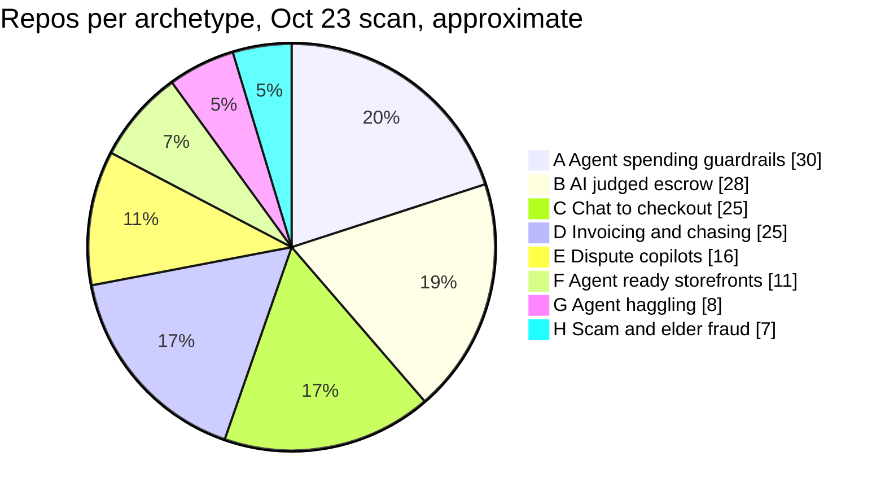
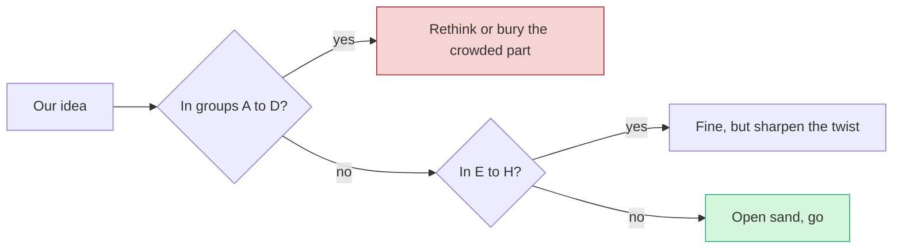

# Live Competition Scan (Oct 23)

> [!tldr] In one breath
> On Oct 23 we found 266 public GitHub repos built for this hackathon and sorted them by type. **The packed areas are agent spending guardrails (~30), AI judged escrow (an AI referee decides when held money is released, ~28), chat to checkout bots (~25) and invoice chasers (~25).** Accessibility, nonprofits, inclusion and developer tooling are almost empty, and some sponsor prizes have barely any competition.

> [!example] Picture this
> You arrive at a beach and every towel is squeezed into the same 20 metres near the ice cream van. Down the sand there is lots of open space with a perfectly good view. This note is the aerial photo of that beach. Where the towels are bunched, you'd have to be the best of 30. Where the sand is empty, you only have to be good.

## The event right now

| Fact | Value | Confidence |
|---|---|---|
| Official project gallery | **Not public yet.** "The hackathon managers haven't published this gallery yet" | high |
| Registered participants | **18,754** (was 11,274 on Oct 11) | high |
| Cash prizes | $67.5K+ | high |
| Dedicated $5K prizes | Best Use of Agentic Commerce, Best Use of PayPal + AI, Most Creative, Most Impactful, Best Demo | high |
| Sponsor prizes | AG Grid ($5K/$2K/$1K), APIMatic ($1K x3), Bryntum ($1K x3), Channel3 ($1.5K), Render (credits) | high |
| Judging criteria | Technological Implementation, Design (complete product, not proof of concept), Potential Impact, Innovation ("differs from existing concepts"), Presentation | high |
| Must submit | Working demo, public open source repo with a visible license, YouTube video under 3 minutes | high |
| Estimated final submissions | 500 to 1,000+ | estimate, not data |

**PayPal's own "Inspiration" list** (expect many teams to copy it): shopping or checkout agent, auto pay contractors, agent to agent negotiation, receipt bill split, freelancer multi currency invoicing, creator tipping, marketplace split payouts, budgeting categoriser, accessible donations, microloans, community pooling.

## How we counted

We searched GitHub for public repos created 2026-09-01 to 2026-10-22 that mention the hackathon, using the GitHub search API. **We found 266.** Coverage is partial because the API limits how many searches you can run. Each repo was sorted into an archetype from its description, and one repo can show up in more than one group.

## The crowd heat map

| Heat | Archetype | ~Count | Example repos | What it means for us |
|---|---|---|---|---|
| Very high | **A. Agent spending mandates, guardrails, firewall between AI agent and PayPal** | ~30 (most saturated) | [permit](https://github.com/FetchDoge/permit) (caps, allowlist, emergency stop, hash chained receipts), [mandate](https://github.com/KaparthyReddy/mandate) ("OAuth for AI spending"), [Warden](https://github.com/arnavgupta2004/Warden), paypal-agent-firewall (midas-png, Z3 formal verification), four repos named "leash", three named "allowance", two "countersign", payguard x3, mandateguard, aegismandate, SafePayAI, payagent-mesh, agenttab, sentinel-prooflayer, trust-engine-v2, allowagent-mcp, riderpay, Mandat, PricePilot | **Do not pitch a guardrail.** Include one quietly inside a bigger idea if needed. |
| Very high | **B. AI verified escrow, milestone release via authorize then capture or void** | ~28 | [handback](https://github.com/ZNLong2203/handback) (rental deposit photo compare), milestone-ai-escrow (AI writes tests, a passing PR releases funds), mergepay (GitHub bounties via Payouts), three named "ProofPay", fairshake, holdfast, TrustLock, ArbiterPay, specpay, judgepay, PayGrade, stood, escrowease, trustrail-hold, wasl, rentabot, sudhaar, PropLock, tidehold, outcomepay, scopepay, fairdeal | Authorize then capture is no longer a novelty. A rental deposit idea like [[D009 Rental Deposit Inspector (Deep Dive)\|D009]] already has a twin in handback. |
| Very high | **C. Chat shopping or checkout agent that ends in a PayPal order** | ~25 | at least 10 repos named "PayPilot"; checkout-agent, errand (Channel3), buyguy, agentic-cart, gofer, sahaya (voice), kincart (elderly relative + family approval), shopvoice-pay, procurement agents (procure-agent, procurepilot, procura-ai, reliefos) | The "PayPilot" cliché. Judges will see a dozen. Avoid. |
| Very high | **D. Freelancer and small business invoicing, chasing what you're owed** | ~25 | ledgerbird, ledgerly, two "invoicepilot", chaser (Agent Toolkit), owed (Bryntum), sorted, docket, brigpay, paid-tonight, clause-and-pay, paceline, duespilot (AR agent negotiates with client AP agent), kioku, guardian-ai, docpilot; WhatsApp to invoice: invoicepilot, panjar, sarafupay; handwritten IOU book photo | Invoicing is now crowded. An idea here needs a very sharp twist. |
| High | **E. Dispute and chargeback copilots** | ~16 | witness, dispute-defender, dispute-copilot (AG Grid), rebuttal, dispute-radar (LightGBM), dispute-autopilot, two "disputedesk", dispute-steward, Docket, two "payguard-ai". Close cousins: **preflight-for-paypal** (seller protection checker, near duplicate of idea #23), subguard, returngate, clippay (partial refunds) | Busy. [[D023 Seller Protection Preflight (Deep Dive)\|D023]] now has a near twin in preflight-for-paypal. |
| Medium | **F. Agent ready storefronts, MCP, WebMCP for merchants** | ~11 | suede-shelf, paypal-webmcp-shop, leafline-agent-store, shopfront-agent, AgentBaazar, ShopGenie, vendorapay, mrstockd, uamarket, atlas-order-agent, paypal-agent-shop | Medium crowd. [[D047 WebMCP Storefront Kit (Deep Dive)\|D047]] would need to stand out. |
| Medium | **G. Agent to agent haggling** | ~8 | three "haggle", Haggle Court, mandado, negotiator-payments, asterion-commerce, duespilot | Medium crowd, and it is on PayPal's inspiration list. |
| Low | **H. Scam and elder fraud protection** | ~7 | scam-shield-paypal, Haven, guardianpay, nonna-mode, safesend, kincart; breakpoint (red teams a shop's AI checkout assistant) | Some company for [[D032 F&F Scam Interrupter (Deep Dive)\|D032]], but far from packed. |
| Low | **I. Smaller clusters** | 3 to 6 each | group pooling and splitting (caresplit, potluck, purser, sarafupay, WePay, homeward); reconciliation (settlesight, settleproof, cleared-settle, creatorsettle); payouts to workers or bounties (payday-agent, Burmalda, takken, routewell; the only PYUSD use found); HTTP 402 pay per crawl (TollGate, adparity, skuuy); budget agents (budget-guardian, two paypal-budget-agent, Monetra) | Room to move. Note that CrawlerPal, an AI paywall agent, **won 1st at PayPal Dev Days 2025**, so pay per crawl has a track record. |
| Single | **J. Distinctive one offs** | 1 each | [cutover](https://github.com/jeretc/cutover) (AI migrates legacy NVP, checkout.js and IPN to Orders v2 and JS SDK v6, verified in sandbox), ebb (household agents bid electricity flexibility, Payouts settle), rain-day-cover (parametric weather income cover for roofers), plainpay and plainbill (medical bills explained and paid), claimguard-pay, meddata-escrow, answertab (pay per answer on live streams), pulsepay (biometric POS), paypal-webhook-simulator, hearthline (APIMatic SDK) | These are the teams to watch. Original, specific, and hard to compare against. |

_The pie shows groups A to H only. Group I has 3 to 6 repos per small cluster and group J is single repos, so they are left out to keep the counts honest._

**Crowd ranking, most to least packed:** 1 agent mandates and guardrails; 2 AI judged escrow; 3 chat to checkout (the "PayPilot" cliché); 4 invoicing; 5 dispute copilots; 6 MCP storefronts and haggling (medium).

**Other hackathons looked the same.** The SF x402 hackathon (Feb 2026: Superpage, Pincer, World of Geneva) and Circle Arc (Jan 2026: OmniAgentPay, AIsaEscrow, AIsaPay) were dominated by agent wallets, escrow and pay per API. See [[14 Prior Winners & Duplicated Archetypes]].

## Empty land

**These areas had zero or almost zero repos in the scan.** Several are on PayPal's own inspiration list, which makes them even more attractive.

| Area | What we found | Why it is interesting |
|---|---|---|
| Accessibility first payments | **Zero hits** | It is on PayPal's own list. See [[D084 Accessible Voice Checkout (Deep Dive)\|D084]] |
| Nonprofits and donations | Only amanah + a classroom repo | "Accessible donations" is on PayPal's list |
| Microloans, inclusion, underbanked | None | Microloans are on PayPal's list |
| Pay Later or Subscriptions as the core | Thin: triad, subscription-killer | Underused PayPal products |
| Marketplace split payouts | Not found as the main idea | On PayPal's list |
| Developer tooling for PayPal integrators | Only cutover and the webhook simulator | Echoes the Dev Days 2025 SDK upgrade winner. See [[D056 Integration Chaos Monkey (Deep Dive)\|D056]] |
| Cross border FX | Thin: homeward, WePay, tradeos | Real pain, few builders |
| Venmo, PYUSD, Payouts at scale, Transaction Search analytics | 1 to 2 repos each | PayPal products almost nobody is showing off |
| Untouched verticals | Events and ticketing, education, agriculture and co-ops, tax and 1099, insurance (except rain-day-cover and tidehold), household worker payroll, climate and community pooling | Whole industries with no entry |

## Sponsor gaps

**Some sponsor prizes have very little competition.** Fewer rivals means better odds for the same effort.

| Sponsor | Prize | Repos using it | Read |
|---|---|---|---|
| APIMatic | $1K x3 | **1 to 2** | Fewer teams than prizes so far. Best odds. |
| Channel3 | $1.5K | ~4 | Thin |
| Bryntum | $1K x3 | ~5 | Thin |
| AG Grid | $5K/$2K/$1K | ~20 | More contested, but the biggest pool |
| Render | Credits | not counted | n/a |

See [[15 Sponsor Tools]] for what each tool does.

## Confidence notes

| Claim | Confidence |
|---|---|
| Gallery status, prizes, criteria | high |
| That each repo exists | high |
| That each repo will actually be submitted | medium |
| Coverage of all entries | partial (GitHub search was rate limited) |
| Archetype counts | medium (sorted from descriptions, not code) |
| Social media posts | low coverage |
| Final submissions 500 to 1,000+ | estimate, not data |

> [!warning] Read the counts as a heat map, not a census
> Many teams keep repos private until the deadline, and the search was rate limited. The real numbers are likely higher everywhere. **The ranking of crowded vs empty is the useful part.**

## Prior winners worth remembering

PayPal Dev Days 2025: CrawlerPal (1st), a Shopware SDK v6 upgrade, and Rosen (PYUSD), per developer.paypal.com/community/blog/winners-dev-days-hackathon (2025-05-29).

## Sources
* paypalaihackathon.devpost.com (home, resources, updates, project-gallery)
* api.github.com search/repositories
* skale.space/blog/san-francisco-agentic-commerce-x402-hackathon-recap-winners
* lablab.ai/ai-hackathons/agentic-commerce-on-arc/live
* algorand.co/blog/agentic-commerce-x402-hackathon-berlin-recap
* developer.paypal.com/community/blog/winners-dev-days-hackathon

> [!info]- Jargon decoder
> **Repo**: a project's code folder on GitHub. Public means anyone can see it.
> **Archetype**: a type of project many teams build in slightly different ways.
> **Saturated**: so crowded that standing out is very hard. Like the 30th lemonade stand on one street.
> **Mandate / guardrail / agent firewall**: rules that stop an AI agent from spending too much or on the wrong thing. A permission slip with limits.
> **E stop**: emergency stop button.
> **Hash chained receipts**: receipts linked so that changing one breaks the chain, like numbered pages glued together.
> **Formal verification (Z3)**: using a maths tool to prove the rules can never be broken, not just test them.
> **Escrow**: a neutral middle holds the money until the job is checked.
> **Authorize then capture or void**: like a hotel holding $200 on your card at check in, then charging only what you used, or cancelling the hold.
> **AR / AP agent**: accounts receivable (money owed to you) and accounts payable (money you owe). Here, one company's AI haggles with another's.
> **MCP / WebMCP**: standard plugs that let an AI use a tool, or a website list tools an AI can use directly.
> **Haggling agents**: two AIs negotiating a price with each other.
> **Red team**: attacking your own system on purpose to find weak spots.
> **HTTP 402 / pay per crawl**: a website charging AI bots a tiny fee to read a page. A toll booth for robots.
> **PYUSD**: PayPal's digital dollar coin.
> **Parametric insurance**: pays out automatically when a measured event happens (like a set amount of rain), with no claim form.
> **NVP, checkout.js, IPN**: old PayPal integration methods that many shops still run and need to upgrade.
> **Rate limited**: the website only lets you ask so many questions per hour.
> **OAuth**: the "log in with" permission system, here used as a metaphor for giving an AI limited spending rights.
> **Allowlist**: a list of the only shops or payees the agent may pay. A guest list at the door.
> **PR (pull request)**: a proposed code change. Here, a passing PR is the proof that releases the money.

## Where to next
* ⬆️ Up: [[00 PayPal AI Hackathon Hub]]
* ⬅️ Previous: [[16 Developer Pain, Gaps & Hidden Insights]] · ➡️ Next: [[18 AI and Fintech Frontier (Oct 2026)]]
* 🔗 Related: [[14 Prior Winners & Duplicated Archetypes]], [[15 Sponsor Tools]], [[70 The Winning Idea]], [[Theme C Control group (obvious ideas)]]
