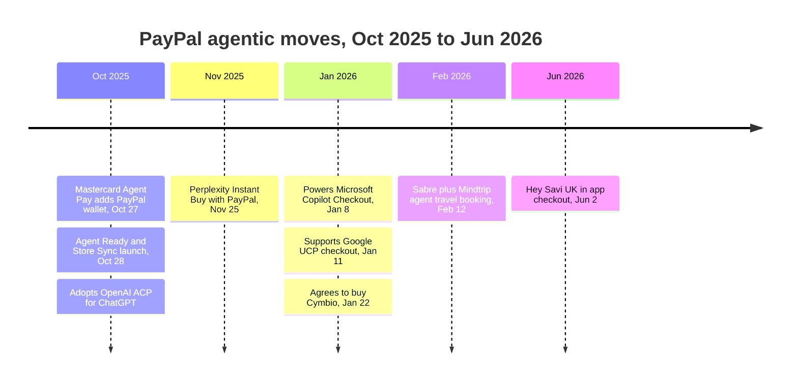
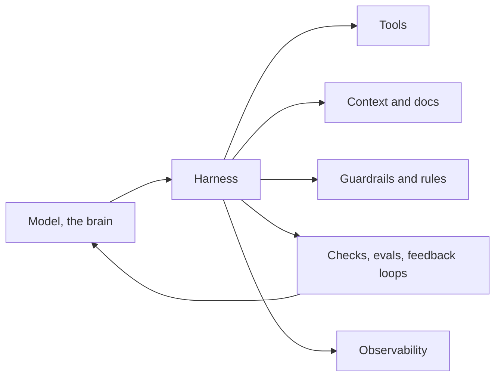
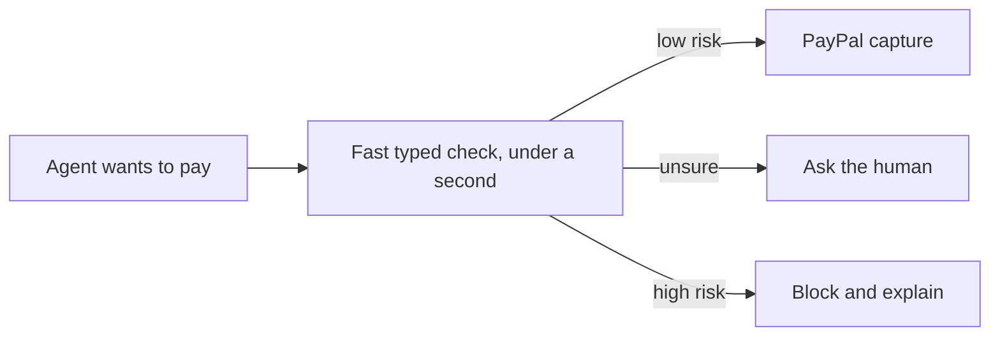

# AI and Fintech Frontier (Oct 2026)

> [!tldr] In one breath
> From mid 2025 to Oct 2026, every big payment company launched its own rulebook for letting AI agents shop and pay, and PayPal plugged itself into almost all of them. **The hard parts are still open: who pays when an agent gets it wrong, how to prove what the agent was told, how to stop agents being tricked, and how to approve risky steps quickly.** New "typed answer" models like Jev could make safety checks fast enough to sit inside a checkout.

> [!example] Picture this
> Imagine every country suddenly inventing its own plug socket in the same year. Your phone charger works in some places and not others, and nobody agrees who pays if a plug sets a toaster on fire. That is agent payments right now. PayPal is trying to be the travel adapter that fits every socket.

> [!info] How reliable is this note?
> Mostly secondary blogs. The PayPal newsroom, the Visa TAP article and the Jev blog were checked directly. The newest PayPal AI newsroom item found was Jun 2 2026. Checked 2026-10-23.

## 1. Agent payment protocols, one line each

| Protocol or product | Who | One line analogy |
|---|---|---|
| **ACP** (Agentic Commerce Protocol) | OpenAI + Stripe | A checkout counter built inside the chatbot |
| **UCP** (Universal Commerce Protocol) | Google | A shared shop layout so any agent can walk any store |
| **AP2** (Agent Payments Protocol) | Google, now at FIDO | A signed permission slip saying what the agent may buy |
| **Verifiable Intent** | Mastercard (with Google) | A tamper proof diary of what you asked and what the agent did |
| **Trusted Agent Protocol (TAP)** | Visa + Cloudflare | A verified ID badge a good bot shows at the shop door |
| **Agent Pay / Agentic Tokens** | Mastercard | A card number that works for one agent and one set of rules only |
| **Agent Purchase Protection** | Amex | Insurance when your registered agent buys the wrong thing |
| **x402** | Coinbase | A toll booth: pay a few cents in crypto, then the page opens |
| **PYUSD** | PayPal | A digital dollar that machines can pass to each other |
| **WebMCP** | Google + Microsoft | A website putting a menu of buttons on the counter for robots |

### PayPal's agent timeline

Source: newsroom.paypal-corp.com/news-aritificial-intelligence

* **Oct 27 2025:** Mastercard Agent Pay integrates the PayPal wallet.
* **Oct 28 2025:** PayPal Agentic Commerce Services. "Agent Ready" lets existing merchants accept payments on AI surfaces, with fraud detection + buyer protection. "Store Sync" makes catalog, inventory and fulfillment discoverable by AI channels. PayPal adopts OpenAI ACP for ChatGPT checkout, built on NVIDIA Nemotron (digitalcommerce360.com 2025/10/28; techcrunch.com 2025/10/28).
* **Nov 25 2025:** Perplexity Instant Buy with PayPal.
* **Jan 8 2026:** PayPal powers Microsoft Copilot Checkout.
* **Jan 11 2026:** PayPal supports Google UCP checkout in AI Mode and Gemini (some sources still say "coming soon" as late as May 2026).
* **Jan 22 2026:** PayPal to acquire Cymbio, which powers Store Sync, closing in H1 2026.
* **Feb 12 2026:** Sabre + Mindtrip + PayPal agent travel booking.
* **Jun 2 2026:** Hey Savi UK with in app PayPal checkout (Debenhams first).

**The takeaway: PayPal is on nearly every agent surface. It doesn't own the protocols, it plugs into them.**

### PayPal Agent Toolkit and MCP server
* TypeScript + Python toolkit, local @paypal/mcp, and a hosted remote MCP (sandbox + prod; SSE + Streamable HTTP).
* Tools: orders, invoices, subscriptions, refunds, disputes, shipment tracking, transactions. OAuth login; tools are scoped by token.
* A third party review (Jul 2026, vorplabs.com/agent-tools/paypal-agent-toolkit) found **no built in human approval step before risky calls like refunds or accepting disputes.**
* Docs: paypal.gitbook.com/agent-toolkit-and-mcp-server; developer.paypal.com/community/blog/mcp-server-toolexpansion/

### OpenAI and Stripe ACP
* Launched Sept/Oct 2025.
* Reports say OpenAI scaled back in chat Instant Checkout in March 2026 after weak conversion. Walmart's in chat checkout converted about one third as well as its own site. OpenAI pivoted to discovery first plus retailer apps. (Not verified against OpenAI.)
* The ACP spec has had 4 revisions, the latest in Apr 2026 (feeds, carts, auth, order updates).
* Sources: manchesterdigital.com agentic commerce update mid 2026; naturaily.com/blog/agentic-commerce-shopify-guide.

**Lesson: putting a checkout inside a chat did not convert well. Trust and the handoff are the hard bit.**

### Google UCP and AP2
* UCP launched Jan 11 2026 at NRF (Shopify, Etsy, Wayfair, Target, Walmart), covering the full commerce flow.
* AP2 is the mandates and authorization layer.
* Apr 28 2026: Google donated AP2 to the FIDO Alliance. AP2 v0.2 added "Human Not Present" payments.
* Mastercard Verifiable Intent (with Google, Mar 5 2026 per one source; also donated to FIDO): a cryptographic, tamper proof log tying together the consumer, the agent's instructions and the outcome.
* FIDO working groups: Payments (Mastercard and Visa chair) and Agentic Authentication (Google, OpenAI, CVS).
* Sources: pymnts.com 2026 google mastercard FIDO; helpnetsecurity.com/2026/04/29/fido-alliance-ai-agents-authentication-payments-standards/

### Visa, Mastercard, Amex
* **Visa:** Intelligent Commerce, Apr 30 2025. Trusted Agent Protocol, Oct 14 2025, with Cloudflare on Web Bot Auth (HTTP Message Signatures). Working with x402 is in progress (digitaltransactions.net).
* **Mastercard Agent Pay:** Apr 29 2025. "Agentic Tokens" on MDES, each scoped to one agent + one commerce policy.
* **Amex Agent Purchase Protection** (Apr 2026, single source): covers charges caused by agent errors when the agent is registered and the intent was authenticated.

### Coinbase x402 and PYUSD
* **x402** (dates approximate): any ERC-20 token (Mar 2026); batch settlement escrow + off chain vouchers (May 2026); AWS integration, CloudFront/WAF "charge the bots" (May to Jun 2026); Coinbase Business accepts agent USDC (Jul 2026).
* A claim citing Chainalysis says agent payments grew from ~1.5K to 138M+ by Q3 2026 (unverified).
* **PYUSD** is positioned as a settlement asset for machine to machine payments, with ~$3.5B market cap in Apr 2026 (single source). **No primary source found for a PayPal x402 or "PYUSD for agents" product.**

### WebMCP
* Google + Microsoft, a proposed W3C standard. Sites declare tools via document.modelContext (name, description, JSON Schema).
* Chrome 146 Canary preview Feb 2026; shown at I/O 2026; origin trial reportedly Chrome 149 to 156.
* **Open question: how login and sessions work for payment actions** (searchengineland.com webmcp explained).

## 2. Harness engineering in plain words

**Agent = Model + Harness.** The model is the brain. The harness is everything around it: the tools it can use, the context and docs it reads, the architecture rules it must follow, the guardrails, the loops that check its work, the evals that grade it, and the observability that records what it did.

Think of a racing horse. The horse is fast but has no idea where the track is. The harness, reins, blinkers and jockey turn raw speed into winning a race. In AI, the same model can be useless or brilliant depending on the harness.

* It is framed as the next phase after **prompt engineering** (writing good questions) and **context engineering** (feeding the right documents).
* The key source: OpenAI, "Harness engineering: leveraging Codex in an agent first world" (Ryan Lopopolo, Feb 11 2026). An internal product was built over 5 months with no hand written code, in about 1/10 the time. openai.com/index/harness-engineering/
* Survey, Mar 2026: yage.ai/share/harness-engineering-survey-en-20260312.html; also faros.ai/blog/harness-engineering; markolukicic.substack.com/p/harness-engineering.
* Anthropic "Effective harnesses for long running agents" (Nov 2025, from memory, not checked again). A claimed Martin Fowler framework is unverified.

**Why it matters for us:** judges will reward a payment agent whose harness is visible: approval checks, retries, logs and tests, not just a clever prompt. AG Grid's prize text even mentions "a swapped-in harness" (see [[15 Sponsor Tools]]).

## 3. Jev and lightning fast typed answers

### What it is
**Jev**, from TypeSafe AI, is a "System One" model. It does not write sentences. It returns only **structured, typed decisions**: a choice, a yes/no, or a numeric score, each with a probability.

It is **non autoregressive**: instead of writing one word at a time, it answers many typed questions about one block of state in a single forward pass. Think of a doctor glancing at a chart and ticking ten boxes at once, instead of dictating a letter word by word.

* Latency: ~70 to 500 ms.
* Announced ~Sept 15 to 16 2026. Whether console.typesafe.ai is early access only or open is unclear.
* Sources: typesafe.ai/blog/introducing-system-one-models-and-jev; seangoedecke.com/jev-means-structured-output-is-interesting-again/; levelup.gitconnected.com "your agent loop is paying LLM prices for yes/no answers".

### Why it matters for payments
A checkout cannot wait 5 seconds while a big model writes an essay about whether a payment looks risky. **A sub second, typed "approve / hold / ask the human" answer with a probability is exactly the shape of a fraud, approval or risk gate inside an agent checkout loop.** It also makes logs cleaner: a score of 0.91 is easier to audit than a paragraph.

### The disputed claims

| Vendor claim | Status |
|---|---|
| 20 to 200x faster | Vendor claim |
| 40 to 400x cheaper | Vendor claim |
| Calibrated probabilities | Vendor claim |
| "Immune to hallucination" | **Disputed by Sean Goedecke** |
| Access open to all | Unclear |

### Alternatives if Jev is not available
* **Cerebras:** ~2,000 to 3,000 tokens/s (Llama 3.3 70B, gpt-oss-120B).
* **Groq:** ~500 to 1,200 tokens/s (tied to NVIDIA via a reported $20B licensing deal). Source: costbench.com/best/fastest-llm-inference/
* JSON schema structured outputs are believed to be supported on both. Check the docs.

## 4. Risks and opportunities

| Topic | What is happening | Source |
|---|---|---|
| Prompt injection at checkout | arXiv 2601.22569 (Jan 2026) red teamed AP2 agents on Gemini 2.5 Flash. "Branded Whisper" manipulates product ranking. "Vault Whisper" extracts user data. Unit 42 (Mar 2026): hidden instructions on a coupon site got a UCP agent to add an unauthorized gift card | unit42.paloaltonetworks.com/retail-fraud-agentic-ai/ |
| KYA, agent identity | Visa TAP, Web Bot Auth, scoped Agentic Tokens, FIDO agentic auth. Proof, Jul 2026: "the identity layer nobody built" | proof.com/blog |
| Verifiable intent and mandates | AP2 mandates, Mastercard Verifiable Intent | see §1 |
| Disputes | Agent chargebacks need new evidence: proof of delegated authority, purchase parameters, notification timestamps | chargeflow.io agentic commerce chargebacks evidence playbook |
| Stablecoin micropayments | x402 pay per call | see §1 |

## 5. Unsolved gaps, mapped to opportunity

| Gap experts call unsolved | Evidence | Opportunity for a team |
|---|---|---|
| **Liability is unassigned** between consumer, AI provider and merchant. Agent transactions are card not present with no liability shift. Under Reg E it is unclear whether agent authorization counts as consumer consent | chargeflow.io/blog/ai-agent-chargeback-liability; stellagent.ai mastercard CEO risks. CFPB Jan 2026 advisory and EU AI Liability Directive claims unverified | A clear record of who approved what, ready for a dispute. See [[13 Problem Evidence Base]] §6 |
| **Protocol fragmentation**: 5+ protocols (ACP, UCP/AP2, TAP, Agent Pay, x402) | atxp.ai comparison 2026 | A translation or orchestration layer: cross protocol checkout adapter |
| **Poor conversion inside agents** (the ACP pullback) | See §1 ACP | Better trust and UX at the handoff to payment |
| **No approval gating for agent tools**: PayPal MCP has no mandatory human in the loop for refunds or disputes | vorplabs.com review, see §1 | Agent firewall on PayPal MCP, **but see the warning below** |
| **Prompt injection defense** for shopping agents | arXiv 2601.22569, Unit 42 | Stronger isolation between components; injection detection |
| **WebMCP login and session for payment actions** undefined | searchengineland.com | A safe pattern for WebMCP checkout handoff |
| **Dispute evidence packaging** for agent transactions | chargeflow.io playbook | Agent dispute evidence builder |

**Angles the raw research suggested:** an agent firewall on PayPal MCP (Jev or Cerebras fast risk gating, mandate checks, injection detection); an agent dispute evidence builder; a cross protocol checkout adapter.

> [!warning] Crowd check, Oct 23 2026
> The agent firewall and mandate idea is the **most crowded archetype in this hackathon, with ~30 repos** (permit, mandate, Warden, paypal-agent-firewall, four "leash" repos and more). Fast typed risk checks are a good *ingredient*, not a good *headline*. See [[17 Live Competition Scan (Oct 23)]].

> [!info]- Jargon decoder
> **Agentic commerce**: AI agents that don't just suggest products but actually buy them for you.
> **Protocol**: a shared rulebook so different systems can talk. Like everyone agreeing to drive on the same side of the road.
> **Mandate**: a signed set of limits you give an agent ("max $50, groceries only").
> **Human Not Present**: the agent pays while you are not watching, using rules you set earlier.
> **FIDO Alliance**: the industry group behind passkeys. Now writing rules for agent login and payments.
> **Card not present / liability shift**: online card payments where the card isn't physically shown. A liability shift means someone else (usually the bank) takes the loss if fraud happens. Agents don't get one yet.
> **Reg E**: the US rule that protects consumers from unauthorized electronic payments.
> **Web Bot Auth / HTTP Message Signatures**: a bot signing each request so a website knows it is a known, good bot. A stamped visitor pass.
> **MDES / token**: Mastercard's system that swaps your real card number for a stand in number.
> **ERC-20 / USDC / stablecoin**: a standard crypto token format, and digital coins pegged to $1.
> **Off chain vouchers / batch settlement**: writing IOUs quickly and settling them all together later, like a bar tab.
> **MCP / SSE / Streamable HTTP / OAuth**: the AI tool plug, two ways of streaming its messages, and the "log in with" permission system.
> **Origin trial**: Chrome letting chosen websites test a new feature before it is official.
> **JSON Schema**: a template that says exactly what shape an answer must have, like a form with labelled boxes.
> **Harness**: everything around an AI model that makes it useful and safe: tools, rules, checks, logs.
> **Evals**: tests that grade how well an AI does its job.
> **Observability**: recording every step an agent takes so you can replay it, like a flight recorder.
> **Autoregressive vs non autoregressive**: writing one word at a time vs answering everything in one go.
> **Forward pass**: one run of the model from input to output.
> **Latency / ms**: how long you wait for an answer, in thousandths of a second.
> **Calibrated probability**: when the model says 80% sure, it is right about 80% of the time.
> **Hallucination**: an AI confidently making something up.
> **Tokens per second**: how fast a model writes. A token is roughly part of a word.
> **Prompt injection**: hidden text that tricks an AI into doing something else, like a forged note from the teacher.
> **Red team**: attacking your own system on purpose to find holes.
> **KYA**: Know Your Agent, ID checks for AI agents.
> **Chargeback**: the bank pulling money back from a merchant after a customer complains.
> **SDK**: software development kit, a box of ready made code pieces.
> **W3C**: the group that sets official web standards.
> **NRF**: the National Retail Federation, whose big January show is where retail tech gets launched.

## Where to next
* ⬆️ Up: [[00 PayPal AI Hackathon Hub]]
* ⬅️ Previous: [[17 Live Competition Scan (Oct 23)]] · ➡️ Next: [[70 The Winning Idea]]
* 🔗 Related: [[16 Developer Pain, Gaps & Hidden Insights]], [[12 Agentic Payments Landscape]], [[Jargon Decoder]]
