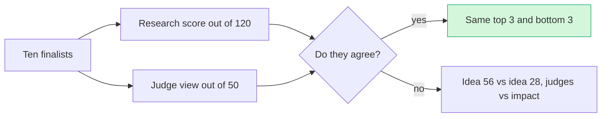

# Final comparison of the Top 10

> [!tldr] In one breath
> Here are the ten finalist ideas in one table, scored two different ways. Both scores agree on the top 3 and the bottom 3. Every finalist is weakest on Impact, so that is the part of the pitch to fix.

> [!example] Picture this
> Two friends rate the same ten pizzas. One is a food critic with a 120 point checklist. The other just asks "would I order this again?" and gives marks out of 50. Where they agree, you can trust the result. Where they disagree, you learn something about what each one cares about.

> [!warning] Update, Oct 23 2026
> The table below is the Oct 12 picture. On Oct 23 a live repo, preflight-for-paypal, turned up doing the core job of #23. See [[70 The Winning Idea]] for the new pick.

## The two scores

* **120 point score**: the research score from our own detailed scoring method.
* **Judge score out of 50**: the council judge reading the five Devpost criteria literally. Each criterion gets 1 to 10 points: Tech (Technological Implementation), Design, Impact, Innovation, Presentation.

They disagree in places, and **that disagreement is useful information**.

| Idea | 120 pt | Judge /50 | Tech | Design | Impact | Innov. | Present. | Main strength | Main weakness |
|---|---|---|---|---|---|---|---|---|---|
| #23 Preflight | 89 | 39 | 8 | 8 | 7 | 8 | 8 | Scarcity; hooks into PayPal's own policy | AI may look decorative |
| Wrong Box | 88 | 36 | 8 | 8 | 5 | 6 | 9 | Best video moment; two PayPal money movements | Provenant overlap; impact is about the future |
| #55 Payout Triage | 86 | 35 | 8 | 8 | 6 | 6 | 7 | Covers the unhappy path, plus a compliance refusal | Leans on mocks; Payouts is crowded |
| #28 Early Pay | 85 | 30 | 6 | 7 | 6 | 5 | 6 | Clear cash flow value for small businesses | One API family; Chaser exists |
| #56 Chaos Monkey | 80 | 31 | 8 | 6 | 4 | 6 | 7 | DevRel will enjoy it | /paypal:doctor exists; impact is anecdotal |
| #42 Selection firewall | 76 | 30 | 6 | 7 | 5 | 5 | 7 | Clever counterfactual flip | Warden in the same hackathon |
| #9 Rental Deposit | 81 | 30 | 7 | 8 | 5 | 3 | 7 | Clean holds mechanic | RentProof is a near duplicate |
| #20 Dispute to Listing | 80 | 29 | 6 | 7 | 5 | 5 | 6 | Real dispute data | ReasonWhy exists; the PayPal fix is cosmetic |
| #84 Accessible Checkout | 75 | 29 | 4 | 8 | 6 | 5 | 6 | Strong accessibility evidence | Cannot touch the PayPal popup |
| #8 Overcapture | 78 | 25 | 6 | 6 | 4 | 5 | 4 | Documented mechanic | The demo is a JSON number; consent laws |

## What the table tells us

* **The two scores agree on the top 3 and the bottom 3.** They disagree on #56. The judge view rates it above #28 because DevRel judges (the developer relations team: PayPal people whose job is helping outside developers) are the audience. The research score rates #28 higher on impact.
* **Impact is the weakest score for every finalist (4 to 7).** No finalist has top tier primary evidence of how badly a named group of people is hurt. The best evidenced problems (disputes, holds, late payment) are in [[13 Problem Evidence Base]]. #23 rests on PayPal policy text, not on a measured count of how often the scam happens. **This is the main thing to fix in the pitch.**
* **Innovation separates the pack.** Every demotion in [[43 Score Reconciliation]] was an innovation cut, made after a close competitor was found.

## A warning about the method

The Judge /50 column is one Claude subagent pretending to be a judge, not a real judge. **Use it as a lens, not as evidence.**

> [!info]- Jargon decoder
> **DevRel**: developer relations. The PayPal team that helps outside coders use PayPal, a bit like the friendly staff at a hardware store who show you how to use the tools.
> **Unhappy path**: what happens when things go wrong (card declined, wrong email). Like a fire drill: you test it on purpose so you know the exits work.
> **Mock**: a fake response that looks real, like a cardboard cutout of a cake on a bakery shelf.
> **Payouts**: PayPal's tool for sending money to many people at once, like a teacher handing out prize envelopes.
> **Counterfactual flip**: checking "would the AI have chosen differently if this sneaky text were not there?" Like asking whether you'd still buy the cereal if the cartoon on the box were gone.
> **Overcapture**: charging a bit more than the amount first held on a card, within set limits. Like a restaurant adding the tip after the card was first swiped.
> **Holds**: money reserved on a card but not yet taken, like a hotel holding $200 at check in.
> **Subagent**: a helper copy of the AI given one narrow job.

## Where to next
* ⬆️ Up: [[00 PayPal AI Hackathon Hub]]
* ⬅️ Previous: [[50 Top 10 Overview]] · ➡️ Next: [[61 Top 3 & Winner Recommendation]]
* 🔗 Related: [[62 Council Reports]], [[43 Score Reconciliation]], [[13 Problem Evidence Base]], [[70 The Winning Idea]]
