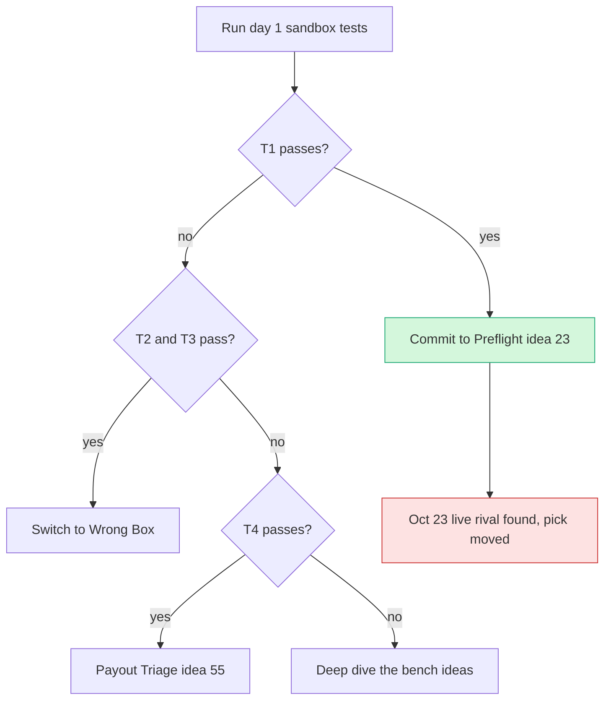

# Top 3 and winner recommendation

> [!warning] Superseded on Oct 23 2026
> Superseded on Oct 23 2026: a live repo preflight-for-paypal now does #23's core job, so the pick moved. See [[70 The Winning Idea]]

> [!tldr] In one breath
> On Oct 12 we picked #23 Seller Protection Preflight, with "Wrong Box" as the backup and #55 Payout Failure Triage third. On Oct 23 a live GitHub repo turned out to do #23's main job, so the pick moved to [[70 The Winning Idea]]. Everything below is the Oct 12 reasoning, kept as history.

> [!example] Picture this
> You plan to open the only taco stand on your street. You pick the spot, buy the sign, and practise the menu. Then, a week later, you walk past and see a brand new taco stand already open on that exact corner. Your plan was not wrong when you made it. It just stopped being the best plan. This note is the old plan, kept so you can see how the thinking went.

> [!warning] Crowd check, Oct 23 2026
> The live scan of 266 GitHub repos found **preflight-for-paypal**, a seller protection checker that is a near duplicate of #23. It sits next to the dispute copilot cluster (about 16 repos, including witness, dispute-defender, dispute-copilot, rebuttal, two "disputedesk"). Wrong Box sits near the AI verified escrow cluster (about 28 repos) and the agent guardrails cluster (about 30, the most crowded). #55's area, payouts to workers, was small (payday-agent, Burmalda, takken, routewell). See [[17 Live Competition Scan (Oct 23)]].

## History: the Oct 12 pick

### The Top 3

| Rank | Idea | Final | Why it wins | Biggest risk | Decisive day 1 test |
|---|---|---|---|---|---|
| 1 | [[D023 Seller Protection Preflight (Deep Dive)\|#23 Seller Protection Preflight]] (+ tracking release + evidence pack) | 89 | No Devpost entry found doing the gate before shipping (DisputeDesk overlaps only the evidence module); starts from a word for word PayPal policy clause; uses Orders, Transaction Search, Tracking and Disputes beyond checkout | AI reads as decorative next to a rules engine | T1 |
| 2 | [[Wrong Box Combined Concept\|"Wrong Box"]] (#3 + #1 + #2) | 88 | Best 3 minute visual: one photo, two payers, two PayPal money movements | Provenant overlaps the liability angle | T2, T3 |
| 3 | [[D055 Payout Failure Triage (Deep Dive)\|#55 Payout Failure Triage]] | 86 | Literally "test the unhappy paths"; the compliance refusal is memorable | Failure branches may be mocks | T4 |

In plain words:
* **#23** checks an order *before* the seller ships it, to make sure the seller keeps PayPal Seller Protection. Seller Protection is PayPal's promise to cover a seller if a buyer falsely says "it never arrived". It is like a warranty that only holds if you follow the instructions on the box, here "ship to the address shown in PayPal".
* **Wrong Box** uses a photo of what arrived to decide who pays when an AI shopping agent's order goes wrong.
* **#55** fixes stuck payouts: money sent through PayPal that nobody picked up.

### The recommendation (Oct 12)

**Build #23 first, and keep Wrong Box as the agreed backup plan.** Reasons:
1. Two of the three council roles ranked #23 first, and the third ranked it third. So it never fell out of the set.
2. Innovation is a full fifth of the score. #23 was the only Top 3 member whose core mechanism had no near duplicate in the same hackathon. Wrong Box has Provenant. #55 has HoldWatch and ≥10 Payouts entries. #23's evidence pack module does overlap DisputeDesk, hence the advice to keep the gate as the headline.
3. Its PayPal usage matches PayPal's own interest (fewer lost Seller Protection claims). That is the story DevRel judges (PayPal's developer relations team) say they want.

**Why not just take the builder's top pick?** The builder's pick (Wrong Box) has the stronger video but the weaker novelty position. Its impact is about the future, because nobody has published how many disputes AI agents cause. **It is a closer call than the headline suggests: the scores are 89 vs 88.**

### Decision tree after day 1 (⚠ inference)

* **T1 passes** (a sandbox capture shows a `seller_protection` status that can change, and `/track` appears) → commit to #23.
* **T1 fails but T2 and T3 pass** → switch to Wrong Box. #23's Tracking and Disputes evidence modules can be reused, so little work is wasted.
* **T1 and T2 fail, T4 passes** → #55.
* **All three fail** → do deep dives on the bench ([[44 Bench Ideas Not Deep-Dived|bench ideas]]).

The sandbox is PayPal's practice playground with fake money, like a flight simulator for payments. A capture is the moment money actually moves after a card is approved.

### What would change this recommendation (Oct 12 list)

* **A published competitor for #23 found late.** A follow up hunt found **DisputeDesk** (same hackathon, an evidence copilot for after a dispute starts, with an AG Grid queue) but nothing doing the preflight before shipping. See the addendum in [[D023 Seller Protection Preflight (Deep Dive)]]. *On Oct 23 this risk came true: preflight-for-paypal.*
* **Evidence that Seller Protection status never changes in sandbox.** Then the verdict must come from a rules table, and the video must say so.
* **PayPal shipping its own equivalent warning** for sellers before they ship.

### Prize mapping

Each team can win at most one Grand/HM (honourable mention) prize plus one sponsor prize.
* **#23** → Grand or Most Impactful, plus AG Grid.
* **Wrong Box** → Best Use of Agentic Commerce or Best Demo Delivery, plus AG Grid or Channel3.
* **#55** → Best Use of PayPal + AI, plus AG Grid.

> [!info]- Jargon decoder
> **Seller Protection**: PayPal's cover for sellers against "item not received" claims and unauthorised payments, as long as they follow the rules. Like a phone warranty that only works if you did not drop it in the pool.
> **Sandbox**: PayPal's test world with pretend money. A flight simulator for payments.
> **Capture**: actually taking the money after the card was approved. Like the hotel charging you at check out after holding money at check in.
> **Tracking (`/track`)**: telling PayPal the parcel's tracking number. Like texting a friend a photo of the post office receipt.
> **Dispute**: a buyer formally complaining to PayPal about a payment. Like asking the referee to review a goal.
> **Payouts**: sending money to many people at once, like handing out prize envelopes.
> **Mock**: a fake response that looks real, like a cardboard cake in a bakery window.
> **Unhappy path**: the "things go wrong" route that you test on purpose, like a fire drill.
> **AG Grid**: a sponsor's spreadsheet style table component for web apps. Think of Excel living inside your web page.
> **Channel3**: a sponsor's product search service (find products by text, image or link).
> **Provenant, HoldWatch, DisputeDesk**: rival hackathon entries found earlier.
> **Grand/HM**: the grand prize or an honourable mention prize category.

## Where to next
* ⬆️ Up: [[00 PayPal AI Hackathon Hub]]
* ⬅️ Previous: [[60 Final Comparison]] · ➡️ Next: [[62 Council Reports]]
* 🔗 Related: [[70 The Winning Idea]], [[17 Live Competition Scan (Oct 23)]], [[63 Day-1 Sandbox Test Plan|Day 1 test plan]], [[D023 Seller Protection Preflight (Deep Dive)]], [[Wrong Box Combined Concept]], [[D055 Payout Failure Triage (Deep Dive)]]
