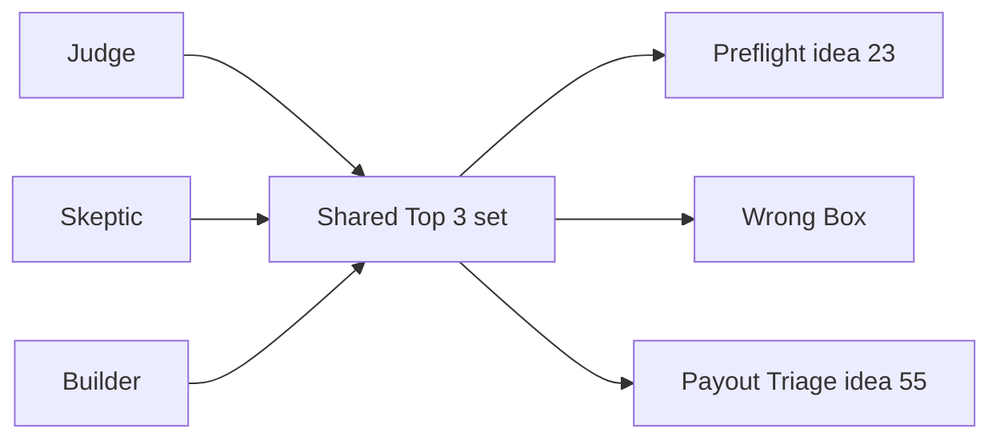

# Council reports (judge, skeptic, builder)

> [!tldr] In one breath
> Three AI advisors, each playing a different role, ranked the ten finalists. All three picked the same Top 3 set (#23, Wrong Box, #55) but in different orders. Everything still depends on sandbox tests nobody has run yet.

> [!example] Picture this
> You ask three friends which bike to buy. One is a racing coach, one is a bargain hunter who assumes every shop is overcharging, and one is a mechanic who asks "will it break?". If all three name the same three bikes, that is a good sign. But if all three friends grew up in the same house reading the same magazines, their agreement counts for less.

> [!warning] Same model council
> No outside AI model API keys were available. So this is a local version of the claude-council idea: three independent Claude subagents, each given one role and the same evidence. **Agreement between them is weaker evidence than agreement between different AI model families.** Each rated its own confidence **3 / 5**.

> [!info] Update, Oct 23 2026
> The llm-council skill is now installed, and a live repo (preflight-for-paypal) now does #23's core job. See [[70 The Winning Idea]].

## Who said what

| Role | Top 3 | Overrated pick |
|---|---|---|
| Judge ([[Council Judge]]) | 1. #23 Preflight · 2. Wrong Box · 3. #55 | #28 (then #56) |
| Skeptic ([[Council Skeptic]]) | 1. #23 · 2. #55 · 3. Wrong Box | #28 |
| Builder ([[Council Builder]]) | 1. Wrong Box · 2. #55 · 3. #23 | #56 |

**Consensus Top 3 (as a set): #23, Wrong Box, #55.**

**Where they disagree on order:**
* The judge and the skeptic put #23 first, because it is rare in the competition and very native to PayPal.
* The builder put Wrong Box first, for its two PayPal money movements and its demo. The builder put #23 last, because the only thing #23 actually changes inside PayPal is a tracker (a parcel tracking number).

## What the council could not settle

**Every ranking depends on sandbox behaviour nobody has tested yet** ([[63 Day-1 Sandbox Test Plan|day 1 sandbox test plan]]). The sandbox is PayPal's practice world with pretend money. Also, #23's search for rivals was cut short by search budgets, so a rival found late would drop it.

> [!info]- Jargon decoder
> **Council**: several AI helpers given different roles, then their answers compared. Like a panel of judges on a talent show.
> **Subagent**: a helper copy of the AI given one narrow job.
> **API key**: a password that lets a program use another company's service.
> **Sandbox**: PayPal's test world with fake money. A flight simulator for payments.
> **Tracker**: the parcel tracking number attached to a PayPal order.

## Where to next
* ⬆️ Up: [[00 PayPal AI Hackathon Hub]]
* ⬅️ Previous: [[61 Top 3 & Winner Recommendation]] · ➡️ Next: [[63 Day-1 Sandbox Test Plan]]
* 🔗 Related: [[Council Judge]], [[Council Skeptic]], [[Council Builder]], [[70 The Winning Idea]], [[71 Council Verdict (Oct 23)]]
