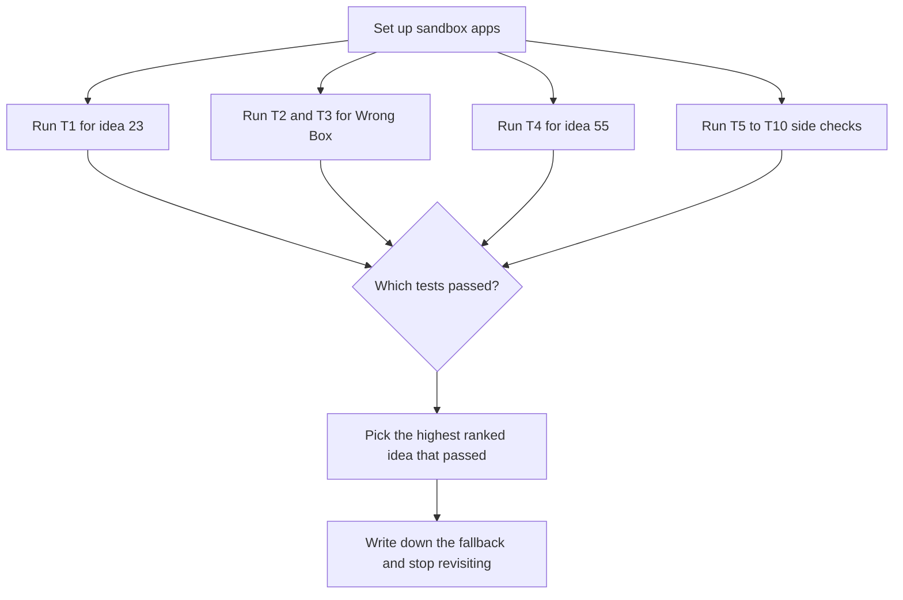

# Day 1 sandbox test plan (these tests decide the pick)

> [!tldr] In one breath
> Every Top 3 ranking depends on things PayPal's practice environment might or might not do, and the docs are unclear. Run these ten tests first. Their results decide which idea to build. Deadline: **Nov 12, 2026 12:00pm PT** (about 4.5 weeks from 2026-10-12).

> [!example] Picture this
> Before you plan a beach party, you check three things: is the beach open, is the weather good, and can you park? If the beach is closed, nothing else matters. These tests are the "is the beach open?" checks for each idea.

> [!info] Update, Oct 23 2026
> The week plan below was written for #23. A live repo (preflight-for-paypal) now does #23's core job, so the pick moved. See [[70 The Winning Idea]]. The tests for other ideas stay useful.

The **sandbox** is PayPal's test world with pretend money, like a flight simulator for payments. You can crash as much as you like and nobody loses real cash.

## The ten tests

| ID | For | Test | Pass means | If it fails |
|---|---|---|---|---|
| T1 | #23 | Capture a sandbox order with a shipping address; `GET /v2/checkout/orders/{id}`. Check `purchase_units[].payments.captures[].seller_protection`. Vary `shipping_preference: NO_SHIPPING`, pickup shipping type, guest card. Then `POST /v2/checkout/orders/{id}/track` and look at the sandbox UI. | `seller_protection.status` can change, and the tracker is visible | The verdict must come from a policy rules table. Say so honestly in the video. Consider switching to Wrong Box |
| T2 | Wrong Box | `POST /v1/customer/disputes` with the buyer `PayPal-Auth-Assertion` on an Orders v2 capture. Confirm `allowed_response_options.make_offer` contains `REPLACEMENT_WITHOUT_REFUND`, then `accept-offer` resolves the case | Case reaches RESOLVED | Drive it from a dispute created in the UI. If the replacement offer is unavailable, the hero moment shrinks to a refund and Wrong Box drops below #55 |
| T3 | Wrong Box | Payout from a second sandbox business app to the buyer's personal sandbox email | Balance visible on the buyer | Show only the payout response and webhook |
| T4 | #55 | `POST /v1/payments/payouts` to an unregistered email. Confirm `UNCLAIMED` with `RECEIVER_UNREGISTERED`, the `PAYMENT.PAYOUTS-ITEM.UNCLAIMED` webhook, then `POST .../payouts-item/{id}/cancel` → RETURNED | The whole loop works for real | Demote #55 below #56 |
| T5 | #28 | Create invoice conditional rules (`EARLY_PAYMENT_DISCOUNT`); see whether the payer view applies the discount | Discount visible and applied | The scope `invoicing/internal` is gated, so #28 loses its demo |
| T6 | #56 | Inject `PayPal-Mock-Response` through a proxy into a merchant SDK call; check whether any sandbox state changes | Fault paths can be reproduced | Falls back to mock responses only |
| T7 | #42 | Reproduce the counterfactual flip against a v6 checkout with injected product text | Flip and capture block shown | Drop |
| T8 | #8, #9 | Overcapture above 100% on a sandbox authorization; reauthorize once (day 4 to 29) | Enforced as documented | Branch removed |
| T9 | Wrong Box | `GET dispute` → `disputed_transactions[0].custom` equals the order `custom_id` | Equal | Link them through invoice_id or a local table |
| T10 | Wrong Box | `provide-evidence` multipart upload with a PDF under 10 MB | Success | Avoid `INVALID_EVIDENCE_FILE` by trimming the file |

**The big three are T1 (for #23), T2 and T3 (for Wrong Box) and T4 (for #55).** Whichever of those pass decides the build.

Sources for these tests: [PayPal Disputes test & go-live](https://developer.paypal.com/disputes/test-go-live.md) ✅, [Payouts test values](https://developer.paypal.com/api/payouts/test-go-live.md) ✅, [Add Tracking API](https://developer.paypal.com/api/tracking/track-orders/integrate.md) ✅.

## Rough 4.5 week plan for #23 (⚠ inference)

| Week | Goal |
|---|---|
| 1 (to Oct 19) | T1 to T10; repo, README skeleton, PayPal sandbox apps; decide #23 or switch |
| 2 | Read in orders and buyer messages; address and policy rules engine with cited clauses |
| 3 | AI layer: intent with a quoted span, fuzzy address matching, label OCR; tracking upload; evidence pack |
| 4 | AG Grid order queue; unhappy path tests; webhook handling; polish |
| 4.5 (to Nov 12) | 3 minute video, README sections "PayPal APIs used" and "Unhappy paths handled", buffer for submission |

> [!info]- Jargon decoder
> **Capture**: actually taking the money after a card was approved. Like a hotel charging you at check out for what you used.
> **Authorization (and reauthorize)**: putting a hold on money without taking it yet, like a hotel holding $200 at check in. Reauthorizing is refreshing that hold before it expires.
> **Overcapture**: taking a bit more than was first held, within limits. Like adding a tip after the card was swiped.
> **Dispute**: a buyer formally complaining to PayPal. Like calling the referee over.
> **`REPLACEMENT_WITHOUT_REFUND`**: the seller offers to send a new item instead of giving money back.
> **`PayPal-Auth-Assertion`**: a header that lets an app act on behalf of a specific PayPal user, like a signed permission slip.
> **Webhook**: PayPal calling your app to say "something happened", like a doorbell rather than you checking the door every minute.
> **UNCLAIMED / RETURNED**: a payout nobody picked up, and then the money coming back to the sender. Like a parcel waiting at the post office, then returned to sender.
> **`custom_id`**: a label you stick on an order so you can find it later, like writing your name on your lunchbox.
> **Mock response (`PayPal-Mock-Response`)**: asking PayPal's sandbox to pretend an error happened, like a fire drill alarm.
> **Proxy**: a middleman program that sits between your app and PayPal and can change messages in transit.
> **SDK**: a ready made code toolkit for talking to PayPal.
> **Scope (`invoicing/internal`)**: a permission level. "Gated" means outsiders may not get it.
> **Counterfactual flip**: checking whether the AI's choice changes when sneaky text is removed.
> **OCR**: reading text from a photo, like your phone reading a parcel label.
> **Multipart**: a way to send a file and data together in one request, like an envelope with a letter and a photo.
> **AG Grid**: a sponsor's spreadsheet style table for web apps.

## Where to next
* ⬆️ Up: [[00 PayPal AI Hackathon Hub]]
* ⬅️ Previous: [[62 Council Reports]] · ➡️ Next: [[64 Judge Q&A & Scorecard Optimisation]]
* 🔗 Related: [[61 Top 3 & Winner Recommendation]], [[65 Risk Analysis]], [[70 The Winning Idea]]
