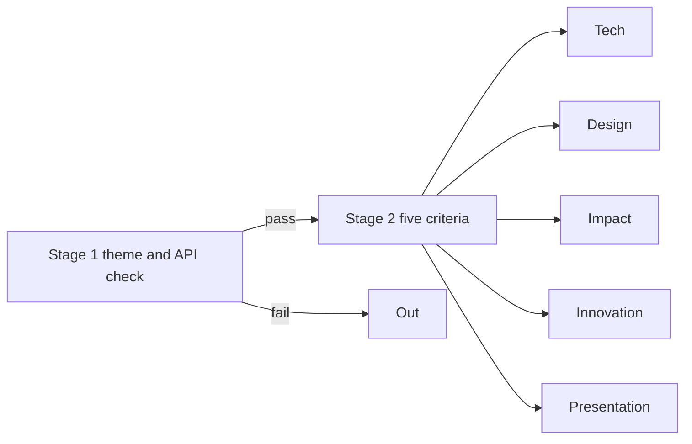

# Judge Q&A and scorecard optimisation

> [!tldr] In one breath
> Judges score five equal criteria, and they may scan your code with AI instead of running it. This note lists what to make visible for each criterion and gives honest answers to the hard questions judges will ask.

> [!example] Picture this
> You are about to sit a driving test. You know the examiner will check mirrors, speed, parking, signals and road position. So you make every mirror check big and obvious, and you rehearse your answer to "why did you slow down there?". This note is that rehearsal.

> [!info] Update, Oct 23 2026
> The criterion table and answers below were written for #23. A live repo (preflight-for-paypal) now does #23's core job, so the pick moved. See [[70 The Winning Idea]]. The rules facts and the general advice still apply to any idea.

## The rules, in plain words

(✅ [Official Rules](https://paypalaihackathon.devpost.com/rules))
* **Stage 1 is pass or fail** on theme and API use.
* **Stage 2 scores five equal criteria.**
* Judges may not run your code, and they may use automated AI analysis of the repo (the code folder on GitHub).

From the kickoff (✅ [kickoff transcript](https://www.youtube.com/watch?v=FFJfCW9z3Do)), three quotes to remember:
* "adding a PayPal button to an unrelated app is not going to be enough"
* "test the unhappy paths" (the routes where things go wrong, like a fire drill)
* "start from the problem, not a PayPal product"

## What to show for each criterion (written for #23)

| Criterion | Make visible |
|---|---|
| Technological Implementation (first tie break) | Orders, Transaction Search, Tracking, Disputes and webhooks in one loop; tests; a README section "PayPal APIs used" naming endpoints. The AI repo scan reads this first |
| Design | One persona (a small seller), one clear start and end state, an AG Grid queue showing protection status |
| Potential Impact | Quote the PayPal clause; show a real loss story; cite only figures actually verified. Do not claim a scam frequency that has not been measured |
| Innovation | Say once what existing tools (ShipStation, Shippo) do not do: they check if a parcel can be delivered, not whether it keeps Seller Protection |
| Presentation | Open with a person and a loss, not "we built an AI agent". End with a 10 second montage of unhappy paths. Show real sandbox state changes, never a mock |

**Takeaway: make the PayPal work easy to see, both on screen and in the README, because the AI scanner and the judges read those first.**

## Likely judge questions and honest answers

| Question | Answer |
|---|---|
| Isn't this a rules engine? | Partly. The policy verdict is rule based on purpose. The model does what rules cannot: reading intent in many languages and quoting the exact words, fuzzy address matching (forwarders, reshippers), and label OCR |
| Where do buyer messages come from? | They live outside PayPal. The first version takes a pasted or forwarded message. Say so |
| Does PayPal already warn sellers before shipping? | Not verified either way. The follow up hunt found no such tool, but check PayPal's seller dashboard before the video |
| Is the protection verdict reliable? | It is advice, with cited clauses. Never promise protection. Policy varies by region; the US Jan 2026 and UK Jul 2026 terms were read |
| Why would a seller trust AI with tracking uploads? | A human confirms; the AI only drafts |
| What if the buyer never sent a message? | The address and proof of delivery checks still run |

> [!info]- Jargon decoder
> **API**: a menu of requests one program can send another. Like ordering at a restaurant counter.
> **Endpoint**: one item on that menu, a specific web address the program calls.
> **Webhook**: PayPal ringing your app's doorbell to say something happened.
> **README**: the front page of a code repo that explains what it is.
> **Persona**: one imagined, specific user you design for.
> **AG Grid**: a sponsor's spreadsheet style table for web apps.
> **Seller Protection**: PayPal's cover for sellers, valid only if they follow its rules (like shipping to the address PayPal shows).
> **Mock**: a fake response that looks real, like a cardboard cake in a bakery window.
> **OCR**: reading text from a photo, like your phone reading a parcel label.
> **Forwarder / reshipper**: a company that receives a parcel and sends it on elsewhere. Scammers use them to hide where goods end up.
> **Rules engine**: a fixed list of "if this, then that" checks.

## Where to next
* ⬆️ Up: [[00 PayPal AI Hackathon Hub]]
* ⬅️ Previous: [[63 Day-1 Sandbox Test Plan]] · ➡️ Next: [[65 Risk Analysis]]
* 🔗 Related: [[61 Top 3 & Winner Recommendation]], [[D023 Seller Protection Preflight (Deep Dive)]], [[70 The Winning Idea]]
