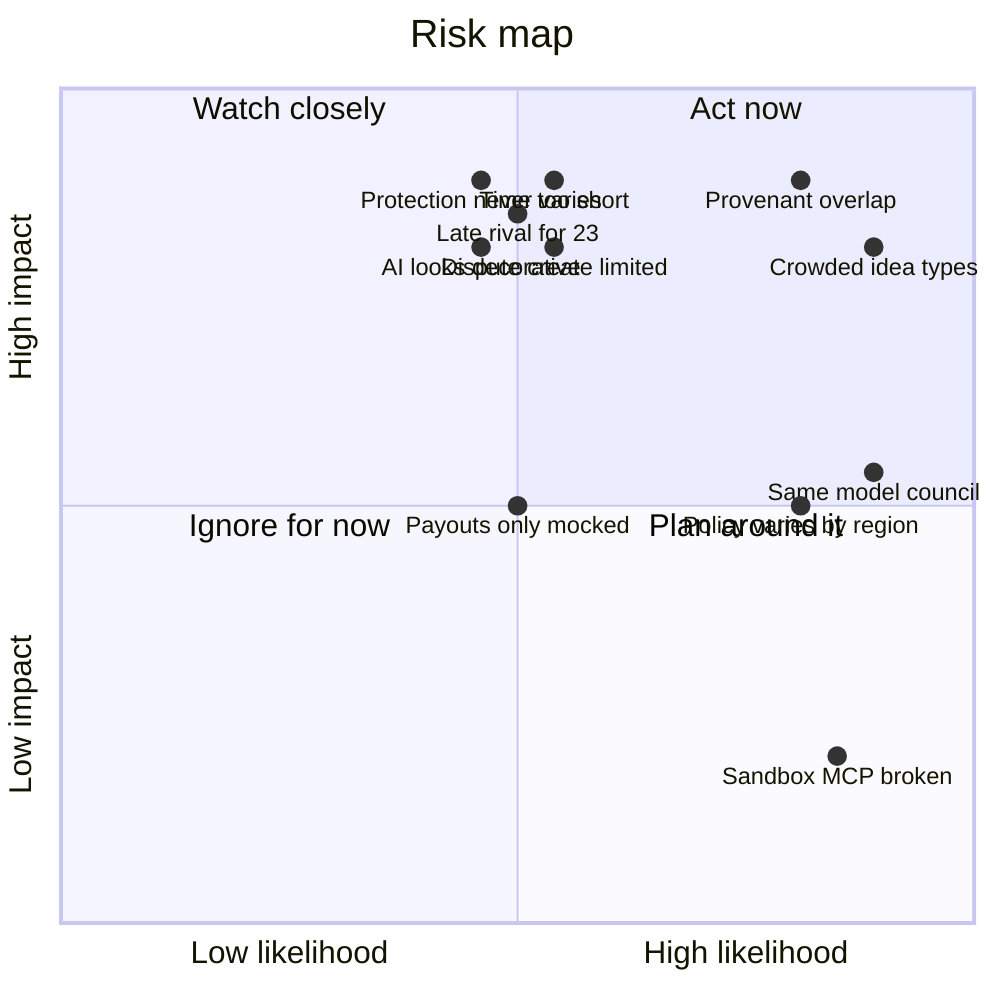

# Risk analysis

> [!tldr] In one breath
> This is a list of eleven things that could sink the project, each rated for how likely it is and how badly it would hurt, with a plan for each. The scariest group is "likely and painful": crowded idea types, Provenant overlap, and the AI looking decorative.

> [!example] Picture this
> Before a school camping trip, the teacher lists what could go wrong: rain, a lost kid, a forgotten tent. Rain is likely but only annoying, so you pack ponchos. A lost kid is unlikely but serious, so you use a buddy system. This note does the same for the hackathon.

> [!warning] Update, Oct 23 2026
> The "late found competitor for #23" risk came true. A live repo, preflight-for-paypal, now does #23's core job. See [[70 The Winning Idea]] and [[17 Live Competition Scan (Oct 23)]].

## The risk table

| Risk | Likelihood | Impact | Applies to | What to do about it |
|---|---|---|---|---|
| Sandbox `seller_protection` never varies | Medium | High | #23 | T1 on day 1; present the verdict as a policy table and say so |
| Competitor for the seller protection preflight found late | Medium | High | #23 | A follow up hunt (addendum in the #23 deep dive) found DisputeDesk. It overlaps the evidence pack and AG Grid modules but not the gate before shipping. Keep the gate as the headline. Check Devpost again weekly |
| Provenant judged a near duplicate | High | High | Wrong Box | Lead with the buyer and the photo; position it as "before the dispute" and driven by facts |
| The endpoint that creates disputes is limited release | Medium | High | Wrong Box | Fall back to a dispute created in the UI |
| Payout failure branches only mocked | Medium | Medium | #55 | Build the hero loop on a real UNCLAIMED state |
| Hosted PayPal sandbox MCP broken (since Oct 8, issue #34) | High | Low | all | Use the REST API or the local agent toolkit |
| Policy varies by region | High | Medium | #23 | State the region; never promise protection |
| AI judged decorative | Medium | High | #23, #28 | Show on screen what only the model can do |
| Fatigue from duplicate idea types (spend gates, escrow, shopping agents, PayPilot) | High | High | any idea in those clusters | Avoid the words "gate", "escrow", "shopper" in the headline |
| Time: 4.5 weeks, 1 to 3 builders | Medium | High | all | Cut to the must haves in [[63 Day-1 Sandbox Test Plan\|the day 1 plan]] |
| Same model council bias | High | Medium | recommendation | Get an outside human to review the shortlist |

**Takeaway: the top right corner of the chart below is where to spend your worry.**

## The risk map

Low, Medium and High are placed at about 0.2, 0.5 and 0.85. Dots in the same cell are nudged apart so you can see them.

> [!info]- Jargon decoder
> **Sandbox**: PayPal's test world with pretend money.
> **`seller_protection`**: a field on a PayPal payment saying whether the seller is covered if something goes wrong.
> **Endpoint, limited release**: a specific PayPal web address that only some developers are allowed to use, like a club with a guest list.
> **Mock**: a fake response, like a cardboard cake in the window.
> **UNCLAIMED**: a payout nobody has picked up yet, like a parcel waiting at the post office.
> **MCP**: Model Context Protocol, a standard plug that lets an AI assistant use outside tools. Like a universal phone charger for AI.
> **REST API**: the normal way programs talk to PayPal over the web, by sending requests to web addresses.
> **Escrow**: a neutral party holding money until both sides are happy, like a referee holding the bets.
> **PayPilot**: a name used by at least 10 chat shopping repos in this hackathon, a sign of a crowded idea.
> **Same model council**: three AI helpers that all come from the same AI model, so they share blind spots.

## Where to next
* ⬆️ Up: [[00 PayPal AI Hackathon Hub]]
* ⬅️ Previous: [[64 Judge Q&A & Scorecard Optimisation]] · ➡️ Next: [[66 Grill Me]]
* 🔗 Related: [[63 Day-1 Sandbox Test Plan]], [[17 Live Competition Scan (Oct 23)]], [[70 The Winning Idea]]
