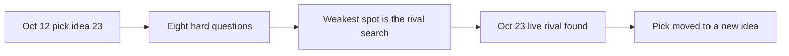

# Grill Me: a pressure test of the recommendation

> [!tldr] In one breath
> We threw eight hard questions at our own Oct 12 pick (#23) to see where it cracks. The weakest spot was question 1, the search for rivals, and on Oct 23 that is exactly where it broke.

> [!example] Picture this
> Before a big debate, a good coach plays the meanest opponent possible and fires every awkward question at you. Better to stumble in practice than on stage.

> [!warning] Update, Oct 23 2026
> Question 1 came true. A live repo, preflight-for-paypal, now does #23's core job. See [[70 The Winning Idea]].

## The eight questions

1. **You recommend an idea whose search for rivals was cut short. Why trust it?**
   You should not fully. The deep dive found no competitor across ~144 Devpost entries reviewed. A follow up hunt found only DisputeDesk, which collects evidence after a dispute starts rather than checking before shipping. Three more searches is still thin; repeat the hunt weekly.

2. **If PayPal's sandbox always returns ELIGIBLE, what is left?**
   A policy table plus an AI layer. That scores Tech 6 and Innovation 5. Wrong Box becomes the better bet. (The sandbox is PayPal's test world with pretend money. ELIGIBLE means "this sale is covered by Seller Protection".)

3. **Isn't "ship to my cousin's address" a niche scam?**
   The policy clause is general: any redirected shipment, or one the buyer arranges, voids protection. No figure for how often the scam happens was verified, so Impact is scored 6, not 8.

4. **Your Top 10 includes four ideas whose own deep dives say don't build them. Why list them?**
   Because their desk scores were high, and the reasons they fell are useful. They are marked Tier C.

5. **Is the council independent?**
   No. It is three Claude subagents with different roles. That is correlated evidence, like three witnesses who all watched the same TV report.

6. **Why is nothing here an agent payments protocol play (AP2, ACP, x402)?**
   PayPal's agent tooling is gated (Store Sync, Agent Ready) and sandbox support is thin. Ideas that needed it lost points on feasibility and risk.

7. **What if the judges are pure PayPal DevRel?**
   Then #56 and #55 gain ground. That is why #55 is in the Top 3.

8. **Would you submit two entries?**
   Not recommended in 4.5 weeks. The prize cap per person is one Grand/HM plus one sponsor prize.

> [!info]- Jargon decoder
> **Seller Protection / ELIGIBLE**: PayPal's cover for a seller. ELIGIBLE means the sale qualifies.
> **Desk score**: a score given from reading and research alone, before any testing.
> **Tier C**: our lowest finalist tier, ideas kept for the lessons they teach.
> **AP2, ACP, x402**: new standards for AI agents to pay for things. AP2 is Google's agent payments protocol, ACP is the agentic commerce protocol, x402 uses the old "402 Payment Required" web code to let a program pay per request, like a coin slot on a web page.
> **Store Sync, Agent Ready**: PayPal products that let AI agents shop at merchants. "Gated" means you need permission to use them.
> **DevRel**: developer relations, the PayPal team that helps outside coders.
> **Grand/HM**: the grand prize or an honourable mention prize category.

## Where to next
* ⬆️ Up: [[00 PayPal AI Hackathon Hub]]
* ⬅️ Previous: [[65 Risk Analysis]] · ➡️ Next: [[70 The Winning Idea]]
* 🔗 Related: [[61 Top 3 & Winner Recommendation]], [[62 Council Reports]], [[D023 Seller Protection Preflight (Deep Dive)]]
