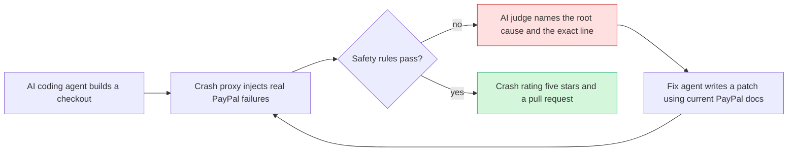
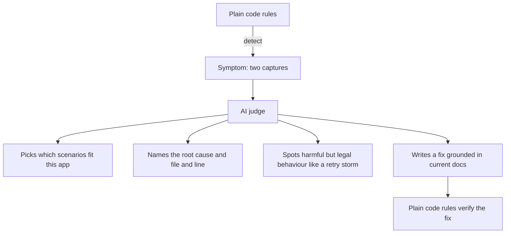
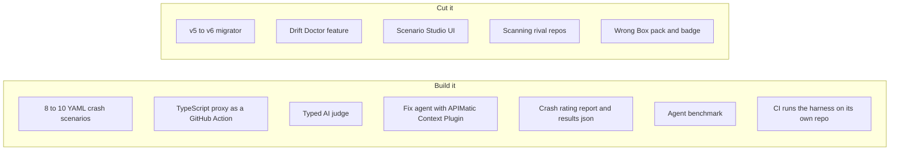
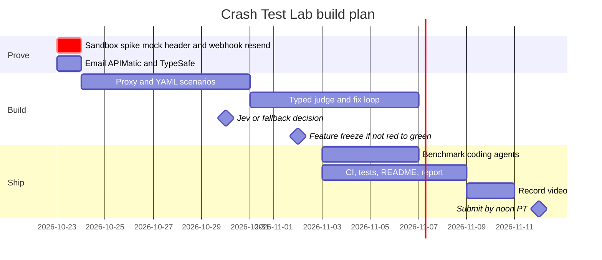

# 70 The Winning Idea: Crash Test Lab 🚗💥

> [!tldr] In one breath
> Today most new PayPal checkouts are written by AI coding agents, and nobody checks whether that code survives a bad day. **Crash Test Lab** smashes a shop's payment code into real PayPal failures in the sandbox, lets an AI explain exactly what broke, makes the coding agent write the fix, and then crashes it again to prove the fix works. One star becomes five stars, on camera.

> [!example] Picture this
> A café owner asks an AI to "add PayPal checkout" to their website. It works perfectly in the demo. Then on a busy Saturday PayPal sends the same "payment received" message twice, as it is allowed to do, and the café ships two orders and charges nobody for the second one. Car makers do not discover that a car is unsafe after selling it. They put a dummy in the seat and crash it into a wall first. Crash Test Lab is that wall, for payment code.

> [!success] Why this beats everything else in the vault
> * **Empty land.** Out of 266 live hackathon repos, only two touch PayPal developer tooling (`cutover`, a webhook simulator). The crowded areas are agent spending limits (~30), AI escrow (~28) and shopping bots (~25). See [[17 Live Competition Scan (Oct 23)]].
> * **The judges are the users.** PayPal DevRel literally said "test the unhappy paths, not just the happy path." A PayPal PM is angry that coding agents install SDKs "two, three, sometimes even five years old." See [[10 Event, Rules & Judging Intelligence]].
> * **Unanimous council.** All 5 advisors and all 5 peer reviewers picked it. See [[71 Council Verdict (Oct 23)]].
> * **It rides the 2026 wave.** It is pure *harness engineering* (see [[18 AI and Fintech Frontier (Oct 2026)]]): building the test loop around an AI coder so its output can be trusted.

---

## The one line pitch
**"PayPal's doctor checks the happy path. We crash test the unhappy ones and make your coding agent prove the fix."**

The line in plain words: PayPal already ships a code checker called `/paypal:doctor`. It reads your code like a spell checker. It never actually crashes your running app. We do.

## How it works, in four moves

1. **The patient.** A coding agent (Claude Code, Cursor, Copilot, Codex) builds a normal Orders v2 checkout with no special hints. Whatever it gets wrong is the real world.
2. **The crash.** A small TypeScript proxy sits between the app and PayPal. It sends 8 to 10 nasty scenarios using the sandbox's own `PayPal-Mock-Response` header and real signed webhook resends.
3. **The verdict.** Plain code rules spot the damage ("two captures for one order"). The AI explains *why* and *where*.
4. **The repair.** A fix agent, fed fresh PayPal SDK docs through the APIMatic Context Plugin, writes a patch. The harness crashes the app again. Only a green result counts.

## The crash scenarios (version 1)

| #       | Scenario                              | What a real customer feels if the code is wrong | PayPal tool used                   |
| ------- | ------------------------------------- | ----------------------------------------------- | ---------------------------------- |
| 1       | Card declined (`INSTRUMENT_DECLINED`) | Stuck on a spinning wheel forever               | Orders v2 + mock header            |
| 2       | Too many requests (429)               | App hammers PayPal and gets blocked             | Orders v2 + mock header            |
| 3       | PayPal server error (500)             | Order lost, or charged with no receipt          | Orders v2 + mock header            |
| 4       | Capture times out                     | Charged twice when the app retries              | Payments v2                        |
| 5       | Same signed webhook arrives twice     | Two parcels shipped for one payment             | Webhooks resend + verify signature |
| 6       | Forged webhook with a bad signature   | A stranger fakes "paid" and gets free goods     | Webhook signature verification     |
| 7       | Retry without `PayPal-Request-Id`     | Duplicate charge                                | Idempotency header                 |
| 8       | Buyer cancels at PayPal               | Order marked paid anyway                        | Orders v2 states                   |
| 9 to 10 | Refund failure, partial capture       | Wrong money back                                | Payments v2 refunds                |

> [!info]- Jargon decoder for this table
> **Webhook**: PayPal phoning your server to say "this happened". Like a doorbell. Sometimes the postman rings twice, and your code must not open the door twice.
> **Signature verification**: checking the caller ID on that doorbell so a prankster cannot fake it.
> **Idempotency / PayPal-Request-Id**: a ticket number on each request so that if you ask twice, PayPal does it once. Like a coat check ticket.
> **Mock response header**: a sandbox switch that tells PayPal "pretend this fails". A crash test dummy setting.
> **429**: "slow down, you are calling too often." **500**: "PayPal's side hiccupped."

## "So what is the AI actually for?"

Every judge will ask this, so the answer is built into the design: **assertions detect, AI diagnoses and repairs, assertions verify.**

* **Picks scenarios.** It reads the app's code and endpoints and chooses which crashes apply.
* **Diagnoses.** It reads the trace, the logs and the code and says something like "fulfilment runs before the duplicate check in `webhook.ts:42`." A rule can only say "failed."
* **Judges grey areas.** For example an endless retry loop after a 429, or a declined buyer left hanging. None of that is technically an error, but all of it is harmful.
* **Repairs.** The fix is accepted only when the rules go green again. The AI never grades its own homework.

**Fast typed answers.** Every verdict is strict JSON: `{scenario, verdict, severity, root_cause, file, line}`. Jev from TypeSafe AI returns exactly this kind of typed decision in 70 to 500 ms. If Jev access is not confirmed by **Oct 30**, use Groq or Cerebras JSON schema output with a zod check and a repair loop. PayPal judge Jo Franchetti talks publicly about exactly that pattern ("validating and repairing unpredictable output").

## The killer finding: the benchmark

Impact used to be the weak spot (only anecdotes). The fix is to **measure it, not argue it**:

> Build the same checkout with 4 to 5 popular coding agents, crash test all of them, and publish the table. For example: "3 of 5 agents ship duplicate orders on a repeated webhook; 2 of 5 install a deprecated SDK."

That one table is the impact story, the gap over `/paypal:doctor`, and the hook for the PayPal PM, all at once. **If most agents pass**, that is still a finding ("which agents pass, which fail, on what"), and the pitch leans on diagnosis quality and the CI product.

We do **not** scan other teams' hackathon repos. The council flagged consent, licensing and judge backlash.

## Scorecard at a glance (judging criteria)

| Criterion | Why we score high | Main risk |
|---|---|---|
| Technological Implementation (first tie breaker) | Orders v2, Payments v2, webhooks with signature checks, idempotency, mock failures, CI, typed AI | Sandbox flakiness, so cache fixtures |
| Design (a complete product) | A GitHub Action plus a report page plus a `results.json` file: a real developer product | Looks "only for developers" |
| Potential Impact | The benchmark turns anecdotes into numbers | The finding may be weak (hedge above) |
| Innovation | A live crash test with an AI fix and proof is unclaimed. Doctor is static, and PayPal's announced integration agent has not shipped | PayPal ships it before Nov 12 |
| Presentation | The crash test metaphor: one star, crash, fix, five stars | Jargon overload, so cut it from the video |

## Scope: what is in, what is cut

The AG Grid results page is optional, and only if time allows.

## Where the old ideas went
This pick merges the best parts of four vault ideas:
* [[I056 Integration Chaos Monkey]] supplies the spine: fault injection with red to green. Deep dive: [[D056 Integration Chaos Monkey (Deep Dive)]].
* [[I045 Agent Payment Eval Harness]] supplies the benchmark of coding agents.
* [[I057 Webhook Drift Doctor]] supplies the duplicate and forged webhook scenarios only.
* [[I060 Sandbox Scenario Studio]] supplies the YAML scenario format, but not its UI.

The old pick, [[I023 Seller Protection Preflight]], lost its novelty because a live repo, `preflight-for-paypal`, now does its core job. See [[61 Top 3 & Winner Recommendation]] for the history.

## Prizes to target
* **Grand prize** and **Best Use of PayPal + AI**, plus the Technological Implementation tie breaker.
* **APIMatic** as the one sponsor prize. Only 1 to 2 rivals are competing (AG Grid has about 20), and the Context Plugin sits right inside the fix loop.
* Skip "Best Use of Agentic Commerce". Chasing it is scope creep.

## The 20 day plan

## Safety nets
* **Flaky sandbox:** record fixtures and keep a cached verified run. Judges can replay it with one command.
* **Fix loop misbehaves live:** pin a known good fix branch and use a recorded run in the video.
* **Automated AI grading:** the README, a one command quickstart and a machine readable `results.json` must make sense to an AI grader as well as a human.
* **Small team:** the proxy plus the judge is a shippable product even without the fix agent.

## The 3 minute video
1. (0:00) An AI agent builds a shop in 30 seconds. It looks perfect.
2. (0:30) "Let's crash it." The webhook arrives twice, and **two orders, one payment** appears in big red numbers. Rating: ⭐.
3. (1:15) One line on screen: "AI judge: duplicate fulfilment, root cause `webhook.ts:42`."
4. (1:40) The agent pulls current PayPal docs, opens a pull request, and the crash is rerun. Rating: ⭐⭐⭐⭐⭐.
5. (2:20) The benchmark table: "How 5 coding agents survived PayPal's bad days."

**The test:** someone outside tech watches it and can say back, "it crash tests payment code."

> [!tip] The one thing to do first
> Run a 2 hour spike in the live sandbox today. Prove that `PayPal-Mock-Response` returns a decline, a 429 and a 500 on Orders v2, and that a webhook resend delivers a duplicate signed event. In the same hour, email APIMatic for Context Plugin access. If the spike fails, you learn on day 1 that you need fixtures, not on day 18. Test details: [[63 Day-1 Sandbox Test Plan]].

> [!info]- Jargon decoder
> **Coding agent**: an AI that writes and edits code for you, like Claude Code or Cursor.
> **Harness engineering**: building the seatbelts, test track and dashboard around an AI so you can trust what it does. Agent = Model + Harness.
> **Sandbox**: PayPal's practice playground with fake money, like a flight simulator.
> **GitHub Action**: a robot that runs your checks every time someone changes the code.
> **Pull request (PR)**: a proposed code change waiting for a human to approve it.
> **Red to green**: failing tests (red) turning into passing tests (green).
> **Jev**: a 2026 AI model that skips prose and answers only in typed form (yes or no, a choice, a score) very fast.
> **Context Plugin (APIMatic)**: feeds a coding agent today's PayPal docs, so it stops writing code from a five year old memory.
> **zod**: a TypeScript library that checks JSON has exactly the shape you expect, like a bouncer with a guest list.
> Full glossary: [[Jargon Decoder]].

## Where to next
* ⬆️ Up: [[00 PayPal AI Hackathon Hub]]
* 🧑‍⚖️ How we decided: [[71 Council Verdict (Oct 23)]]
* ⬅️ Old pick: [[61 Top 3 & Winner Recommendation]]
* 🔗 Related: [[D056 Integration Chaos Monkey (Deep Dive)]], [[17 Live Competition Scan (Oct 23)]], [[18 AI and Fintech Frontier (Oct 2026)]], [[64 Judge Q&A & Scorecard Optimisation]], [[65 Risk Analysis]]
