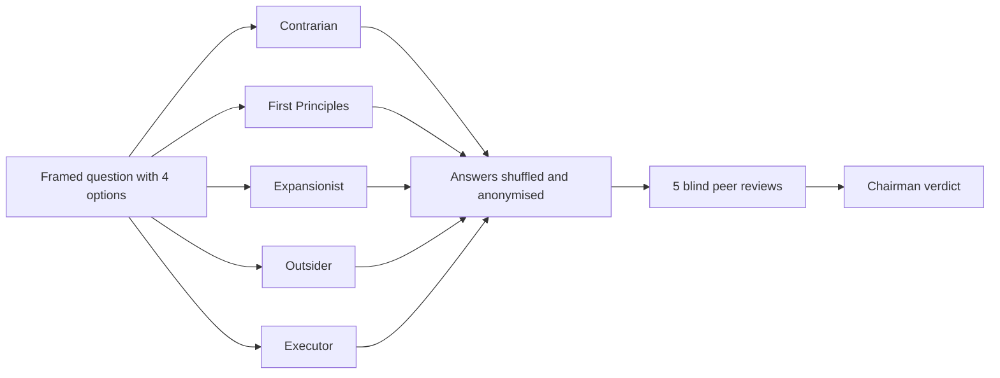

# 71 Council Verdict (Oct 23)

> [!tldr] In one breath
> We put four finalists in front of a council of five AI advisors with deliberately clashing mindsets. Then five reviewers graded the advisors' answers blind, and a chairman wrote the verdict. **The vote was unanimous: build Crash Test Lab, but only one tight loop of it.**

> [!example] Picture this
> Imagine pitching your startup to five people at once: a cynic, a physicist, a dreamer, your grandma, and a project manager holding a stopwatch. Then you shuffle their notes, strip off the names, and ask five more people which note was smartest. Whatever survives that is probably real.

## How the council works

## The four options on the table
| Option | What it is | Prior score |
|---|---|---|
| A. Crash Test Lab | Crash tests PayPal code written by AI coding agents, then makes the agent fix it ([[I056 Integration Chaos Monkey]] and friends) | 80/120 for #56 alone |
| B. Wrong Box | Your shopping agent bought the wrong thing: a photo decides who pays ([[Wrong Box Combined Concept]]) | 88/120 |
| C. Accessible agent checkout | Voice first, screen reader first paying ([[I084 Accessible Voice Checkout]] + [[I085 Plain-Language Payment Consent]]) | 75/120 |
| D. Payout Rescue | Turns failed payouts into a fix workflow ([[I055 Payout Failure Triage]]) | 86/120 |

## What each advisor said, in one line
* **Contrarian:** Every option has a fatal flaw, but only A's can be fixed in 20 days. B has same hackathon clones (Provenant, AgentProof), C dies at PayPal's approval popup, and D is "a lookup table with a compliance speech."
* **First Principles:** The judges *are* the users of A. Don't argue impact, measure it: crash test the same checkout built by 4 to 5 coding agents and publish the table.
* **Expansionist:** A is a working prototype of PayPal's own unshipped "Merchant AI Integration Agent." Go for the APIMatic prize, not AG Grid.
* **Outsider:** Your pitch is jargon soup. Sell it as a **car crash test**: one star, crash, fix, five stars.
* **Executor:** Cut it to Orders v2 and Payments v2, 8 to 10 YAML scenarios and a TypeScript proxy in a GitHub Action. Feature freeze on Nov 2 if red to green isn't working.

**Peer review result:** all 5 reviewers rated the First Principles answer strongest, with the Executor second.

## Where the council agrees
* Build **A**, much smaller. One loop: inject failures, AI verdict, fix, rerun.
* Jev is **optional, never a dependency**. The fallback is Groq or Cerebras JSON schema output with a zod check and a repair loop.
* The sponsor prize is **APIMatic** (1 to 2 rivals), not AG Grid (~20).
* The patient is a naive checkout built by a coding agent.
* Impact must be **measured**.

## Where it clashed
* **What to benchmark.** The Expansionist wanted to crash test rival hackathon repos. Reviewers flagged that as an ethics, licensing and backlash risk. **Winner:** benchmark coding agents instead.
* **Absorbing Wrong Box for the Agentic Commerce prize.** Everyone except the Expansionist called that scope creep.
* **How much AI to show in the video.** The Outsider wanted it down to one line. Reviewers said AI doing real work is a judging criterion, so keep it visible.

## Blind spots the reviewers caught
* Judging may use **automated AI analysis**, so the README, the quickstart and `results.json` must be readable by a machine.
* **Sandbox feasibility is unproven** (the mock header only covers Orders v2 and Payments v2), so record fixtures and keep a cached run.
* **The benchmark might find little.** If so, publish which agents pass and which fail.
* **PayPal could ship its integration agent before Nov 12.**
* **"What is the AI for?"** A duplicate webhook check is just an assertion. Answer: *assertions detect, AI diagnoses and repairs, assertions verify.*
* **Team size.** The proxy plus the judge must be shippable on its own.

## The one thing to do first
A 2 hour live sandbox spike: prove the mock header returns a decline, a 429 and a 500, and prove that a webhook resend delivers a duplicate signed event. Email APIMatic in the same hour.

Full plan: [[70 The Winning Idea]].

## Where to next
* ⬆️ Up: [[70 The Winning Idea]]
* 🔗 Earlier council (Oct 12): [[62 Council Reports]]
* 🏠 Hub: [[00 PayPal AI Hackathon Hub]]
