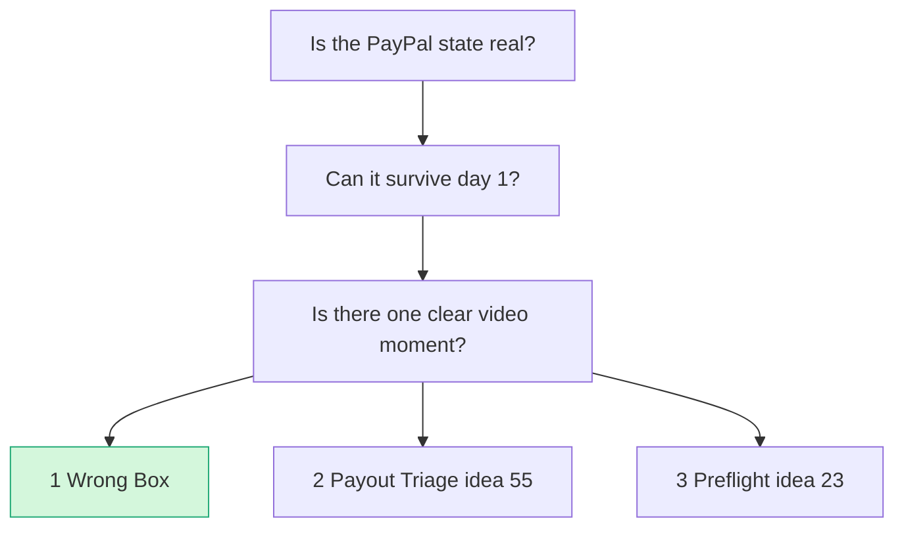
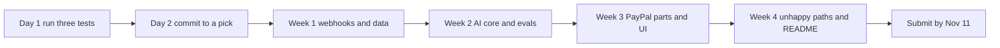

# Council: the builder (staff engineer and demo producer)

> [!tldr] In one breath
> The builder asks "can a tiny team actually build this and film it well?". Its pick was Wrong Box first, #55 second and #23 third, because Wrong Box shows two real PayPal money movements from one photo. Each top pick hangs on one untested sandbox behaviour, so all three tests should run on day 1.

> [!example] Picture this
> A film director scouting locations does not care how pretty the script is. They ask: is the building really there, can we get permission to film, and is there one shot the audience will remember? A set built from cardboard looks fine in the script but falls apart on camera. This report checks which ideas are real buildings and which are cardboard.

> [!info] Update, Oct 23 2026
> A live repo, preflight-for-paypal, now does #23's core job, so the pick moved. See [[70 The Winning Idea]]. This report is kept as the Oct 12 record.

## How the builder looks at each idea

Lens: a team of 1 to 2 people with about 4.5 weeks (to Nov 12, 12:00 PT). For each idea I ask four things:
* Which PayPal sandbox behaviours are **verified** (read in docs or OpenAPI) and which are **untested**? The sandbox is PayPal's practice world with pretend money. OpenAPI is the machine readable "menu" that lists every request PayPal accepts.
* What can kill the idea on **day 1**?
* How much of the PayPal state on screen is **real** and how much is **simulated** (mock headers, magic test values, our own UI)? A mock is a fake answer, like a cardboard cake in a bakery window.
* Is there **one unmistakable moment** a 3 minute video can carry?

Sources: the deep dive reports in this folder plus BRIEF.md. I ran 2 web searches and 1 fetch. None of them settled a sandbox unknown, so every "untested" below is still untested. ⚠ marks my judgement.

## The builder's ledger: what is real, what is risky

| # | Core PayPal calls | Verified (docs/OpenAPI) | Untested, could fail on day 1 | On screen state, real vs simulated ⚠ | Video moment ⚠ |
|---|---|---|---|---|---|
| 3 (+1,+2 modules) | Orders custom_id, Tracking, Disputes (create, make offer, accept offer, provide evidence), Refunds, Payouts, webhooks | The make offer list includes `REPLACEMENT_WITHOUT_REFUND`; accept offer and adjudicate are sandbox only; evidence limits; custom_id ≤255 and echoed back as `custom` ≤2000 | (a) Creating a dispute via the API: missing from the public spec, called "limited release". **Fallback:** dispute opened in the sandbox buyer UI. (b) Whether REPLACEMENT_WITHOUT_REFUND actually shows up in `allowed_response_options` for a NOT_AS_DESCRIBED inquiry. (c) Whether `custom` echoes custom_id. (d) Payouts from a second sandbox app | **~85% real**: the dispute reaching RESOLVED and the payout reaching SUCCESS are both genuine sandbox state. The vision verdict is ours, but on staged objects it gives the same answer every time | **Strongest.** Split screen "asked navy/M · listed navy/M · got royal/L", then the PayPal dispute flips to RESOLVED. Then the same photo on a different order produces a Payout instead |
| 55 | Payouts create/get/cancel, item webhooks | Statuses, cancel works only on UNCLAIMED → RETURNED, the 30 day return, webhooks carry no error object, magic strings for test values | **Hero loop gate:** does a payout to a never registered email go UNCLAIMED and fire the webhook in sandbox? (Docs describe UNCLAIMED but say nothing specific to sandbox; I checked again.) Venmo wallet in sandbox. Reporting API 403 | **~60% real**: the UNCLAIMED→RETURNED→issue again→SUCCESS loop is real if day 1 passes. RISK_DECLINE and the rest are magic string mocks and must be labelled | Good. The ledger row goes UNCLAIMED → "pay my Venmo" reply → RETURNED → SUCCEEDED. The refusal on RISK_DECLINE is a strong second beat |
| 23 | Orders GET (shipping, seller_protection), Transaction Search, Tracking, webhooks | All fields exist in the public schemas; the policy text is primary | Sandbox `seller_protection` may **always be ELIGIBLE**. Transaction Search lag of up to 3 h. Whether `transaction_note` fills from sandbox checkout. Whether the tracker shows in the sandbox UI | **~40% real**: the only state we *change* is a tracker. The red/green verdict is our own rules plus AI over pasted text | Medium. A red banner on "ship to my cousin" is easy to read, but it is "AI flags a message", which judges have seen many times. The PayPal change (a tracker) is quiet |
| 28 | Invoicing create, conditional rules, send, webhook, GET | Endpoint and enums are in the public reference and agent toolkit v1.11 | **Yes or no gates:** a 403 because of the `invoicing/internal` scope; whether the payer page shows or charges the discount; whether `is_applied` flips | **~80% real if it passes, ~30% if it fails** (the fallback is a breakdown discount plus a note) | Good *if* PayPal's own invoice page shows the discounted total, because PayPal's UI then proves it. A cash gap chart dip closing is nice but generic |
| 9 | Authorize, partial capture, void, (reauth) | Partial capture, void, 29 day authorization with a 3 day honor period | Partial capture enablement on a fresh sandbox business account. The reauth contradiction (once vs multiple) | ~85% real | Strong ($300 hold → $85 captured → rest released), but a near identical public demo exists (RentProof) |
| 56 | Orders/Payments with mock header, webhook resend/verify | Mock header endpoints are listed | Mock on an unapproved capture; whether a replayed webhook still verifies; header injection into the SDK (needs a proxy) | **~25% real**: mock responses never change PayPal state. Only the duplicate webhook → duplicate order case shows something real, and that is in *our* DB | A red→green PR is easy for developers to read, but the bugs are seeded in our own toy shop |
| 42 | Orders create/get/capture, v6, webhooks | Standard checkout | Hash stability of GET order; whether the temperature 0 rerun gives the same answer | Real but thin. The hero frame is "no order exists", and an absence is a weak visual | The counterfactual flip is good, but Warden owns "injection blocked" in this hackathon |
| 20 | Disputes list/get/messages; catalog PATCH | Dispute fields | Seeding ~20 disputes (one per transaction, a buyer JWT each); whether buyer free text round trips | The fix lands on a catalog object no shopper sees: **cosmetic** | A listing diff with quotes, but the change on the PayPal side is invisible |
| 8 | Auth + overcapture | 115% / +$75 limit documented | Eligibility and sandbox enforcement unknown | Real but tiny | A JSON number |
| 84 | v6 checkout, (vault) | Standard | v6 vault with clientToken; focus behaviour across the popup | Real, but the UI PayPal owns is the hard boundary | Audio is memorable but slow; tech is thin |

**Takeaway: Wrong Box has the most real PayPal state on screen (~85%), #23 the least of the top three (~40%).**

## (1) The builder's ranking of all 10

1. **#3 Mismatch-to-Replacement, as the "Wrong Box" combination** (spine #3 + #1 instruction record + #2 Payouts fork). It has the highest demo ceiling and two genuine, different PayPal money movements from one photo. Its riskiest dependency (creating a dispute via the API) has a documented fallback (the buyer UI).
2. **#55 Payout Failure Triage.** It is the smallest build with a real loop that changes state. It lives or dies on one 10 minute day 1 test, and the persona (paying hackathon winners) is one the judges live.
3. **#23 Seller Protection Preflight.** Nothing gates it, so it is the safest build. But it changes very little real PayPal state and its AI is thin, so it is a floor, not a ceiling.
4. **#28 Early-Pay Discount Optimizer.** The maths is clean and PayPal's own invoice page would carry the demo. It sits on an endpoint that either works or does not, possibly gated, and on a single API family.
5. **#9 Rental Deposit Inspector.** The money mechanics are the easiest of all to follow, but RentProof and Texada already ship the demo, so it loses on innovation.
6. **#56 Integration Chaos Monkey.** Interesting to developer judges, but mocks do not change PayPal state, the proxy plus webhook replayer eat two weeks, and `/paypal:doctor` is a tool made by the judges' own employer.
7. **#42 Selection integrity firewall.** A sound mechanism, but Warden is already in this gallery and the PayPal surface is checkout plus one API.
8. **#20 Dispute-to-Listing Fixer.** The PayPal fix is cosmetic and seeding the disputes is a slog.
9. **#8 Final-Price Overcapture.** The hero frame is a JSON number, with unknown eligibility and consent law headwinds.
10. **#84 Accessible Voice Checkout.** The PayPal popup is a wall we cannot touch, the tech depth is checkout only, and expert accessibility judges will punish any defect.

## (2) Top 3

### Pick 1: "Wrong Box" (spine: #3 Mismatch-to-Replacement; modules: #1 instruction record, #2 Payouts fork for when the agent is at fault)

**Why it wins against about 550 to 1,100 entries:**
* The gallery is full of agent spend gates, escrow and shopping agents. All of them stop at checkout.
* This is the only one I have seen that starts **after the box arrives**, with a physical fact (a photo) that settles "who pays".
* It carries out that answer on two different PayPal rails:
  * Disputes `make-offer REPLACEMENT_WITHOUT_REFUND` → `accept-offer` → RESOLVED when the merchant made the mistake;
  * Payouts SUCCESS when the agent made the mistake.
* That is 5 capabilities beyond checkout, and the AI makes the important, structured decision, so it hits the Tech anchor of 8 to 9. Tech is the first tie breaker.
* The video beat ("same photo method, different payer, different PayPal API") is the most unmistakable moment in this whole list.

**Prizes:** HM **Best Use of Agentic Commerce** (primary) or **Best Demo Delivery**, with a realistic shot at the Grand top 3. Sponsor: **AG Grid** for the case queue of the merchant or agent platform (style it differently from Provenant's grid). If the AG Grid use feels decorative, **Channel3** as the official "listing" source is the alternative.

**Single biggest risk:** being read as "Provenant with a camera". Provenant is in this hackathon and already does custom_id trace binding, a fault split and Payouts from a liability pool. To reduce that:
* Lead with the buyer and the photo, never with "liability engine", hashes or Shapley values.
* Keep the custom_id hash as a small inset.
* In the README, position it clearly as "before the dispute, driven by facts".

The engineering risk comes second: scope. Two consoles, vision, disputes and payouts is the biggest build here. **Cut order if behind:** drop Fork B (ambiguous split), then `provide-evidence`/adjudicate, then Channel3. Never cut the Payouts fork, because it *is* the second beat.

**Decisive day 1 test.** It must pass, or a fallback must be chosen, by the end of day 1:
1. Capture a v2 order from a sandbox personal buyer.
2. Open a NOT_AS_DESCRIBED dispute: first `POST /v1/customer/disputes` with the buyer `PayPal-Auth-Assertion`, and if that is refused, the **sandbox buyer UI**.
3. As the merchant, `GET /v1/customer/disputes/{id}` and confirm `allowed_response_options.make_offer` contains `REPLACEMENT_WITHOUT_REFUND` and `custom` echoes the custom_id.
4. `make-offer`, then as the buyer `accept-offer`, and confirm the status becomes RESOLVED and `CUSTOMER.DISPUTE.RESOLVED` arrives.

Same day: run a Payouts batch from a second sandbox business app to the buyer email and confirm SUCCESS.

**If REPLACEMENT_WITHOUT_REFUND is not offered:** fall back to `REFUND_WITH_REPLACEMENT`, or to a partial refund before any dispute plus a replacement tracker. The beat survives, a little less elegantly.

**Notes for producing the demo:**
* Buy two real hoodies (navy and royal blue, with size tags that OCR can read). Staged objects make the vision verdict repeatable.
* Every PayPal state change on screen is a live API response or a webhook toast (a small popup).
* Record the dispute opening in advance in case the API path breaks.
* Show one unhappy path on camera: confidence below 0.8 goes to human review.

### Pick 2: #55 Payout Failure Triage ("get the money unstuck, and refuse when unsticking it would be evasion")

**Why it wins:**
* It is the tightest real loop I can build and polish in the time: UNCLAIMED → the agent messages the recipient → it reads "pay my Venmo @maya-r" → the organiser confirms the change of identifier → `cancel` → RETURNED → issue again → SUCCEEDED.
* The guardrail beat (refusing to reroute around RISK_DECLINE) answers "test the unhappy paths" and also shows judgement, which most AI payments entries lack.
* The persona is someone who pays 10 hackathon winners. The judges literally run that process, so the impact argument needs no explaining.
* About 10 entries use Payouts on the happy path (when everything works). HoldWatch explains holds but does not fix anything. No one fixes the failures.

**Prizes:** HM **Best Use of PayPal + AI** (AI decides the next action under a fixed policy) or **Most Impactful**. Sponsor: **AG Grid**, with a live ledger whose cells flash, grouped by failure type. Bryntum (a 30 day return clock) is the backup, and you can only win one sponsor prize anyway.

**Single biggest risk:** the sandbox does not produce a *real* UNCLAIMED for an unknown email. Then the whole hero loop becomes magic string mocks and the demo turns into "simulated JSON". The second risk is weak AI: mapping a code to a failure type is a lookup table, so the model has to visibly earn its place in working out identity from free text replies and in choosing the best next action.

**Decisive day 1 test:**
1. `POST /v1/payments/payouts` with one item to `ghost-<random>@example.com` (not a sandbox account).
2. Confirm the item status is UNCLAIMED with `errors.name = RECEIVER_UNREGISTERED`, and that `PAYMENT.PAYOUTS-ITEM.UNCLAIMED` reaches a Render webhook URL.
3. `POST /v1/payments/payouts-item/{id}/cancel` → RETURNED, plus the `.RETURNED` webhook.

**Fallback if step 2 fails:** a sandbox personal account with an unconfirmed email, aiming for RECEIVER_UNCONFIRMED. If that also fails, demote this pick: a hero loop that is entirely mocked is not a finalist.

### Pick 3: #23 Seller Protection Preflight (with tracking upload to release holds)

**Why it is in my top 3:**
* It has **zero gating risk**. Every endpoint is in public schemas, and nothing depends on limited release APIs.
* The policy facts are primary, current, and quotable to PayPal judges: ship to the Transaction Details address; a redirect voids protection.
* Nothing in about 144 Devpost entries touches it.
* If pick 1 or pick 2 dies on day 1, this is the plan that still ships a polished product on Nov 12.
* To lift it above the "AI reads a scary message" cliché, make the AI do things rules cannot:
  * OCR the shipping label (read the text from a photo) and fuzzy match it to the PayPal ship to address;
  * read scam intent across languages, quoting the exact words as evidence;
  * write a reply that cites the exact clause.
* End on a real PayPal change: `POST /v2/checkout/orders/{id}/track` → the tracker shows in the sandbox order → the "hold released" story.

**Prizes:** HM **Best Use of PayPal + AI** (a protection preflight that uses only signals native to PayPal). Sponsor: **AG Grid** order queue.

**Single biggest risk:** the "wow" is not PayPal state. Sandbox `seller_protection` probably returns ELIGIBLE no matter what, so the red/green verdict is our own rules, and the only change made inside PayPal is a tracker. Novelty is also unproven: the competitor hunt never ran. An eBay/ShipStation feature or a Chrome extension that warns about address changes would hurt.

**Decisive day 1 test:**
1. Capture sandbox orders that vary the inputs: a shipping address; `shipping_preference: NO_SHIPPING`; a guest card; `PICKUP_IN_PERSON`.
2. `GET /v2/checkout/orders/{id}` and record `payments.captures[].seller_protection.status` for each. **Does anything other than ELIGIBLE ever appear?**
3. Then `POST …/track` with USPS and a test tracking number, and confirm the tracker is visible in the sandbox business UI.

If seller_protection never changes, the product still works, because the fixed policy table drives the verdict. But say so honestly in the video.

## A note on combining ideas

I am proposing exactly one combination, and it is my pick 1: **spine = #3**, plus #1 trimmed to the instruction record and custom_id, plus #2 trimmed to the Payouts fork for when the agent is at fault. I would **not** bolt #84's accessibility layer or #42's selection audit onto it. Each adds a week and dilutes the single visual story. I would also not merge #23 and #55. They share nothing but a webhook receiver.

## Suggested build order (removes the risk from all three in week 1)

* **Day 1 (one person, ~4 h):** run all three decisive tests above in parallel sandbox apps.
* **Day 2:** commit to the highest ranked pick that passed. Write down the fallback choice. Do not revisit it.
* **W1:** day 1 tests, webhook receiver on Render, data model.
* **W2:** AI core with structured outputs and an eval set (20 photo pairs for #3; 20 reply strings for #55).
* **W3:** PayPal parts plus UI.
* **W4:** unhappy paths on camera, a README with "PayPal integration" headings that machines can read (judges may use AI analysis), video rehearsal.
* **Final 3 days:** record, edit, submit by Nov 11. Never submit on the 12th.

## (3) The idea everyone else will overrate: #56 Integration Chaos Monkey

It looks custom made for these judges: Eddie's "test the unhappy paths" line, DevRel judges, a red→green PR. From the point of view of building and filming it, it is a trap:
* **`PayPal-Mock-Response` returns canned errors and never changes PayPal state.** The only "real" failure on camera is a duplicate order in *our own* database.
* **The bugs are seeded by us in a toy "Buggy Bakery" shop**, so the agent "fixing" them is in effect scripted. Expert judges will sense the staging.
* **PayPal already ships the static half.** `/paypal:doctor` with auto fix is in the AI-Toolkit made by the judges' own employer, and PayPal has announced a Merchant AI Integration Agent.
* **The infrastructure eats the schedule.** A TLS proxy to inject headers, a webhook replayer that copies byte for byte, and a rerun harness take roughly two weeks before the first frame worth filming.
* **Its impact is the weakest of the ten** (Impact 5): developer anecdotes only.

Honourable mention for overrating: **#23's 89** rests on a competitor hunt that never ran and no verified user voices. Treat it as a reliable floor, not the favourite.

## (4) Confidence: 3 / 5

I am confident in the *logic of the ordering* (real state change × survives day 1 × video moment). I am only moderately confident in the specific winner, because pick 1 and pick 2 each hang on one untested sandbox behaviour: whether the dispute offer is available, and whether a real UNCLAIMED happens. Day 1 could reorder my top 3 in an afternoon, and that is exactly why all three tests should run before anyone writes product code.

> [!info]- Jargon decoder
> **Sandbox**: PayPal's practice world with pretend money. A flight simulator for payments.
> **Webhook**: PayPal ringing your app's doorbell to say "something happened".
> **Dispute, make offer, accept offer, adjudicate**: the buyer complains, the seller offers a fix, the buyer accepts, or PayPal decides as referee.
> **custom_id**: a label you stick on an order to find it later, like your name on a lunchbox.
> **Payouts**: sending money to many people at once, like handing out prize envelopes.
> **UNCLAIMED / RETURNED**: a payout nobody picked up, then sent back. Like a parcel waiting at the post office, then returned to sender.
> **Magic strings / test values**: special fake inputs that make the sandbox pretend a certain error happened.
> **Mock**: a fake response, like a cardboard cake.
> **Authorize, capture, void, reauth**: hold money, take it, cancel the hold, or refresh the hold. Like a hotel holding $300 at check in, charging $85 at check out, and releasing the rest.
> **Overcapture**: taking a little more than was held, within limits (here 115% or +$75).
> **OCR**: reading text from a photo, like your phone reading a parcel label.
> **Vision verdict**: the AI looking at a photo and deciding what it shows.
> **Spine / module / fork**: the main idea, add on parts, and a branch where the flow splits.
> **Shapley values**: a maths way to split blame or credit fairly between several players.
> **JWT**: a signed digital pass that proves who you are.
> **Proxy / TLS proxy**: a middleman program between your app and PayPal that can read and change messages, even encrypted ones.
> **SDK**: a ready made code toolkit for PayPal.
> **PR (red→green)**: a pull request, a proposed code change. Red→green means tests go from failing to passing.
> **Temperature 0**: an AI setting that makes answers as repeatable as possible.
> **Eval set**: a fixed set of test examples used to grade the AI.
> **AG Grid, Bryntum, Channel3, Render**: sponsor tools. A spreadsheet style table, a scheduling and timeline widget, a product search service, and a hosting service.
> **DevRel**: developer relations, the PayPal team that helps outside coders.
> **HM**: honourable mention prize category.

## Where to next
* ⬆️ Up: [[62 Council Reports]]
* ⬅️ Previous: [[Council Skeptic]] · ➡️ Next: [[Council Judge]]
* 🔗 Related: [[63 Day-1 Sandbox Test Plan]], [[Wrong Box Combined Concept]], [[D055 Payout Failure Triage (Deep Dive)]], [[D023 Seller Protection Preflight (Deep Dive)]], [[70 The Winning Idea]]
