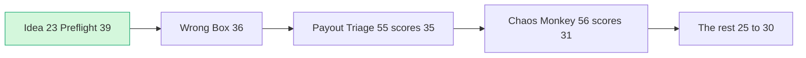

# Council member: the JUDGE (a PayPal Developer Advocate on the panel)

> [!tldr] In one breath
> This AI advisor pretends to be a PayPal judge and scores each idea on the five official criteria. It ranked #23 Seller Protection Preflight first (39/50), Wrong Box second (36) and #55 Payout Failure Triage third (35), mainly because #23 was the only one of its kind.

> [!example] Picture this
> A talent show judge has watched 300 people sing the same pop song today. The person who walks out and plays a song nobody has heard, and plays it well, gets remembered. This judge rewards being the only one of your kind, as long as the act is solid.

> [!info] Update, Oct 23 2026
> A live repo, preflight-for-paypal, now does #23's core job, so #23 is no longer "the only one of its kind". The pick moved. See [[70 The Winning Idea]]. This report is kept as the Oct 12 record.

## How this judge thinks

**My lens.** I score the five Devpost criteria literally and give each the same weight: Tech, Design, Impact, Innovation, Presentation. Feasibility and risk only count when they would show up in the video or the repo (the project's code folder). I have watched hundreds of 3 minute videos, and I reward four things:
* **Starting from the problem.** The first 20 seconds name a person and a loss, not a PayPal product.
* **PayPal used beyond checkout.**
* **Unhappy paths shown on screen.** These are the "things go wrong" routes, tested on purpose like a fire drill.
* **A real open source repo.** I want a README that an AI driven code scan can read, plus tests.

I am also tired of what this pile will be full of: agent spend gates (~13), AI escrow (~11), shopping agents (~10) and "PayPilot" chat assistants (~8).

Scores below are my judge view on the five criteria (1 to 10 each, /50). They are not the 120 point research score.

## 1. Ranking of all 10

| # | Idea | Tech | Design | Impact | Innov. | Present. | /50 | One line |
|---|---|---|---|---|---|---|---|---|
| 1 | **23 Seller Protection Preflight** (+ tracking to release holds + dispute evidence pack) | 8 | 8 | 7 | 8 | 8 | **39** | Starts from the problem, native to PayPal (it enforces PayPal's own policy text), and nobody in ~144 Devpost entries is near it. It reads as "this team understands how PayPal sellers actually lose money". |
| 2 | **3 Mismatch-to-Replacement as spine ("Wrong Box", with #1 binding + #2 payout fork)** | 8 | 8 | 5 | 6 | 9 | **36** | Best video moment in the set: one photo, two payers, two PayPal APIs. But it lands in the most crowded judging pile (agent liability: Provenant, AgentProof, XReceipt), and the impact is about the future. |
| 3 | **55 Payout Failure Triage** | 8 | 8 | 6 | 6 | 7 | **35** | It literally answers "test the unhappy paths", and the compliance refusal is a great judge moment. Every judge has paid hackathon winners, so the persona works. Payouts are crowded, and the failure branches are mostly mocks. |
| 4 | 56 Integration Chaos Monkey | 8 | 6 | 4 | 6 | 7 | 31 | DevRel judges will love it personally. But Impact is "developers, anecdotally", and every PayPal judge knows `/paypal:doctor` and the announced Merchant AI Integration Agent. |
| 5 | 28 Early-Pay Discount Optimizer | 6 | 7 | 6 | 5 | 6 | 30 | Single API family. It looks like invoice entry #5. The wow moment is a percentage on an invoice, and there is gating risk on the payer view. |
| 6 | 42 Selection integrity firewall | 6 | 7 | 5 | 5 | 7 | 30 | The counterfactual flip is clever, but Warden is already in this hackathon and I will have seen "hidden injection blocked". The PayPal surface is checkout plus Orders. |
| 7 | 20 Dispute-to-Listing Fixer | 6 | 7 | 5 | 5 | 6 | 29 | The PayPal "fix" is a catalog object no shopper sees, which is exactly the "PayPal bolted on" smell. ReasonWhy already does the loop on returns. |
| 8 | 9 Rental Deposit Inspector | 7 | 8 | 5 | 3 | 7 | 30* | A near identical public repo exists (RentProof, Claude + Render), and the backlash against Hertz's AI billing invites a hostile question. High risk of a duplicate in the same judge queue. |
| 9 | 84 Accessible Voice Checkout | 4 | 8 | 6 | 5 | 6 | 29 | It cannot touch the PayPal approval window, so the tech is checkout plus one API. Jo will spot any accessibility defect. Better as a pillar inside another build. |
| 10 | 8 Final-Price Overcapture | 6 | 6 | 4 | 5 | 4 | 25 | The hero moment is "$1,075 captured" as a JSON number. Consent laws undercut the premise that the AI sets the price. |

(*#9 sits below #20 and #42 despite a similar raw total. A likely duplicate submission in the same queue is a tie breaker I would actually apply.)

## 2. Top 3

### Pick 1: Seller Protection Preflight (spine #23, plus tracking to release holds and a ready made dispute evidence pack)

In plain words: before a seller ships, check whether the order still qualifies for PayPal Seller Protection. Seller Protection is PayPal's promise to cover the seller against false claims, but only if the seller follows its rules, like a warranty that is void if you open the case.

**Why it wins against about 550 to 1,100 entries**
* **Scarcity.** It is the only finalist with zero visible Devpost overlap and outside every crowded cluster. In a judging queue, being the only one of its kind is worth a lot.
* **It starts from the problem by design.** The hook is a word for word PayPal policy clause, "you must ship the item to the shipping address on the Transaction Details page… redirected… not eligible", plus a seller who lost $480.
* **Real user voices exist.** Recurring eBay community threads include "Buyer asking to ship to different address", "Zero feedback new buyer paid, asked to ship to different address" and "Scammed out of $400". These are ⚠️ search result titles only, still to be read and quoted properly (see sources).
* **Deep PayPal usage beyond checkout, in line with PayPal's own interest.** Orders GET (shipping, `seller_protection`), Transaction Search (`protection_eligibility`, `address_status`, `transaction_note`), Tracking, Disputes webhooks plus evidence. Fewer losses from voided protection is a story PayPal people want told.
* **Unhappy paths are the product.** It covers the cousin address, the courier the buyer arranged, pickup or digital goods (NOT_ELIGIBLE), a mismatch found by label OCR (reading the label photo), and a region that is not supported.

**Prize targets**
* **Grand** (it is balanced across all five criteria).
* **Fallback HM: Most Impactful or Best Use of PayPal + AI.**
* **Sponsor: AG Grid** for the order queue with protection status. APIMatic is the alternative if the server SDK is used.

**Single biggest risk.** The AI looks decorative: "a rules engine with a paste box". If the video does not show the model doing things rules cannot, Tech and Innovation drop to 6. Those things are reading intent in many languages while quoting the exact words, fuzzy address matching (spotting a forwarder or reshipper), and label OCR checked against the PayPal address. The second risk is that buyer messages live outside PayPal, so be upfront about the paste box or forwarding inbox.

**Decisive day 1 test.** Capture a sandbox order with a shipping address, then run `GET /v2/checkout/orders/{id}`.
* Is `purchase_units[].payments.captures[].seller_protection` present?
* Can any input make it not ELIGIBLE? Try `shipping_preference: NO_SHIPPING`, a pickup `shipping.type`, or a guest card.
* Then `POST /v2/checkout/orders/{id}/track` and confirm the tracker shows in the sandbox UI.

If `seller_protection` never changes, the eligibility verdict must come from a policy rules table, and the video should say so honestly.

### Pick 2: "Wrong Box" (spine #3 Mismatch-to-Replacement; modules: #1 instruction binding, #2 Payouts fork for when the agent is at fault)

**Why it wins**
* **The easiest 3 minutes to follow in the set.** The split screen reads "asked navy/M · listed navy/M · got royal/L". The PayPal dispute then flips to RESOLVED through REPLACEMENT_WITHOUT_REFUND. A second photo produces a Payout instead, and the balance rises in frame.
* **Five capabilities beyond checkout**, with an important, structured AI decision: the fault class (who is to blame).
* **It wins on presentation even if innovation is docked**, and presentation is a full fifth of the score.

**Prize targets**
* **HM Best Use of Agentic Commerce** is primary.
* **Best Demo Delivery** is next.
* **Grand** is possible.
* **Sponsor: AG Grid** (keep the grid visually distinct from Provenant's) or Channel3 for the official listing.

**Single biggest risk.** Provenant is in the same hackathon and probably the same judge queue. It already does custom_id trace hashing, a fault split, payout of the agent's share and an evidence pack. If the video says "liability" before it shows the photo, I mark it as copied. A second risk: the agent platform as payer is invented, and both consoles belong to the team. Say so.

**Decisive day 1 test.**
1. Run `POST /v1/customer/disputes` (buyer `PayPal-Auth-Assertion`) against an Orders v2 capture.
2. Confirm `allowed_response_options.make_offer` contains `REPLACEMENT_WITHOUT_REFUND`.
3. Confirm `accept-offer` resolves the case.

If creating the dispute through the API fails, drive everything from a dispute created in the UI. If the replacement offer is unavailable, the hero moment shrinks to a refund, and this pick drops below #55.

### Pick 3: Payout Failure Triage (#55)

**Why it wins**
* It is the purest "unhappy path" entry. The loop is UNCLAIMED → AI contacts the recipient → corrected handle → cancel → RETURNED → issue again → SUCCESS.
* The guardrail is the beat I would remember: the agent refuses to reroute around RISK_DECLINE or REGULATORY_BLOCKED. Fixing plus refusing is different from HoldWatch, which only explains holds.
* The persona of a hackathon or bounty organiser is one every judge on this panel has lived.

**Prize targets**
* **HM Best Use of PayPal + AI** or Most Impactful (creators and gig workers).
* **Sponsor: AG Grid**, with a live ledger whose cells flash, grouped by failure type. AG Grid is a better fit than Bryntum.

**Single biggest risk.** The demo is mostly simulated JSON. Test values are magic strings, so if the real UNCLAIMED loop does not exist in sandbox, I see a lookup table with chat on top: Tech 6 and Innovation 5. Payouts are also used by 10+ entries already.

**Decisive day 1 test.**
1. Send a `POST /v1/payments/payouts` to an email that is not a sandbox account.
2. Confirm the item goes `UNCLAIMED`, with `RECEIVER_UNREGISTERED` on `GET /v1/payments/payouts-item/{id}`, and that the `PAYMENT.PAYOUTS-ITEM.UNCLAIMED` webhook fires.
3. Confirm `POST …/payouts-item/{id}/cancel` returns RETURNED.

If any step fails, demote this idea below #56.

### Judge advice for whichever idea wins
* Open with a person and a loss, not "we built an AI agent with PayPal".
* End with a 10 second montage of unhappy paths.
* The README needs a "PayPal APIs used" section with endpoint names, an "Unhappy paths handled" table and runnable tests. The automated AI scan will read these first.
* Show live sandbox state changes or webhook toasts (small popups), never a mock.
* Max one Grand/HM plus one sponsor prize, so pick the sponsor tool that does real work in the UI.

## 3. The idea everyone else will overrate: #28 Early-Pay Discount Optimizer (85/120, 4th)

The 120 point table gives it Design 8 and Impact 7. A judge sees something else:
* Another invoicing assistant (~4 already on Devpost, one literally named "Chaser").
* The core loop is one PayPal API family.
* The "AI" is a formula, honestly fixed and predictable, which is correct engineering but not memorable.
* The best visual moment depends on an undocumented behaviour of the payer view behind an `invoicing/internal` scope.

The per client pricing maths is a good idea for a product and a mediocre one for a 3 minute video. Runner up for overrating: **#56 Chaos Monkey**. It echoes the judges' own kickoff quotes, so it feels tailored. But Impact is a full fifth of the score, and "developers, anecdotally" scores 4. PayPal judges also know `/paypal:doctor` exists.

## 4. Confidence: **3 / 5**

The order of pick 1 vs pick 2 depends on one thing: whether judges value scarcity (#23) more than the presentation ceiling (#3). Both depend on day 1 sandbox results. #23's search for rivals was cut short by the search budget, so a late eBay or Chrome extension competitor would drop it to #2.

## Sources (new this pass; everything else is from the deep dive files)
* eBay community: "Buyer asking to ship to different address": https://community.ebay.com/t5/Selling/Help-Buyer-asking-to-ship-to-different-address/m-p/27772008/highlight/true ⚠️ (title only)
* eBay community: "Zero feedback new buyer paid, asked to ship to different address": https://community.ebay.com/t5/Shipping/Zero-feedback-new-buyer-paid-asked-to-ship-to-different-address/m-p/30476177/highlight/true ⚠️ (title only)
* eBay community: "Scammed out of $400": https://community.ebay.com/t5/Selling/Scammed-out-of-400-thanks-to-eBay/m-p/27830012/highlight/true ⚠️ (title only)
* eBay community: "Buyer wants to change name and shipping address after purchase": https://community.ebay.com/t5/Selling/Buyer-wants-to-change-name-and-shipping-address-after-purchase/m-p/31298622/highlight/true ⚠️ (title only)
* Multichannel Merchant: "5 PayPal Chargeback Scams": https://multichannelmerchant.com/blog/5-paypal-chargeback-scams-prevent ⚠️ (title only)
* Search for a Devpost competitor ("agent wrong item photo PayPal replacement"): no Devpost hit (3 searches used out of 5)

> [!info]- Jargon decoder
> **Devpost criteria**: the five things judges score: Technological Implementation, Design, Potential Impact, Innovation, Presentation.
> **DevRel / Developer Advocate**: PayPal staff whose job is helping outside developers.
> **Sandbox**: PayPal's practice world with pretend money.
> **Capture**: actually taking money after a card is approved. Like a hotel charging at check out.
> **Tracking / tracker**: telling PayPal the parcel's tracking number.
> **Dispute, REPLACEMENT_WITHOUT_REFUND, accept offer**: a buyer complaint; the seller offers a new item instead of money back; the buyer says yes.
> **Webhook / webhook toast**: PayPal ringing your app's doorbell; a toast is the small popup showing it on screen.
> **Payouts, UNCLAIMED, RETURNED**: bulk money sending; a payment nobody picked up; the money coming back to the sender.
> **Magic strings**: special fake inputs that make the sandbox pretend an error happened.
> **Mock**: a fake response, like a cardboard cake in a bakery window.
> **OCR**: reading text from a photo.
> **Forwarder / reshipper**: a company that receives a parcel and sends it on elsewhere.
> **Escrow**: a neutral party holding money until both sides are happy.
> **Counterfactual flip**: checking whether the AI's choice changes when sneaky text is removed.
> **Scope (`invoicing/internal`)**: a permission level that outsiders may not get.
> **SDK**: a ready made code toolkit. APIMatic is a sponsor that generates these.
> **AG Grid, Channel3, Bryntum**: sponsor tools (a spreadsheet style table, a product search service, a scheduling widget).
> **HM / Grand**: honourable mention prize categories, and the grand prize.

## Where to next
* ⬆️ Up: [[62 Council Reports]]
* ⬅️ Previous: [[Council Builder]] · ➡️ Next: [[Council Skeptic]]
* 🔗 Related: [[64 Judge Q&A & Scorecard Optimisation]], [[D023 Seller Protection Preflight (Deep Dive)]], [[Wrong Box Combined Concept]], [[70 The Winning Idea]]
