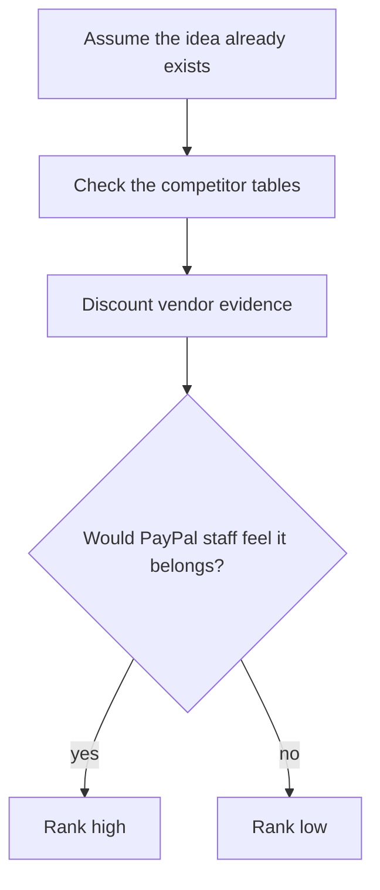

# Council: the skeptic (fintech VC and competitive analyst)

> [!tldr] In one breath
> The skeptic assumes every idea already exists somewhere and asks "would PayPal staff feel this belongs inside PayPal?". It ranked #23 first, #55 second and Wrong Box third. Its loudest warning: the two leaders had never had a proper search for rivals.

> [!example] Picture this
> Your friend says "I have a great idea, an app that tells you when your plant needs water!". The skeptic friend pulls out their phone and finds five such apps in ten seconds. Annoying, but you would rather hear it now than after building it.

> [!warning] Update, Oct 23 2026
> The skeptic's warning came true. A live repo, preflight-for-paypal, now does #23's core job, so the pick moved. See [[70 The Winning Idea]] and [[17 Live Competition Scan (Oct 23)]]. This report is kept as the Oct 12 record.

## How the skeptic thinks

Lens: I assume every idea has already been built. I give the competitor tables the most weight, discount problem evidence that comes from vendors (companies selling a fix), and ask one question of each idea: **would a PayPal SWE (software engineer), PM (product manager) or DevRel judge feel this belongs inside PayPal's strategy?** That strategy is branded checkout, disputes and Seller Protection, holds and access to funds, Payouts, and agentic commerce (AI agents that shop and pay for you).

Searches used: 4 of 5, plus 1 fetch. New facts from them:
* **#23 has real seller voices.** At least 9 eBay Community threads match "buyer asked me to ship to a different address", "zero feedback buyer paid, asked to ship elsewhere" and "buyer asked me to ship elsewhere, then opened a case" ([1](https://community.ebay.com/t5/Shipping/The-Buyer-asked-me-to-ship-to-a-different-address-then-opened-a/m-p/29024177), [2](https://community.ebay.com/t5/Shipping/Zero-feedback-new-buyer-paid-asked-to-ship-to-different-address/m-p/30476177/highlight/true), [3](https://community.ebay.com/t5/Shipping/Do-I-still-have-seller-protection-from-ebay-amp-paypal-if-I-ship/td-p/27885827), [4](https://community.ebay.ca/t5/Archive-1/Buyer-bids-on-item-then-wants-me-to-ship-to-address-not-on/m-p/248092)). I saw titles only (⚠️). Caveat: most are about eBay's managed payments, not PayPal. The behaviour is the same, but the audience specific to PayPal is G&S (Goods and Services payments) on social marketplaces plus indie stores.
* **For #55, PayPal's docs describe the manual routine this idea automates.** "Track and resolve unclaimed payouts promptly to avoid delays and improve the payment success rate… If details are wrong, cancel and create a new payout… If correct, contact the recipient." There are no built in reminders or automation. Funds return after 30 days ([PayPal docs](https://developer.paypal.com/payouts/use-payouts/handle-unclaimed-payouts.md) ✅). That proves PayPal cares about the problem. It also means the mechanism is "PayPal's own runbook, automated", so innovation is capped.
* **PayPal's agentic commerce push is real and public** ([Oct 2025 launch](https://newsroom.paypal-corp.com/2025-10-28-PayPal-Launches-Agentic-Commerce-Services-to-Power-AI-Driven-Shopping)). That raises the strategic fit of #3 and #42. It also guarantees that the agentic lane is the most crowded on Devpost.

## 1. Ranking of all 10 (skeptic order)

| # | Idea | Council score | Skeptic one liner |
|---|---|---|---|
| 1 | **23 Seller Protection Preflight** | 89 | Emptiest Devpost lane (0 of ~144), primary policy evidence, and it touches PayPal's two most sensitive seller topics: protection eligibility and held funds. Its weakness is an AI layer that could read as a rules table. |
| 2 | **55 Payout Failure Triage** | 86 | PayPal's own docs prescribe the manual fix and the webhook leaves out the error, so the gap is first party. Every rival Payouts entry covers only the happy path. Capped by failure branches that are only mocked, and by rivals not yet checked (Dots, Trolley). |
| 3 | **3 Mismatch-to-Replacement (spine of "Wrong Box")** | 87 | Best demo, and it points at PayPal's top strategic bet. But it lives in the most crowded lane (Provenant, AgentProof, XReceipt) and its impact evidence is a vendor survey. It wins only if the photo leads the story. |
| 4 | 56 Integration Chaos Monkey | 80 | DevRel judges asked for "unhappy paths", but PayPal already ships `/paypal:doctor` and has announced a Merchant AI Integration Agent. Pitch it to PayPal and they will say "we're building that". |
| 5 | 28 Early-Pay Discount Optimizer | 85 | Chaser already ships per debtor discounts. It uses one API family, and that endpoint lists an `invoicing/internal` scope. The AI is a formula. See §3. |
| 6 | 42 Selection Integrity | 76 | Warden (same hackathon) owns taint tracking and firewall, and MELON owns masked re execution. The selection counterfactual is clever but at research stage, and the PayPal surface is thin (Orders + v6). |
| 7 | 20 Dispute-to-Listing Fixer | 80 | ReasonWhy already runs the same loop on returns, and the PayPal "fix" (a catalog product) is cosmetic. Worth keeping only as a prevention tab inside #23. |
| 8 | 9 Rental Deposit Inspector | 81 | RentProof (Claude + Render, public repo) is close to identical. Texada and UVeye exist, and the Hertz backlash is the framing a judge will raise. The 81 is stale; the report itself says demote. |
| 9 | 84 Accessible Voice Checkout | 75 | The PayPal approval popup is a hard boundary, Tech is about 5, and PayU and Be My Eyes are already in the space. Good cause, losing entry. |
| 10 | 8 Final-Price Overcapture | 78 | Consent laws (FL §559.905) kill the core pitch, overcapture eligibility is unpublished, and the demo moment is a JSON number. |

Note: the 81 for #9 and the 80 for #20 sit above several ideas their own reports rank higher. **Treat the council scores for ranks 6 to 10 as noise.**

## 2. Top 3

### Pick 1: Seller Protection Preflight (spine) + tracking to release holds + dispute evidence pack

* **Why it wins against 550 to 1,100 entries.**
  * It is the only finalist whose problem statement is a **PayPal legal clause** ("ship to the address on Transaction Details; redirects void protection") and whose data is **fields only PayPal has**: `seller_protection.status`, `protection_eligibility`, `address_status` and `transaction_note`.
  * No Devpost entry seen touches shipping or protection. The visible clusters (agent spend gates, escrow, shopping agents, "PayPilot" assistants) run away from this lane.
  * It speaks to "trouble accessing funds", the #1 category of PayPal complaints to the CFPB (the US consumer finance watchdog): 1,276; primary. That is because uploading tracking is PayPal's stated fastest route to releasing held funds.
  * A PayPal PM sees fewer lost protection claims and fewer hold tickets. That is real strategic fit, not a PayPal button on an unrelated app.
* **Prizes.** Grand (strongest fit with "start from the problem"). Otherwise HM **Best Use of PayPal + AI** or **Most Impactful**. Sponsor: **AG Grid** (order and preflight queue).
* **Biggest risk.** The competitor hunt was **never run**, because the analyst's search budget ran out. The likely killers are a Shopify/eBay app or a Chrome extension that warns about address changes, or ShipStation/Shippo marketing "PayPal protection" checks. Second risk: judges score the AI as thin. The model must read scam intent in many languages while quoting the exact words, do fuzzy address matching (spotting a reshipper or forwarder), and read labels with OCR. The eligibility logic stays fixed and rule based.
* **Decisive day 1 test.** Capture a sandbox order with shipping, then run `GET /v2/checkout/orders/{id}` and `GET /v1/reporting/transactions?transaction_id=…&fields=all`.
  * (a) Does `seller_protection.status` ever vary? Try NO_SHIPPING, PICKUP and guest card.
  * (b) Does a buyer checkout note appear in `transaction_note`?
  * (c) Does `POST /v2/checkout/orders/{id}/track` show up in the sandbox UI?
  * If (a) never changes **and** (c) fails, the moment where PayPal state changes is gone. Then demote below #55.
  * Run the 6 query competitor hunt the same day, before writing any code.

### Pick 2: Payout Failure Triage

* **Why it wins.** PayPal itself documents the gap: the webhook carries no error object, the guidance is manual, and the automatic return after 30 days wipes out the payment. About 10+ Payouts entries on Devpost cover only the happy path, and HoldWatch only *explains* holds. The **compliance refusal** (the agent will not reroute around RISK_DECLINE or REGULATORY_BLOCKED) is exactly what a PayPal judge who thinks about risk rewards. It turns "AI agent moves money" from a liability into a selling point. The persona of a hackathon prize organiser is one every judge has lived. Payouts is a revenue line, and PayPal's own docs frame the goal as "payment success rate".
* **Prizes.** HM **Best Use of PayPal + AI** (Payouts depth plus a guarded agent), else **Most Impactful**. Sponsor: **AG Grid** (live ledger with flashing cells). It is the strongest AG Grid fit of the ten.
* **Biggest risk.** The demo shows **mocked JSON**: failure codes come from magic strings, not real state. Commercial payout platforms (Dots, Trolley, Tipalti) were not checked ❌ and may already do "recipient fixes details → automatic resend". Data on how often this happens is zero.
* **Decisive day 1 test.** `POST /v1/payments/payouts` to an email that is not a sandbox account. Check whether the item goes **UNCLAIMED** with RECEIVER_UNREGISTERED and whether the `.UNCLAIMED` webhook fires. Then run `POST …/payouts-item/{id}/cancel`, expect **RETURNED**, and issue it again to SUCCESS. If the item never goes UNCLAIMED, the only real state change disappears; drop the idea to #4.

### Pick 3: "Wrong Box" combination (spine **#3 Mismatch-to-Replacement** + #1 instruction record + #2 Payouts fork)

* **Why it wins.** It is the strongest single visual in the set: asked navy/M, listed navy/M, received royal/L, then a PayPal dispute flips to RESOLVED. A second order sends a Payout instead. That covers 5 capabilities beyond checkout. It aims squarely at the HM PayPal most wants to award (**Agentic Commerce**) and at the company's top public bet. The three way photo comparison is the one mechanism in the agent liability cluster nobody on Devpost shows.
* **Prizes.** HM **Best Use of Agentic Commerce** (primary) or **Best Demo Delivery**. Grand is possible on demo quality. Sponsor: AG Grid (make the grid look different from Provenant's), or Channel3 (official listing lookup), whichever is less contested.
* **Biggest risk.** **Collision.** The lane for agent disputes already holds Provenant (fault split, Payouts liability pool, AG Grid), AgentProof and XReceipt, and roughly 600+ entries are still to land in the busiest cluster. Judges will match it to "agent liability" within 10 seconds. Impact is speculative: NMI 58% is a vendor survey, no data exists on how often agents buy the wrong item, and no rule makes agent platforms pay, so the Payouts fork is a hypothetical business. PayPal Purchase Protection already makes the buyer whole on SNAD (significantly not as described), which leaves the merchant paying. That arguably *is* the pitch, but a PayPal judge may ask what changes for them.
* **Decisive day 1 test.** Sandbox `POST /v1/customer/disputes` (with buyer `PayPal-Auth-Assertion`) on an Orders v2 capture. Confirm `allowed_response_options.make_offer` includes `REPLACEMENT_WITHOUT_REFUND`, then confirm `accept-offer` gives RESOLVED. If dispute creation is blocked, the hero moment depends on a UI dispute recorded in advance. That is survivable, but Tech drops to 7.

## 3. The idea everyone else will overrate: **#28 Early-Pay Discount Optimizer**

At 85 it looks like a safe #4, but every support is soft:
* **The core endpoint is unproven.** Conditional rules list an `invoicing/internal` scope, and nothing documents whether the payer page shows or applies the discount. If day 1 tests T1 or T3 fail, the fallback is a static breakdown discount, and the "native PayPal" claim is gone.
* **The mechanism already ships elsewhere.** Chaser applies per debtor discounts automatically in its portal, Upflow and Zoho have the feature, and the accounts payable side is full of AI discount agents.
* **The PayPal footprint is one API family**, in a cluster (invoicing and reminders) that AG Grid itself suggests to entrants, so expect duplicates.
* **The "AI" is a fixed expected value formula.** The honest design admits it.
* **The chain from problem to impact is broken.** Late payment is primary (QuickBooks), but "a discount makes clients pay earlier" is only vendor or search snippet level, with counter evidence that over half of SaaS firms decline discounts.
* **Strategic fit is weak.** Invoicing is not where PayPal's 2026 story lives (branded checkout, agentic, Payouts).

Secondary caution: #3 will also be overrated on demo charm. Its Innovation is 6 *before* the ~600 unseen entries land in the most crowded lane.

## 4. Confidence: **3 / 5**

I am confident in the ordering of 1 to 3 against 4 to 10. I am not confident in #23 vs #55 vs #3, because the two leaders both have **competitor hunts that were never run** (the search budget ran out in their deep dives), and one discovered rival would swap them. **Run #23's and #55's competitor searches before committing.**

> [!info]- Jargon decoder
> **VC**: venture capitalist, an investor who funds startups and has seen a thousand pitches.
> **Seller Protection**: PayPal's cover for sellers, valid only if they follow the rules (like shipping to the address PayPal shows).
> **Holds**: PayPal keeping a seller's money for a while before they can use it, like a shop keeping your deposit until you return the rental skis.
> **Agentic commerce**: AI agents that shop and pay on your behalf.
> **Runbook**: a step by step checklist staff follow by hand.
> **Webhook**: PayPal ringing your app's doorbell when something happens.
> **Payouts, UNCLAIMED, RETURNED**: bulk money sending; a payment nobody picked up; the money coming back.
> **Happy path**: the route where everything works first time.
> **Magic strings / mocked JSON**: special fake inputs that make the sandbox pretend an error happened; the fake replies that come back.
> **Taint tracking**: marking untrusted text so you can see where it travels, like dye in water.
> **Masked re execution**: rerunning the AI with the suspicious text hidden, to see if its choice changes.
> **Scope (`invoicing/internal`)**: a permission level outsiders may not get.
> **CFPB**: the US Consumer Financial Protection Bureau, which collects complaints about money companies.
> **SNAD**: "significantly not as described", the buyer saying the item is not what was advertised.
> **Expected value formula**: maths that weighs each outcome by how likely it is.
> **OCR**: reading text from a photo.
> **AG Grid, Channel3**: sponsor tools (a spreadsheet style table, a product search service).
> **HM / Grand**: honourable mention prize categories, and the grand prize.

## Where to next
* ⬆️ Up: [[62 Council Reports]]
* ⬅️ Previous: [[Council Judge]] · ➡️ Next: [[Council Builder]]
* 🔗 Related: [[17 Live Competition Scan (Oct 23)]], [[D023 Seller Protection Preflight (Deep Dive)]], [[D055 Payout Failure Triage (Deep Dive)]], [[70 The Winning Idea]]
